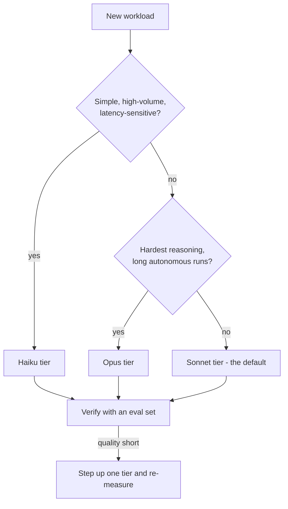

# 08 - 모델 선택과 최적화

CCDV-F의 Domain 2(16.8%)입니다. 이 도메인은 워크로드(workload, 처리해야 할 작업의 양과 성격)에 맞는 모델을 고르고 그 비용을 통제할 수 있는지를 평가합니다. 거의 모든 문제는 하나의 트레이드오프(tradeoff, 하나를 얻으면 다른 것을 잃는 관계)로 귀결됩니다: 성능 vs 지연 시간(latency, 응답이 오기까지 걸리는 시간) vs 가격.

---

## Claude 모델 패밀리 (2026년 중반)

현재 라인업은 Claude 5 패밀리와 Haiku입니다:

| 모델 | 등급 | 강점 | 대표적 용도 |
|---|---|---|---|
| Claude Opus 5 | 최고 성능 | 깊은 추론, 장기간의 에이전트(agent, 스스로 판단하며 작업을 수행하는 AI 프로그램)형 작업, 어려운 코딩 작업 | 복잡한 에이전트, 어려운 종합 작업, 코드 마이그레이션(migration, 코드를 다른 환경·버전으로 옮기는 작업) |
| Claude Sonnet 5 | 균형형 | 코딩과 에이전트형 작업에서 Opus에 가까운 품질을 더 낮은 비용으로 제공 | 대부분의 프로덕션(production, 실제 서비스 운영 환경) 애플리케이션의 기본값 |
| Claude Haiku 4.5 | 가장 빠르고 저렴 | 속도와 처리량(throughput, 단위 시간당 처리 가능한 양) | 분류, 라우팅(routing, 요청을 적절한 곳으로 보내는 것), 추출, 서브 에이전트 |

특정 ID보다 다음 두 가지 사실이 더 중요합니다:

1. **모델 라인업은 바뀝니다.** 이름, ID, 가격, 컨텍스트 윈도우(context window, 모델이 한 번에 읽을 수 있는 입력의 최대 길이)는 시간이 지나며 변합니다. 시험 전과 출시 전에 **[📖 Models overview](https://docs.anthropic.com/en/docs/about-claude/models)** - 현재 모델 ID, 컨텍스트 윈도우, 가격 - 를 확인하십시오.
2. **가격은 등급에 비례합니다.** Opus는 토큰(token, 모델이 글자를 처리하는 단위)당 Sonnet의 몇 배, Sonnet은 Haiku의 몇 배입니다. 모든 등급에서 출력 토큰은 입력 토큰의 약 5배 비용이 듭니다. 이 비율 때문에 긴 응답과 extended thinking(확장 사고, 답하기 전에 모델이 추론에 토큰을 더 쓰는 기능)이 청구액의 대부분을 차지합니다.

Models API(`GET /v1/models`)는 사용 중인 키로 호출할 수 있는 모델 목록을 보여 주므로, 애플리케이션은 가정을 하드코딩(hardcoding, 값을 코드에 직접 박아 넣는 것)하는 대신 런타임(runtime, 프로그램 실행 중)에 기능을 파악할 수 있습니다.

---

## 모델 선택하기

다음 세 가지 질문을 순서대로 검토합니다:

### 1. 성능: 이 작업이 요구하는 가장 어려운 것은 무엇인가?

- 다단계 추론, 모호한 요구사항, 장시간의 자율 실행: Opus 등급.
- 일반 코딩, 요약, 도구 사용 루프, 채팅: Sonnet 등급.
- 단일 레이블 분류, 라우팅, 엔터티(entity, 이름·날짜·금액 같은 특정 정보 항목) 추출, 형식 변환: Haiku 등급.

동작할 가능성이 있는 가장 저렴한 모델로 시작하고, 평가 세트(eval set, 품질을 측정하기 위한 테스트 문제 모음)로 품질을 측정한 뒤, 평가 결과가 필요하다고 할 때만 상위 등급으로 올리십시오. 측정 없이 "큰 모델이 필요하다"고 추측하는 것은 시험에서 감점되는 안티패턴(anti-pattern, 흔하지만 피해야 할 잘못된 방식)입니다.

### 2. 지연 시간: 누가 기다리고 있는가?

- 사람이 지켜보는 대화형 UI: 작은 모델일수록 빨리 응답하며, 스트리밍(streaming, 응답을 다 만들기 전에 조금씩 받아 보는 방식)은 어떤 모델이든 더 빠르게 느껴지게 합니다.
- 백그라운드 작업: 지연 시간은 거의 중요하지 않으므로 비용을 최적화하십시오.
- 에이전트 루프는 단계 수만큼 지연 시간을 곱합니다. 느린 모델에서 10단계 루프를 돌리면 느린 제품이 됩니다.

### 3. 비용: 이 트래픽을 한 달 운영하면 얼마인가?

추정식: 일일 요청 수 x (입력 토큰 x 입력 단가 + 출력 토큰 x 출력 단가). 그다음 아래의 레버를 적용합니다. Opus로는 감당할 수 없는 워크로드도 더 나은 프롬프트(prompt, 모델에게 주는 지시문)와 함께 Sonnet을 쓰면 괜찮은 경우가 많습니다.

대부분의 시험 시나리오가 제시하는 의사결정 흐름은 다음과 같습니다:



다이어그램 읽는 법: 워크로드의 형태에서 출발해 등급을 정하고, 상위 등급으로 올릴지는 직감이 아니라 평가 세트가 결정하게 합니다.

---

## 컨텍스트 윈도우 등급

- 현재 최상위 모델은 매우 큰 컨텍스트 윈도우(수십만에서 백만 토큰)를 제공하며, 작은 모델은 더 적을 수 있습니다. 모델별 최신 수치는 문서를 확인하십시오.
- 큰 윈도우는 공짜가 아닙니다. 모든 입력 토큰이 매 요청마다 과금되며, 스테이트리스(stateless, 서버가 이전 대화를 기억하지 않는) API이므로 매 턴마다 대화 기록을 다시 보내야 합니다.
- 실용 규칙: 컨텍스트 윈도우는 목표가 아니라 상한입니다. 긴 대화에는 기록 관리(잘라내기(truncation), 요약(summarization), 압축(compaction))가 필요하며, 그렇지 않으면 비용이 턴 수에 비례해 증가합니다.

---

## 토큰 카운팅

- `POST /v1/messages/count_tokens`는 Messages 요청과 동일한 본문을 받아 `input_tokens`를 반환합니다.
- 카운트는 모델별로 다릅니다. 같은 텍스트라도 모델 세대에 따라 토큰화(tokenize, 텍스트를 토큰으로 쪼개는 것) 결과 개수가 다를 수 있습니다. 실제로 호출할 모델 기준으로 세십시오.
- 서드파티 토크나이저(tokenizer, 텍스트를 토큰으로 나누는 도구)는 절대 사용하지 마십시오(tiktoken 등은 다른 제공사용으로 만들어져 Claude 토큰을 상당히 적게 셉니다).
- 카운팅은 사전 비용 추정, 컨텍스트 예산 관리, 문서를 보내기 전에 들어가는지 확인하는 용도로 사용합니다.

---

## 프롬프트 캐싱의 경제성

캐싱(caching, 반복되는 앞부분을 저장해 재사용하는 기능)은 공통 접두부(prefix, 요청의 앞쪽에 공통으로 들어가는 부분)를 가진 워크로드에서 가장 큰 비용 절감 레버입니다. 동작 방식은 [notes/04](04-prompt-caching-and-batch-api.md)에 있으며, 이 섹션은 경제성을 다룹니다.

| 작업 | 기본 입력 대비 대략적 비용 |
|---|---|
| 캐시 쓰기 (5분 TTL) | ~1.25x |
| 캐시 쓰기 (1시간 TTL) | ~2x |
| 캐시 읽기 | ~0.1x |

- **손익분기점:** 5분 TTL(Time To Live, 캐시가 유지되는 시간)에서는 약 2회 요청, 1시간 TTL에서는 약 3회입니다. TTL 내에 2회 이상 재사용되는 것은 무엇이든 캐싱하십시오.
- **1시간 TTL**은 더 높은 쓰기 비용을 치르는 대신, 몰렸다 끊겼다 하는(bursty) 트래픽의 공백을 견딜 수 있게 합니다. 요청이 5분보다 짧은 간격으로 도착한다면 기본 TTL이 스스로 갱신되므로 1시간 등급은 돈 낭비입니다.
- **캐싱은 바이트 단위로 정확히 일치하는 접두부 매칭입니다.** 접두부 어딘가에 타임스탬프, UUID, 정렬되지 않은 JSON 직렬화(serialization, 데이터를 문자열로 변환하는 것)가 있으면 읽기는 0이고 쓰기 할증만 발생합니다. 똑같아 보이는 요청들에서 `cache_read_input_tokens`가 0이라면, 실제로 렌더링된 프롬프트를 diff(차이 비교)하십시오.
- **안정적인 것에서 변하는 것 순으로 배치:** 도구, 시스템 프롬프트, 안정적인 문서, 그다음 매번 바뀌는 사용자 질문 순입니다. 브레이크포인트(breakpoint, 캐시할 범위의 끝을 표시하는 지점)는 프롬프트의 끝이 아니라 공통 부분의 끝에 두십시오.

---

## 오프라인 워크로드를 위한 Batch API

Message Batches API는 요청을 비동기(async, 응답을 기다리지 않고 나중에 결과를 받는 방식)로 **표준 가격의 50%**에 처리합니다.

- 배치당 최대 100,000건 또는 256 MB, 결과는 24시간 이내(보통 훨씬 빠름)에 나오며 29일간 보관됩니다.
- Messages의 모든 기능이 배치 안에서 동작합니다: 도구, 비전(vision, 이미지 이해), 캐싱, 구조화된 출력.
- 캐싱은 배치와 결합해 효과가 커집니다: 100K개 배치 항목에 걸친 안정적인 시스템 프롬프트는 한 번 쓰이고 이후 내내 저렴하게 읽힙니다.
- 적합한 경우: 백필(backfill, 과거 데이터를 한꺼번에 소급 처리하는 것), 야간 분류, 평가 실행, 대량 데이터 보강. 적합하지 않은 경우: 사용자가 기다리고 있는 모든 작업.
- 결과는 임의의 순서로 도착하므로 `custom_id`로 대응시키고, 항목별 `succeeded` / `errored` / `canceled` / `expired` 상태를 처리하십시오.

시험이 좋아하는 판단 규칙: "50,000건, 야간, 비용에 민감"은 항상 Batch API이며, 보통 공통 접두부에 캐싱을 함께 적용합니다.

---

## Extended Thinking 예산

Extended thinking은 Claude가 답하기 전에 추론에 토큰을 쓰게 해 줍니다.

- 사고(thinking) 출력은 **출력 토큰**으로 과금되며 `max_tokens`에 포함됩니다. `max_tokens`를 늘리지 않고 thinking을 켜면 눈에 보이는 답변이 잘립니다.
- 예산을 표현하는 방식은 발전해 왔습니다. 구형 모델은 명시적인 thinking 토큰 예산을 받았고, 신형 모델은 effort 방식의 제어로 얼마나 생각할지 적응적으로 결정합니다. 어느 쪽이든 개발자가 조절하는 손잡이는 "이 작업에 추론 비용을 얼마나 쓸 가치가 있는가"입니다.
- 정말 어려운 문제(수학, 계획 수립, 까다로운 코드)에는 thinking을 더 사용하십시오. 추출, 분류, 일상적인 채팅에서는 thinking이 낭비이므로 최소화하거나 끄십시오.
- 정확한 파라미터(parameter, 호출 시 지정하는 설정값) 형태는 모델 세대마다 다르므로 **[📖 Extended thinking](https://docs.anthropic.com/en/docs/build-with-claude/extended-thinking)** - 모델별 현재 설정 파라미터 - 를 확인하십시오.

---

## 비용 최적화 패턴

시험은 레버를 하나만 고르는 것이 아니라 조합하기를 기대합니다. 대략적인 효과 순서는 다음과 같습니다:

### 1. 프롬프트 캐싱

위에서 다루었습니다. 접두부 비중이 큰 워크로드에서는 입력 측 비용이 흔히 80-90% 줄어듭니다.

### 2. 모델 라우팅

각 요청을 처리할 수 있는 가장 저렴한 모델로 보냅니다:

```python
def pick_model(task_type: str) -> str:
    if task_type in ("classify", "route", "extract"):
        return HAIKU        # 저렴하고 빠름
    if task_type in ("hard_reasoning", "long_agent_run"):
        return OPUS         # 비싸지만 고성능
    return SONNET           # 기본값
```

흔한 프로덕션 구성: Haiku가 들어오는 요청을 분류한 다음, 직접 답하거나 Sonnet/Opus로 에스컬레이션(escalation, 상위 단계로 넘기는 것)합니다. 라우팅과 캐싱을 함께 쓰면 혼합 비용이 절반 이상 줄어드는 경우가 흔합니다.

### 3. 대화형이 아닌 것은 배치로

사용자가 기다리지 않는 작업은 모두 Batch API로 옮겨 자동으로 50% 할인을 받습니다.

### 4. 대화 기록 잘라내기와 요약

- 대화 기록을 최근 N개 턴으로 제한하거나, 오래된 턴을 짧은 요약으로 정리하십시오.
- 에이전트 루프에서는 오래된 도구 결과를 지우거나 압축하십시오. 2단계의 5KB 검색 결과가 20단계에서 중요한 경우는 드뭅니다.
- 문서는 캐싱될 수 있도록 프롬프트의 변동 부분에서 빼 두십시오.

### 5. `max_tokens`와 프롬프트 크기 적정화

- `max_tokens`는 요청당 비용 상한입니다. 200 토큰이면 되는 작업에 8192를 설정하지 마십시오.
- 짧고 간결한 프롬프트는 매 요청마다 비용을 줄입니다. 동작을 바꾸지 않는 상투적인 문구(boilerplate)는 삭제하십시오.
- 장황함이 가치가 없을 때는 간결한 출력을 요청하십시오. 비싼 것은 출력 토큰입니다.

### 6. 미디어 축소

이미지와 PDF는 토큰화된 크기만큼 과금됩니다. 보내기 전에 큰 이미지는 크기를 줄이고 문서는 관련 페이지만 남기십시오.

---

## 지연 시간 최적화

- 사용자에게 보이는 모든 것은 **스트리밍**하십시오. 전체 시간보다 첫 토큰까지의 시간(time-to-first-token)이 더 중요합니다.
- 품질이 허용하는 곳에서는 **더 작은 모델**을 쓰십시오. Haiku의 지연 시간은 Opus의 일부에 불과합니다.
- **캐싱된 접두부**는 비용뿐 아니라 지연 시간도 줄입니다. 캐싱된 토큰은 다시 처리되지 않기 때문입니다.
- 독립적인 호출은 순차 처리하지 말고 **병렬화**하십시오(비동기 클라이언트(client, API에 요청을 보내는 프로그램 쪽 객체), 병렬 도구 실행).
- 지연 시간에 민감한 경로에서는 **thinking을 최소화**하십시오.

---

## 풀이 예시: 비용 감사

어떤 고객 지원 어시스턴트가 하루 100K건의 요청을 처리합니다: 입력 6K 토큰(안정적인 시스템 프롬프트 + 도구 5K, 사용자 콘텐츠 1K), 출력 500 토큰, 중간 등급 모델 사용.

1. 기준선: 매 요청마다 입력 6K 전체가 정가로 과금됩니다.
2. 안정적인 5K 접두부를 캐싱: 입력의 ~83%가 이제 ~0.1x로 과금됩니다. 입력 비용이 약 75% 감소합니다.
3. 간단한 FAQ 조회인 40%의 요청을 Haiku로 라우팅: 해당 요청의 비용이 등급 간 비율만큼 줄어듭니다(흔히 3-5배 저렴).
4. 야간 분석용 요약 작업(10K건)을 Batch API로 이동: 해당 부분이 50% 할인됩니다.

어떤 프롬프트도 나빠지지 않았습니다. 이런 계층적 조합이 바로 Domain 2 시나리오 문제가 묘사하는 내용입니다.

---

## 시험 포인트

- 워크로드 설명을 모델 등급에 대응시키기(성능, 지연 시간, 비용 순서로)
- 캐시 경제성: 쓰기 할증, ~0.1x 읽기, 손익분기 횟수, TTL 선택
- Batch API: 50% 할인, 한도, `custom_id` 대응, 적합한 경우
- Thinking 예산은 `max_tokens`에 포함되며 출력으로 과금됨
- 토큰 카운팅은 모델별로 다르며 API 엔드포인트(endpoint, API의 개별 호출 주소)로 수행함
- 비용 레버는 조합됨: 캐싱 + 라우팅 + 배치 + 잘라내기
- 모델 라인업은 바뀜. ID와 가격의 기준은 기억이 아니라 문서임
