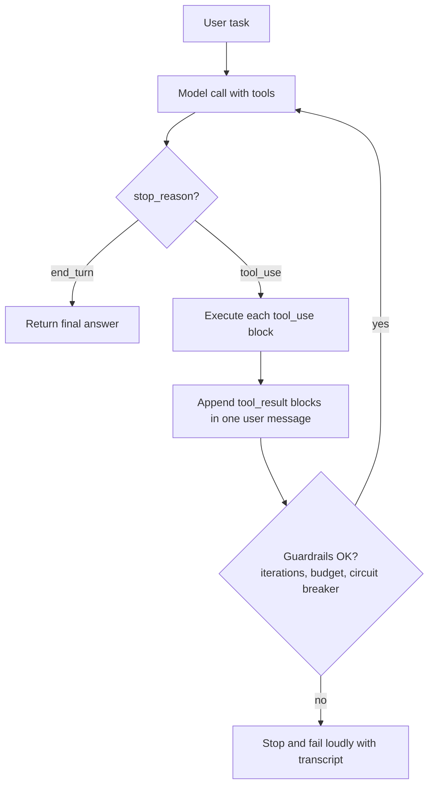

# 09 - 에이전트와 워크플로

CCDV-F의 도메인 3(14.7%)입니다. 이 도메인은 단일 API(API, 프로그램끼리 기능을 주고받는 창구) 호출부터 완전 자율형 에이전트(agent, 스스로 다음 행동을 판단해 작업을 진행하는 AI 프로그램)까지의 스펙트럼, 그 사이에 있는 표준 워크플로(workflow, 미리 정해 둔 처리 순서) 패턴, 그리고 프로덕션(production, 실제 서비스 운영 환경)에서 에이전트를 안정적으로 유지하는 방법을 알고 있는지 평가합니다.

---

## 스펙트럼: 호출, 워크플로, 에이전트

| 단계 | 다음 단계를 누가 결정하는가 | 예시 |
|---|---|---|
| 단일 호출 | 아무도 결정하지 않음. 요청 1회, 응답 1회 | 이 문서를 요약하기 |
| 워크플로 | 여러분의 코드가 고정된 오케스트레이션(orchestration, 여러 처리 단계를 조율·지휘하는 것) 로직으로 결정 | 필드를 추출한 다음 검증하고, 그다음 서식을 맞추기 |
| 에이전트 | 모델이 도구 사용(tool use, 모델이 외부 기능을 호출하는 것) 루프를 통해 결정 | 파일 도구와 셸(shell, 명령어를 입력해 컴퓨터를 조작하는 환경) 도구를 주고 "이 실패하는 테스트를 고쳐 줘" |

시험에서 중요하게 보는 구분은 다음과 같습니다.

- **워크플로**는 코드가 오케스트레이션합니다. 단계와 그 순서는 여러분의 프로그램이 결정하고, 모델은 각 단계의 내용을 채웁니다. 예측 가능하고, 테스트할 수 있으며, 비용이 저렴합니다.
- **에이전트**는 모델이 주도합니다. Claude가 다음에 어떤 도구를 호출할지 결정하고, 결과를 관찰하고, 작업이 끝났다고 판단할 때까지 계속 진행합니다. 유연하지만 더 느리고, 비용이 더 들며, 범위를 제한하기가 더 어렵습니다.

기본적으로는 동작하는 가장 단순한 단계를 선택합니다. 대부분의 프로덕션 LLM(LLM, 대규모 언어 모델) 시스템은 단일 호출과 워크플로로 이루어져 있으며, 에이전트는 사전에 완전히 명세할 수 없는 작업에 사용합니다.

---

## 도구 사용 루프

어떤 프레임워크(framework, 개발을 돕는 기본 뼈대 소프트웨어)를 쓰든 모든 에이전트는 다음 루프입니다.

```python
messages = [{"role": "user", "content": task}]
for _ in range(MAX_ITERATIONS):
    resp = client.messages.create(model=MODEL, max_tokens=4096,
                                  tools=tools, messages=messages)
    messages.append({"role": "assistant", "content": resp.content})
    if resp.stop_reason != "tool_use":
        break                     # 에이전트가 작업 완료라고 판단함
    results = []
    for block in resp.content:
        if block.type == "tool_use":
            output = execute(block.name, block.input)   # 여러분의 코드
            results.append({"type": "tool_result",
                            "tool_use_id": block.id,
                            "content": output})
    messages.append({"role": "user", "content": results})
```

아래 다이어그램은 같은 루프를 제어 흐름으로 보여 줍니다. 모델 호출은 턴(turn, 한 차례의 응답 주고받기)을 끝내거나 도구를 요청하며, 모델이 더 이상 도구를 요청하지 않거나 가드레일(guardrail, 폭주를 막는 안전장치)이 작동할 때까지 도구 결과가 다음 호출로 전달됩니다.



핵심 동작 방식(자세한 내용은 [notes/03](03-tool-use-function-calling.md) 참고):

- `stop_reason: "tool_use"`는 오류가 아니라 "실행하고 계속 진행하라"는 의미입니다.
- 하나의 assistant 턴에서 나온 모든 도구 결과는 **하나의** user 메시지로 묶어 돌려보냅니다.
- assistant의 전체 콘텐츠(thinking 블록이 있다면 그것도 포함)를 대화 기록(history)에 추가하여, 모델이 자신이 이전에 한 호출을 볼 수 있게 합니다.
- 루프는 모델이 도구 호출을 멈추거나, 여러분이 설정한 가드레일이 작동할 때 종료됩니다.

---

## 워크플로 패턴

이름이 붙은 다섯 가지 패턴이 코드 오케스트레이션 설계의 거의 전부를 포괄합니다. 이름으로 기억해 두십시오. 시험에서는 시나리오를 제시하고 어떤 패턴이 맞는지 묻습니다.

### 1. 프롬프트 체이닝

작업을 순차적인 단계로 나누고, 각 단계를 별도의 API 호출로 실행하며, 한 단계의 출력이 다음 단계의 입력이 됩니다. 필요에 따라 단계 사이에 프로그램으로 하는 검사("게이트(gate, 통과 조건을 확인하는 관문)")를 추가합니다.

- 적합한 경우: 깔끔하게 분해할 수 있고, 각 단계를 단순하게 만들수록 효과가 있는 작업. 예시: 개요를 생성하고, 그 길이를 확인한 뒤, 개요를 바탕으로 문서를 작성합니다.
- 비용: 호출 횟수 증가, 지연 시간(latency, 응답까지 걸리는 시간) 증가, 대신 단계별 정확도는 높아집니다.

### 2. 라우팅

먼저 입력을 분류한 다음, 전문화된 프롬프트(prompt, 모델에 주는 지시문)(그리고 흔히 전문화된 모델)로 보냅니다.

- 적합한 경우: 서로 다른 처리가 필요한 뚜렷한 입력 범주가 있을 때. 예시: 고객 지원 분류(triage)에서 환불 요청, 기술 질문, 악용 신고를 각각 다른 프롬프트로 보내고, 쉬운 범주는 Haiku로, 어려운 범주는 더 큰 모델로 보냅니다.
- 추가 이점: 라우팅은 비용을 조절하는 수단이기도 합니다([notes/08](08-model-selection-and-optimization.md) 참고).

```python
def handle(ticket: str) -> str:
    category = classify(ticket, model=CHEAP_MODEL)   # 호출 1: 저렴한 분류기
    prompt, model = ROUTES[category]                 # 여러분의 코드가 경로를 선택
    return answer(ticket, prompt, model=model)       # 호출 2: 전문화된 처리기
```

### 3. 병렬화

여러 호출을 동시에 실행합니다. 두 가지 변형이 있습니다.

- **섹셔닝(Sectioning):** 서로 독립적인 하위 작업(예: 문서 10개를 각각 요약)으로 나누어 동시에 실행합니다.
- **투표(Voting):** 같은 작업을 여러 번 실행한 뒤 결과를 집계(다수결, 또는 가장 엄격한 판정 채택)하여 신뢰도를 높입니다.

### 4. 오케스트레이터-워커

중앙의 모델 호출이 작업을 동적으로 분해하고, 하위 작업을 워커(worker, 하위 작업을 맡아 처리하는 쪽) 호출들에 나누어 맡긴 뒤, 그 결과를 종합합니다. 병렬화와 달리 하위 작업이 사전에 정해져 있지 않으며, 오케스트레이터가 입력마다 하위 작업을 만들어 냅니다.

- 적합한 경우: "이 질문을 여러 출처에 걸쳐 조사하라"나 여러 파일에 걸친 코드 변경처럼, 분해 방식이 입력에 따라 달라지는 작업.
- 흔한 비용 구성: 오케스트레이터에는 성능 좋은 모델, 워커에는 더 저렴한 모델을 사용합니다.

### 5. 평가자-최적화자

한 호출이 결과물을 생성하고, 두 번째 호출이 기준에 따라 평가하며, 평가자가 통과시키거나 재시도 상한에 도달할 때까지 생성자가 피드백을 반영해 다시 시도합니다.

- 적합한 경우: 평가 기준이 명확하고 반복이 측정 가능한 개선을 가져오는 작업. 예: 번역 다듬기, 리뷰 체크리스트를 통과해야 하는 코드.

---

## Claude Agent SDK

Claude Agent SDK(SDK, 개발을 위한 도구 모음)는 Claude Code의 하네스(harness, 모델을 감싸 실행을 관리하는 실행 틀)를 라이브러리(library, 다른 프로그램에서 가져다 쓰는 코드 묶음)(Python 및 TypeScript)로 패키징한 것입니다. 위의 루프를 직접 작성하는 대신 다음을 제공받습니다.

- 내장 도구를 갖춘 완전한 에이전트 루프: 파일 읽기/쓰기/편집, bash, glob/grep 검색, 웹 가져오기(web fetch).
- 컨텍스트(context, 모델이 한 번에 참고하는 대화·자료 전체) 관리, 권한, 훅(hook, 특정 시점에 자동 실행되는 처리), 세션 처리.
- MCP(MCP, 외부 도구·데이터를 모델에 연결하는 표준 규격) 서버 지원과 서브에이전트(subagent, 상위 에이전트가 일을 나눠 맡기는 보조 에이전트) 오케스트레이션.
- 프로그램에서의 호출: 프롬프트와 옵션을 넘기면 모든 과정을 알아서 진행하고 결과를 반환합니다.

무엇을 언제 쓸지:

| 원하는 것 | 사용할 것 |
|---|---|
| 자체 도구만 갖춘 맞춤형 에이전트 | Claude API + 도구 사용 루프 |
| 필요한 기능이 모두 갖춰진 코딩 또는 파일 시스템 에이전트 | Claude Agent SDK |
| 대화형 터미널 개발 | Claude Code 자체 |

Agent SDK는 자동화를 위해 공개된 Claude Code의 엔진입니다. Claude Code가 대화형으로 할 수 있는 모든 일을 SDK는 헤드리스(headless, 사람이 화면에서 조작하지 않고 자동 실행되는 방식)로 할 수 있습니다(CI(CI, 코드 변경 시 자동으로 빌드·테스트하는 체계) 작업, 봇, 파이프라인 등). **[📖 Claude Code overview](https://docs.anthropic.com/en/docs/claude-code/overview)** - Claude Code 및 Agent SDK 문서를 참고하십시오.

---

## 에이전트 신뢰성

에이전트는 단일 호출에서는 일어나지 않는 방식으로 실패합니다. 끝없이 루프를 돌거나, 예산을 소진하거나, 해서는 안 되는 행동을 합니다. 프로덕션 에이전트에는 가드레일이 필요합니다.

### 반복 상한

루프에는 항상 한도를 두십시오(`max_iterations`). 20~30단계 안에 수렴하지 못한 에이전트는 대개 철저한 것이 아니라 막혀 있는 것입니다. 상한에 도달하면 대화 기록(transcript)을 첨부해 명확하게 실패를 알리십시오. 마지막의 불완전한 답을 완성된 것처럼 조용히 반환해서는 안 됩니다.

### 예산 한도

루프 전체에 걸친 누적 토큰(token, 모델이 글자를 처리하는 단위) 사용량(과 실제 경과 시간)을 추적하고 상한에 도달하면 멈추십시오. 도구 결과는 이후의 모든 반복에서 입력으로 계산되므로, 루프가 진행될수록 컨텍스트와 단계당 비용이 늘어납니다.

### 서킷 브레이커

같은 도구가 N번 연속 실패하거나, 모델이 같은 입력으로 같은 호출을 반복하면, 모델이 헛돌게 두지 말고 루프를 끊으십시오(서킷 브레이커(circuit breaker, 이상 반복을 감지하면 자동으로 차단하는 장치)). 동일한 도구 호출의 반복은 무한 루프의 전형적인 징후입니다.

### 휴먼 인 더 루프

되돌릴 수 없거나 위험도가 높은 행동(이메일 전송, 데이터 삭제, 비용 지출, 코드 푸시)은 사람의 명시적 승인을 거치도록 하십시오(휴먼 인 더 루프(human-in-the-loop, 사람이 중간에 확인·승인하는 방식)). 이 관문은 도구 실행기(tool executor) 안에 구현합니다. 일시 정지하고, 확인을 요청하고, 거절되면 "user declined" 도구 결과를 반환합니다. 읽기 전용 도구는 자유롭게 실행해도 되지만, 파괴적인 도구는 절대 그래서는 안 됩니다.

### 컨텍스트 위생

오래 실행되는 에이전트에는 오래된 도구 결과가 쌓입니다. 더 이상 필요 없는 오래된 결과는 지우거나 요약하십시오. 그렇지 않으면 에이전트의 컨텍스트가 잡음으로 가득 차고 비용이 올라갑니다. 여러 세션에 걸쳐 동작하는 에이전트에는 거대한 대화 기록 하나에 의존하는 대신 메모리 저장 공간(스크래치 파일이나 저장소)을 마련해 주십시오.

### 관측 가능성

모든 반복을 기록(로그)하십시오. 도구 이름, 입력, 결과 크기, 토큰, stop_reason. 에이전트가 잘못 동작할 때 디버깅(debugging, 오류 원인을 찾아 고치는 작업)할 수 있는 유일한 방법은 대화 기록입니다([notes/10](10-security-safety-claude-code-and-evals.md) 참고).

---

## 에이전트를 만들지 말아야 할 때

이 도메인에서 가장 출제 가능성이 높은 판단 문제입니다. 다음과 같은 경우에는 에이전트를 만들지 마십시오.

- **단계가 사전에 알려져 있을 때.** 순서도를 그릴 수 있다면 워크플로를 작성하십시오. 코드로 고정된 단계는 더 저렴하고, 더 빠르며, 테스트할 수 있습니다.
- **호출 한 번이면 충분할 때.** 분류, 추출, 요약, 질의응답에는 루프가 필요하지 않습니다.
- **오류의 대가가 크고 잡아내기 어려울 때.** 에이전트는 실수를 합니다. 저렴하게 검증하거나 되돌릴 방법(테스트, 리뷰, 실행 취소)이 없다면 자율성은 오히려 부담이 됩니다.
- **지연 시간이나 비용 예산이 빠듯할 때.** 에이전트의 반복 한 번 한 번이 점점 커지는 컨텍스트 전체에 대한 완전한 모델 호출입니다.
- **"에이전트"가 단지 껍데기(wrapper)에 불과할 때.** 도구 하나를 한 번 호출하는 에이전트는 불필요한 절차가 덧붙은 단일 호출일 뿐입니다.

에이전트 단계를 선택하기 전 체크리스트: 작업이 진정으로 개방형(정해진 답이나 절차가 없음)인가, 결과가 비용을 정당화하는가, 모델이 이 유형의 작업에서 능력이 입증되었는가, 오류를 잡아내고 복구할 수 있는가. 하나라도 "아니오"라면 한 단계 아래로 내려가십시오.

---

## 시험 핵심 포인트

- 단일 호출 vs 워크플로 vs 에이전트: 다음 단계를 누가 결정하는가
- 도구 사용 루프: stop_reason 처리, 결과 짝짓기, 종료
- 다섯 가지 워크플로 패턴의 이름과 각각에 맞는 시나리오
- 오케스트레이터-워커 vs 병렬화: 동적 하위 작업 vs 사전 정의된 하위 작업
- Agent SDK = 내장 도구를 갖춘, 라이브러리 형태의 Claude Code 하네스
- 신뢰성: 반복 상한, 예산, 서킷 브레이커, 사람의 승인 관문
- 시나리오가 에이전트를 정당화하지 못하는 경우를 알아보기

---

## 핵심 용어

- **워크플로(Workflow)** - 코드 오케스트레이션 방식: 여러분의 프로그램이 단계와 그 순서를 결정하고, 모델은 각 단계의 내용을 채웁니다.
- **에이전트(Agent)** - 모델 주도 방식: Claude가 다음에 어떤 도구를 호출할지 결정하고, 결과를 관찰하며, 작업이 끝났다고 판단할 때까지 계속 진행합니다.
- **프롬프트 체이닝(Prompt chaining)** - 작업을 순차적인 API 호출로 나누어 각 호출이 다음 호출로 이어지게 하며, 단계 사이에 프로그램으로 하는 게이트를 선택적으로 둡니다.
- **라우팅(Routing)** - 먼저 입력을 분류한 다음, 전문화된 프롬프트와 흔히 전문화된 모델로 보냅니다.
- **오케스트레이터-워커(Orchestrator-workers)** - 중앙의 모델 호출이 작업을 동적으로 분해하고, 하위 작업을 워커 호출에 나누어 맡긴 뒤, 결과를 종합합니다.
- **평가자-최적화자(Evaluator-optimizer)** - 한 호출이 생성하고, 두 번째 호출이 기준에 따라 평가하며, 통과하거나 재시도 상한에 도달할 때까지 생성자가 피드백을 반영해 다시 시도합니다.
