# 3. Claude Code — 반드시 알아야 할 지식
> 시험 비중 3% · 약 1문항 · 근거 문항 10개

> 커버: CCDV-F D3 · CCAR-F D3 · CCAR-P D7

## 1. 핵심 개념

### `CLAUDE.md`는 지시, `settings.json`은 강제
**매번 지킬 규칙은 settings로 강제**

| 구분               | 내용                                                          |
| ---------------- | ----------------------------------------------------------- |
| 정의               | `CLAUDE.md` = 프로젝트 컨텍스트 파일                                  |
| 로드               | 세션 시작 시 전체 자동 로드                                            |
| 내용               | 매번 필요한 정보 예: 빌드 명령 · 코딩 규약 예: "migrations 디렉터리 수정 금지" |
| 공유               | git 커밋 → 팀 전체 공유                                            |
| 강제력              | `CLAUDE.md` · `.claude/rules/` = 참고 문맥 강제 ✗              |
| 권한 · "반드시 매번" 규칙 | settings의 permissions 또는 hooks                              |

| 판단 축 | 내용 |
|---|---|
| 적용 대상 | 팀 · 개인 전체 · 이 프로젝트 개인 |
| 강제 여부 | 강제 = settings · 알려 주기만 = `CLAUDE.md` |

| 수단 | 분류 | 이유 |
|---|---|---|
| deny 규칙 (예: `Read(.env)`) | 강제 | 도구 실행 전 평가 · 모델이 뒤집기 ✗ |
| `PreToolUse` hook | 강제 | 호출 실행 전 결정 · 차단 |
| `CLAUDE.md` · memory 파일 · wiki · 팀 메모 | 지침 | 선택 유도만 · 호출 차단 ✗ |
| 굵은 글씨 · 긴 메모 · 더 큰 모델 | 지침 | 판단력 향상 ≠ 잠금 |

| 상황 | 구성 |
|---|---|
| 비밀 읽기 차단 + 모든 편집에 lint | 비밀 경로 deny + `PostToolUse` lint hook 공유 settings를 repo에 commit → 모든 clone 적용 |
| 고객사 비밀 보호 (30명 팀) | commit한 settings의 deny (`.env` · 키 파일) + 유출 차단 hook · `CLAUDE.md` = 워크플로 안내용 |
| 시크릿 출력 금지 | 출력 패턴 deny + vault 출력 가림 hook 공유 settings에 commit |
| 에이전트가 배포 스크립트 실행 (사고 2회) | 배포 경로 deny + 릴리스 엔지니어 allow-list 경로 + 감사 스크립트 삭제 ✗ → 릴리스 중단 |
| 인턴 월별 합류 · 고객 데이터 내보내기 | commit한 permissions + 경로 deny 범위 제한 subagent + 비협상 항목 = managed |
| 보호 대상 없는 개인 scratch repo | `CLAUDE.md` 가벼운 지침 · 강제는 오버헤드 managed · 50쪽 정책 · 승인 위원회 ✗ |

| 한계 | 대응 |
|---|---|
| deny glob 부정확 | 빗나감 → 실제 차단 테스트 |
| 영리한 명령 재작성 | deny 우회 가능 → glob 테스트 |
| hook = shell 명령 실행 | 악의적 hook 위험 → 코드처럼 리뷰 |
| 정당한 사용 경로 부재 | 개발자 우회 → 승인된 예외 경로 |
| 규칙 오구성 | 정당한 작업 차단 → 설계 시간 필요 |

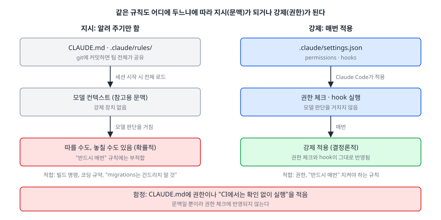
*그림: 같은 규칙도 CLAUDE.md에 두면 확률적 지시, settings.json에 두면 결정론적 강제가 된다.*

근거: CCAR-P-jrajath94-0257, CCAR-P-jrajath94-0264, CCAR-P-jrajath94-0328, CCAR-P-jrajath94-0391, CCAR-P-jrajath94-0454, CCAR-P-jrajath94-0517, CCAR-P-jrajath94-0518, CCAR-P-jrajath94-0672, Patrick-0028, Udemy-0017, Udemy-0029, Udemy-0032, Udemy-0052

### 설정 파일의 범위
**팀 = 공유 settings · 개인 = local · user**

| 파일 | 역할 |
|---|---|
| `.claude/settings.json` | 프로젝트 공유 설정 커밋 → 팀 전원 동일 배포 (permissions · hooks · plugins) |
| `.claude/settings.local.json` | 이 프로젝트 전용 개인 덮어쓰기 gitignore(Claude Code가 생성 시 git 제외) → 팀원 영향 없음 · 팀 공유용 ✗ |
| `~/.claude/settings.json` | 사용자 설정 → 한 사람 · 모든 프로젝트 |
| `CLAUDE.local.md` | 개인용 지시 권한 설정 파일 ✗ |
| `.mcp.json` | MCP 서버 설정 권한 설정 파일 ✗ |

| 구분 | 내용 |
|---|---|
| 우선순위(높은 순) | managed > command line > local > shared project > user |
| 리스트형 설정 | `permissions.allow` 등 덮어쓰기 ✗ → 병합 |

| 구분 | 내용 |
|---|---|
| 팀 규칙을 commit한 설정에 두는 이유 | 버전 관리 · 리뷰 · CI 포함 모든 사람에게 적용 로드 속도 · context 절감 · 덮어쓰기 불가 = 이유 ✗ (로컬에서 덮어쓸 수 있음) |
| 팀 표준화 | repo에 공유 구성 commit (`CLAUDE.md` · MCP 서버 목록 · permissions) → 한 곳 수정 → 전원 전파 |
| 표준화 ✗ | 개인 설정 방치 · PDF 이메일 Claude Code 사용 금지 |
| CI 포함 어디서나 금지 | commit한 project settings deny (예: `Bash(git push *)` · `Bash(curl *)`) → 클라이언트 강제 · CI 포함 적용 |

| 구분 | 내용 |
|---|---|
| 계층 모델 | 개인(local) → 팀(commit 프로젝트 기본값) → 조직(managed) guidance(`CLAUDE.md`)는 어느 계층도 아님 |
| 개인 예외 | `.claude/settings.local.json` 공유 파일 미수정 · 사유 기록 · 기간 한정 |
| 공유 파일 임시 수정 후 복구 | 전원 통제 약화 · 복구 전까지 방치 |
| 팀 규칙 + 개인 예외 | 팀 deny = commit한 공유 settings 개인 추가 allow = git 제외 local settings |
| deny 범위 | 어떤 범위의 deny든 여전히 적용 |
| ⚠️ local 예외 | 해설: local 파일이 공유 deny를 덮어씀 공식 문서: 어느 scope의 deny든 allow보다 먼저 평가 → local allow로 공유 deny 해제 ✗ |
| ⚠️ 만료 | settings 파일의 자동 만료 기능 확인 ✗ "하루 뒤 만료"는 운영 절차(해설 전제) (공식 문서 미확인) |

| 구분 | 내용 |
|---|---|
| managed settings 특성 | 팀 · 개인 재정의 불가 `--settings` · repo 설정 · user 설정으로 완화 ✗ 새 repo에도 추가 작업 없이 적용 |
| 배포 | MDM으로 `managed-settings.json` 배포 |
| 계층 선택 질문 | 누구에게 적용하고 싶은가 누구에게 변경시키고 싶지 않은가 |
| managed에 두는 것 | 비밀 경로 · `.env` 읽기 deny (repo 일괄) 모든 커밋 시크릿 스캔 hook + deny 모델 · 지출 가드레일 · 협상 불가 항목만 |
| project 기본값에 두는 것 | 팀 hook (예: 편집마다 lint `PostToolUse`) 조직 의무화 시에만 managed |
| 개인 config | 에디터 테마 등 개인 취향 |
| 신호 문구 | "어느 팀도 약화 ✗" · "어디서나 · 예외 없이" → managed |
| committed 파일의 한계 | repo 쓰기 권한자는 편집 가능 → 조직 규칙 보장 ✗ |
| managed 운영 조건 | 조직 플랜 · 관리자 권한 · 비상 해제(break-glass) 예외 경로 없으면 shadow workflow |
| ⚠️ 지출 상한 | 해설 = 모델 · 지출 가드레일을 managed에 배정 공식 문서: managed settings에 지출 한도 키 ✗ (한도는 admin 설정 · Console workspace) |
| permissionless mode | 공식 용어 아님 = `bypassPermissions` 모드 `disableBypassPermissionsMode`를 managed에서 `"disable"` 설정 → 차단 |

| 구분 | 내용 |
|---|---|
| 공유 MCP 서버 | 공유 config에 1회 선언 → 전원 같은 도구 머신별 drift 종료 |
| 자격 증명 | config의 비밀 처리 방식 안에 보관 채팅에 붙여넣기 ✗ (transcript 유출) |
| 한계 | 공유 서버 = 단일 장애점 자격 증명 rotation 별도 필요 |
| 오답 | 토큰 계속 붙여넣기 · 서버 금지(검색 기능 상실) 개인별 서버 (N개 서버 = N가지 동작) |
| 예외 | 서버가 실제 필요 미충족 → 제거가 정답 데이터 경계로 격리 필요 → 각 서버를 공유 config에 선언 |

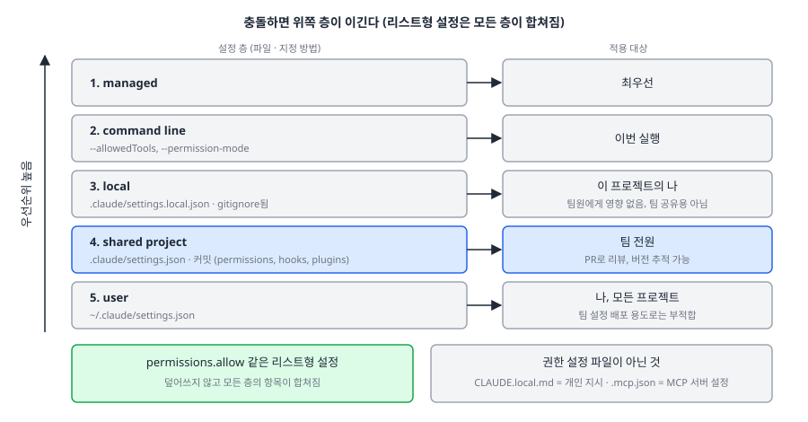
*그림: 충돌하면 위쪽 층(managed > command line > local > project > user)이 이기고, permissions.allow 같은 리스트는 합쳐진다.*

근거: CCAR-F-Amey-Thakur-0071, CCAR-F-Udemy01-0008, CCAR-P-jrajath94-0060, CCAR-P-jrajath94-0103, CCAR-P-jrajath94-0258, CCAR-P-jrajath94-0259, CCAR-P-jrajath94-0260, CCAR-P-jrajath94-0262, CCAR-P-jrajath94-0392, CCAR-P-jrajath94-0455, CCAR-P-jrajath94-0580, CCAR-P-jrajath94-0581, CCAR-P-jrajath94-0703, CCAR-P-preporato-0029, Patrick-0044, Preporato-0029, Udemy-0029, Udemy-0031

### Headless / CI 실행
**CI = `-p` + `--allowedTools` + JSON**

| 구분 | 내용 |
|---|---|
| `claude -p` · `--print` | 비대화형 실행 → 결과 stdout |
| 기계 판독 출력 | `--output-format json` + schema 검증 |
| `-p`의 권한 | 승인자 없음 → 허가 필요 작업 거부 |
| 필요 도구 | `--allowedTools`로 사전 허용 |
| `--permission-mode dontAsk` | 허용 목록 밖 작업 → 묻지 않고 거부 |

| trust · `permissions.allow` | 내용 |
|---|---|
| 커밋된 `permissions.allow` | `.claude/settings.json` 허용 = workspace trust 수락 후에만 적용 |
| `-p`의 trust 처리 | trust 대화상자 표시 ✗ → CI 신규 checkout 폴더에서 허용 규칙 미적용 |
| CI 허용 위치 | `--allowedTools` 또는 runner의 user · managed 설정 |

| defaultMode 제한 | 내용 |
|---|---|
| `permissions.defaultMode` | `auto` · `bypassPermissions` → project · local 설정에서 효과 ✗ |
| 지정 위치 | user · managed 설정 또는 `--permission-mode`만 |
| `bypassPermissions` | 격리 환경 한정 |

| 구분 | 내용 |
|---|---|
| 프로젝트 지침 로드 | `claude -p` = 기본 프로젝트 `CLAUDE.md` 로드 `--bare` = 자동 로드 생략 → `--append-system-prompt-file` 등 명시 전달 |
| CI 품질 지침 | commit한 `CLAUDE.md`에 기재 (가치 있는 테스트 기준 · fixture 용도와 사용법) → 저가치 테스트 감소 · 기존 factory 재사용 |
| 공유 + CI 동시 충족 | 루트 `CLAUDE.md` = 테스트 방침 · 리뷰 기준 하위 `CLAUDE.md` = 그 디렉터리 규약 (예: `tests/` fixture 명명) · 간결 유지 |
| CI에서 안 읽히는 곳 | 러너 이미지의 `~/.claude/CLAUDE.md` = repo 밖 `claude_args`의 `--append-system-prompt` = workflow 안에서만 유효 |
| 약한 지침 | "질 높은 테스트를 써라" 한 문장 = 구체성 ✗ 사용자 수준 파일 = 공유 ✗ |
| 기준 보강 | 리뷰에서 반려된 테스트 사례를 모아 기준 기술에 반영 |

| 구분 | 내용 |
|---|---|
| 여러 대화 처리 | `-p` + `--output-format json` → 결과의 `session_id` 기록 |
| 특정 대화 재개 | `claude -p "<prompt>" --resume "$session_id"` → 재개 + 첫 후속 prompt를 한 명령으로 |

| 구분 | 내용 |
|---|---|
| headless 적합 | 범위 분명 · 반복 가능 · 무인 실행 예: 모든 PR마다 도는 명세 분명한 검사 |
| headless 부적합 | 탐색적 디버깅 · 아키텍처 설계 · pair programming = 사람 개입 필요 → interactive |
| 적합성 기준 ✗ | 도구 수 · 출력 길이 |
| 멈춤 원인 ① | `claude "..."` = 대화형 시작 → 입력 대기 → `-p`(`--print`)로 시작 |
| 멈춤 원인 ② | 후속 확인 prompt에 응답할 사람 없음 → 필요 도구 사전 승인 (`--allowedTools` · 권한 설정) |
| 무인 실행 조건 | 실행 모드 + 권한, 2곳 모두 사람 대기 제거 |
| 점검 순서 | 자동화 멈춤 → 시작 모드가 사람 입력 전제인지 먼저 확인 |

| 출력 · 결과 처리 | 내용 |
|---|---|
| `--output-format text` | 기본값 · 평문 |
| `--output-format json` | 결과 + session ID · 비용 등 metadata 묶음 |
| `--output-format stream-json` | 실행 중 이벤트 순차 전송 = 리뷰 결과 자체 ✗ |
| `--json-schema` + `json` | schema 적합 데이터 → 결과 JSON의 `structured_output` 필드 |
| 비용 · 소요시간 | `json` 출력 metadata에서 읽기 (예: `total_cost_usd`) |
| 요건 분리 | 내용 형식 = `--json-schema` 실행 기록 = `json` metadata |
| 성공 판정 | 종료 코드 0 = 성공 · 0 아님 = 실패 → 스크립트가 종료 상태로 분기 |
| 집계 값 | 사람이 읽는 문장 정규식 추출 ✗ → `structured_output`에서 읽기 |
| prompt 서식 지시 | "마지막 줄에 `N` 형식" 지시 → 표현 흔들림 확률적으로 잔존 ✗ |
| PR inline 코멘트 자동화 | `-p` + `json` + `--json-schema` → file path · line · severity · 수정 제안 필드 강제 |
| 코멘트 게시 | 출력 파싱 → GitHub API로 inline 게시 |
| schema 없는 prompt 지시 | 검증 구조 없음 → 유효 데이터 보장 ✗ |

| 도구 · context | 내용 |
|---|---|
| `--tools` | 실행에 존재하는 내장 도구 제한 예: Read · Grep만 |
| `--allowedTools` | 나열 도구를 prompt 없이 실행 허용 = 제한 ✗ |
| 제한 + 실패 시 job 실패 | `--tools` + `claude -p` → 다음 CI 단계에서 종료 상태 확인 |
| `--bare` | `CLAUDE.md` 포함 자동 탐색 생략 → 프로젝트 규약 미로드 |
| `--bare`의 context 전달 | `--append-system-prompt-file` 등 플래그 |
| 증상 판별 | 일부 규약 위반이 아니라 전면 미사용 → 규약 전체 미전달 변경 의심 |
| 로드와 무관한 것 | `--output-format` 지정 · 비대화형 모드 |
| CI 명령 변경 | 소수 PR로 규약 준수 확인 → 전체 적용 |
| `--bare` 기본값 | 공식 문서: 향후 `-p` 기본값 예정 → 현재 `-p`는 `CLAUDE.md` 자동 탐색 → 기본값이 되면 생략 (버전별 차이) |

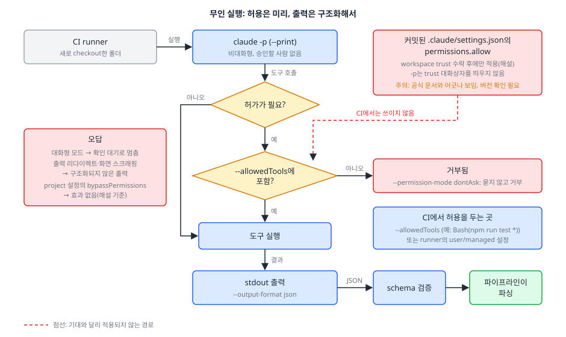
*그림: 무인 실행에서는 허용을 --allowedTools로 미리 주고, 출력은 --output-format json + schema로 받는다.*

근거: Amey-0049, CCAR-F-Amey-Thakur-0006, CCAR-F-Amey-Thakur-0019, CCAR-F-Amey-Thakur-0046, CCAR-F-Amey-Thakur-0056, CCAR-F-MyPractice-0016, CCAR-F-MyPractice-0026, CCAR-F-Udemy01-0034, CCAR-F-Udemy01-0038, CCAR-F-Udemy01-0051, CCAR-F-Udemy02-0005, CCAR-F-Udemy03-0039, CCAR-F-Udemy04-0001, CCAR-F-Udemy05-0039, CCAR-F-Udemy05-0050, CCAR-F-paullarionov-0016, CCAR-F-paullarionov-0026, CCAR-P-jrajath94-0704, CCAR-P-jrajath94-0705, Udemy-0017

### Hooks: 결정론적 실행
**차단은 실행 전 `PreToolUse`만 가능**

| 구분 | 내용 |
|---|---|
| hook 정의 | lifecycle 고정 시점에 실행되는 사용자 정의 처리 (shell command · HTTP 호출 등) |
| 실행 조건 | 모델 판단 ✗ `matcher` 일치 → 매번 실행 (예: `Edit\|Write` · `Bash`) |

| hook | 발화 시점 | 용도 · 제약 |
|---|---|---|
| `PreToolUse` | 도구 실행 전 | 유일하게 실행 차단 가능 차단 = exit code 2 또는 `deny` + 이유 (`hookSpecificOutput.permissionDecision`) 기타 반환값 = `allow` · `ask` · `defer` |
| `PostToolUse` | 도구 호출 성공 직후 | 감사 로그 · 포맷 정리 · 알림 이미 실행됨 → 차단 · 되돌리기 ✗ |
| `PostToolUseFailure` | 도구 호출 실패 시만 | 성공한 변경 기록 ✗ |

**exit code · 반환값별 효과**

| hook · 반환 | 효과 |
|---|---|
| `PreToolUse` + exit 2 | 호출 차단 stderr(또는 JSON 거부 사유) → Claude 전달 |
| `PreToolUse` + exit 0 + 경고 출력 | 차단 ✗ → 호출 계속 |
| JSON `permissionDecision: allow` | 경고와 함께 실행 허용 → 차단 ✗ |
| `PostToolUse` + exit 2 | 이미 실행됨 → 쓰기 취소 ✗ stderr → Claude 전달 → 후속 대응 가능 |
| `Stop` + exit 2 | Claude 종료 ✗ stderr 전달 → 실패 테스트 계속 수정 |
| `SessionEnd` | 세션 닫히는 시점 실행 → 막을 대상 없음 |
| `UserPromptSubmit` | prompt 제출 시점 → 작업 전에 실행 |

**hook 시점 선택**

| 요건 | 정답 |
|---|---|
| 수정 직후 팀 전체 Prettier | `PostToolUse` + matcher `Edit\|Write` commit된 `.claude/settings.json`에 정의 |
| 테스트 실패 중 작업 종료 금지 | `Stop` + 실패 시 stderr 출력 + exit 2 |
| 쓴 파일에서 API key 발견 | `PostToolUse` = 사후 대응만 (파일 이미 존재 · 쓰기 취소 ✗) |
| 쓰기 자체 차단 | `PreToolUse`에서 검사 → exit 2 |

**강제 수단 선택**

| 요건 | 정답 |
|---|---|
| 정해진 시점 · 모델 무관 · deterministic 동작 | hook (지침 · context = project memory 모델 선택 = 설정) |
| 권한 규칙으로 표현 불가한 shell 검사 | `PreToolUse` + shell matcher 검사 실패 시 exit 2 |
| workspace 밖 경로 명령 차단 + 위반 피드백 | `PreToolUse` 경로 검증 → 이유 포함 차단 |
| 필수 순서 (대상 확인 → 상태 변경) | `PreToolUse` 전제 gate 확인 기록 전까지 Bash 거부 |
| 필수 순서 (tool 설계) | 상태 변경 전용 tool 확인된 ID 필수 입력 + 불일치 호출 거부 |
| API key commit 방지 | pre-commit hook = diff 스캔 일치 시 commit 차단 · fail closed |

**pre-commit secret 스캔의 조건 · 한계**

| 구분 | 내용 |
|---|---|
| 시점 | 이력에 들어가기 전 차단 (merge 이후 스캔 = 포렌식 · 백스톱) |
| fail closed | scanner 고장 → 통과 ✗ · 차단 |
| 패턴 목록 | 새 키 형식 누락 가능 → 담당자 필요 |
| 유출 발생 시 | 키 교체(rotation) 여전히 필요 |

**Bash 출력 정규화 (실행은 그대로)**

| 구분 | 내용 |
|---|---|
| 수단 | `PostToolUse` + matcher `Bash` → `updatedToolOutput` 반환 |
| 효과 | Claude 전달 전 도구 출력 교체 |
| 값 형태 | 도구 출력 shape 일치 Bash = stdout · stderr · interrupted · isImage 객체 |
| 적용 범위 | 성공한 Bash만 교체 · 실패 = 원본 출력 (오류 상세 삭제 → 잘못된 전제로 작업) |
| MCP 전용 | `updatedMCPToolOutput` → 모든 도구용 `updatedToolOutput` 권장 |
| 교체 불가 | `PostToolUse` exit 2 + stderr ✗ `PreToolUse` = 실행 전이라 출력 처리 ✗ |

**hook 배포 · 점검**

| 구분 | 내용 |
|---|---|
| 팀 전체 적용 | commit된 `.claude/settings.json` `~/.claude/settings.json` = 설정한 본인만 |
| 로드 확인 | `/hooks` = 현재 session hook 구성 표시 읽기만 → 파일 변경 ✗ |
| 점검 수단 ✗ | `CLAUDE.md` 안내 줄 = hook 시작 ✗ `/context` = hook match · exit code 목록 ✗ |

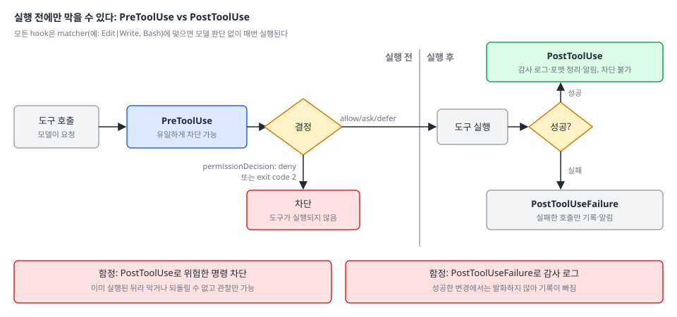
*그림: 차단은 실행 전 PreToolUse에서만 가능하고, 실행 후 hook은 성공/실패에 따라 나뉘어 관찰만 한다.*

근거: CCAR-F-Amey-Thakur-0021, CCAR-F-Amey-Thakur-0057, CCAR-F-Udemy01-0002, CCAR-F-Udemy01-0024, CCAR-F-Udemy03-0036, CCAR-F-preporato-0017, CCAR-F-preporato-0018, CCAR-F-preporato-0019, CCAR-P-jrajath94-0269, CCAR-P-jrajath94-0678, CCAR-P-jrajath94-0707, Udemy-0021, Udemy-0052

### 구성 요소 구분 (로드 시점 · 작성자)
**`CLAUDE.md` 항상 · skill 필요 시**

| 구성 요소 | 작성자 | 로드 | 비고 |
|---|---|---|---|
| `CLAUDE.md` | 사람 | 매 세션 전체 | 규약 |
| Skills | 사람 | 설명문만 상시 노출 호출 · 관련 시 본문 로드 → 길어도 컨텍스트 비용 작음 | 절차 · 참고 자료 custom slash command 통합 → `/이름`으로 호출 |
| Subagent | — | 부모 대화 기록 없이 독립 컨텍스트 → 요약만 반환 | 대화 이어받기 = fork형만 호출 = 모델 판단 → "반드시 매번" 보장 ✗ |
| auto memory(Agent Memory) | Claude | 세션 시작 시 앞부분 (200줄 또는 25KB까지) | 사용자 정정 · 선호 기반 메모 |

| 상황 | 배치 |
|---|---|
| 모든 코드에 항상 적용될 규약 (예: 환자 ID 로그 금지 · UTC 저장) | 프로젝트 `CLAUDE.md` skill에 두면 미호출 session 미적용 |
| 특정 작업의 절차 | skill (온디맨드 호출) |
| 가끔 쓰는 절차 | skill → 필요할 때만 로드 |
| `disable-model-invocation` `context: fork` | 호출 방식만 변경 → 상시 적용 요건 충족 ✗ |
| 개발 절차서에 "시작 시 skill 실행" 기재 | 사람 의존 → 누락 발생 |
| 위반 불허 규약 | `CLAUDE.md` + hook · 리뷰 병행 |

**배치 판단: `CLAUDE.md` · skill · subagent**

| 상황 | 배치 |
|---|---|
| 모든 session 항상 적용 (코딩 표준 · 테스트 규칙) | `CLAUDE.md` (모든 session 로드) |
| 해당 작업 때만 적용 (PR 리뷰 · 배포 · migration) | trigger 키워드 지정 skill (Claude가 감지 → on-demand 호출) |
| 새 endpoint 생성 때만 쓰는 예시 2~3개 | skill + slash command 호출 → 메인 context 깨끗하게 유지 |
| 요구 = 재사용할 노하우 · 절차 | skill |
| 요구 = 자체 context의 독립 작업 흐름 | subagent (context 격리) |
| skill vs subagent 선택 기준 ✗ | 작업 길이 · `CLAUDE.md` 유무 "skill이 항상 낫다" |

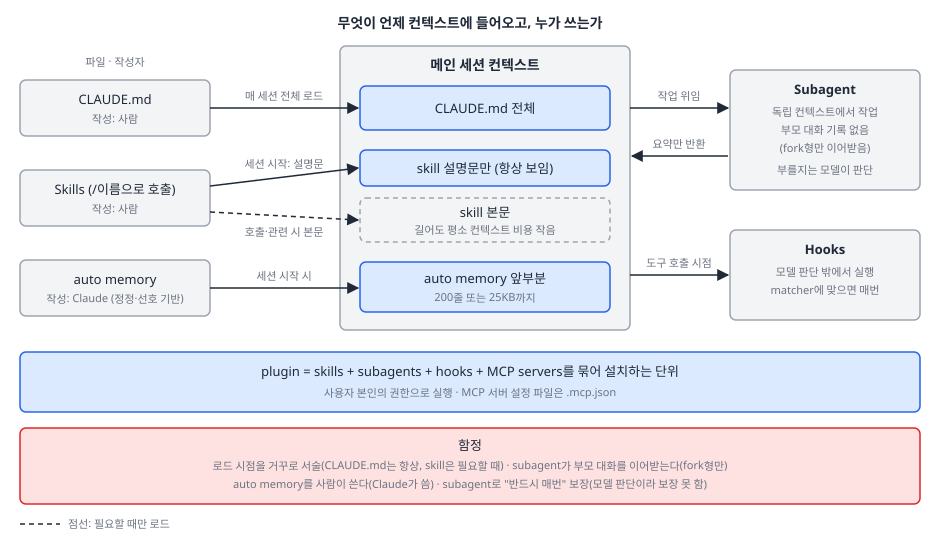
*그림: CLAUDE.md는 매 세션 전체, skill은 설명문만 있다가 필요할 때 본문, subagent는 독립 컨텍스트에서 요약만 돌려준다.*

근거: CCAR-F-Amey-Thakur-0020, CCAR-F-MyPractice-0033, CCAR-F-MyPractice-0038, CCAR-F-Udemy04-0042, CCAR-F-Udemy05-0013, CCAR-F-paullarionov-0033, CCAR-F-paullarionov-0038, Udemy-0021, Udemy-0032, Udemy-0052

### Plugins의 팀 운영
**project scope 공유 + 버전 고정 + 내용 심사**

| 구분 | 내용 |
|---|---|
| plugin 정의 | skills · subagents · hooks · MCP servers 묶음 설치 단위 |
| 실행 권한 | 사용자 본인 권한 |
| 팀 배포 | project scope 설치 → PR 리뷰 가능 |
| 기록 위치 | 활성화 정보 → 커밋되는 `.claude/settings.json` |
| 적용 시점 | 공유 설정 일부 = 멤버별 workspace trust 수락 후 적용 |

| 구분 | 내용 |
|---|---|
| 버전 고정 | marketplace tag · branch로 고정 (예: `#v1.2.0`) |
| auto-update | marketplace별 ON/OFF 공식 marketplace 기본값 = ON |
| 팀 업데이트 방식 | 버전 고정 → 변경 확인 → 의도적 업데이트 |
| 도입 심사 | 설명문 · 사용자 수만 확인 ✗ → 설치 화면 "추가되는 것" 내용까지 확인 (hooks · MCP servers · skills) |

| 구분 | 내용 |
|---|---|
| 전사 동일 버전 배포 | skill + subagent → plugin으로 패키징 또는 managed settings로 배포 → 관리되는 버전 1개 |
| 복사 배포 | 채팅에 prompt 게시 · `~/.claude/` 복사 → 원본 변경 즉시 어긋남 |
| `CLAUDE.md`에 붙여넣기 | 항상 적용 지침용 subagent · 온디맨드 skill 정의 ✗ |

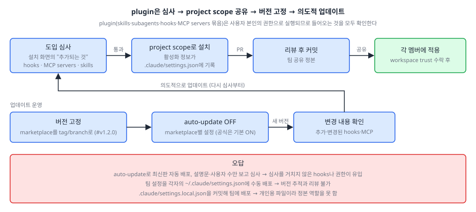
*그림: 팀 plugin은 심사 → project scope 설치 → PR 커밋 → trust 수락 후 적용, 업데이트는 고정된 버전에서 다시 심사를 거친다.*

근거: CCAR-P-preporato-0030, Udemy-0031

### CLAUDE.md 위치별 범위와 결합
**공유 범위는 파일 위치가 결정**

| 위치 | 적용 대상 | 로드 · 용도 |
|---|---|---|
| 프로젝트 `./CLAUDE.md` 또는 `./.claude/CLAUDE.md` | 팀 전원 commit → 버전 관리 · 리뷰 | 작업 디렉터리 · 상위 = 시작 시 로드 저장소 전체 규칙 · 팀 컨벤션 |
| `~/.claude/CLAUDE.md` | 본인 · 모든 프로젝트 버전 관리 공유 ✗ | 개인 선호 (예: 설명 방식) 팀 규약 기재 ✗ |
| `CLAUDE.local.md` | 본인 · 이 프로젝트만 | `.gitignore` 추가 (예: 개인 검증 서버 · 담당 데이터 번호) |
| 하위 디렉터리 `CLAUDE.md` | 팀 · 그 디렉터리 작업 | Claude가 그 디렉터리 파일을 읽을 때 추가 로드 디렉터리 한정 규약용 |

| 구분 | 내용 |
|---|---|
| 결합 방식 | 발견된 파일 = 덮어쓰기 ✗ → 연결해 context 투입 "자식이 부모 덮어쓰기" 전제 = 오답 |
| 로드 순서 | 사용자 수준 → 프로젝트 수준 디렉터리 = 루트 → 하위 |
| 시작 위치 | 작업 디렉터리 · 상위 = 시작 시 로드 하위 = 읽을 때 로드 → 시작 위치에 따라 로드 파일 상이 |
| 모순 지시 | 수준 간 충돌 → Claude가 한쪽 임의 선택 → session · 멤버별 결과 불일치 |
| 모순 해소 | 같은 항목을 한 수준에만 남김 (루트 규약 범위 한정 · 개인 파일 지시 제거) "상위보다 우선" 문구 · 루트 삭제 ✗ |

| 구분 | 내용 |
|---|---|
| 팀 · 개인 판단 기준 | 전원에게 같은 적용이 필요한가 위반 시 팀 산출물에 영향이 나오는가 |
| 팀 규약 | 시간대 저장(UTC) · 빌드 명령(`make ci`) commit 서식 |
| 개인 선호 | 설명 방식 (예: 짧은 bullet) |
| 개인 + 이 프로젝트 한정 | `CLAUDE.local.md` `~/.claude/CLAUDE.md` = 다른 프로젝트에도 로드 → 부적합 |
| `.claude/rules/` | 팀 공유 파일 · `paths`는 사람이 아니라 파일로 범위 축소 → 개인용 ✗ |

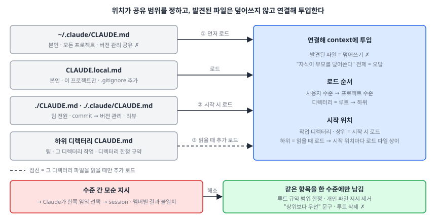
*그림: 파일 위치가 공유 범위를 정하고, 발견된 파일은 덮어쓰지 않고 연결해 투입되므로 모순 지시는 한 수준에만 남겨 해소한다.*

근거: CCAR-F-Amey-Thakur-0018, CCAR-F-Amey-Thakur-0055, CCAR-F-Udemy01-0041, CCAR-F-Udemy03-0046, CCAR-F-Udemy04-0007, CCAR-F-Udemy05-0012, CCAR-F-Udemy05-0058, CCAR-F-Udemy06-0016

### 팀 일관성과 CLAUDE.md 크기
**커밋된 짧은 공통 파일이 일관성의 기반**

| 증상 | 원인 | 조치 |
|---|---|---|
| 한 명만 잘 동작 팀 결과 들쭉날쭉 | 컨벤션이 한 사람의 로컬 환경에만 존재 | 저장소에 commit (장비 · 저장소 크기 · terminal ✗) |
| 기존 멤버만 지침 준수 신규 입사자 미준수 | 지침이 기존 멤버의 사용자 수준 `~/.claude/CLAUDE.md`에만 존재 | 프로젝트 `CLAUDE.md`로 이동 · commit → 현재 · 미래 팀원 자동 적용 |
| 리더 환경만 준수 신규 멤버 · CI 미준수 | 규약이 리더의 `CLAUDE.local.md`에만 존재 (신규 `/context` = 공유 `CLAUDE.md`만 표시) | 공유 `CLAUDE.md`로 이동 |
| 새 코드엔 도움 레거시엔 해가 됨 | 레거시에 commit된 컨텍스트 · 관례 부재 | 조사 대상 = 컨텍스트 · 관례 교육 · 더 큰 모델 → 저장소 관례 제공 ✗ 재작성 = 진단 전 과잉 |
| 기존 코드베이스 성과 저조 | 관례 · 구조를 설명하는 commit된 컨텍스트 부재 | 팀이 직접 고칠 수 있는 원인 (크기 · 언어 · 기여자 수 = 원인 ✗) |
| `CLAUDE.md` 수천 줄 | 중요한 지시가 무관한 내용과 경쟁 · 희석 | 많다고 좋아짐 ✗ · 속도 개선 ✗ 기준 = 파일당 200줄 미만 |
| 개인 내용을 commit 파일에 기재 | 다른 멤버 Claude 오동작 해당 줄 편집 → merge 충돌 | 공통 내용만 commit 파일에 유지 개인 내용 → `CLAUDE.local.md` |

근거: CCAR-F-Amey-Thakur-0022, CCAR-F-Amey-Thakur-0069, CCAR-F-MyPractice-0037, CCAR-F-Udemy04-0007, CCAR-F-Udemy05-0026, CCAR-F-Udemy05-0047, CCAR-F-Udemy06-0060, CCAR-F-paullarionov-0037, CCAR-P-Amey-Thakur-0035, CCAR-P-Amey-Thakur-0080

### @import로 공통 표준 재사용
**@import는 정리용 · 로드량은 불변**

| 구분 | 내용 |
|---|---|
| 문법 | `CLAUDE.md` 안 `@경로` 상대 · 절대 경로 모두 허용 |
| 상대 경로 기준 | import를 포함한 파일의 위치 작업 디렉터리 ✗ |
| 로드 시점 | 시작 시 · 포함한 파일과 함께 로드 → context 소비 감소 ✗ (정리 효과만) |
| 로드 제외 | code span · fenced code block 안의 `@경로` |
| 용도 | 표준 정본 1곳 + 패키지별 필요한 것만 import → 본문 복사 제거 · 표준 개정 시 일괄 반영 |

| 방식 | 판정 |
|---|---|
| 공통 = 루트 `CLAUDE.md` 고유 표준 = 패키지 `CLAUDE.md`의 `@import` | ✓ 공통은 전원 · 고유는 해당 패키지만 (개발자가 패키지에서 시작하는 조건) |
| 모든 도메인 표준을 루트에 집약 | ✗ 모든 패키지가 전 도메인 지시 상속 |
| README 링크 · 문장으로 "읽어라" | ✗ 자동 로드 · 로드 보장 없음 |
| 각 패키지에 본문 복사 | ✗ 개정 시 일부만 stale → 패키지별 규약 상이 |
| CI 스크립트로 자동 복사 | ✗ 복제 구조 유지 |
| import를 fenced code block 안에 배치 | ✗ 로드 안 됨 |
| `@docs/standards/x.md`가 `packages/x/CLAUDE.md`에서 미로드 | 원인 = 상대 경로가 그 파일 위치 기준으로 해석 → 경로를 `../../docs/standards/x.md`로 수정 |
| 항상 루트에서 시작 · 복사 `~/.claude/CLAUDE.md`로 이동 | ✗ 기준 오해 · 공유 · 선택적 import 방침 붕괴 |

근거: CCAR-F-Udemy03-0029, CCAR-F-Udemy04-0042, CCAR-F-Udemy04-0059, CCAR-F-Udemy05-0047, CCAR-F-Udemy06-0031

### CLAUDE.md 로드 진단
**수정 전에 로드 상태부터 관찰**

| 확인 수단 | 보여 주는 것 |
|---|---|
| `/context`의 "Memory files" | 현재 session에 로드된 지시 파일 목록에 없으면 Claude에게 안 보임 |
| `/memory` | 사용자 · 프로젝트 메모리 파일 위치 목록 (없는 파일 포함) · 열어 편집용 · 로드 확인 ✗ |
| `/status`의 Setting sources | 설정 파일 로드 현황 · 지시 파일 ✗ |
| `InstructionsLoaded` hook 로그 | 로드된 지시 · 규칙 파일 기록 → path rule 로드 여부 검증 |
| 하위 디렉터리 파일 읽기 | 하위 `CLAUDE.md`는 그 디렉터리 파일을 읽을 때 로드 |
| 명령 표기 | 공식 문서: fullscreen에서 `/context`만으론 목록 접힘 → `/context all`로 펼침 (비 fullscreen은 `/context`로 표시) |

| 상황 | 첫 조치 |
|---|---|
| 같은 요청인데 시작 위치마다 동작 상이 | 시작 디렉터리 ↔ `CLAUDE.md` 위치 대조 + 각 session `/context` Memory files 비교 |
| 내 환경에서만 재현 · 신규 환경 ✗ | 관련 `CLAUDE.md`가 로드되는 위치에 있는지 확인 + `/context`에서 로드 여부 확인 |
| 루트에서 시작 · `/context`에 하위 `CLAUDE.md` 없음 | 결함 ✗ · 온디맨드 로드의 정상 동작 → 그 하위 파일을 Claude에게 읽혀 로드 확인 |
| 지시 효과 없어 보임 | 설정 변경 전 로드 위치 확인이 출발점 |
| 진단이 아닌 변경 | `/init` 재실행 · auto memory 비활성화 `settings.local.json`에 규약 기재 · 내용 루트로 이동 |

근거: CCAR-F-Udemy01-0039, CCAR-F-Udemy03-0046, CCAR-F-Udemy04-0020, CCAR-F-Udemy04-0059, CCAR-F-Udemy05-0026, CCAR-F-Udemy06-0016

### path-specific rules (.claude/rules/)
**규칙 범위는 디렉터리가 아니라 파일 경로 패턴**

| 구분 | 내용 |
|---|---|
| 위치 · 단위 | `.claude/rules/*.md` 주제별 1파일 (예: `testing.md` · `api-conventions.md`) |
| `paths` 없음 | 시작 시 로드 → 로드량 불변 파일명 · 폴더 구성(`rules/db/`)으로 범위 제한 ✗ |
| `paths` 있음 | 일치 파일을 Claude가 Read · Write · Edit 할 때만 로드 |
| 로드 계기 | 작업 주제 ✗ · Claude가 다룬 파일 경로 ✓ |
| frontmatter | Claude Code가 읽는 항목 = `paths`뿐 |
| `paths` 값 | YAML 리스트 또는 쉼표 구분 문자열 중괄호 확장 `{ts,tsx}` 가능 |
| 사용자 수준 | `~/.claude/rules/` = 개인용 · 팀 공유 ✗ |
| 적합한 경우 | 같은 종류 파일이 여러 디렉터리에 분산 (colocated 테스트 · migration `.proto` · `.sql`) |

| 패턴 | 일치 범위 |
|---|---|
| `*.sql` · `*.md` | 프로젝트 루트 파일만 |
| `proto/*.proto` | 루트 `proto/` 바로 아래만 |
| `packages/*/*.graphql` | 얕은 계층만 · 깊은 계층 ✗ |
| `**/*.ts` | 모든 디렉터리의 `.ts` → 범위 넓음 |
| `**/*.sql` · `**/*.proto` | 깊이 무관 해당 확장자 전체 ✓ |
| `**/*.{graphql,ts}` | `**/*.graphql` + `**/*.ts`로 확장 → 모든 TypeScript 파일 일치 |
| `**/*.graphql` + `**/*.resolver.ts` | 의도한 두 종류만 ✓ (쉼표 구분 문자열도 가능) |
| `**/*.test.tsx` · `src/api/**/*.ts` `services/payments/**` | 위치 무관 테스트 · 특정 영역 한정 |

| 구분 | 디렉터리 `CLAUDE.md` | `paths` rule |
|---|---|---|
| 범위 결정 | 어느 디렉터리인가 | 어느 파일 패턴인가 |
| 로드 | 그 디렉터리 파일을 읽을 때 | 일치 파일을 다룰 때 |
| 적합 | 디렉터리 한정 규약 (예: payments 서비스 · `tests/` fixture 명명) | 흩어진 같은 종류 파일 규약 |
| 분산 파일에 사용 시 | 디렉터리마다 복제 → 유지보수 부담 | 한 곳 정의 |

| 상황 | 정답 배치 |
|---|---|
| payments 코드에서만 로드 (2개 선택) | `services/payments/CLAUDE.md` `paths: ["services/payments/**"]` rule |
| payments 오답 | 루트 `CLAUDE.md` 섹션 = 모든 session 로드 `~/.claude/CLAUDE.md` = 개인용 `.mcp.json` = 지시 미포함 |
| 공통 commit 규칙 + 영역별 컨벤션 | commit 규칙 = 프로젝트 `CLAUDE.md` 영역 컨벤션 = 경로 지정 rule |
| 지시 파일 하나가 비대 · 영역별 규칙 상이 | `.claude/rules/` 주제별 파일 분리 `.claude/config.yaml` 매핑 · README 로드 = 지원 방식 아님 |

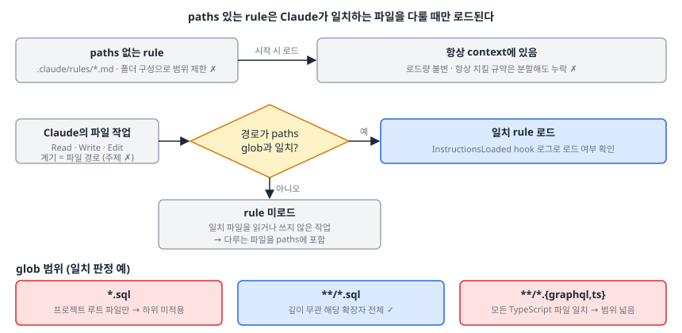
*그림: paths 있는 rule은 작업 주제가 아니라 Claude가 읽거나 쓴 파일 경로가 glob과 일치할 때만 로드된다.*

근거: CCAR-F-Amey-Thakur-0005, CCAR-F-Amey-Thakur-0040, CCAR-F-MyPractice-0040, CCAR-F-MyPractice-0042, CCAR-F-Udemy01-0038, CCAR-F-Udemy02-0047, CCAR-F-Udemy02-0053, CCAR-F-Udemy03-0040, CCAR-F-Udemy04-0020, CCAR-F-Udemy05-0029, CCAR-F-Udemy05-0056, CCAR-F-Udemy06-0001, CCAR-F-paullarionov-0040, CCAR-F-paullarionov-0042, CCAR-F-preporato-0022

### 비대한 CLAUDE.md 분할과 paths 점검
**이동 + 원본 삭제 · 둘 다 필요**

| 상황 | 조치 |
|---|---|
| 한 파일에 주제 혼재 (리뷰 톤 · 테스트 · API · 배포) | 루트 = 모든 변경 공통 기준만 주제별 = `.claude/rules/` 특정 파일용 = `paths` 부여 |
| 특정 파일 종류 규약이 수백 줄 (`*.tf` · `*.yang` · `*.sql`) | `paths` rule로 이동 + 루트에서 삭제 이동만 · 삭제만 ✗ |
| 테스트 규약이 여러 디렉터리에 복제 · stale | `paths` rule 1개(`testing.md`)로 집약 + 복제본 삭제 |
| 가끔만 쓰는 절차 (예: SDK 마이그레이션) | skill → 필요할 때만 로드 |
| 항상 지킬 규약 | 루트 `CLAUDE.md` 또는 `paths` 없는 rule (시작 시 로드 → 분할해도 누락 ✗) |
| 여러 팀 편집 → merge 충돌 · 후반부 규약 미준수 | 주제별 rule 분할 + 루트 최소화 (예: `billing-api.md`) |
| 분할 후 확인 | `/context`로 시작 시 로드된 파일 확인 → 프런트엔드 작업에 무관 규약 미포함 |

| 증상 | 원인 | 조치 |
|---|---|---|
| 기존 파일 작업은 규약 준수 변환 스크립트 작업은 미준수 로그상 rule 미로드 | 작업이 `paths` 일치 파일을 읽거나 쓰지 않음 | 작업에서 다루는 파일(생성 스크립트 · 템플릿)을 `paths`에 포함 `InstructionsLoaded` 로그로 확인 |
| 루트 파일엔 적용 하위 디렉터리엔 미적용 | 패턴 범위 좁음 (`*.sql`) | `**/*.sql` |
| 무관한 TypeScript 작업에도 로드 | 패턴 범위 넓음 (`{graphql,ts}` 확장) | 대상별 패턴으로 좁힘 |
| 범위 과대 · 과소 | 과대 → 무관 context · 토큰 소비 과소 → 규약 미적용 | 대상 파일 · 비대상 파일을 각각 읽혀 확인 |

| 방식 | 판정 |
|---|---|
| 테스트 규약을 루트 `CLAUDE.md`로 이동 | 일관성 ✓ · 항상 로드 ✗ |
| 규약을 slash command(`.claude/commands/`)로 | 개발자 수동 실행 의존 ✗ |
| `paths` 없는 rule을 폴더별 정리 | 로드량 불변 ✗ |
| 패키지마다 `CLAUDE.md`에 규약 복제 | 유지보수 ✗ · stale |
| `~/.claude/rules/`로 이동 | 팀 공유 ✗ · `paths` 없으면 시작 시 로드 |
| `@import`로 분리 | 로드량 불변 ✗ |

근거: CCAR-F-Udemy02-0035, CCAR-F-Udemy02-0040, CCAR-F-Udemy04-0020, CCAR-F-Udemy04-0042, CCAR-F-Udemy05-0029, CCAR-F-Udemy05-0047, CCAR-F-Udemy05-0056, CCAR-F-Udemy06-0017

### permissions 설계와 실행 전 강제 수단
**위험 = deny · 안전 = allow · 회색 = ask**

| 구분 | 내용 |
|---|---|
| 평가 | deny 규칙 먼저 평가 · 모델이 결과 뒤집기 ✗ |
| 분류 | 안전 → allow · 위험 → deny 판단이 중요한 회색 영역 → ask |
| 전부 ask | 하루 40건 → 3일차 읽지 않고 "허용" 위험 요청이 일상 요청에 묻힘 |
| 전부 allow | 통제 제거 |
| 전부 deny | 정당한 작업 차단 → 우회 (우회 경로는 규칙 없음) |
| 관점 | 묻기 = 주의력 예산 · 판단이 가치 더하는 곳에만 사용 |
| 유지 | 안전 · 위험 목록이 워크플로와 일치해야 함 변경 시 갱신 · 오분류 = 귀찮음 또는 위험 |
| 반례 | 요청 하루 5건 미만 + 각각 회색 → 전부 ask 가능 일상 행동 없는 기밀 환경 → 전부 deny는 명시 결정 |

| 수단 | 판정 |
|---|---|
| 권한 deny 규칙 (deploy 명령) | ✓ 실행 전 평가 · 모델 무관 |
| 시스템 프롬프트에 금지 문장 반복 | ✗ 모델 판단 의존 |
| sandbox 허용 도메인 목록에서 호스트 제외 | ✗ sandbox 안 명령이 닿는 호스트만 제어 명령 실행 자체는 금지 ✗ |
| `PostToolUse` hook으로 읽기 차단 | ✗ 도구 호출 성공 후에만 실행 |
| 커밋된 settings의 `Read` deny (secrets 폴더) | ✓ pull 후 모든 clone · 모델이 메모 무시해도 유지 |
| 팀 deny를 개인 user settings에 | ✗ 팀 전체 강제 불가 |
| 팀 deny를 `CLAUDE.md`에 | ✗ `CLAUDE.md`는 permission 강제 ✗ |
| 팀 deny(commit) + 개인 allow(local) | ✓ 팀 규칙 유지 + 개인 예외 |
| ⚠️ deny의 차단 범위 | 해설 = deny가 "모든 시도" 차단 공식 문서: Bash deny는 `/bin/rm` · `sh -c` 등 다른 호출 형태를 못 막음 → sandbox 병행 |

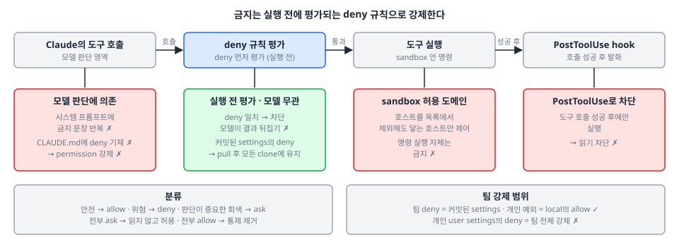
*그림: 금지는 실행 전에 평가되는 deny 규칙으로 강제하며 프롬프트·CLAUDE.md·sandbox 도메인·PostToolUse는 강제 수단이 아니다.*

근거: CCAR-P-jrajath94-0265, CCAR-P-jrajath94-0672, CCAR-P-jrajath94-0701, CCAR-P-jrajath94-0703, CCAR-P-preporato-0029

### Skill · custom command 위치와 공유
**위치가 공유 범위와 우선순위를 결정**

**저장 위치 → 사용 범위**

| 위치 | 범위 |
|---|---|
| 저장소 `.claude/commands/` | 프로젝트 command commit → clone · update한 모두 자동 사용 |
| `~/.claude/commands/` | 개인 command 본인 전 프로젝트 · 팀원 ✗ |
| 저장소 `.claude/skills/<이름>/SKILL.md` | 프로젝트 skill 저장소와 함께 버전 관리 → 팀 공유 |
| `~/.claude/skills/<이름>/SKILL.md` | 개인 skill 본인 전 프로젝트 |
| `.claude/skills/<이름>.md` 단일 파일 | skill로 로드 ✗ (폴더 + `SKILL.md` 필요) |
| `.claude/config.json` commands 배열 | command 위치 ✗ |
| `CLAUDE.md` 기재 | 명령으로 호출 ✗ |

**command · skill 관계**

| 구분 | 내용 |
|---|---|
| 통합 | command · skill 동일 취급 `.claude/commands/` 파일 계속 사용 가능 |
| 신규 작성 | skill 권장 |
| 보조 파일 | 체크리스트 · 예시 기록 → `SKILL.md`에서 참조 |

**같은 이름 충돌 처리**

| 구분 | 내용 |
|---|---|
| 우선순위 | enterprise > personal > project |
| 결정 기준 | 선언 ✗ · 위치 ✓ `override: true` 필드 없음 username 조건 로직 없음 |
| 개인 skill = 같은 이름 | 본인에게만 프로젝트 skill 대체 저장소 변경 ✗ · 팀원 영향 ✗ |
| 같은 이름의 부작용 | 팀 업데이트 미수신 (옛 절차로 계속 실행) |
| 개인 skill = 다른 이름 | 프로젝트 skill과 공존 · 가리지 않음 팀 업데이트 계속 수신 |
| 다른 이름의 약점 | `/commit` · `/my-commit` 동시 활성 → 비슷한 `description` → 자동 선택 예측 어려움 팀 문서의 `/commit` 안내 · 습관 깨짐 |
| 운영 방침 | 팀 skill 이름 목록 관리 개인 skill = 접미사 명명 약속 |

**공유 · 도입 판단**

| 상황 | 방향 |
|---|---|
| 본인만 `/명령` 사용 · 팀원 목록에 없음 | 개인 위치에 있음 → `.claude/commands/`로 이동 + commit |
| 진단 단서 | 본인 환경만 동작 저장소 `.claude/`에 commands · skills 없음 이름 중복 · 버전 · frontmatter = 설명 ✗ |
| 팀이 반복하는 다단계 검토 절차 | commit한 custom command · skill |
| 공유 skill commit 조건 | 팀이 실제 반복하는 절차 + 코드처럼 리뷰 가능 길이 · 작성자 경력 · edge case 포괄 = 근거 ✗ |
| 신입 온보딩 (build · test · deploy · API 소유 서비스) | 선별 Skills · slash command + 저장소 `CLAUDE.md` 문서화 → 시니어 1회 유지 |
| 위키 prompt 복사 · 낡음 | 반복 workflow = 버전 관리 Skills (리뷰 · 테스트 · 코드와 함께 갱신) 위키 = 서술형 글 |

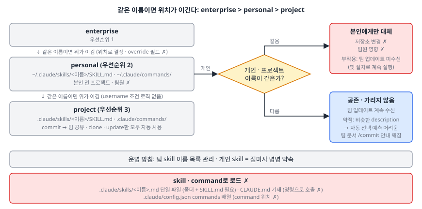
*그림: 같은 이름이면 선언이 아니라 위치로 우선순위가 정해져 개인 skill은 본인에게만 프로젝트 skill을 대체하고 팀 업데이트를 받지 못한다.*

근거: CCAR-F-Amey-Thakur-0042, CCAR-F-Amey-Thakur-0070, CCAR-F-MyPractice-0036, CCAR-F-MyPractice-0041, CCAR-F-Udemy01-0040, CCAR-F-Udemy02-0015, CCAR-F-Udemy02-0059, CCAR-F-Udemy03-0026, CCAR-F-Udemy05-0034, CCAR-F-Udemy06-0037, CCAR-F-paullarionov-0036, CCAR-F-paullarionov-0041, CCAR-P-jrajath94-0063, CCAR-P-jrajath94-0106

### Skill frontmatter 제어
**필드는 요건의 동사로 고른다**

**필드 → 역할**

| 필드 | 역할 |
|---|---|
| `context: fork` | 새 subagent의 독립 context에서 실행 대화 이력 ✗ · 결과만 메인 반환 |
| `allowed-tools` | 호출 turn 동안 나열 tool 확인 없이 사용 = 사전 승인 (예: `Bash(git log *)`) |
| `disallowed-tools` | skill 활성 동안 tool 풀에서 제거 다음 메시지 전송 시 해제 |
| `disable-model-invocation: true` | Claude 자동 로드 차단 → `/이름` 수동 호출만 (부작용 workflow 권장) |
| `user-invocable: false` | 반대 방향 = 개발자 호출 차단 |
| `argument-hint` | 자동 완성 시 기대 인수 표시 예: `[case-id]` · `[version-tag]` 입력 검증 ✗ |
| `description` | Claude의 자동 적용 판단 근거 |
| `model: haiku` | 모델만 변경 → 출력 위치 변화 ✗ |

**해석 차이**

| 구분 | 내용 |
|---|---|
| ⚠️ 시험 가이드 vs 현행 문서 | 시험 가이드 = `allowed-tools`를 접근 제한으로 설명 해설(현행 문서) = 사전 승인 · 제한 ✗ 공식 문서: 사전 승인 · 제한은 `disallowed-tools` |
| ⚠️ 복합 설정 문항의 `allowed-tools` | 해설 = "파일 쓰기 작업으로 제한" 공식 문서: `allowed-tools` = turn 한정 사전 승인 제한 ✗ (제한은 `disallowed-tools`) |

**증상 → 조치**

| 증상 | 조치 |
|---|---|
| 대용량 분석 출력 → 응답 느려짐 · 원래 작업 context 소실 | `context: fork` |
| 수천 줄 출력이 메인 대화를 덮음 | `context: fork` `disable-model-invocation` ✗ `allowed-tools` · `model` ✗ |
| 탐색 · 대안 brainstorming이 이후 구현에 영향 | `context: fork` (+ 본문에서 결론 · 추천안 · 비교표만 반환 지시) |
| 이전 대화의 schema 정보 유입 | `context: fork` |
| 인수 없이 실행 → 추측 · 정지 | `argument-hint` + 본문에서 `$0` · `$1` 사용 (첫머리: 인수 없으면 입력 요청) |
| 요청만 해도 자동 로드 → 게시 · 배포 | `disable-model-invocation: true` |
| 자동으로 거의 안 쓰임 (`description` = "SDS용") | `description`에 확인 내용 + 사용 시점 기재 |
| 실행 중 파일 수정 · shell 금지 | `disallowed-tools:` `Write Edit NotebookEdit Bash` |
| 같은 명령 승인 반복 (`git log`) | `allowed-tools: Bash(git log *)` |
| 메인 밖 실행 + Read · Grep 승인 제거 + 인수 표시 | `context: fork` `allowed-tools: Read Grep` `argument-hint: [case-id]` |
| 인수 누락 + context 누수 + 파괴 동작 | `argument-hint` + `context: fork` + tool 제한 |

**`context: fork` 주의**

| 구분 | 내용 |
|---|---|
| `/fork`와 다름 | `context: fork` = 이력 없는 새 subagent `/fork` = 현재 대화 이력 전부 상속 |
| 지시 단독 성립 | subagent는 이력 ✗ → 절차를 명시적 task 지시로 유지 |
| 격리 아님 | `/clear` = 필요한 context까지 소실 `CLAUDE.md` 이동 = 상시 로드 `/compact` = 사후 압축 |
| 요약 지시만 추가 | fork 없으면 실행 위치 그대로 → 해결 ✗ |
| 본문 주의 문구 | "수정 금지" 강조 = 확률적 준수 |
| 확실한 차단 | skill 설정 + permissions deny 또는 `PreToolUse` hook (skill 밖 작업까지 대응) |

근거: CCAR-F-MyPractice-0035, CCAR-F-MyPractice-0039, CCAR-F-MyPractice-0043, CCAR-F-Udemy02-0015, CCAR-F-Udemy02-0041, CCAR-F-Udemy03-0026, CCAR-F-Udemy04-0017, CCAR-F-Udemy04-0026, CCAR-F-Udemy06-0006, CCAR-F-Udemy06-0045, CCAR-F-Udemy06-0047, CCAR-F-paullarionov-0035, CCAR-F-paullarionov-0039, CCAR-F-paullarionov-0043, CCAR-F-preporato-0021

### Subagent 도구 범위와 위임 설계
**권한은 지시가 아니라 도구 목록으로 제한**

**도구 범위**

| 구분 | 내용 |
|---|---|
| `tools` 필드 | subagent가 쓸 수 있는 도구 제한 예: `Read` · `Grep`만 |
| `tools` 생략 | 모든 도구 상속 |
| write 도구 미부여 | 호출 가능한 쓰기 경로 없음 → prompt injection이 유도해도 실행 ✗ |
| 최소 권한 | subagent마다 하위 작업에 필요한 도구만 프로덕션 자격 증명 ✗ |
| 결과 처리 | subagent = 조사 결과 반환 main agent = 그 결과로 행동 |
| handoff | 결과 schema 필요 (없으면 main이 조사 내용 오해석) |
| 한계 | 하위 작업 변화에 따라 목록 유지 필요 너무 좁으면 정당한 작업 확장 차단 |

**요건 → 구성**

| 요건 | 정답 |
|---|---|
| 연구 subagent 쓰기 금지 + injection 대비 | `tools: Read, Grep` |
| 메인 context 보호 + 조사 중 편집 차단 | Explore subagent (read-only · Write · Edit 거부 · 요약 반환) |
| 조사 → 구현 다단계 작업 | 조사 = Explore 요약 설계 = plan mode → 승인 후 직접 실행 |
| 범용 `/investigate` 명령 | 위임할 조사 = coordinator가 질문별 판단 위임 지시 = 목적 · 증거 · 출력 형식 · 범위 경계 |

**위임 설계의 두 축**

| 축 | 내용 |
|---|---|
| 적응성 | 위임 대상 · subagent 수 = 질문에 따라 coordinator가 결정 고정 절차 ✗ |
| 신뢰성 | 목적 · 요구 증거 · 출력 형식 · 담당 경계를 위임 시 명시 제약 없는 폭넓은 조사 ✗ |
| 요약 형태 | Explore 요청 시 돌려받을 형태 지정 (컴포넌트 · 사용처 · 제약) → 계획에 바로 사용 |

근거: CCAR-F-Amey-Thakur-0020, CCAR-F-Udemy03-0052, CCAR-F-Udemy04-0046, CCAR-F-Udemy06-0034, CCAR-P-jrajath94-0261, CCAR-P-jrajath94-0331, CCAR-P-jrajath94-0702

### plan mode와 direct execution 선택
**불확실성 큰 작업 = plan · 범위 명확 = direct**

| 구분 | plan mode | direct execution |
|---|---|---|
| 규모 | 대규모 · 여러 파일 수정 | 작고 범위 명확한 변경 |
| 접근법 | 타당한 방법 2개 이상 | 방침 확정 |
| 판단 | 아키텍처 · 경계 결정 필요 | 원인 · 위치 특정 완료 |
| 코드 이해 | 낯선 코드 · 의존 관계 불명확 | 내용 충분히 이해 |
| 한 문장 기준 | diff를 한 문장으로 설명 ✗ | 한 문장 설명 가능 → 계획 생략 |

| 단서 | 선택 |
|---|---|
| 파일 40~60개 이상 마이그레이션 · 구조 재편 | plan mode |
| 연동 방식 미정 (예: webhook · bot token · Slack App) | plan mode → 장단점 비교 후 방향 합의 |
| 영향 범위 큼 + 판단 여지 큼 (예: 전체 흐름 조사 후 방침 결정) | plan mode |
| 고칠 때마다 다른 곳이 깨짐 (공유 모듈 · fixture 얽힘) | plan mode → 의존 관계 파악 후 수정 |
| 의존 그래프 불명확 · 설계안 복수 과거 즉시 편집 → 광범위 rewrite · revert | plan mode → 편집 전 조사 먼저 |
| 접근 비교를 direct로 의뢰 → 편집 시작 → 되돌림 | plan mode → 탐색 · 설계와 편집 분리 |
| 설계 의견 대립 + 담당자가 코드에 낯섦 | plan mode + `AskUserQuestion` |
| 함수 1개 guard clause · 오타 · 로그 추가 | direct execution |
| 원인 행 특정 + 실패 test 보유 | direct execution → 수정 후 test 실행 |

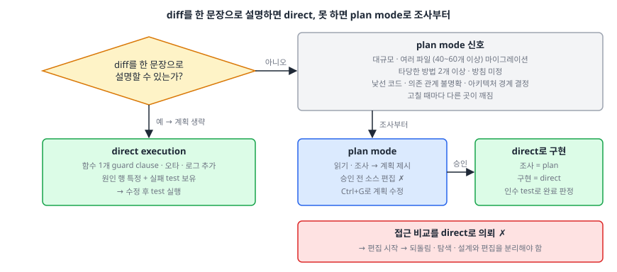
*그림: diff를 한 문장으로 설명하면 direct로 바로 수정하고, 못 하면 plan mode로 조사한 뒤 승인 후 direct로 구현한다.*

근거: CCAR-F-Amey-Thakur-0041, CCAR-F-MyPractice-0032, CCAR-F-MyPractice-0034, CCAR-F-Udemy01-0015, CCAR-F-Udemy01-0057, CCAR-F-Udemy02-0004, CCAR-F-Udemy03-0005, CCAR-F-Udemy03-0009, CCAR-F-Udemy03-0011, CCAR-F-Udemy04-0050, CCAR-F-Udemy05-0055, CCAR-F-Udemy06-0012, CCAR-F-Udemy06-0057, CCAR-F-paullarionov-0032, CCAR-F-paullarionov-0034, CCAR-F-preporato-0020

### plan mode 운용과 권한 모드
**조사는 plan · 승인 뒤 direct로 전환**

| 구분 | 내용 |
|---|---|
| 성격 | 접근 방식을 사람이 검토하는 관문 모든 작업에 쓰는 것 ✗ · 위험 있을 때 |
| 동작 | 읽기 · 조사 → 계획 제시 승인 전 소스 편집 ✗ |
| Agent SDK | `permission_mode`="plan" → 탐색 · 계획만 수행 · 편집 ✗ |
| 비용 | 계획 왕복 = 오버헤드 → 소규모 작업은 생략 |
| 권장 흐름 | 조사 = plan mode → 계획 승인 → 구현 = direct |
| 계획 편집 | 승인 전 `Ctrl+G`로 계획 수정 판단 갈리는 점 명기 → 이후 논의 감소 |
| 계획 요청 구성 | 실패 fixture · 공유 제약 · 검증 명령 포함 변경 범위 한정 (예: parser + 공유 fixture) |
| 계획 승인 조건 | 구 방식 동작의 재현 방법 명시 후 승인 (예: 구 library의 retry → 새 library) |
| 관련 결함 여러 개 | 범위 · 제약 · 검증 방법을 한 요청에 묶어 plan 시작 → 인수 test로 완료 판정 (예: 각 항목 1회만 표시되는지 확인) |

| 모드 | 동작 | 적합 |
|---|---|---|
| plan mode | 읽기 · 조사 + 계획 제시 | 방침 미정 · 영향 큼 |
| `acceptEdits` | 파일 편집 확인 생략 | 방침 확정 뒤 반복 작업 |
| `bypassPermissions` | 모든 확인 생략 | 격리 환경 무인 실행 |
| 직접 구현 | 변경 먼저 · 검토 사후 | 작고 명확한 변경 |

- 모드 선택 기준: 지금 편집을 시작해도 되는 단계인가

근거: CCAR-F-Amey-Thakur-0041, CCAR-F-Udemy01-0057, CCAR-F-Udemy02-0004, CCAR-F-Udemy03-0005, CCAR-F-Udemy03-0013, CCAR-F-Udemy04-0050, CCAR-F-Udemy05-0049, CCAR-F-Udemy05-0055, CCAR-F-Udemy06-0012, CCAR-F-Udemy06-0057

### 요구 불명확 시 인터뷰 패턴
**미확정 요건은 구현 전 인터뷰로 spec 확정**

1. 최소 prompt로 시작
2. `AskUserQuestion`으로 Claude가 인터뷰 (구현 · 엣지 케이스 · 우려 · trade-off)
3. 결과를 spec 문서(`SPEC.md`)로 정리
4. 새 session에서 구현 (인터뷰 대화 영향 ✗)

| 신호 | 판단 |
|---|---|
| 요건 미결 (무엇이 actionable? 무엇으로 검증?) | 구현 의뢰 전 인터뷰 |
| 개발자가 영역에 낯섦 (캐시 무효화 · 장애 모드 등) | 인터뷰로 설계 고려사항 발굴 |
| 과거 같은 방식 의뢰 → 고려 누락 → 재작업 | 질문으로 논점 발굴 + 합의 내용을 수락 조건으로 spec화 |
| 설계 의견 대립 | `AskUserQuestion` 선택식 질문으로 합의 |

| 구분 | 내용 |
|---|---|
| 미결 요건 두고 의뢰 | Claude가 그럴듯한 전제로 빈틈 메움 → 큰 재작업 |
| 계획 · 보수적 구현 · test 주도 | 요건 명확이 전제 → 요건 부족 자체는 못 메움 |
| subagent | `AskUserQuestion` 사용 ✗ |
| 판별 질문 | 논점을 끌어내는 대화가 있는가 |

근거: CCAR-F-Udemy02-0019, CCAR-F-Udemy03-0006, CCAR-F-Udemy03-0011, CCAR-F-Udemy05-0042

### 예시 · test case로 요구 전달
**글 설명이 흔들리면 입출력 예시 · test case**

| 증상 | 조치 | 이유 |
|---|---|---|
| 글 요구를 매번 다르게 해석 (중첩 · timestamp · 단위 · 소수 자릿수) | 구체적 입출력 예시 2~3개 | 기대 변환을 직접 제시 → 모호함 제거 |
| 글 수정 2~3회 → 다른 엣지 케이스가 깨짐 | 입력 + 기대 출력 test case | 기대값 유일 전달 + 회귀 test |
| 설명 2회 → 다른 데이터에 같은 오류 | 구체적 test case (예: null 처리) | 원인 = 검증 수단 부재 설명 추가 ✗ |
| 제안이 기존 것과 중복 (test 제안 10개 중 6개) | 기존 test 파일을 context에 포함 | 있는 것을 알아야 회피 가능 |

| 구분 | 내용 |
|---|---|
| 예시 보존 | 입출력 예시 → test case로 저장 → 수정 후 기존 케이스 깨짐 확인 |
| 패턴 누적 | 발견된 엣지 케이스마다 test 추가 (null · 연호 · 미입력 · 전각 숫자) |
| 자가 검증 | Claude가 직접 실행해 합격 확인할 check 제공 → 작업 · 확인 · 수정 loop 자력 반복 |
| 증상 해석 | 같은 오류 잔존 = 수정 정확성 확인 못 하고 종료 |
| 구분 기준 | 요건 확정 · 전달 방식만 문제 → 예시 |

근거: CCAR-F-MyPractice-0024, CCAR-F-MyPractice-0031, CCAR-F-Udemy04-0035, CCAR-F-Udemy04-0058, CCAR-F-Udemy06-0025, CCAR-F-Udemy06-0044, CCAR-F-paullarionov-0024, CCAR-F-paullarionov-0031

### 테스트 주도 반복과 요청 묶기
**test가 구현보다 먼저 · 연관 문제는 한 요청에**

| 구분 | 내용 |
|---|---|
| 테스트 선행 | suite 먼저 작성 → 실패를 공유하며 단계적 개선 |
| test 포함 항목 | 기대 동작 · 엣지 케이스 · 성능 요건 |
| 구현 + test 동시 의뢰 | test가 구현 분기만 추종 → 경계 조건 누락 (날짜 경계 · 상한 횟수) |
| 구현 후 커버리지 목표 · 일괄 의뢰 | test가 구현을 뒤따름 ✗ |
| 버그 발견 시 | 재현 test 먼저 추가 → 수정 → 재발 방지 |
| 판별 기준 | test가 구현보다 먼저 요건을 정하는가 |

| 문제 관계 | 요청 방식 |
|---|---|
| 상호 영향 (한쪽 수정 → 다른 기대값 변경) | 단일 상세 메시지로 함께 |
| 독립 (CSV 열 순서 · 오타) | 순서대로 반복 |
| 상호 영향 문제를 함께 요청 | 기대 결과를 test case로 첨부 |

근거: CCAR-F-Udemy05-0005, CCAR-F-Udemy05-0048

### AI 작업물 merge 전 검증
**완료 보고는 주장 · 증거는 실행 · 검사 · 대조 · 스캔**

| 요소 | 확인 내용 |
|---|---|
| 실행 | test 실제 실행 (실행 안 한 test = 증명 ✗) |
| 검사 | 사람이 결과를 읽음 |
| 대조 | 보고한 주장 = 실행 결과 일치 |
| secret 스캔 | diff · fixture · 붙여넣은 로그에 secret ✗ |
| 의존 조건 | test가 수정 사항을 다룸 스캔이 키 형식을 인식 |

| 작업 | 필요한 증거 |
|---|---|
| 수정 완료 보고 (예: auth 모듈 "fixed") | 4요소 전부 |
| 리팩터링 후 "all green" | 수정 전 red 로그 + 수정 후 green 로그 → PR에 첨부 |
| AI가 작성한 unit test | 실행 + 결과 검사 + secret 확인 (fixture = 유출 경로) |
| AI가 작성한 DB migration | diff 검토 · staging 실행 결과 점검 · secret 확인 → 기준 충족 |
| AI 작성 postmortem · 사고 요약 | 기술적 주장 검증 + secret 점검 |
| test 불가 작업 (repo 구조 요약) | 인용한 파일 경로 + 동작 주장은 실행한 예제 |
| 부정 주장 (예: "재시도 로직 없음") | 파일 경로 + 실행 예제 파일 집합이 완전해야 함 |

| 원칙 | 내용 |
|---|---|
| 책임 | AI는 속도 활용 · 정확성 책임 = 엔지니어 |
| "AI가 썼다" | 검토됨 ✗ · 검증 = 사람의 일 |
| 약한 suite의 통과 | 검증 아님 |
| 미검증 요약에 따른 대응 | 엉뚱한 방향 (예: 잘못된 서비스 지목) |
| 모델 자기 보고 | 검증 ✗ |

| flaky test 단계 | 내용 |
|---|---|
| 1 증거 | 실패 증거 먼저 수집 |
| 2 진단 | 원인 진단 |
| 3 수정 | test 강도 유지 (assertion 삭제 ✗) |
| 4 검증 | 반복 실행으로 수정 확인 |

근거: CCAR-P-jrajath94-0061, CCAR-P-jrajath94-0266, CCAR-P-jrajath94-0267, CCAR-P-jrajath94-0270, CCAR-P-jrajath94-0273, CCAR-P-jrajath94-0329, CCAR-P-jrajath94-0393, CCAR-P-jrajath94-0456, CCAR-P-jrajath94-0519, CCAR-P-jrajath94-0582

### 증거 게이트 설계와 비례 적용
**merge를 게이트 · 강도는 실패 비용에 비례**

| 구분 | 내용 |
|---|---|
| revert 비율 상승 | 원인 = 검증 안 된 주장 → 증거 기준으로 merge 게이트 |
| 게이트 구성 | hook이 매 편집마다 실제 suite 실행 로그 요건 · 주장 확인 · secret 스캔 |
| 전제 | hook = 실제 suite 실행 리뷰어 = 로그를 실제로 읽음 |
| 비용 논리 (문항 예시) | revert 9건 × $600 = $5,400/월 게이트 후 1건 → $600 → 절감 $4,800 |
| 한계 | 에이전트가 무검증 test로 gate 우회 가능 → red-before-green 계속 필수 |
| red-before-green | 한 번도 실패 안 한 test = 증명 ✗ 수정 전 red 실행 → test가 버그를 본다는 증명 |
| red 재현 비용 | agent 루프 1회 추가 · 재현 어려운 버그 존재 그래도 재현 = 신뢰의 대가 |

| 비례 원칙 | 내용 |
|---|---|
| gate 비용 > revert 비용 | gate 생략 (예: 주석 오타 = revert 10초 vs gate 20분) |
| 영향 범위가 사소하지 않은 변경 | gate가 더 저렴한 경로 |
| 사소함 판단 | 정직하게 분류 로직 건드리는 "오타" = 사소 ✗ |
| 오분류 | 필요한 gate 우회 |
| trade-off | 모든 편집에 10분 suite = 흐름에 세금 → 변경 무게에 맞춤 |

근거: CCAR-P-jrajath94-0266, CCAR-P-jrajath94-0267, CCAR-P-jrajath94-0268, CCAR-P-jrajath94-0272

### session 이어가기 · fork · rewind
**특정 = resume · 최근 = continue · 분기 = fork**

| 방법 | 동작 | 용도 |
|---|---|---|
| `--continue` | 디렉터리 내 최신 대화 이어감 | 가장 최근 대화 |
| `--resume` + session ID | 지정한 대화 재개 | 특정 과거 대화 |
| fork | 원래 이력 복사 → 새 ID 원본 ID · 이력 불변 | 같은 기준점에서 분기 |

| 요건 | 정답 |
|---|---|
| 특정 과거 대화 + 터미널 + 첫 후속 prompt | `claude -p "<prompt>" --resume "$session_id"` |
| 같은 baseline에서 전략 2개 비교 추론 혼입 ✗ · 원본 보존 | fork 2개 → 각각 독립 재개 |
| 일반 재개 · continue | 같은 대화에 추가 → 혼입 · 원본 덮어쓰기 불가피 |
| 폴더 복제 | ✗ session은 작업 디렉터리 대응 `~/.claude/projects` 아래 저장 |
| fork의 한계 | 분리 = 대화 이력 · 파일 ✗ 파일 편집 시 별도 작업 트리 · checkpoint 병용 |

| 되돌릴 대상 | 수단 |
|---|---|
| Claude가 편집한 파일 | rewind (session이 유지하는 checkpoint 범위 내) |
| Bash 명령으로만 바뀐 파일 | rewind 추적 ✗ → 버전 관리로 되돌림 |
| 두 종류 모두 | rewind + 버전 관리 병용 |
| rewind 성격 | 사후 복구 수단 · 사전 차단 ✗ |

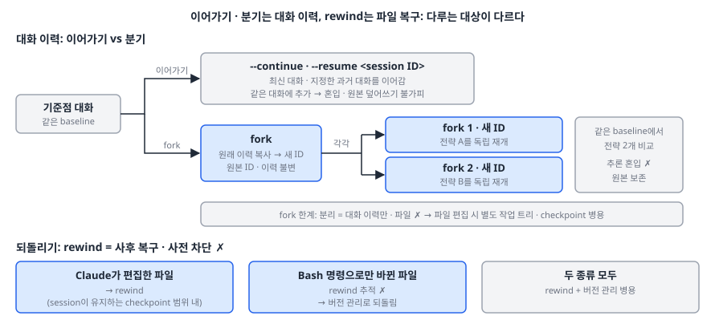
*그림: 이어가기는 같은 대화에 추가, fork는 새 ID로 분기, rewind는 Claude가 편집한 파일만 복구하며 Bash 변경은 버전 관리로 되돌린다.*

근거: CCAR-F-Udemy01-0051, CCAR-F-Udemy03-0001, CCAR-F-Udemy06-0057, CCAR-P-jrajath94-0709

### 운영 agent 지연 · 유실 · 추적
**지연은 context 먼저 · 유실은 checkpoint + trace**

| 증상 | 조치 |
|---|---|
| p95 지연 급증 | runbook 순서 context 크기 → 의존성 지연 → 캐시 적중률 |
| 프롬프트 변경으로 평균 context 12,000 → 90,000 토큰 | context 축소 = 근본 원인 수정 (전체 이력 → 최근 N건) |
| 하루 지나며 느려짐 (아침 정상) | context · 의존성 조사 (하루에 걸친 증가 = 전형 패턴) |
| 축소 시 주의 | 후속 단계 필요 항목 유지 context 크기 경보를 runbook에 추가 |
| 모델 업그레이드 · 로그 증설 · reviewer 추가 | 근본 원인 ✗ (대리 수정) |

| 유실된 실행 | 내용 |
|---|---|
| 필요한 아티팩트 | checkpoint (재개 지점) trace (완료 단계 · 출력) |
| 재개 vs 재시작 | 재시작 = 부수 효과 중복 가능 → 재개 |
| 재시작 허용 | 실행이 idempotent · 저렴 + checkpoint 없음 |
| 더 큰 context window | 유실된 실행 기록 없음 → 복구 ✗ |
| 조건 | checkpoint = plan 상태 포함 trace = 처음부터 끝까지 재구성 가능 |
| 비용 | checkpoint = handoff마다 비용 trace = 보존 필요 |

| 관측성 | 내용 |
|---|---|
| 증상 | tool call ↔ 사용자 요청 재구성에 몇 시간 (request ID 없음 · 자유 텍스트 tool 결과) |
| 투자 | 전파되는 request ID + 구조화된 tool I/O |
| 이유 | 진단 = 상관관계 파악 ID 없는 로그 증가 = 건초 더미 증가 |

근거: CCAR-P-jrajath94-0105, CCAR-P-jrajath94-0274, CCAR-P-jrajath94-0278, CCAR-P-jrajath94-0520

### 내장 검색 도구 Glob · Grep · Read
**이름 단서 = Glob · 내용 단서 = Grep**

| 도구 | 검색 기준 | 용도 |
|---|---|---|
| `Glob` | 파일 이름 패턴 | 이름으로 파일 찾기 |
| `Grep` | 파일 안의 줄 (ripgrep 기반) | 코드 속 문자열 · 참조 찾기 |
| `Read` | 지정한 파일 | 알려진 파일 읽기 횡단 검색 ✗ |

| `Grep` 파라미터 | 역할 |
|---|---|
| `pattern` | 찾을 문자열 |
| `glob` | 파일 범위 한정 (예: `**/*.ts`) |
| `output_mode` = `files_with_matches` | 기본값 · 경로만 |
| `output_mode` = `content` | 일치 행 + 파일명 + 행 번호 |
| `output_mode` = `count` | 건수 |

| 요건 | 구성 |
|---|---|
| 이름에 없는 필드명을 쓰는 파일 탐색 | `Grep` (내용 검색) |
| 함수 참조 전부 + TypeScript만 + 바로 점프 | `pattern` = 함수명 `glob` = `**/*.ts` `output_mode` = `content` (행 번호) |
| 판별 기준 | `glob` = 어디를 찾나 `output_mode` = 무엇을 돌려받나 |

| 구분 | 내용 |
|---|---|
| 기본 도구 세트 | macOS · Linux · WSL = Glob · Grep 기본 제외 → Bash `find` · `grep`으로 검색 (Windows는 기본 포함 · 문항은 활성화 전제) |

근거: CCAR-F-Udemy01-0049, CCAR-F-Udemy03-0035

### 자동 리뷰 · skill 출력 품질 측정
**측정 단위 = 오류가 몰린 단위**

| 상황 | 조치 |
|---|---|
| 전체 채택률 높음 + 오류가 일부 필드에 집중 | 필드 단위 confidence 출력 → 라벨 달린 검증 예시로 정확도 대응 확인 → 임계값 calibration 후 리뷰 축소 |
| 일부 분류의 오탐 많음 → 개발자가 리뷰 전체 무시 · mute | 분류별 precision · recall 측정 → 노이즈 큰 검사 좁히기 · 일시 중지 |
| 오탐 원인이 알려진 패턴 (plugin entry point · reflection 참조) | 제외 대상으로 명시 → 재발 방지 |

| 구분 | 내용 |
|---|---|
| 성공 기준 | 구체적 · 측정 가능 |
| 평가 데이터 | 실제 작업을 반영한 test case |
| 집계값 (전체 채택률 · 단일 점수) | 편향을 평균에 묻음 → 문제 소재 은폐 |
| 판별 기준 | 측정 단위 = 문제 단위 |

근거: CCAR-F-Udemy03-0033, CCAR-F-Udemy03-0049

### API 운영 설정 key · workspace · 버전 이행
**유출 범위 분리 · 환경별 workspace · 제거 파라미터 삭제**

| 구분 | 내용 |
|---|---|
| 문제 | key 1개를 모든 환경 · CI job이 공유 → 유출 시 추적 ✗ |
| 범위 한정 | 유출된 key가 할 수 있는 일 제한 |
| 환경별 key | 피해가 미치는 곳 제한 + 추적성 확보 |
| 교체 · 폐기 | 유출이 의미 있는 기간 제한 |
| 요건 | blast radius 축소 + 사용 내역 추적 |

| 요건 | 조치 |
|---|---|
| 개발 · 프로덕션 별도 rate limit + 비용 보고서 | 환경마다 workspace 분리 (요청은 정확히 1 workspace에서 실행) |
| Default Workspace | 이름 변경 ✗ → 새 workspace 생성 |

| 증상 | 조치 |
|---|---|
| API 버전 이행 후 모든 요청 400 (`temperature` 전송) | 제거된 파라미터 삭제 + release 전 test gate 통과 |
| API 버전 기준 | 공식 문서: API version `2026-10-21`부터 `temperature` · `top_p` · `top_k` 전송 → 400 |

근거: CCAR-P-jrajath94-0104, CCAR-P-jrajath94-0698, CCAR-P-jrajath94-0700

### CI PR 리뷰 설계
**리뷰는 수정 session과 분리 · 이전 결과는 context로**

| 리뷰 독립성 | 내용 |
|---|---|
| 자기 리뷰 | 코드를 생성한 같은 session = 독립 리뷰보다 효과 낮음 (`--continue` · `--resume` = 같은 대화 이어감) |
| 독립 리뷰 | `--continue` 없는 별도 `claude -p` 실행 또는 새 context의 subagent |
| 효과 | 수정 시 추론 없이 diff 평가 → 편향 제거 |
| 리뷰 job 입력 | diff + `CLAUDE.md`(리뷰 기준)만 |
| 작성자 무관 | Claude 작성 PR도 사람 PR과 같은 리뷰 workflow |
| 이상 신호 | 사람 PR 대비 Claude PR 지적률 극단적으로 낮음 + merge 후 결함이 Claude 변경에 집중 |
| 판별 질문 | 리뷰하는 context에 수정 시 대화가 남아 있는지 확인 |

| 재리뷰 중복 | 내용 |
|---|---|
| 증상 | push 후 재리뷰가 이미 고친 코드에 같은 코멘트 반복 |
| 해법 | 이전 리뷰 결과를 context에 포함 + "새 문제 · 미해결 문제만 보고" 지시 |
| 효과 | Claude가 해결된 문제와 새 문제 구분 → 철저함 유지 |
| 관리형 Code Review | `@claude review once` = 단발 리뷰 `@claude review always` = push마다 리뷰 구독 |
| `REVIEW.md` | 리뷰 전용 지시 (심각도 정의 · 지적 건수 상한 · skip 규칙 · 이미 리뷰된 PR 동작) |
| 관리형 재리뷰 중복 | `REVIEW.md`에 "과거 지적 고려, 새 · 미해소만 보고" 기재 |
| ⚠️ `REVIEW.md` 재리뷰 지시 | 해설 기준 · 공식 customize 문서에 해당 항목 ✗ (공식: 이후 리뷰는 변경분 중심 · 답글 반영) → 검증 필요 (공식 문서 미확인) |
| 기동 방식 변경 | `review always` · Checks 재실행 · 수작업 close = 리뷰 내용 불변 → 중복 원인 그대로 |

| PR 리뷰 봇 | 내용 |
|---|---|
| 범위 | 기계적 검사 한정 (테스트 존재 · 스타일 · 명백한 버그) 문서화된 팀 규칙 기준 |
| 출력 | 리뷰 코멘트 게시 → 결정권 = 사람 |
| 권한 | merge 금지 · 승인 = 사람 → 자율 승인 방지 |
| 효과 | 리뷰어 = 설계에 집중 · 기계적 항목 지연 감소 |

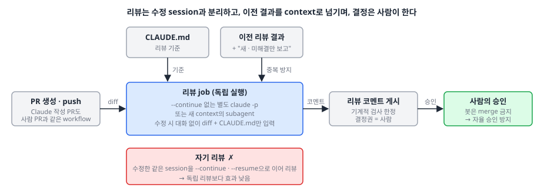
*그림: CI 리뷰는 수정 session과 분리된 job이 diff와 리뷰 기준·이전 결과로 코멘트만 게시하고 승인은 사람이 한다.*

근거: CCAR-F-MyPractice-0025, CCAR-F-Udemy02-0025, CCAR-F-Udemy04-0051, CCAR-F-Udemy06-0058, CCAR-F-paullarionov-0025, CCAR-P-jrajath94-0062

### CI 테스트 생성 품질
**diff만 주지 말고 기존 테스트 · 규약을 보여준다**

| 구분 | 내용 |
|---|---|
| 증상 | 기존 테스트와 같은 시나리오 반복 `conftest.py` fixture와 같은 helper 재정의 |
| 원인 | job이 diff만 전달 → 기존 테스트 · fixture 존재 모름 |
| 해법 ① | 대상 모듈 기존 테스트 + `conftest.py` 읽기 → 기존 시나리오 제외 |
| 해법 ② | 테스트 표준 · 좋은 테스트 기준 · 사용 가능 fixture → 저장소 `CLAUDE.md`에 커밋 |
| `CLAUDE.md` 역할 | CI의 Claude Code에 프로젝트 context 전달 (테스트 표준 · fixture 규약 · 리뷰 기준) |
| 개인정보 | 규약에 "개인 식별 값은 fixture 외 사용 금지" 명시 + PR 리뷰에서 확인 → 이중 방어 |
| 전달 정보 기준 | 중복 판단에 도움 + 양 적절 |
| 전제 | `CLAUDE.md`가 실제 로드될 때만 효과 (`--bare` 주의) |

근거: CCAR-F-Udemy04-0001, CCAR-F-Udemy05-0007, CCAR-F-Udemy06-0033

### 팀 도입 · 표준화 (enablement)
**공유 기준선 = 저장소에 커밋 + 코드처럼 리뷰**

| 상황 | 정답 방향 |
|---|---|
| 팀별 구성 어긋남 · 신규 입사자 적응 지연 | 공유 기준선 제공 → 팀별 규칙은 그 위에 추가 |
| 기준선 구성 | 버전 관리되는 팀 구성 공통 skills · commands 온보딩 경로 |
| 여러 저장소 일관 활용 | 각 저장소에 project memory + 공유 skills 커밋 → 코드처럼 리뷰 |
| 파트너 팀 도입 | 기준선 구성과 동일 → 일회성 인수인계 ✗ |
| 지속 원리 | 관례가 저장소 안에 있고 작업과 함께 리뷰될 때 유지 |
| 정책 문서 · 교육 | 시간이 지나면 희미해짐 |

근거: CCAR-P-Amey-Thakur-0010, CCAR-P-Amey-Thakur-0033, CCAR-P-Amey-Thakur-0049, CCAR-P-Amey-Thakur-0065

### 성과 · 생산성 · 비용 측정
**활동량이 아니라 성과 · 살아남은 작업을 측정**

| 대상 | 정답 지표 |
|---|---|
| enablement · 라이선스 가치 | 도입 목적이었던 전달 성과의 변화 |
| 에이전트 생산성 ① | 증거 게이트 이후 에이전트 PR의 revert 비율 = merge된 작업의 생존 |
| 에이전트 생산성 ② | 검사된 결과가 담긴 실행 로그 포함 PR 비율 = 증거 규율 |
| 사용량 지표 = 이익 ✗ | 교육 인원 · 온보딩 수 · 라이선스 활용률 도구 호출량 · 사용 시간 |
| 활동 지표 = 생산성 ✗ | 생성 코드 줄 수 = 물량 지표 함정 개발자별 토큰 = 비용 귀속 지표 에이전트 실행 시간 = 런타임 지표 |
| revert 비율 한계 | 느림 · revert 원인 라벨링 필요 (에이전트 잘못 / 사람 잘못 분리) |
| 로그 비율 한계 | 빈 로그로도 좋아 보임 → red-before-green 증명 병행 |

| 비용 통제 | 내용 |
|---|---|
| 지출 가드레일 | 작업별로 저렴한 모델 라우팅 + 월간 지출 수치에 담당자 지정 · 검토 |
| 비용 통제 오해 | AI 덜 쓰기 ✗ → 충분한 성능의 가장 저렴한 모델로 라우팅 + 총액 감시 |
| 담당자 있는 수치 | 깜짝 청구 → 감시 대상 편차로 전환 |
| 전제 | 작업-모델 매핑 정의 · 유지 필요 잘못된 매핑 = 어려운 작업이 약한 모델로 → 품질 하한선 보존 |

근거: CCAR-P-Amey-Thakur-0034, CCAR-P-Amey-Thakur-0079, CCAR-P-jrajath94-0263, CCAR-P-jrajath94-0271

### 운영 런북 · 증상별 점검 순서
**추측 대신 증상 → 용의 대상 순서로 점검**

| 증상 | 점검 순서 |
|---|---|
| tool 호출 실패 (코드 불변 · 권한 변경 · 마이그레이션 후) | 자격 증명 · 토큰 만료 → 권한 (서비스 ID scope) → 스로틀링 (할당량) → tool 계약 |
| 비용 급증 (품질 · 지연 불변 · 배포 없음) | ① 라우팅: 저렴한 작업이 비싼 모델로 가는지 ② 컨텍스트: 호출마다 과대 · 중복 ③ 캐싱: 적중률 하락 |
| 품질 저하 (프롬프트 불변 · 코드 불변) | 맵 순서 = 프롬프트 → 모델 → retrieval drift 알려진 변경 계층부터 (예: reindex → retrieval) eval 재실행 → 하락 실재 · 위치 확인 |

| 점검 원칙 | 내용 |
|---|---|
| 원인 규명 먼저 | 원인 확인 전 절감 ✗ 품질 하한선 아래로 감축 ✗ |
| 코드 불변 | 원인은 코드 바깥 (자격 증명 · 권한 · 스로틀링 · 계약) |
| 점검 신호 | 인증 로그 = 토큰 만료 제공자 헤더 = 스로틀링 reindex 전후 eval 분할 = retrieval |
| 비용 사전 계측 | tier별 · 단계별 비용 내역 + 작업별 귀속 없으면 누수가 합계에 숨음 |

| 런북 | 내용 |
|---|---|
| 필수 요소 | 순서 정해진 증상-용의 대상 점검 (맵) 지정 담당자 + escalation 경로 |
| 본질 | 담당자 있는 절차 → 영웅 의존 종료 담당자 없는 문서 = wiki 페이지 |
| 새로운 실패 (일치 항목 없음) | 설계자 호출 → 조사 장애 후 리뷰에서 새 항목으로 런북 갱신 |
| 유지보수 | 장애마다 갱신 장애 리뷰 = 유지보수 계약 (산출물 = 런북 수정) |
| 낡음 | 런북은 ADR처럼 낡음 → 시스템 변경 후 방치 시 오도 |
| 한계 | 런북 = 알려진 실패만 다룸 새 실패는 사람이 조사 → 이후 런북 성장 |

근거: CCAR-P-jrajath94-0275, CCAR-P-jrajath94-0276, CCAR-P-jrajath94-0277, CCAR-P-jrajath94-0279, CCAR-P-jrajath94-0280, CCAR-P-jrajath94-0281, CCAR-P-jrajath94-0330, CCAR-P-jrajath94-0394, CCAR-P-jrajath94-0457, CCAR-P-jrajath94-0583

### 에이전트 구성 배포 (canary · rollback)
**구성 변경도 canary로 검증 · 한 명령으로 복구**

| 구분 | 내용 |
|---|---|
| 증상 | 배포 후 agent가 오래된 지시 사용 이름 바뀐 tool에서 루프 (`CLAUDE.md` · MCP 서버 구성 변경 직후) |
| 요건 | 전체 롤아웃 전 검증 + 문제 시 빠른 복구 |
| canary | 새 `CLAUDE.md` · MCP 구성을 소규모 그룹에 먼저 롤아웃 |
| smoke test | 좋은 출력이 있는 샘플 작업 실행 → 실패 시 배포 자동 중단 |
| rollback | 이전 구성 유지 → 한 번의 명령으로 복구 |
| changelog | 구성 changelog 필수 → fleet 행동 감사 가능 |

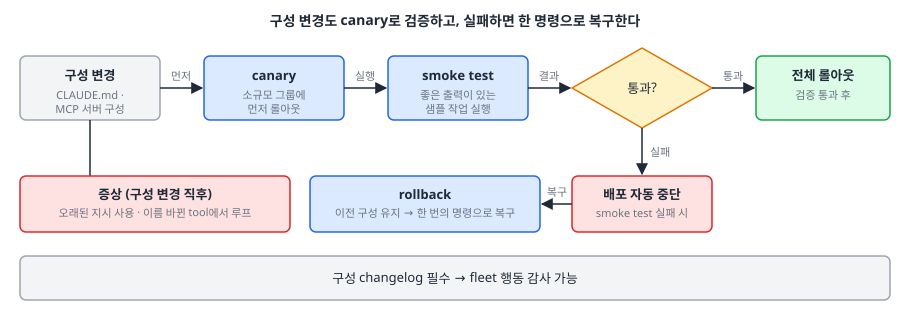
*그림: 구성 변경도 canary와 smoke test로 검증하고, 실패하면 배포를 중단해 이전 구성으로 한 번의 명령에 복구한다.*

근거: CCAR-P-jrajath94-0064

## 2. 상황별 정답 판단 규칙

| 상황 | 정답 |
|---|---|
| CI · 스크립트 무인 실행 + 출력 파싱 | `claude -p` + `--output-format json` (+ schema) |
| CI에서 확인 프롬프트 없이 필요 도구만 실행 | `--allowedTools` 사전 허용 필요 시 `--permission-mode dontAsk` |
| 매 세션 같은 빌드 명령 · 규약 재설명 | 저장소 루트 `CLAUDE.md` + 커밋 |
| 팀 공통 권한 · hooks · plugins 배포 | `.claude/settings.json` 커밋 |
| 팀 영향 없이 내 머신만 허용 추가 | `.claude/settings.local.json` |
| 모든 프로젝트 공통 개인 취향 | `~/.claude/settings.json` |
| "확실히, 매번, 모델 판단 없이" | hooks (프롬프트 · `CLAUDE.md` · subagent ✗) |
| "실행 전에" 차단 | `PreToolUse` + `deny` 또는 exit 2 |
| 성공한 변경 전부 기록 | `PostToolUse`(matcher `Edit\|Write`) |
| 실패한 호출만 기록 · 알림 | `PostToolUseFailure` |
| 가끔 필요한 긴 절차 · 참고 자료 | skill (`CLAUDE.md`는 매번 필요한 것만) |
| 대량 탐색으로 부모 컨텍스트 오염 방지 | subagent (독립 컨텍스트 → 요약 반환) |
| 팀 plugin 운영 | project scope 공유 + 버전 고정 + 의도적 업데이트 |
| 저장소 전체 규칙 · 팀 컨벤션 | commit한 프로젝트 `CLAUDE.md` |
| 모든 프로젝트 공통 개인 선호 | `~/.claude/CLAUDE.md` |
| 이 프로젝트 한정 개인 설정 | `CLAUDE.local.md` + `.gitignore` |
| 특정 디렉터리 한정 규약 | 그 디렉터리 `CLAUDE.md` |
| 여러 디렉터리에 흩어진 같은 종류 파일 규약 | `.claude/rules/*.md` + `paths` glob |
| 공통 표준 1곳 + 패키지별 선택 | 루트 공통 + 패키지 `CLAUDE.md`에서 `@import` |
| context 소비를 줄이는 것이 목표 | `paths` rule로 이동 + 원본 삭제 (`@import`로는 로드량 불변) |
| 상시 규약 vs 가끔 쓰는 절차 | 상시 = `CLAUDE.md` · 가끔 = skill |
| `CLAUDE.md` 비대 · merge 충돌 | 주제별 rule 분할 + 루트 최소화 |
| 지시가 안 지켜지는 것 같음 | 변경 전 `/context` Memory files · 시작 위치 확인 |
| 모든 clone에 팀 deny 강제 | commit한 공유 settings의 deny |
| 팀 규칙 약화 없는 개인 예외 | `.claude/settings.local.json` + 사유 · 기간 기록 |
| 조직 전체 · 신규 repo 자동 · 개발자 변경 불가 | managed settings (MDM 배포) |
| 팀 워크플로 hook (편집마다 lint) | commit한 `.claude/settings.json` |
| 권한 요청 피로 | 안전 allow · 위험 deny · 회색만 ask |
| CI에서 프로젝트 지침 전달 | commit한 `CLAUDE.md` (`--bare`면 명시 전달) |
| 공유 MCP 서버 + 토큰 유출 | 공유 config에 1회 선언 · 토큰 채팅 ✗ |
| 전사 동일 skill + subagent 배포 | plugin 패키징 또는 managed settings |
| 보호 대상 없는 개인 repo | 가벼운 `CLAUDE.md` 지침 |
| 팀 전체가 호출하는 반복 검토 절차 | commit한 custom command · skill |
| clone한 모두에게 `/review` 제공 | 저장소 `.claude/commands/` + commit |
| 개인 홈 command를 팀원도 사용 | `.claude/commands/`로 이동 + commit |
| 개인 변형으로 팀 skill 대체 · 팀원 영향 ✗ | `~/.claude/skills/<같은 이름>/SKILL.md` |
| 팀 skill 가리지 않기 · 팀 업데이트 수신 | `~/.claude/skills/` 다른 이름 |
| 대용량 출력 · 탐색 context가 메인 오염 | skill `context: fork` |
| 인수 누락 방지 | `argument-hint` + 본문 `$0` · `$1` |
| "확인 없이 쓰게" | `allowed-tools` (사전 승인) |
| "쓸 수 없게" | `disallowed-tools` 또는 permissions deny |
| 부작용 skill 자동 실행 방지 | `disable-model-invocation: true` |
| 항상 적용 + workflow별 지침 혼재 `CLAUDE.md` | 항상 = `CLAUDE.md` workflow별 = trigger 키워드 skill |
| 필수 순서 · 경계 · 금지 | `PreToolUse` gate (+ 상태 변경 전용 tool) |
| 테스트 통과 전 작업 종료 금지 | `Stop` hook + stderr + exit 2 |
| 쓰기 후 팀 전체 포맷 | `PostToolUse` `Edit\|Write` + commit된 설정 |
| Bash 결과만 짧게 정규화 | `PostToolUse` + `updatedToolOutput` (성공 시만) |
| hook 로드 확인 (파일 변경 ✗) | `/hooks` |
| research subagent 쓰기 금지 | `tools: Read, Grep` |
| 조사 context 보호 + 편집 차단 | Explore subagent |
| 조사 → 구현 다단계 | Explore 요약 + plan mode → 승인 후 직접 실행 |
| 범용 `/investigate` | coordinator 위임 판단 위임 지시 = 목적 · 증거 · 형식 · 경계 |
| secret commit 방지 | pre-commit 스캔 hook · fail closed |
| 대규모 · 여러 파일 · 복수 접근법 · 아키텍처 결정 | plan mode 조사 · 계획 → 승인 후 구현 |
| 접근 방식 비교가 목적 | plan mode (비교 전 편집 차단) |
| 함수 1개 수정 · 오타 · 원인 특정 + 실패 test | direct execution |
| diff를 한 문장으로 설명 가능 | 계획 생략 |
| 설계 의견 대립 + 담당자가 코드에 낯섦 | plan mode + `AskUserQuestion` |
| 요건 미결 · 낯선 영역 · 과거 고려 누락 | 인터뷰 → spec → 새 session 구현 |
| 글 설명을 매번 다르게 해석 | 입출력 예시 2~3개 |
| 수정 반복해도 엣지 케이스가 깨짐 | 입력 + 기대 출력 test case |
| 같은 오류가 다른 데이터에서 반복 | Claude가 실행할 검증 수단(test) 제공 |
| 자동 리뷰 제안이 기존 test와 중복 | 기존 test 파일을 context에 포함 |
| 구현 + test 동시 의뢰 → 경계 조건 누락 | test 선행 (동작 · 엣지 · 성능) |
| 상호 영향 문제 vs 독립 문제 | 단일 상세 메시지 vs 순차 반복 |
| 여러 곳에 걸친 관련 결함 | plan mode + 인수 test |
| "fixed" 보고 후 merge 직전 | 실행 · 검사 · 대조 · secret 스캔 |
| "all green"의 신뢰 근거 | 수정 전 red → 수정 후 green 로그 |
| test 불가 작업의 증거 | 인용한 파일 경로 + 실행한 예제 |
| agent PR의 revert 증가 | 증거 기준 merge 게이트 |
| 사소한 변경 + revert 비용 < gate 비용 | gate 생략 |
| flaky test 수정 | 증거 → 진단 → 강도 유지 수정 → 반복 실행 |
| 특정 과거 대화 + 첫 후속 prompt | `claude -p "<prompt>" --resume "$session_id"` |
| 같은 baseline에서 갈래 비교 | fork |
| Bash로 바뀐 파일까지 되돌림 | rewind + 버전 관리 |
| 파일 이름 단서 vs 내용 단서 | `Glob` vs `Grep` |
| agent 지연 증가 | context 크기 → 의존성 → 캐시 순 점검 |
| 유실된 agent 실행 복구 | checkpoint + trace 재개 |
| trace 재구성에 몇 시간 | request ID 전파 + 구조화된 tool I/O |
| 전체 채택률 높은데 일부 필드 오류 | 필드별 confidence + 라벨 검증 데이터로 calibration |
| 일부 분류 오탐으로 리뷰 무시 | 분류별 precision · recall + 제외 대상 명시 |
| 공유 key 유출 | 환경별 key + 범위 한정 + 교체 · 폐기 |
| 환경별 rate limit · 비용 보고 | 환경별 workspace |
| API 버전 이행 후 400 | 제거 파라미터 삭제 + test gate |
| CI에서 `claude "..."` 실행 후 job 멈춤 | `-p`(`--print`)로 비대화형 실행 |
| CI 후속 확인 prompt 대기 | `-p` + 필요 도구 사전 승인 |
| PR 리뷰를 파이프라인이 기계 파싱 | `-p` + `--output-format json` + `--json-schema` → `structured_output` |
| PR 발견 사항을 inline 코멘트로 자동 게시 | json + schema로 필드 강제 → 파싱 → GitHub API |
| 실행 비용 · 소요시간 기록 | `json` 출력 metadata |
| 실행 성공 · 실패 판정 | 종료 코드 확인 (0 = 성공) |
| 도구를 Read · Grep로 제한 + 실패 시 job 실패 | `--tools` + `-p` → 다음 단계에서 종료 상태 확인 |
| CI에서 `CLAUDE.md` 규약이 전혀 안 먹음 | `--bare` 사용 여부 점검 → 필요 context는 플래그로 전달 |
| headless 적합 작업 | 반복 가능 · 명세 분명 · 무인 (PR마다 도는 검사) |
| Claude 작성 코드의 리뷰 효과 낮음 | 별도 session · 새 context subagent로 리뷰 분리 |
| 재리뷰에서 중복 코멘트 | 이전 리뷰 결과 context 포함 + 새 · 미해결 문제만 보고 |
| 관리형 Code Review 재리뷰 중복 | `REVIEW.md`에 과거 지적 고려 방침 기재 |
| CI 테스트 생성의 중복 시나리오 · helper | 기존 테스트 + `conftest.py` 제공 + 저장소 `CLAUDE.md` 규약 |
| PR 리뷰 봇으로 리뷰 병목 완화 | 기계적 검사 한정 · 코멘트만 · merge 금지 |
| 팀별 Claude Code 구성 어긋남 | 공유 기준선 (버전 관리 구성 · skills · commands · 온보딩) + 팀별 규칙 |
| 여러 저장소에서 일관 활용 | 저장소 커밋 project memory + 공유 skills → 코드처럼 리뷰 |
| 도입 효과 · 라이선스 가치 측정 | 도입 목적이었던 성과의 변화 |
| 에이전트 생산성 지표 | revert 비율 + 증거 로그 포함 PR 비율 |
| 월 지출 통제 | 작업별 모델 라우팅 + 담당자 있는 월간 수치 검토 |
| 월 비용 급증 | 라우팅 → 컨텍스트 → 캐싱 순 점검 |
| tool 실패 (코드 불변 · 권한 변경 후) | 자격 증명 → 권한 → 스로틀링 → tool 계약 |
| 품질 저하 | 변경된 계층부터 프롬프트 → 모델 → retrieval drift 순 |
| 당직 런북 작성 | 순서 있는 증상-용의 대상 점검 + 담당자 · escalation |
| 런북에 없는 새 실패 | 설계자 호출 + 장애 후 런북 항목 추가 |
| 런북이 낡음 | 장애마다 갱신 · 장애 리뷰 = 유지보수 계약 |
| `CLAUDE.md` · MCP 구성 변경 배포 | canary → smoke test → 자동 중단 → 한 명령 rollback + changelog |

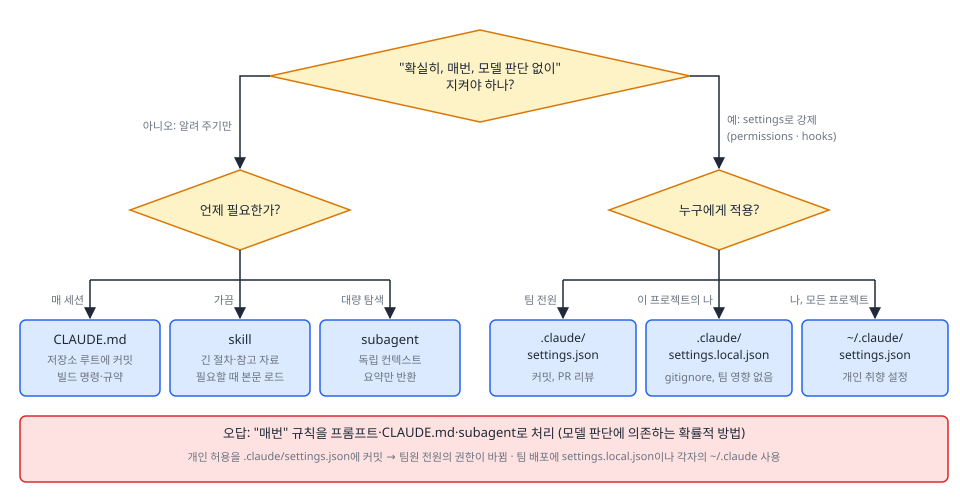
*그림: "매번, 모델 판단 없이"면 settings로 강제하고 적용 대상으로 파일을 고르며, 아니면 필요 빈도로 CLAUDE.md·skill·subagent를 고른다.*

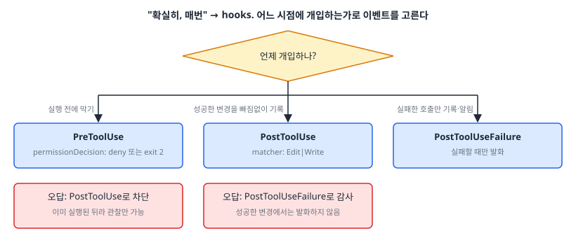
*그림: 실행 전 차단은 PreToolUse, 성공 기록은 PostToolUse, 실패만 기록은 PostToolUseFailure.*

근거: Amey-0049, CCAR-F-Amey-Thakur-0005, CCAR-F-Amey-Thakur-0006, CCAR-F-Amey-Thakur-0018, CCAR-F-Amey-Thakur-0019, CCAR-F-Amey-Thakur-0041, CCAR-F-Amey-Thakur-0042, CCAR-F-Amey-Thakur-0046, CCAR-F-Amey-Thakur-0056, CCAR-F-Amey-Thakur-0071, CCAR-F-MyPractice-0016, CCAR-F-MyPractice-0025, CCAR-F-MyPractice-0026, CCAR-F-MyPractice-0033, CCAR-F-MyPractice-0036, CCAR-F-MyPractice-0041, CCAR-F-MyPractice-0043, CCAR-F-Udemy01-0008, CCAR-F-Udemy01-0024, CCAR-F-Udemy01-0034, CCAR-F-Udemy01-0038, CCAR-F-Udemy01-0039, CCAR-F-Udemy01-0040, CCAR-F-Udemy01-0041, CCAR-F-Udemy01-0049, CCAR-F-Udemy01-0051, CCAR-F-Udemy02-0005, CCAR-F-Udemy02-0019, CCAR-F-Udemy02-0025, CCAR-F-Udemy02-0040, CCAR-F-Udemy02-0059, CCAR-F-Udemy03-0001, CCAR-F-Udemy03-0005, CCAR-F-Udemy03-0006, CCAR-F-Udemy03-0009, CCAR-F-Udemy03-0011, CCAR-F-Udemy03-0013, CCAR-F-Udemy03-0026, CCAR-F-Udemy03-0029, CCAR-F-Udemy03-0033, CCAR-F-Udemy03-0035, CCAR-F-Udemy03-0036, CCAR-F-Udemy03-0039, CCAR-F-Udemy03-0049, CCAR-F-Udemy03-0052, CCAR-F-Udemy04-0001, CCAR-F-Udemy04-0007, CCAR-F-Udemy04-0017, CCAR-F-Udemy04-0035, CCAR-F-Udemy04-0042, CCAR-F-Udemy04-0046, CCAR-F-Udemy04-0050, CCAR-F-Udemy04-0051, CCAR-F-Udemy05-0005, CCAR-F-Udemy05-0007, CCAR-F-Udemy05-0012, CCAR-F-Udemy05-0013, CCAR-F-Udemy05-0039, CCAR-F-Udemy05-0042, CCAR-F-Udemy05-0048, CCAR-F-Udemy05-0050, CCAR-F-Udemy05-0055, CCAR-F-Udemy05-0056, CCAR-F-Udemy06-0006, CCAR-F-Udemy06-0017, CCAR-F-Udemy06-0025, CCAR-F-Udemy06-0033, CCAR-F-Udemy06-0034, CCAR-F-Udemy06-0037, CCAR-F-Udemy06-0044, CCAR-F-Udemy06-0047, CCAR-F-Udemy06-0057, CCAR-F-Udemy06-0058, CCAR-F-paullarionov-0016, CCAR-F-paullarionov-0024, CCAR-F-paullarionov-0025, CCAR-F-paullarionov-0026, CCAR-F-paullarionov-0031, CCAR-F-paullarionov-0033, CCAR-F-paullarionov-0041, CCAR-F-preporato-0017, CCAR-F-preporato-0018, CCAR-F-preporato-0019, CCAR-P-Amey-Thakur-0010, CCAR-P-Amey-Thakur-0033, CCAR-P-Amey-Thakur-0034, CCAR-P-Amey-Thakur-0049, CCAR-P-Amey-Thakur-0065, CCAR-P-Amey-Thakur-0079, CCAR-P-jrajath94-0061, CCAR-P-jrajath94-0062, CCAR-P-jrajath94-0064, CCAR-P-jrajath94-0104, CCAR-P-jrajath94-0105, CCAR-P-jrajath94-0259, CCAR-P-jrajath94-0261, CCAR-P-jrajath94-0262, CCAR-P-jrajath94-0263, CCAR-P-jrajath94-0265, CCAR-P-jrajath94-0266, CCAR-P-jrajath94-0267, CCAR-P-jrajath94-0268, CCAR-P-jrajath94-0269, CCAR-P-jrajath94-0270, CCAR-P-jrajath94-0271, CCAR-P-jrajath94-0272, CCAR-P-jrajath94-0274, CCAR-P-jrajath94-0275, CCAR-P-jrajath94-0276, CCAR-P-jrajath94-0277, CCAR-P-jrajath94-0278, CCAR-P-jrajath94-0279, CCAR-P-jrajath94-0280, CCAR-P-jrajath94-0281, CCAR-P-jrajath94-0330, CCAR-P-jrajath94-0394, CCAR-P-jrajath94-0457, CCAR-P-jrajath94-0518, CCAR-P-jrajath94-0581, CCAR-P-jrajath94-0583, CCAR-P-jrajath94-0698, CCAR-P-jrajath94-0700, CCAR-P-jrajath94-0702, CCAR-P-jrajath94-0703, CCAR-P-jrajath94-0704, CCAR-P-jrajath94-0705, CCAR-P-jrajath94-0707, CCAR-P-jrajath94-0709, CCAR-P-preporato-0030, Patrick-0028, Patrick-0044, Preporato-0029, Udemy-0017, Udemy-0021, Udemy-0029, Udemy-0031, Udemy-0032, Udemy-0052

## 3. 자주 나오는 오답 함정

| 오답 | 이유 |
|---|---|
| `CLAUDE.md`에 권한 · "CI에서는 확인 없이 실행" 기재 | 문맥 → 권한 체크 반영 ✗ |
| 시스템 프롬프트로 금지 · 심사용 subagent | 모델 판단 의존 = 확률적 → 결정론적 ✗ |
| `PostToolUse`로 위험 명령 차단 | 이미 실행됨 → 차단 ✗ 관찰만 가능 |
| `PostToolUseFailure`로 감사 로그 | 성공한 변경에서 발화 ✗ |
| 개인 허용을 `.claude/settings.json`에 커밋 | 팀원 전원 권한 변경 |
| `.claude/settings.local.json` 커밋 → 팀 배포 | 개인용 파일 → 충돌 발생 · 정본 역할 ✗ |
| 팀 설정을 각자 `~/.claude/settings.json`에 수동 배포 | 버전 추적 · 리뷰 불가 |
| CI에서 대화형 모드 · 출력 파일 리다이렉트 · 화면 스크래핑 | 확인 대기로 정지 또는 비구조화 출력 |
| 프로젝트 설정 `bypassPermissions`로 확인 일괄 생략 | (해설 기준) project 설정에서 효과 ✗ 전부 무확인 = 과도 |
| `CLAUDE.md`와 skill 로드 시점 반대로 서술 | `CLAUDE.md` = 항상 로드 skill = 필요 시 로드 |
| subagent가 부모 대화 이어받는다고 서술 | fork형만 해당 |
| auto memory = 사람이 쓰는 파일 | Claude가 작성 |
| plugin auto-update로 최신판 자동 배포 | 미심사 hooks · 권한 유입 |
| plugin 설명문만 보고 심사 | 미심사 hooks · 권한 유입 |
| 팀 규약을 `~/.claude/CLAUDE.md` · `CLAUDE.local.md`에 기재 | 팀 공유 ✗ → 신규 멤버 · CI 미적용 |
| "기억할 때까지 반복 요구" · cache 삭제 · 충돌 지시 삭제 | 원인은 지침이 사용자 수준에만 존재 → 프로젝트 파일로 이동 |
| 자식 `CLAUDE.md`가 부모 덮어쓰기 · "상위보다 우선" 문구 | 파일은 연결 → 모순 잔존 → 임의 선택 |
| 개인 파일에 복사 · 요청문마다 규칙 보충 | 팀 공유 구조 ✗ |
| README 링크 · wiki · 채팅 · PR template | 작업 context로 읽히지 않음 |
| `@import`로 context 절감 | 시작 시 로드 → 소비 불변 |
| import 경로를 작업 디렉터리 기준으로 작성 · 루트에서 시작해 해결 | 포함하는 파일 위치 기준으로 해석 |
| fenced code block 안의 `@경로` | 로드 제외 |
| `paths` 없는 rule을 파일명 · 폴더로 범위 지정 | 항상 시작 시 로드 |
| `*.ext` · `dir/*.ext`로 모든 깊이 지정 | 루트 · 바로 아래만 일치 |
| `{graphql,ts}` 중괄호 확장 | `**/*.ts` 전체로 확장 → 과대 일치 |
| 디렉터리마다 `CLAUDE.md` 복제 | 유지보수 부담 · stale 공존 |
| 규약을 slash command로 | 수동 실행 의존 |
| 상시 규약을 skill에 | 미호출 session 미적용 |
| `.claude/config.yaml` 매핑 · 하위 README.md 자동 로드 | 지원 방식 아님 → `.claude/rules/` |
| `/memory`로 로드 여부 확인 | 목록 · 편집용 |
| `/status` Setting sources로 지시 파일 확인 | 설정 파일 대상 |
| `/init` 재실행 · auto memory 끄기로 진단 | 진단 전 변경 |
| 하위 `CLAUDE.md`가 `/context`에 없음 = 결함 | 온디맨드 로드의 정상 동작 |
| `CLAUDE.md` · 메모 · 굵은 글씨 · 큰 모델로 비밀 차단 | 지침 · 호출 차단 ✗ |
| 시스템 프롬프트 반복 · sandbox 도메인 제외로 명령 금지 | 모델 판단 의존 도메인 목록 = 도달 호스트만 제어 |
| 개인 user · local settings에만 팀 deny | 팀 전체 강제 ✗ |
| 공유 settings 임시 수정 후 복구 | 전원 약화 · 방치 위험 |
| 조직 협상 불가 항목을 project 기본값에 | repo 쓰기 권한자 편집 가능 |
| 중요한 모든 것을 managed에 | 협상 불가 항목만 해당 · 워크플로 선호는 우회 |
| 모든 요청 ask · 모두 allow · 모두 deny | 피로 · 통제 제거 · 우회 |
| 토큰 채팅 붙여넣기 · 개인별 MCP 서버 | 유출 · drift |
| prompt 복사 배포 · `CLAUDE.md`에 subagent 정의 | 원본 변경 시 어긋남 · 정의 불가 |
| `CLAUDE.md` · 시스템 지시로 subagent 편집 금지 | injection이 이미 뚫음 `tools` 생략 = 모든 도구 상속 |
| `model` 필드로 subagent 읽기 전용 | 도구 제어 아님 |
| subagent 전체 도구 + 감사 로그 | 편집 뒤 기록뿐 · 파일 이미 변경 |
| subagent 도구 전부 제거 | Read · Grep까지 소실 → 조사 불가 |
| subagent에 main과 같은 도구 | 프로덕션 쓰기 권한 복제 = 범위 최대 |
| 쓰기 도구 주고 "읽기만" 부탁 | 부탁 ≠ 범위 설정 |
| 조사를 권한 있는 main agent에서 수행 | 조사 루프가 쓰기 권한 보유 |
| 범용 subagent + 결과 파일 저장 | context는 보호 · 조사 중 편집 차단 ✗ |
| plan mode만 사용 | 편집은 차단 · context 보호 ✗ |
| `/compact` · 자동 압축 | 사후 대응 · 조사 출력이 메인에 남음 |
| 전체 파일을 먼저 Read | 메인 context 소모 |
| 고정된 조사 절차 | 질문별 적응성 ✗ |
| 제약 없는 폭넓은 조사 | 결과 신뢰성 ✗ |
| `PostToolUse` exit 2 = 쓰기 취소 (또는 세션 종료 · 무시) | 이미 실행됨 stderr → Claude 전달 |
| 경고 출력 + exit 0 `permissionDecision: allow` | 차단처럼 보여도 호출 계속 |
| `SessionEnd` · `UserPromptSubmit` 읽기 후 `PostToolUse`로 종료 차단 | 시점 불일치 · 종료를 막지 못함 |
| `Edit`에 `PreToolUse`로 Prettier | 수정 전 실행 → 포맷 대상 변경 전 |
| hook을 개인 `~/.claude/settings.json`에 | 설정한 개발자에게만 적용 |
| 로그만 남기는 `PreToolUse` · 사후 되돌리기 요청 | 실행 자체 차단 ✗ |
| 시스템 지시 강화 `PostToolUse` 사후 거부로 순서 강제 | 지시 = 이미 실패한 수단 사후 검사 = 변경 방지 ✗ |
| `PostToolUse` exit 2로 출력 교체 `PreToolUse`에서 stdout 재작성 | 교체는 `updatedToolOutput` `PreToolUse` = 실행 전 |
| 실패 Bash 출력까지 정규화 | 오류 상세 소실 → 잘못된 전제 |
| 모든 shell 명령을 수동 승인 큐로 | shell matcher + exit 2로 필요 검사만 자동 차단 |
| merge 후 스캔 · 분기별 grep · `CLAUDE.md` 경고 | 이력 유입 뒤 발견 · 경고 ≠ gate |
| `CLAUDE.md` 안내 줄 · `/context`로 hook 점검 | hook 시작 ✗ · 점검 수단 = `/hooks` |
| 개인 skill을 팀 skill과 같은 이름으로 + 팀 업데이트 기대 | 개인 skill이 가림 → 옛 절차 실행 |
| `override: true` frontmatter username 조건 | 해당 기능 없음 · 우선순위 = 위치 |
| 모든 지침을 skill로 + `CLAUDE.md`엔 설명만 | 항상 적용할 표준 · 테스트 규칙까지 on-demand |
| `@import` 분할 · 경로 기반 rules | `CLAUDE.md` 내용 전부 로드 경로 rules = 디버깅 · 리뷰에도 로드 |
| 예시를 prompt에 매번 복사 | 수동 반복 · skill 호출이 대안 |
| `.claude/config.json` commands 배열 | command 정의 위치 ✗ |
| README 문서화 · `.claude` VCS 제외 | 파일 공유 ✗ |
| `CLAUDE.md` 기재로 command 공유 | 명령으로 호출 ✗ |
| 단일 `.md` 파일을 `.claude/skills/`에 | skill 로드 ✗ · `<이름>/SKILL.md` 필요 |
| `disable-model-invocation`으로 출력 격리 | 자동 호출만 차단 · 수동 실행 출력 그대로 |
| `user-invocable: false`로 자동 실행 방지 | 개발자 호출만 차단 (반대 방향) |
| `argument-hint`로 자동 실행 방지 · 입력 검증 | 자동 완성 표시만 변경 |
| `allowed-tools` · `model: haiku`로 출력 격리 | 사전 승인 · 모델 변경 → 실행 위치 그대로 |
| `/fork`로 skill 격리 | 현재 대화 이력 전부 상속 |
| `/clear` · `/compact` `CLAUDE.md` 이동으로 skill 격리 | context 소실 · 사후 압축 · 상시 로드 |
| skill 분할 · 요약 지시 단독 `/explore-start` · `/explore-end` 분리 | 실행 위치 그대로 → 격리 ✗ |
| `!` 접두사 bash subprocess로 탐색 실행 | 격리 수단 = `context: fork` |
| 길이 · 작성자 경력 edge case 포괄로 skill commit 판단 | 반복 절차 · 리뷰 가능성 입증 ✗ |
| 온보딩 영상 · 시니어 버디 · 프로덕션 전체 접근 | 영상 = 낡음 · 질의 ✗ 버디 = 신입마다 시니어 비용 프로덕션 접근 = 보안 · 안정성 위험 |
| 위키 삭제 · 갱신 날짜 · 주간 이메일 | 삭제 = 지식 소실 날짜 · 이메일 = 버전 관리 ✗ · 낡음 |
| "skill이 항상 낫다" 작업 길이로 skill vs subagent 선택 | 노하우 재사용 vs context 격리가 기준 |
| 모든 작업에 plan mode | 계획 왕복 = 오버헤드 작은 수정은 직접 요청 |
| 복잡한 작업을 direct로 시작 (`acceptEdits` · `bypassPermissions` 포함) | 변경 먼저 · 검토 사후 → 되돌림 비용 |
| 편집이 시작된 뒤 `/rewind`로 대응 | 사후 복구 수단 비교 전 편집을 막지 못함 |
| `CLAUDE.md` 지시로 비교 전 편집 금지 | 확률적 준수 |
| 작은 수정에 plan mode · 인터뷰 · Explore subagent | 불확실성 큰 작업용 기법 → 과함 |
| 관련 결함을 session별 분리 · 계획 생략 | 연동된 원인 분단 범위 큰 변경이 무질서 |
| fixture별 직접 편집 + context 초기화 | 의존 관계 미확인 변경 반복 |
| 요건 미결 상태에서 직접 실행 · 자율 job · 설계서 단독 작성 | 논점 도출 대화 생략 → 추측으로 채움 |
| subagent로 인터뷰 진행 | `AskUserQuestion` 사용 ✗ |
| 글 설명 추가 · `CLAUDE.md` 규칙 추가 · 지적 반복 | 모두 글 설명 의존 → 해석 흔들림 그대로 |
| 요건 확정인데 인터뷰 · plan mode · 함수 지정 | 목적 다름 (함수 지정 = 범위 문제) |
| 구현 후 커버리지 목표 · 일괄 의뢰 | test가 구현을 뒤따름 |
| 문제를 전부 한 메시지로 · 상호 영향 문제를 따로 수정 | 독립 문제 섞임 정합성 상실 |
| 산문 보고 · 오래된 green 배지 · 작성 줄 수로 merge 판단 | 주장일 뿐 증거 ✗ 지난주 green은 이번 편집과 무관 |
| test 수 · 반복 실행 · green만으로 신뢰 | 빈 assertion 200개 = 0이 200개 |
| 확신 문구 · 긴 요약 · 열람 파일 수 · 프롬프트 스크린샷 | 포인터 ✗ · 노력 · 요청만 보여 줌 |
| flaky 수정 = assertion · test 삭제 · AI 사용 중단 | 커버리지 파괴 도구를 올바르게 쓴 것 ✗ |
| revert 증가 대응 = 모델 교체 · PR 물량 · 속도 · 도입률 | 미검증 주장(원인)에 대응 ✗ |
| 모든 변경에 gate · 오타 방치 · 주석에 회의 | 비용 불균형 (gate 절대주의) |
| 모델 자기 보고 · 문장 다듬기 · 서식 | 검증 아님 |
| 지연 → 모델 업그레이드 · 로그 증설 · reviewer 추가 | 근본 원인(context) 미해결 |
| 유실 실행 → 재시작 · 더 큰 window · 사과 | 부수 효과 중복 · 기록 없음 |
| trace 개선 = 로그 verbosity · 큰 모델 · 서술형 요약 | 상관관계 ID 없음 |
| `--continue`로 특정 대화 · prompt에 ID 붙여넣기 | `--continue` = 최근만 prompt 속 ID = 재개 지시 ✗ |
| 폴더 복제 · 일반 resume으로 전략 비교 | 혼입 · 원본 덮어쓰기 |
| `Esc` 두 번 = 전체 되돌리기 | Bash 변경은 rewind 추적 ✗ |
| fork가 파일 변경도 분리 | 대화 이력만 분리 |
| `Glob`으로 내용 검색 · commit 이력 검색 · `Read`로 훑기 | `Glob` = 이름만 commit 이력 = 현재 참조 위치 ✗ `Read` = 횡단 검색 부적합 |
| `Glob` 목록 → 전문 `Read` · `files_with_matches` 유지 | context 낭비 행 번호 · 문맥 없음 |
| 단일 품질 점수 · 파일 단위 confidence · 전체 채택률 | 편향을 평균에 묻음 |
| 오탐 대응 = 심각도 상향 | 노이즈 그대로 |
| 공유 key 월 교체 · secrets manager · key 사본 증가 | 교체 사이 key 1개가 전부 접근 저장 보호일 뿐 유출 표면 증가 |
| Default Workspace 이름 변경 | 이름 변경 불가 |
| 400 오류에 backoff retry | 파라미터 자체가 원인 |
| `--batch` · `CLAUDE_HEADLESS=true` stdin `/dev/null` 리다이렉트 | 공식 비대화형 방법 = `-p`(`--print`) |
| 대화형 `claude` + "답변 후 종료" 지시 · timeout + 재시도 | 대화형 유지 → 증상만 대응 |
| 대화형 `claude`에 `--output-format json`만 추가 | 시작 모드 문제 → 해결 ✗ |
| 공유 slash command(`.claude/commands/`)를 CI에서 호출 | 실행 모드 불변 |
| plan mode로 CI 자동화 · plan 자동 승인 | plan mode = interactive 작업의 검토 단계 계획 승인 = 또 다른 대화 |
| 대화형 실행 + 출력 로그 리디렉션 · transcript grep · 이메일 | 사람 개입 · 문구 변경에 깨짐 |
| `CLAUDE.md` 출력 형식 섹션 · prompt 파싱 템플릿 서술형 뒤 JSON 요약 단계 | CLI 수준 강제 ✗ → 구조화 출력 내장 기능 미사용 |
| prompt 지시만으로 schema 준수 JSON 기대 (text 출력) | 검증 구조 없음 |
| `stream-json` 이벤트를 리뷰 결과로 검증 | 이벤트 = 리뷰 결과 자체 ✗ |
| 정규식으로 "N건 생성" 문장 파싱 · prompt로 서식 고정 | 표현 흔들림 잔존 → 집계 깨짐 |
| 종료 코드 무시 (인증 만료 실행을 성공 처리) | 0 아닌 종료 코드 = 실패 → job 실패 처리 필요 |
| `--max-turns` 인상으로 집계 · 종료 문제 해결 | 두 문제와 무관 |
| `--allowedTools`로 도구 제한 | 사전 허용일 뿐 제한 ✗ → `--tools` |
| 도구 제한에 `--json-schema` 사용 | schema = 출력 형식 · 도구 제한 ✗ |
| 요건에 없는 transcript 전체 DB 저장 추가 | 요건 충족과 무관한 부가 작업 |
| 자유 형식 텍스트 패턴 매칭 + 비용 필드 생략 | 타입 필드 · 비용 값 제공 ✗ |
| `--bare` 추가 후 `CLAUDE.md` 규약 유지 기대 | `--bare` = `CLAUDE.md` 자동 탐색 생략 |
| `--output-format json`이 `CLAUDE.md` 규약보다 우선 | 출력 형식은 지시 로드와 무관 |
| 같은 session `--continue` · `--resume`으로 리뷰 | 같은 대화 이어감 → 자기 리뷰 |
| 리뷰 prompt 강화("엄격히") · 자기 점검 지시 `--append-system-prompt` 역할 부여 | 수정 시 대화 이력 유지 → 편향 그대로 |
| Claude 작성 PR을 리뷰 workflow에서 제외 | 자기 리뷰만 남아 지적률 하락 |
| 중간 commit 리뷰 생략 · 최근 push 파일만 리뷰 · 후처리 필터 | 이전 결과를 context에 넣어 Claude가 구분하는 방식 ✗ |
| `@claude review always` 전환 · Checks 탭 재실행 수작업 close | 리뷰 방침 불변 → 중복 원인 그대로 |
| 전체 테스트 파일(약 2,400건) 매번 prompt에 연결 | 정보량 과다 |
| 커버리지율만 전달 | 시나리오 정보 없음 → 중복 판단 ✗ |
| 생성 후 테스트 이름 일치분 삭제 | 사후 대응 · 생성 단계 개선 ✗ |
| runner 사용자 `~/.claude/CLAUDE.md`에 테스트 규약 | 버전 관리 ✗ |
| 봇이 깨끗하다고 본 PR auto-merge | 승인 결정을 봇에 이양 → 제약 위반 |
| 금요일에만 봇 실행 | 리뷰 몰림 → 지연 증가 |
| 모든 커밋 전체 출력 팀 전체 이메일 | 소음 · 리뷰 프로세스 ✗ |
| 관례 암기 의무화 | 아무것도 구성하지 않음 |
| 관례 정리까지 Claude Code 금지 | 도구가 주는 생산성 포기 |
| 엔지니어별 개인 설정만 유지 | 처음의 어긋남 그대로 |
| 서면 정책 이메일 배포 · 일회성 교육 | 시간이 지나면 희미해짐 |
| 사용마다 승인 요구 | 활용 방식 전달 ✗ · 마찰만 증가 |
| 녹화 워크스루 · 공유 채팅 채널 · 개별 코칭 | 일회성 인수인계 → 정착 ✗ |
| 교육 인원 · 라이선스 활용률 · 호출량 · 온보딩 수 · 사용 시간으로 효과 판단 | 사용량 측정 · 이익 측정 ✗ |
| 생성 코드 줄 수 · 개발자별 토큰 · 실행 시간을 생산성 지표로 | 활동 측정 · 증거 없는 물량 = revert |
| 개발자가 저렴한 모델 고르기를 신뢰 | 수치 · 담당자 없는 신뢰 = 통제 ✗ |
| 리팩터링에서 에이전트 사용 금지 | 도입 목적인 생산성 상실 |
| 모든 작업을 최고 성능 모델로 | 청구액 최대화 |
| 코드 불변 tool 실패에 더 큰 모델로 tool 재작성 | 원인은 코드 바깥 → 수정 효과 ✗ |
| 백오프 없는 재시도 증가 | 스로틀링 의존성 증폭 · 원인 은폐 |
| 타임아웃 10분 연장 | 만료 토큰 → 느리게 실패할 뿐 |
| 비용 절감 목적으로 grounding check 제거 | 품질 하한선 위반 |
| 비용 급증에 전 호출 최소 모델 전환 | 품질 하한선 미확인 · 맹목적 다운그레이드 |
| 비용 급증에 오래된 로그 삭제 | 모델 청구액 앞의 푼돈 사냥 |
| reindex 직후 품질 저하에 모델 재학습 · 최고 tier 업그레이드 | 변경 계층(retrieval) 미점검 · 망가진 인덱스 위 대리 수정 |
| 프롬프트 불변 상황에서 few-shot 추가 | 변경되지 않은 프롬프트 튜닝 = 헛수고 |
| 런북에 "먼저 모델 업그레이드" · 빈 페이지 · 벤더 상태 URL 하나 | 절차 · 담당자 없음 |
| 런북에 없는 새 실패에 가장 가까운 항목 적용 | 일치하지 않는 체크리스트 → 확신에 찬 오도 |
| 새 실패 무시 · 에이전트 매시간 재부팅 | 호출 대상 방치 · 반복만 가림 |
| 런북 동결 · 삭제 · 시니어 기억에 의존 | 낡은 런북 = 확신에 찬 오류 기억 = 시니어와 함께 이탈 |
| 구성 배포를 금요일에만 | 영향받는 사람만 변경 · 깨짐 여부 불변 |
| 초기 설정 후 agent 구성 동결 | 퇴화 누적 · 구성은 저장소와 함께 변경 |
| 각 엔지니어 수동 테스트로 구성 검증 | 확장 ✗ · 일관성 ✗ |

근거: Amey-0049, CCAR-F-Amey-Thakur-0006, CCAR-F-Amey-Thakur-0018, CCAR-F-Amey-Thakur-0020, CCAR-F-Amey-Thakur-0022, CCAR-F-Amey-Thakur-0046, CCAR-F-Amey-Thakur-0070, CCAR-F-MyPractice-0016, CCAR-F-MyPractice-0025, CCAR-F-MyPractice-0026, CCAR-F-MyPractice-0033, CCAR-F-MyPractice-0035, CCAR-F-MyPractice-0036, CCAR-F-MyPractice-0037, CCAR-F-MyPractice-0038, CCAR-F-MyPractice-0041, CCAR-F-MyPractice-0042, CCAR-F-MyPractice-0043, CCAR-F-Udemy01-0002, CCAR-F-Udemy01-0015, CCAR-F-Udemy01-0024, CCAR-F-Udemy01-0034, CCAR-F-Udemy01-0039, CCAR-F-Udemy01-0040, CCAR-F-Udemy01-0041, CCAR-F-Udemy01-0049, CCAR-F-Udemy01-0051, CCAR-F-Udemy01-0057, CCAR-F-Udemy02-0004, CCAR-F-Udemy02-0005, CCAR-F-Udemy02-0015, CCAR-F-Udemy02-0019, CCAR-F-Udemy02-0025, CCAR-F-Udemy02-0040, CCAR-F-Udemy02-0041, CCAR-F-Udemy02-0059, CCAR-F-Udemy03-0001, CCAR-F-Udemy03-0005, CCAR-F-Udemy03-0006, CCAR-F-Udemy03-0009, CCAR-F-Udemy03-0013, CCAR-F-Udemy03-0026, CCAR-F-Udemy03-0029, CCAR-F-Udemy03-0033, CCAR-F-Udemy03-0035, CCAR-F-Udemy03-0036, CCAR-F-Udemy03-0039, CCAR-F-Udemy03-0040, CCAR-F-Udemy03-0046, CCAR-F-Udemy03-0049, CCAR-F-Udemy03-0052, CCAR-F-Udemy04-0001, CCAR-F-Udemy04-0026, CCAR-F-Udemy04-0035, CCAR-F-Udemy04-0042, CCAR-F-Udemy04-0046, CCAR-F-Udemy04-0051, CCAR-F-Udemy04-0058, CCAR-F-Udemy04-0059, CCAR-F-Udemy05-0005, CCAR-F-Udemy05-0007, CCAR-F-Udemy05-0013, CCAR-F-Udemy05-0029, CCAR-F-Udemy05-0034, CCAR-F-Udemy05-0039, CCAR-F-Udemy05-0042, CCAR-F-Udemy05-0048, CCAR-F-Udemy05-0055, CCAR-F-Udemy05-0056, CCAR-F-Udemy05-0058, CCAR-F-Udemy06-0006, CCAR-F-Udemy06-0016, CCAR-F-Udemy06-0025, CCAR-F-Udemy06-0031, CCAR-F-Udemy06-0033, CCAR-F-Udemy06-0034, CCAR-F-Udemy06-0037, CCAR-F-Udemy06-0044, CCAR-F-Udemy06-0045, CCAR-F-Udemy06-0047, CCAR-F-Udemy06-0057, CCAR-F-Udemy06-0058, CCAR-F-Udemy06-0060, CCAR-F-paullarionov-0016, CCAR-F-paullarionov-0025, CCAR-F-paullarionov-0026, CCAR-F-paullarionov-0033, CCAR-F-paullarionov-0035, CCAR-F-paullarionov-0036, CCAR-F-paullarionov-0037, CCAR-F-paullarionov-0038, CCAR-F-paullarionov-0041, CCAR-F-paullarionov-0042, CCAR-F-paullarionov-0043, CCAR-F-preporato-0017, CCAR-F-preporato-0018, CCAR-F-preporato-0019, CCAR-F-preporato-0021, CCAR-P-Amey-Thakur-0010, CCAR-P-Amey-Thakur-0033, CCAR-P-Amey-Thakur-0034, CCAR-P-Amey-Thakur-0049, CCAR-P-Amey-Thakur-0065, CCAR-P-Amey-Thakur-0079, CCAR-P-jrajath94-0061, CCAR-P-jrajath94-0062, CCAR-P-jrajath94-0063, CCAR-P-jrajath94-0064, CCAR-P-jrajath94-0104, CCAR-P-jrajath94-0105, CCAR-P-jrajath94-0106, CCAR-P-jrajath94-0257, CCAR-P-jrajath94-0258, CCAR-P-jrajath94-0259, CCAR-P-jrajath94-0260, CCAR-P-jrajath94-0261, CCAR-P-jrajath94-0262, CCAR-P-jrajath94-0263, CCAR-P-jrajath94-0265, CCAR-P-jrajath94-0266, CCAR-P-jrajath94-0267, CCAR-P-jrajath94-0268, CCAR-P-jrajath94-0269, CCAR-P-jrajath94-0270, CCAR-P-jrajath94-0271, CCAR-P-jrajath94-0272, CCAR-P-jrajath94-0273, CCAR-P-jrajath94-0274, CCAR-P-jrajath94-0275, CCAR-P-jrajath94-0276, CCAR-P-jrajath94-0277, CCAR-P-jrajath94-0278, CCAR-P-jrajath94-0279, CCAR-P-jrajath94-0280, CCAR-P-jrajath94-0281, CCAR-P-jrajath94-0328, CCAR-P-jrajath94-0329, CCAR-P-jrajath94-0331, CCAR-P-jrajath94-0672, CCAR-P-jrajath94-0678, CCAR-P-jrajath94-0698, CCAR-P-jrajath94-0700, CCAR-P-jrajath94-0701, CCAR-P-jrajath94-0702, CCAR-P-jrajath94-0703, CCAR-P-jrajath94-0704, CCAR-P-jrajath94-0705, CCAR-P-jrajath94-0707, CCAR-P-jrajath94-0709, CCAR-P-preporato-0030, Patrick-0044, Preporato-0029, Udemy-0017, Udemy-0021, Udemy-0029, Udemy-0031, Udemy-0032, Udemy-0052

## 4. 암기 목록

| 이름 | 의미 |
|---|---|
| `CLAUDE.md` (루트 또는 `.claude/CLAUDE.md`) | 팀 공유 지시 매 세션 로드 강제력 ✗ |
| `CLAUDE.local.md` | 개인 지시 |
| `.claude/settings.json` | 프로젝트 공유 설정 (permissions · hooks · plugins) 커밋 대상 |
| `.claude/settings.local.json` | 프로젝트 개인 덮어쓰기 gitignore |
| `~/.claude/settings.json` | 사용자 설정 모든 프로젝트 적용 |
| `.mcp.json` | MCP 서버 설정 |
| 우선순위 | managed > command line > local > shared project > user 리스트 = 병합 |
| `claude -p` · `--print` | 비대화형 실행 → stdout 출력 |
| `--output-format json` | 구조화된 출력 |
| `--allowedTools` | 도구 사전 허용 (예: `Bash(npm run test *)`) |
| `--permission-mode dontAsk` | 허용 밖 작업 → 묻지 않고 거부 |
| `bypassPermissions` | 모든 확인 생략 격리 환경 한정 |
| `PreToolUse` | 실행 전 발화 차단 가능 (`permissionDecision: deny` 또는 exit 2) |
| `PostToolUse` | 성공 후 발화 기록 · 알림 차단 ✗ |
| `PostToolUseFailure` | 실패 후에만 발화 |
| `matcher` | hook 대상 도구 지정 (`Edit\|Write` · `Bash`) |
| marketplace `#v1.2.0` | plugin 버전(tag) 고정 |
| `~/.claude/CLAUDE.md` | 개인 · 모든 프로젝트 · 팀 공유 ✗ |
| 하위 디렉터리 `CLAUDE.md` | 그 디렉터리 파일을 읽을 때 로드 |
| `.claude/rules/*.md` | 주제별 규칙 파일 `paths` 없음 = 시작 시 로드 |
| `paths` | rule frontmatter에서 읽는 유일한 항목 일치 파일 Read · Write · Edit 시 로드 |
| `**/*.ext` | 모든 깊이의 해당 확장자 |
| `*.ext` | 프로젝트 루트 파일만 |
| `{a,b}` | 중괄호 확장 → 패턴 여러 개 |
| `~/.claude/rules/` | 사용자 수준 규칙 · 개인용 |
| `@경로` | `CLAUDE.md` import 포함한 파일 기준 상대 경로 · 시작 시 로드 |
| 200줄 | `CLAUDE.md` 파일당 권장 상한 (미만) |
| `/context` | session의 Memory files 확인 |
| `/memory` | 메모리 파일 위치 목록 · 편집 |
| `InstructionsLoaded` | 로드된 지시 · 규칙 파일 기록 hook |
| `--bare` | `claude -p`의 `CLAUDE.md` 자동 로드 생략 |
| managed settings | 조직 배포 · 어떤 계층도 덮어쓰기 ✗ (MDM `managed-settings.json`) |
| deny 평가 | 가장 먼저 · 모델이 뒤집기 ✗ |
| `.claude/commands/` | 프로젝트 custom command commit → 팀 공유 |
| `~/.claude/commands/` | 개인 command · 팀원 사용 ✗ |
| `.claude/skills/<이름>/SKILL.md` | 프로젝트 skill · 저장소와 함께 버전 관리 |
| `~/.claude/skills/<이름>/SKILL.md` | 개인 skill · 본인 전 프로젝트 |
| skill 우선순위 | enterprise > personal > project (같은 이름 · 위치 기준) |
| `context: fork` | skill을 이력 없는 새 subagent에서 실행 (`/fork`와 다름) |
| `allowed-tools` | turn 동안 도구 사전 승인 · 제한 ✗ |
| `disallowed-tools` | skill 활성 동안 도구 풀에서 제거 |
| `disable-model-invocation: true` | Claude 자동 로드 차단 · 수동 호출만 |
| `user-invocable: false` | 개발자 호출 차단 |
| `argument-hint` | 자동 완성 시 기대 인수 표시 |
| `$ARGUMENTS` · `$0` · `$1` | 전체 인수 · 첫째 · 둘째 인수 |
| `Stop` hook + exit 2 | Claude 종료 막고 stderr 전달 |
| `updatedToolOutput` | `PostToolUse`에서 도구 출력 교체 |
| `/hooks` | 현재 session hook 구성 확인 |
| `tools` (subagent) | 사용 가능 도구 제한 · 생략 = 모든 도구 상속 |
| Explore subagent | read-only · Write · Edit 거부 · 요약 반환 |
| `AskUserQuestion` | 선택식 질문 도구 인터뷰에 사용 · subagent 사용 ✗ |
| `SPEC.md` | 인터뷰 결과 spec 문서 → 새 session에서 구현 |
| `acceptEdits` | 파일 편집 확인 생략 |
| `permission_mode`="plan" | Agent SDK의 plan mode |
| `Ctrl+G` | 승인 전 계획 편집 |
| `--continue` | 가장 최근 대화 이어가기 |
| `--resume` + session ID | 특정 대화 재개 |
| fork | 이력 복사 · 새 ID · 원본 불변 |
| `~/.claude/projects` | session 저장 위치 |
| rewind | Claude가 편집한 파일 복원 (checkpoint 범위 내) |
| `Glob` | 파일 이름 패턴 검색 |
| `Grep` | 파일 내용 검색 · ripgrep 기반 |
| `output_mode` | `files_with_matches`(기본) · `content` · `count` |
| red-before-green | 수정 전 실패 test로 탐지 증명 |
| 증거 4요소 | 실행 · 검사 · 대조 · secret 스캔 |
| precision · recall | 분류별 품질 측정 지표 |
| calibration | 검증 데이터로 confidence 임계값 보정 |
| blast radius | key 유출 시 피해 범위 |
| workspace | 환경별 key · rate limit · 비용 보고 단위 |
| request ID | trace 상관관계 키 |
| `--output-format` `text` · `json` · `stream-json` | 평문(기본) · 결과 + metadata · 이벤트 스트림 |
| `--json-schema` | schema 적합 출력 → `json` 결과의 `structured_output` |
| `structured_output` | schema 적합 데이터가 담기는 필드 |
| `total_cost_usd` | `json` 출력의 실행 비용 |
| 종료 코드 | 0 = 성공 · 0 아님 = 실패 |
| `--tools` | 내장 도구 제한 (`--allowedTools` = 사전 허용) |
| `--bare` | `CLAUDE.md` 포함 자동 탐색 생략 context는 `--append-system-prompt-file` 등으로 전달 |
| `--continue` · `--resume` | 같은 대화 이어감 → 독립 리뷰 ✗ |
| `@claude review once` · `always` | 단발 리뷰 · push마다 리뷰 구독 |
| `REVIEW.md` | 관리형 Code Review 전용 지시 |
| `conftest.py` | 테스트 생성 시 context로 줄 fixture 파일 |
| tool 실패 점검 순서 | 자격 증명 → 권한 → 스로틀링 → 계약 |
| 비용 점검 순서 | 라우팅 → 컨텍스트 → 캐싱 |
| 품질 점검 순서 | 프롬프트 → 모델 → retrieval drift |
| 구성 배포 | canary → smoke test → 자동 중단 → 한 명령 rollback |
| 생산성 지표 | revert 비율 · 증거 로그 포함 PR 비율 |

근거: CCAR-F-Amey-Thakur-0006, CCAR-F-Amey-Thakur-0020, CCAR-F-Udemy01-0008, CCAR-F-Udemy01-0034, CCAR-F-Udemy01-0039, CCAR-F-Udemy01-0049, CCAR-F-Udemy01-0051, CCAR-F-Udemy02-0004, CCAR-F-Udemy02-0015, CCAR-F-Udemy02-0019, CCAR-F-Udemy02-0025, CCAR-F-Udemy02-0041, CCAR-F-Udemy02-0047, CCAR-F-Udemy02-0059, CCAR-F-Udemy03-0001, CCAR-F-Udemy03-0006, CCAR-F-Udemy03-0026, CCAR-F-Udemy03-0029, CCAR-F-Udemy03-0033, CCAR-F-Udemy03-0035, CCAR-F-Udemy03-0036, CCAR-F-Udemy03-0046, CCAR-F-Udemy03-0049, CCAR-F-Udemy04-0001, CCAR-F-Udemy04-0017, CCAR-F-Udemy04-0020, CCAR-F-Udemy04-0042, CCAR-F-Udemy04-0046, CCAR-F-Udemy04-0050, CCAR-F-Udemy04-0051, CCAR-F-Udemy04-0059, CCAR-F-Udemy05-0007, CCAR-F-Udemy05-0012, CCAR-F-Udemy05-0029, CCAR-F-Udemy05-0039, CCAR-F-Udemy05-0047, CCAR-F-Udemy05-0049, CCAR-F-Udemy05-0050, CCAR-F-Udemy05-0056, CCAR-F-Udemy06-0001, CCAR-F-Udemy06-0016, CCAR-F-Udemy06-0037, CCAR-F-Udemy06-0045, CCAR-F-Udemy06-0047, CCAR-F-Udemy06-0058, CCAR-F-paullarionov-0036, CCAR-F-paullarionov-0041, CCAR-F-preporato-0018, CCAR-P-jrajath94-0064, CCAR-P-jrajath94-0104, CCAR-P-jrajath94-0105, CCAR-P-jrajath94-0266, CCAR-P-jrajath94-0267, CCAR-P-jrajath94-0271, CCAR-P-jrajath94-0275, CCAR-P-jrajath94-0276, CCAR-P-jrajath94-0277, CCAR-P-jrajath94-0672, CCAR-P-jrajath94-0700, CCAR-P-jrajath94-0702, CCAR-P-jrajath94-0704, CCAR-P-jrajath94-0705, CCAR-P-jrajath94-0707, CCAR-P-jrajath94-0709

## 5. 시험 직전 체크리스트

- [ ] "확실히, 매번" → hooks
- [ ] "실행 전" → `PreToolUse`
- [ ] `PostToolUse` → 차단 ✗
- [ ] `PostToolUseFailure` → 실패 시만 발화
- [ ] `CLAUDE.md` = 지시(문맥)
- [ ] `settings.json` = 강제(권한)
- [ ] 팀 공유 → `.claude/settings.json`
- [ ] 이 프로젝트 개인 → `.claude/settings.local.json`
- [ ] 개인 · 전체 프로젝트 → `~/.claude/settings.json`
- [ ] CI 실행 → `-p` + `--allowedTools`
- [ ] CI 출력 → `--output-format json`
- [ ] `CLAUDE.md` = 항상 로드
- [ ] skill = 필요 시 본문 로드
- [ ] subagent = 독립 컨텍스트 → 요약만 반환
- [ ] 대화 이어받기 = fork형 subagent만
- [ ] auto memory = Claude가 직접 작성
- [ ] plugin → project scope 공유
- [ ] plugin 버전 고정
- [ ] plugin 심사 = 추가 hooks · MCP까지
- [ ] `paths` 규칙 = 일치 파일 다룰 때만 로드 · 없으면 시작 시 로드
- [ ] `**/*.ext` = 모든 깊이 · `*.ext` = 루트만
- [ ] `@import` = 정리용 · context 소비 불변
- [ ] 막아야 하면 deny · 팀 = commit 설정 · 조직 = managed
- [ ] 같은 이름 개인 skill = 대체 · 다른 이름 = 공존
- [ ] "확인 없이" = `allowed-tools` · "쓸 수 없게" = `disallowed-tools`
- [ ] 메인 오염 출력 → `context: fork` (`/fork` 아님)
- [ ] subagent 제한 = `tools` 목록 · 지시문 ✗
- [ ] plan mode = 범위 큼 · 방침 미정, direct = 한 문장 설명 가능
- [ ] 글 설명이 흔들리면 입출력 예시 · test case
- [ ] "fixed" 보고 → 실행 · 검사 · 대조 · secret 스캔
- [ ] 특정 대화 = `--resume` · 최근 = `--continue` · 분기 = fork
- [ ] CI 무인 실행 = `-p` + 도구 사전 허용
- [ ] CI 출력 = `json` + `--json-schema`, 성공 판정 = 종료 코드
- [ ] 도구 제한 = `--tools` (`--allowedTools` ✗)
- [ ] 리뷰 = 수정과 별도 session · 새 context

근거: CCAR-F-Udemy01-0040, CCAR-F-Udemy01-0051, CCAR-F-Udemy02-0005, CCAR-F-Udemy02-0035, CCAR-F-Udemy02-0041, CCAR-F-Udemy03-0001, CCAR-F-Udemy03-0026, CCAR-F-Udemy04-0050, CCAR-F-Udemy04-0051, CCAR-F-Udemy05-0039, CCAR-F-Udemy05-0047, CCAR-F-Udemy05-0049, CCAR-F-Udemy05-0056, CCAR-F-Udemy06-0025, CCAR-F-Udemy06-0037, CCAR-F-paullarionov-0031, CCAR-F-paullarionov-0036, CCAR-P-jrajath94-0258, CCAR-P-jrajath94-0261, CCAR-P-jrajath94-0266, CCAR-P-jrajath94-0702, CCAR-P-jrajath94-0704
