# 4. Eval, Testing, and Debugging — 반드시 알아야 할 지식
> 시험 비중 3% · 약 1문항 · 근거 문항 16개

> 커버: CCDV-F D4 · CCAR-P D4·D3(일부) · CCAR-F D4(일부)

## 1. 핵심 개념

### 1-1. Eval set: 변경은 측정한 뒤 ship
**held-out eval set · 기준 비교 후 ship**

| 구분 | 내용 |
|---|---|
| held-out eval set ✓ | 실제 분포 대표 · 미리 정한 기준 (defined criteria, success criteria) → 비교 후 ship |
| 직접 고른 example 3~5개 | 좋아 보여도 개선 vs noise 구분 불가 ✗ |
| 소수 example 확인 | 경향 파악의 첫걸음일 뿐 드문 입력 깨짐 · 출력 형식 변화 놓치기 쉬움 결과 재현 불가 ✗ |
| self-assessment | 모델에게 "어느 prompt가 나은가" 질문 측정 ✗ |
| flag · 일부 traffic 선배포 | 사용자를 test set으로 쓰는 셈 ✗ |
| production-ready 근거 ✓ | 정의된 성공 기준 + 대표 데이터에 대해 측정된 성능 (준비 상태 = 측정된 주장) |
| 데모 · 이해관계자 인상 | 일화일 뿐 → 작동 입증 ✗ |
| 엔지니어링 동의 · 팀 투표 | 합의일 뿐 → 작동 입증 ✗ |
| 비용 추정 완료 | 작동 여부와 무관 ✗ |
| 모델 자체 평점 · 신뢰도 점수 | 같은 모델이 자기 출력 채점 → 지표 ✗ 보정 안 됨 · prompt injection 가능 |
| rubric 없이 모델에게 채점 요청 | 점수 보정 안 됨 · 임계값 없음 ✗ |

| 상황 | 정답 방향 |
|---|---|
| 대량 batch 앞두고 pilot에서 결함 발견 (섹션 누락 · 판정 불일치 · 근거란 누락) | prompt 템플릿화 대표 eval set · 명확한 기준으로 개선·재평가 → 동기 dry run 성공 후 전체 투입 |
| 규모 확대 판단 | 품질 측정 수단 준비가 전제 결함은 건수만큼 복제 |
| 전체 batch 먼저 → 불량 행만 재전송 ✗ | 비동기 처리(최대 24시간) → 수정 · 재처리 사이클 길어짐 |
| Claude가 쓴 prompt를 그대로 batch ✗ (prompt 개선 기능 1회 실행 포함) | 기준 · 테스트 세트 불변 = 검증 없음 |
| schema 엄격화 · tool 사용 강제 ✗ | 알려진 결함 재현 여부 확인 없이 대규모 투입 |

| 구분 | 내용 |
|---|---|
| 보고에 쓴 example로 prompt tuning | eval set이 개발에 유출 → 점수 부풀림(test 98% · production 84%) |
| 유출 해결 | 별도 개발 세트로 tuning production 반영 held-out으로 보고 |
| 같은 종류 example 몇 개 추가 ✗ | 같은 유출 그대로 |
| 모델 상향 · production 트래픽 걸러내기 ✗ | 측정 문제는 그대로 |
| tuning · 학습에 쓴 data로 측정 | 점수 = 암기 측정 · 일반화 ✗ → 쓰지 않은 대표 held-out 필요 |
| 높은 점수(예: 99%)의 신뢰 근거 | held-out 세트 + judge를 사람 label로 calibration |
| held-out 구성 | production 반영 (edge · adversarial case 포함) |
| held-out 비용 | 학습 pool 축소 judge 보정용 사람 label 시간 |

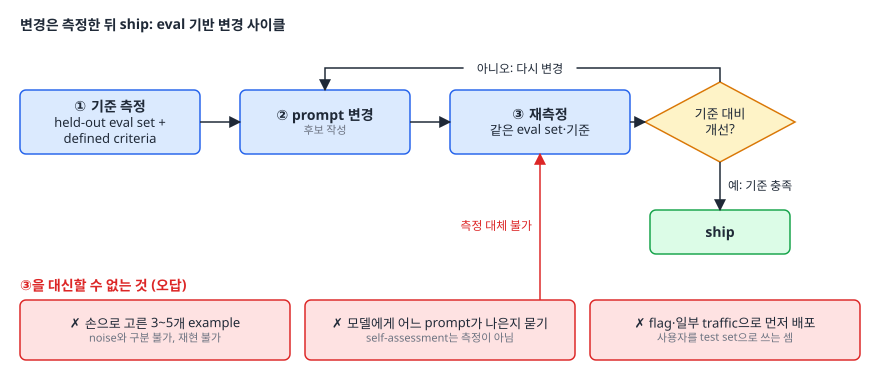
*그림: 같은 held-out eval set과 기준으로 재측정해 개선이 확인될 때만 ship하며, 손 example·self-assessment·일부 traffic 배포는 측정을 대신하지 못한다.*

근거: Amey-0035, Amey-0065, CCAR-F-Udemy01-0010, CCAR-F-Udemy03-0051, CCAR-P-Amey-Thakur-0007, CCAR-P-Amey-Thakur-0020, CCAR-P-Amey-Thakur-0057, CCAR-P-jrajath94-0182, CCAR-P-jrajath94-0307, CCAR-P-jrajath94-0308, CCAR-P-jrajath94-0554, CCAR-P-jrajath94-0597, CCAR-P-preporato-0017, Patrick-0030, Udemy-0027

### 1-2. Grader 선택: free-form prose에는 LLM-as-judge
**주관적 prose 품질 = rubric을 준 LLM-as-judge**

| 구분 | 내용 |
|---|---|
| exact string match | free-form prose는 같은 정답도 표현 다름 → 채점 불가 ✗ |
| LLM-as-judge ✓ | 주관적 품질(예: faithfulness to source)에 사용 |
| rubric ✓ | rubric 제공 (예: 출처에 충실한가, 지어낸 주장 없는가) |
| 점수만 요청(rubric 없이) | ✗ |
| judge validation ✓ | human label 표본과 대조 |
| valid JSON 검사 | 형식 검사일 뿐 품질 eval ✗ |
| 채점 사다리 ✓ | code 검사 → 보정된 judge → 사람 표본 점검 (싼 것부터) |
| 사람 전수 채점 | 가장 신뢰 · 비용 약 10배 (예: 실행당 $250 vs $25.60) |
| 실행 주기 배분 | 매일 실행 = 사다리 release · 분쟁 = 전체 사람 채점 |
| judge 보정 | 사람 label로 1회 보정 → 보정 범위 안에서만 신뢰 |
| 보정 범위 밖 입력 | 사람 확인 필요 "밖"의 기준 = 팀이 정의 |
| 보정 안 된 judge | 싸다는 이유로 채택 ✗ → 채점자 아님 |
| 비용 때문에 eval 월 1회로 축소 | 회귀를 몇 주 놓침 ✗ |

| 구분 | 내용 |
|---|---|
| grading 순서 | code → LLM judge → 사람 표본 가장 빠르고 신뢰할 수 있고 확장되는 방법 선택 |
| code grader | 정확 일치 · 확인 가능한 field에 최적 가장 빠르고 신뢰할 수 있음 · 저비용 |
| LLM judge | 어조 같은 판단 영역 담당 신뢰성 테스트 후에만 대량 적용 |
| 사람 grading | 느리고 비쌈 → 전수 채점 ✗ 표본 점검 · 정기 audit용 |
| 혼합 batch(예: 야간 30,000건) | 정확 일치 field → code 어조 → 신뢰성 확인된 LLM judge |
| 신뢰성 테스트 없이 전량 LLM 채점 ✗ | judge 신뢰 미확인 |
| 두 번째 LLM으로 각 판정 교차 검증 ✗ | 신뢰성 테스트를 대신 못 함 |

| 구분 | 내용 |
|---|---|
| 미보정 judge 점수 | 측정값 ✗ · 의견일 뿐 사람 label이 측정값으로 만듦 |
| 보정 절차 | 대표 sample에 사람 label 수집 → judge를 label에 맞춰 calibrate → 그 뒤에야 점수 신뢰 |
| re-baseline | drift가 발생한 기간의 기준선 재설정 |
| judge 점수 상승 · 사용자 불만 증가 | 원인 불명(drift) · judge 미검증 → 사람 label 보정이 먼저 |
| 일치율 낮음(예: 100건 표본에서 60%) | 채점 결과 신뢰 ✗ judge 수정 · 교체 또는 code · 사람 채점 |
| 일치율 높고 불일치 특성 파악(예: 95%) | judge 사용 가능 |
| ⚠️ 일치율 수치 | 해설의 "60% = 우연 수준"은 척도에 따라 다름 수치 기준은 공식 문서에 없음 · 예시로만 암기 (공식 문서 미확인) |
| 보정 비용 | 사람 label은 시간 · 비용 → 한 번 보정 후 grading 순서로 운용 |

| 구분 | 내용 |
|---|---|
| 주관 품질(예: 법률 조항 요약)을 측정 가능하게 | 중요한 실패 유형을 담은 rubric 전문가와 함께 만든 labeled 세트 rubric 기반 model 채점 + 정기 사람 audit |
| 출시 후 불만 건수 집계 ✗ | 너무 늦게 측정 |
| 참조 요약과 정확 일치 ✗ | 타당한 바꿔 쓰기도 실패 처리 |
| 출력 길이 · thumbs-up 수만 ✗ | 품질 측정 ✗ |

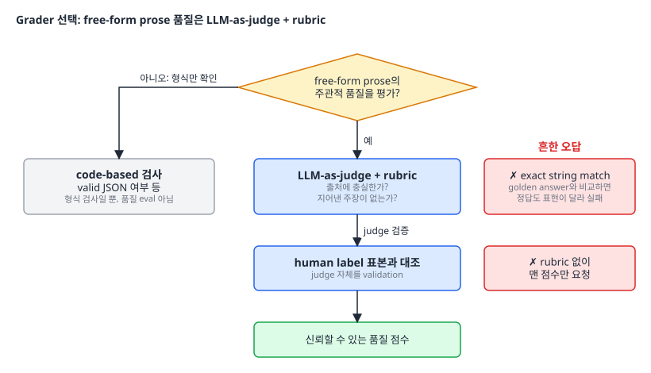
*그림: 주관적 prose 품질은 rubric을 준 LLM-as-judge로 채점하고 judge는 human label로 검증하며, 형식 검사와 exact match는 품질 eval이 아니다.*

근거: CCAR-P-Amey-Thakur-0006, CCAR-P-Amey-Thakur-0039, CCAR-P-jrajath94-0031, CCAR-P-jrajath94-0187, CCAR-P-jrajath94-0188, CCAR-P-jrajath94-0428, CCAR-P-jrajath94-0491, CCAR-P-jrajath94-0656, CCAR-P-jrajath94-0657, Patrick-0014, Patrick-0030

### 1-3. Regression suite
**깨지면 안 되는 것을 변경 때마다 계속 테스트**

| 구분 | 내용 |
|---|---|
| regression | 조용히 발생 예: 목표 동작은 개선, 다른 동작이 깨짐 |
| 일회성 eval과 차이 | 깨지면 안 되는 것을 계속 테스트해 포착 (이 점이 일회성 eval과 다름) |
| latency · rate limit · cost | 운영 신호일 뿐 correctness 신호 ✗ |
| eval set 운용 | versioning → regression suite로 겸용 |
| 실행 시점 | 모든 prompt 변경 · model upgrade 시 |
| production 실패 사례 | 새 case로 추가 |

| 상황 | 정답 방향 |
|---|---|
| 목표 지표는 개선 · 측정 안 한 동작은 저하 | 잃어선 안 되는 동작을 포괄하는 regression suite 유지 |
| 한 번에 하나 변경 · 신중한 review · 변경 빈도 제한 ✗ | 위험만 줄임 탐지 ✗ · 안전화 ✗ |
| 재평가 trigger | model · prompt · data 분포 · 요구사항 변경 동작 결정 요소가 바뀌면 이전 측정 무효 |
| trigger 아님 | 보고된 사고만 · 고정 연간 일정 · 비용 변화 |
| prompt 수정 후 품질 악화 · 원인 논쟁 | 고정 eval set을 이전 · 새 prompt 모두 실행 category별 점수 비교 → prompt를 변수로 분리 · 퇴보 지점 특정 |
| 시점이 같다며 즉시 되돌림 ✗ | 시점 = 상관관계 고칠 수 있는 개선까지 버림 |
| 사용자에게 변화를 물음 ✗ | 노이즈 많고 느림 (eval은 당일 답) |
| 더 큰 모델로 교체 ✗ | 원인 미확인 · 비용 영구 상승 |

| 구분 | 내용 |
|---|---|
| regression drawer red | 이전 동작이 깨짐 → ship ✗ 회귀 원인 파악 · 수정 또는 case를 의도적으로 update |
| red case 삭제 ✗ | 측정 파괴 |
| prompt 직접 편집으로 형식 파손 (downstream parser 중단 · 변경 기록 없음) | prompt를 code처럼 version 관리 모든 변경에 CI로 eval 실행 회귀 시 배포 차단 · changelog 유지 |
| 효과 | 회귀 없음 증명이 배포 전에 일어남 모든 변경을 귀속 가능 |
| 두 번째 엔지니어의 눈 확인 ✗ | 측정 없는 review 형식 회귀 예측 불가 |
| 화요일에만 변경 허용 ✗ | 파손 시점만 바뀜 |
| 시니어에게만 편집 허용 ✗ | 경력은 회귀를 줄일 뿐 증명 ✗ |
| prompt 변경 순서 | regression eval → 사전 정의 지표로 현재 prompt와 통제된 A/B → 배포 |
| 순서 근거 | prompt 변경 = production 변경 |
| 출시 후 불만 monitoring · 팀 투표 · 피드백 양식 ✗ | regression eval · 통제된 비교 없이 배포 |

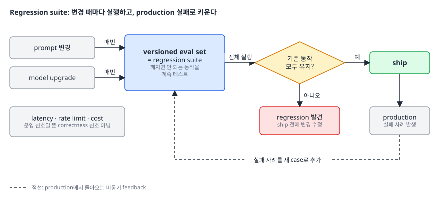
*그림: versioned eval set을 변경 때마다 돌려 조용한 회귀를 ship 전에 잡고, production 실패 사례를 새 case로 되먹인다.*

근거: Amey-0080, CCAR-P-Amey-Thakur-0022, CCAR-P-Amey-Thakur-0023, CCAR-P-Amey-Thakur-0040, CCAR-P-jrajath94-0026, CCAR-P-jrajath94-0090, CCAR-P-jrajath94-0365, Patrick-0014, Patrick-0030

### 1-4. Model 업그레이드와 운영
**upgrade · 운영 모두 eval 확인 후 계획적 변경**

| 구분 | 내용 |
|---|---|
| production | model ID 고정(pin) |
| 새 모델 | regression eval로 성능 저하 없음 확인 → 원하는 시점에 이동 |
| Opus 5.5 (해설) | temperature 등 sampling 설정 변경 불가 thinking 비활성화 불가 |
| parameter 호환 (해설) | 위 Opus 5.5처럼 모델 변경 시 이전 parameter가 error 가능 |
| 동작 변화 | API 호환 유지돼도 변화 가능 (같은 prompt의 길이 · 형식 · 판단 경향) |
| 이전 모델용 지시 · 설정 | 그대로 이전 ✗ → 재eval |
| 근거 안 됨 | "새 모델이니 더 낫다" 가정 ✗ vendor benchmark ✗ |
| retirement | 모델 목록에 모델별 폐기 예정일 존재 → migration을 일정에 넣어 계획적 진행 |

| 구분 | 내용 |
|---|---|
| 단계 | release 이후 운영 · 보존 |
| monitoring | uptime만 감시 ✗ 응답 품질 · 이용 현황 monitoring |
| 변경 대응 | 모델 교체 · 외부 근거(제도 · 문서) 변경 영향 → eval set으로 확인 후 계획적 수정 |
| 재학습 | Claude API 모델은 운영 중 대화 · 피드백 버튼으로 재학습 ✗ |
| 피드백 용도 | 운영 측이 prompt · 참조 데이터 · eval set 수정에 사용 |

| 상황 | 정답 방향 |
|---|---|
| 기반 model version 업데이트 | production traffic 도달 전 eval suite 재실행 |
| "버전 호환이니 무조치" ✗ | 호환 가정 = 안전 ✗ |
| 일주일 monitoring 강화 · 불만 시 자동 rollback ✗ | 사용자 영향 후에야 감지 |
| vendor update 후 어조가 무례해짐 (prompt · retrieval · data 불변) | 실패 계층 = model version version pin 또는 변경 + regression 재실행 |
| version 동작 | production 변경으로 취급 |
| 반례 | prompt가 바뀌었다면 원인은 prompt |

1. 새 prompt를 shadow로 실행(결정 기록 · 조치 ✗)
2. 주요 지표 monitoring하며 통제된 노출
3. 전체 rollout

| 구분 | 내용 |
|---|---|
| 적용 대상 | 사용자 · 돈에 해를 끼칠 수 있는 변경 (예: 정당한 환불을 잘못 거부) |
| shadow | 사용자 영향 없이 해를 측정 이전 prompt가 계속 서비스 · 며칠 소요 |
| 통제된 노출 | 영향 범위(blast radius) 제한 주요 지표에 임계값 필요 |
| 전체 배포 후 주말 dashboard 관찰 ✗ | 측정 전에 모든 사용자 도달 |
| 즉시 50% 배포 ✗ | shadow 생략 50,000건 중 25,000명 피해 가능 |
| 모델에게 새 prompt가 안전한지 질문 ✗ | 모델 승인 ≠ test |
| 대규모 traffic이면 test 불필요라는 생각 ✗ | 큰 traffic = 큰 해 |
| 반례 | 되돌릴 수 있고 저위험(문구 · 돈 무관) 조정은 단순 배포 가능 |

| 구분 | 내용 |
|---|---|
| canary 롤백 기준 | canary 시작 전에 trigger 사전 등록 → 자동 rollback에 연결 (예: escalation 비율 +2pt, 30분 지속) |
| 사전 정의 | 주요 지표 · guardrail 지표 최소 실행 시간 · 최소 표본 크기 |
| 사전 정의 효과 | "흔들림"이 신호인지 잡음인지 논쟁 방지 |
| 원칙 | 판단을 실험 이전으로 이동 · 논쟁은 등록 시점에 한 번 |
| canary 중 on-call 경험 판단 ✗ | 사고 중 판단 = 논쟁 · 담당자에 따라 달라짐 |
| on-call 2명 · dashboard 면밀 감시 ✗ | 관찰만 개선 · 결정은 개선 ✗ |

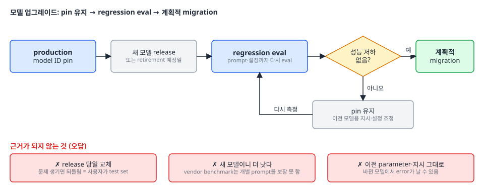
*그림: 새 모델은 pin을 유지한 채 regression eval을 통과한 뒤에만 계획한 시점에 migration한다.*

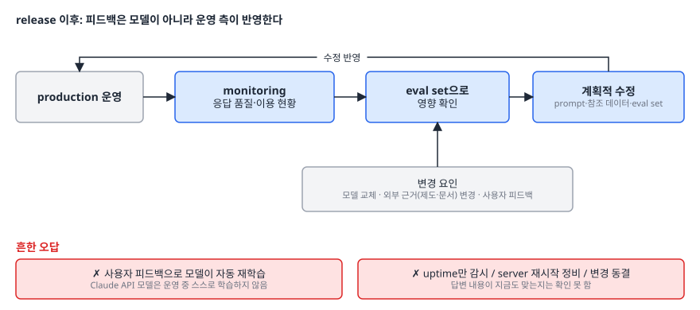
*그림: 운영 중 피드백과 외부 변경은 모델이 스스로 배우지 않으므로 운영 측이 eval로 영향을 확인해 prompt·참조 데이터·eval set을 고친다.*

근거: CCAR-P-Amey-Thakur-0074, CCAR-P-jrajath94-0088, CCAR-P-jrajath94-0190, CCAR-P-jrajath94-0494, Patrick-0030, Udemy-0027, Udemy-0037

### 1-5. Prompt를 SDLC에 통합
**prompt = code처럼 repository · PR · eval로 관리**

| 구분 | 내용 |
|---|---|
| 이유 | prompt = 출력을 좌우하는 산출물 |
| 관리 ✓ | repository에서 version control |
| merge 조건 ✓ | PR에서 review · eval 결과 확인 후 |
| 효과 | diff 확인 · revert · eval 결과 대응 가능 |
| 관리 화면 직접 수정 · DB 저장 | production prompt 이력 · review 남지 않음 ✗ |
| production A/B test | 사전 eval 통과 후보 중 고르는 마지막 단계일 뿐 |

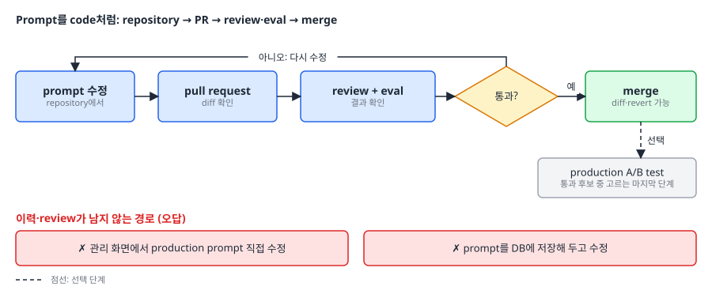
*그림: prompt는 PR에서 review와 eval을 통과해야 merge되며, A/B test는 통과 후보 중 고르는 마지막 선택 단계다.*

근거: Udemy-0018

### 1-6. 안전한 refactoring
**동작을 test로 고정 → 작은 단계로 변경 · 검증**

1. 현재 동작을 고정하는 테스트(characterization test) 작성
2. 작고 검증 가능한 단위로 변경
3. 매번 test · review 통과
4. 문제 발생 → 직전 단계로 되돌림

| 구분 | 내용 |
|---|---|
| 원칙 ✓ | refactoring = 외부 동작 유지 |
| 기능 추가 · bug fix 혼합 | 동작 변경 작업을 같은 변경에 섞음 → 원인 분리 불가 ✗ |
| big-bang rewrite · 수동 화면 확인만 | 안전성 보장 ✗ |

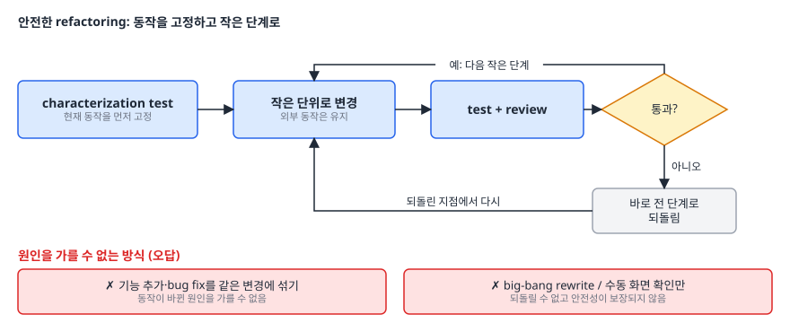
*그림: 동작을 test로 고정한 뒤 작은 단계마다 검증하고, 실패하면 직전 단계로 되돌려야 원인을 가를 수 있다.*

근거: Udemy-0003

### 1-7. Debugging: 결함 위치부터 찾기(localize)
**고치기 전 실패 지점부터 특정**

| 상황 | 판단 |
|---|---|
| trace: 받은 입력엔 올바른 추론, 입력 문서가 틀림 | 결함 = retrieval/integration layer (search · indexing) |
| 위 상황에서 모델 upgrade · prompt 문구 강화 | 잘못된 입력은 못 고침 ✗ |

- API 경계 → 실패를 4xx vs 200 이후로 분류

| 신호 | 판단 |
|---|---|
| 4xx (예: 400 `invalid_request_error`) | API가 요청을 받지 않음 → 자사 request 조립 코드 확인 |
| 200 이후 parse/validation 실패 | `stop_reason` · 원본 응답 본문 확인 → 모델 출력 vs 자사 parser 구분 |
| `stop_reason` = `max_tokens` | 응답 중간 잘림 → 200 이후 parse 실패의 한 원인 가능 400과 무관 |
| `request-id` header | 모든 응답에 부착 기록 → trace와 API 측 기록 대조 가능 |

- 변경 날짜 · 증거 → 의심 계층 결정

| 상황 | 판단 |
|---|---|
| 실패 시작일 = 특정 변경일 | 그 변경이 닿은 계층 먼저 의심 → trace로 확인한 뒤 수정 |
| 변경 2건(월 prompt · 화 re-ingest) 하락은 화요일 시작 | 화요일 계층(index)이 첫 용의자 prompt = 두 번째 용의자 |
| 습관적 용의자(prompt · index · tier) | 변경 로그가 습관보다 우선 날짜가 계층을 지목 |
| rerank 단계 배포 후 latency 3배 | 변경된 단계가 용의자 모델 탓 ✗ |
| 변경 없음 · trace에 오류 없음 사용자 평점만 하락 | 먼저 instrument 증거 없이 수정 ✗ |
| 위 상황의 instrument 대상 | 사용자 결과 tracing(문제를 해결했는가) 사람이 라벨링한 production sampling |
| 위 상황의 한계 | instrument 동안 사용자 불편 지속 distribution shift(새 주제)도 확인 |
| 모델 ID pin · infra update 후 품질 하락 코드 불변 | pin = weight 고정 → 서빙 infra가 유력 원인 |
| 위 상황의 증거 | live 지표를 update 이전 baseline과 비교 지표마다 model ID 기록 같은 기간 prompt · data 변경 확인 |

- 신호 → 지목 계층 → 조치

| 신호 | 계층 | 조치 |
|---|---|---|
| chunk 도착 · 답 틀림 (paraphrase 질문도 동일) | model(generation) | prompt · 모델 선택 수정 검증 gate 추가 |
| 위와 같음 · 환불 기간 오답 | grounding | retrieve된 구절만으로 답 · 인용 지시 강화 faithfulness 평가 |
| 새 prompt가 output schema 누락 retrieval trace 정상 | prompt | schema 복원 → 재테스트 |
| 새 prompt가 "cite your source" 제거 chunk 정상 · 답이 chunk 이탈 | prompt | 지시 복원 → 재테스트 |
| template가 입력을 200자로 절단 trace가 template 지목 | template | 전체 텍스트 전달하도록 수정 tier 상향 ✗ |
| 초안이 chunk에 없는 조항 인용 | verification | 초안 ↔ chunk 대조 단계 수리 (chunk는 정상) |
| 지난 분기 가격 인용 catalog는 어제 update | retrieval(index) | re-ingestion + freshness check |
| embedding 모델만 교체 chunk · prompt · LLM 불변 | retrieval | 새 embedding으로 retrieval eval 재실행 |
| context 조립 0.5 → 7초 retrieval · 추론 시간 불변 | context | retrieval 범위 지정 · compaction · 중복 제거 |

- 단계별 측정이 지연 원인 계층을 지목

| 구분 | 내용 |
|---|---|
| 방법 | 단계별 시간 측정 움직인 단계만 수정 대상 |
| 불변 단계 | 업그레이드 · 재구축 ✗ (모델 tier · index) |
| 근거 없는 원인 | network 재시도 추가 ✗ 증거 없이 원인 지어내기 |
| 한계 | retrieval 범위 지정은 유용한 오래된 문서 누락 가능 |

- 데이터 계층 지목 = 원인 사실 + 시점 일치 두 가지

| 증상 | 지목 사실 | 무혐의 · 중립 |
|---|---|---|
| 입력 feed가 절단 텍스트 전송 | feed 절단 시점 = 하락 시작 | 모델 버전 불변 · latency 정상 |
| 문서 절반이 검증 안 된 mirror 출처 | 출처 변경 · re-ingest 시점 = 저하 시작 | chunk 정상 도착 모델 등급 불변 |
| index rebuild가 문서 30% 누락 | 누락 사실 시점 = 저하 시작 | 모델 버전 불변 · latency 양호 |
| 모델 버전이 같은 날 바뀐 경우 | 모델 결함 주장 강화 | 무관한 사실(예: 사무실 이전)은 중립 |

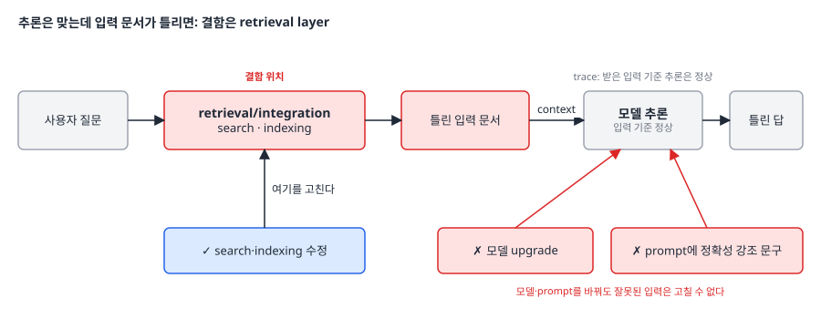
*그림: trace에서 추론은 맞고 입력 문서가 틀렸다면 retrieval layer를 고쳐야 하며, 모델이나 prompt를 바꿔서는 해결되지 않는다.*

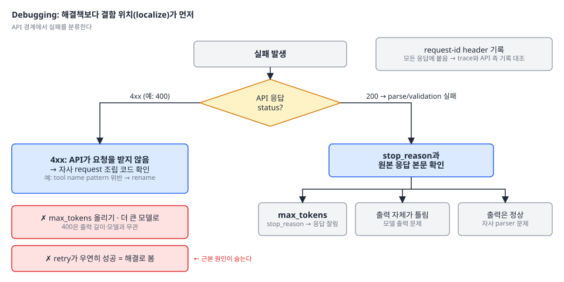
*그림: 4xx는 자사 request 조립 코드, 200 이후 parse 실패는 stop_reason과 원본 본문으로 잘림·모델 출력·자사 parser를 가른다.*

근거: Amey-0010, Amey-0050, CCAR-P-jrajath94-0194, CCAR-P-jrajath94-0195, CCAR-P-jrajath94-0196, CCAR-P-jrajath94-0197, CCAR-P-jrajath94-0310, CCAR-P-jrajath94-0314, CCAR-P-jrajath94-0368, CCAR-P-jrajath94-0369, CCAR-P-jrajath94-0431, CCAR-P-jrajath94-0432, CCAR-P-jrajath94-0557, CCAR-P-jrajath94-0558, CCAR-P-jrajath94-0670, CCAR-P-preporato-0019, Udemy-0023

### 1-8. API error와 retry policy
**429·5xx·connection error만 retry · 400·401·403·404는 요청·tool name 수정**

| error | 조치 |
|---|---|
| 429 `rate_limit_error` 500 `api_error` · 529 `overloaded_error` connection error | 일시적 error → exponential backoff + jitter server가 준 `retry-after` 준수 후 retry |
| 400 · 401 · 403 · 404 등 client error | 요청 자체 오류 → 매번 같은 이유로 실패 → 요청 수정 잘못된 retry policy의 증상: 느린 응답 · 비용 증가 |
| ⚠️ 408 · 409 | 해설: "429 외 4xx 모두 retry 불가"로 일반화 공식 문서: SDK는 408 · 409도 기본 retry 시험: 400 · 401 · 403 · 404 = retry 불가로 암기 |
| 공식 SDK | 429 자동 retry status code별 typed exception (예: `RateLimitError`) |
| SDK로 구분 | retry 가능: 429 · 5xx · connection error retry 불가: 400 · 404 |

| 오답 | 이유 |
|---|---|
| 즉시 retry(tight loop) | 과부하 증가 |
| 첫 일시적 error에서 job 전체 실패 | 불필요하게 fragile |
| 여러 API key 순환으로 rate limit 회피 | ✗ |

| 구분 | 내용 |
|---|---|
| tool 이름 pattern | `^[a-zA-Z0-9_-]{1,128}$`만 허용 |
| 공백 포함 이름(예: `get order status`) | 400 → 이름 변경(`get_order_status`) |
| 허용 문자 | 영문 · 숫자 · `_` · `-` |

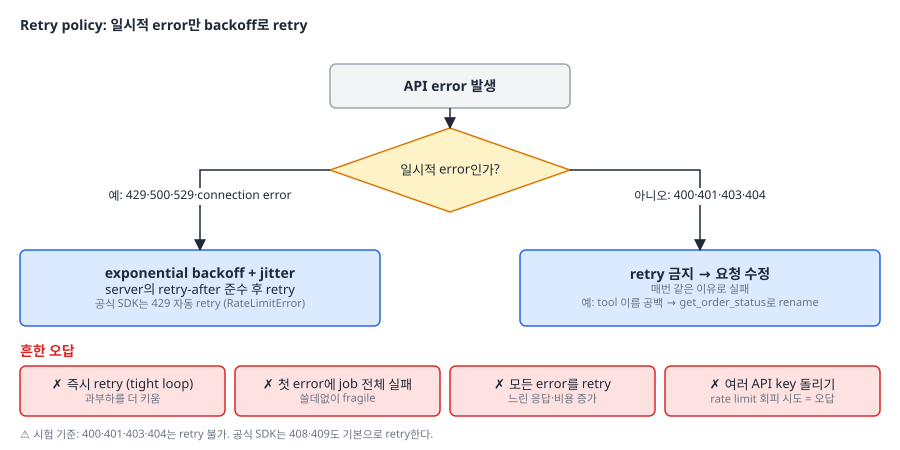
*그림: 429·500·529와 connection error만 backoff·jitter·retry-after로 retry하고, 400·401·403·404는 요청을 고친다.*

근거: Patrick-0006, Patrick-0027, Patrick-0032, Preporato-0030

### 1-9. Eval set 구성: 대표성 · 층화 · 최신성
**크기가 아니라 production 분포 대표성**

| 상황 | 정답 방향 |
|---|---|
| 이미 잘 처리하는 사례만 포함 | 성능 과장 · 중요한 실패 가림 크기로 해결 ✗ · 특정 분야만의 문제 ✗ |
| 최근 티켓 50개 | 최신성 ≠ 포괄성 희귀 유형 빠짐 → 실패 안 보임 |
| 문서 유형 12종 · 희귀 유형까지 포함 필요 | 층화(stratified) 표본 유형별 최소 개수 · 희귀 유형 · 알려진 edge case 규모 수백 개 |
| 다른 모델이 만든 합성 예시 | 생성 모델 편향 반영 실제 문서 다양성 ✗ |
| eval 생략 후 출시 후 평점 의존 ✗ | 테스트 없는 배포 출시 전 확신 ✗ |
| production 입력이 지저분함 (오타 · stack trace · 대문자, 15%) | 들어오는 비율 그대로 반영 edge · adversarial · malformed 포함 |
| 위 상황에서 깨끗한 티켓 추가 ✗ | 이미 통과하는 것만 늘림 |
| 위 상황에서 기준 낮춤 ✗ | 기준은 사용자를 따름 · eval 편의 ✗ |
| 위 상황에서 지저분한 입력 필터링 ✗ | 실제 고객 삭제 입력이 악용이면 필터링은 제품 결정 |
| 대표성 vs 크기 | 대표성 > 크기 깨끗한 1,000개로는 15%를 못 봄 |

| 상황 | 정답 방향 |
|---|---|
| 헤드라인 수치(환각 1%)가 eval 구성 기준 | 집계 함정 production 구성과 다름 |
| 모호 · 저context query (production 20% · eval 2%) | 난이도로 층화 · 어려운 tail 오버샘플링 production 구성으로 가중한 층별 비율 보고 |
| 구성 각주만 붙여 1% 보고 ✗ | 결정은 여전히 1% 수치 기반 |
| 모호한 query 삭제 ✗ | 지표만 깨끗해지고 실패 숨김 |
| 쉬운 query 추가 ✗ | 이미 측정한 것 재측정 · 사각지대 유지 |

| 상황 | 정답 방향 |
|---|---|
| production 구성 변경(새 제품 line) eval 전부 green · 실제 품질 나쁨 | eval 새로고침 · 현재 구성에 맞춤 주제 · 최신성으로 층화 · 새 line 포함 새 세트로 점수 재baseline |
| eval이 측정하는 것 | 추출된 시점의 세계 production이 변하면 eval도 갱신 |
| 옛 티켓 추가 ✗ | 없어진 세계에 정밀도만 상승 (stale-evaluation 함정) |
| 한 분기 대기 후 자연 축적 ✗ | 그 기간 눈 감고 운영 |
| 옛 eval 점수 올리려 모델 tuning ✗ | 새 line 질문 성능 증명 ✗ |
| click-through 서서히 하락 · 1년 된 drawer | 원인 후보 = 오래된 eval regression suite green이어도 사용자 고통 → 최근 대표 data로 refresh |
| 반례 | trace가 새 data에서 모델 실패를 보이면 모델이 원인 |

| 요구 | 정답 방향 |
|---|---|
| 실제 traffic과 일치 | 최근 production traffic 샘플링 → 실제 작업 구성 반영 |
| 특이 입력 포괄 | 빈 · 긴 · 무관 입력을 edge case로 추가 기대 답변은 code로 확인 가능하게 |
| 싼 daily run · 빠른 check loop | 확인 가능한 case는 code 기반 check (출력 형식이 허용하는 곳마다) |
| 사람 panel로 전 답변 채점 ✗ | 느리고 비쌈 |
| 세트 낡음 방지용 매시간 재구축 ✗ | 요구 조건에 없는 관리 |
| ⚠️ Console 샘플러 · 자동 label | 해설이 "문서에 설명 없음"으로 배제 문서 변경 시 달라질 수 있음 (공식 문서 미확인) |

| 상황 | 정답 방향 |
|---|---|
| production 대화 mining (계좌번호 · 건강 정보 · 공유 bucket) | trust boundary 벗어나기 전 PII 제거 |
| 수정된 bug(예: 잘못된 복용량 안내) | regression drawer에 유지 · 변경마다 실행 수정됨 = 방어됨 |
| "현실적 data 필요"로 PII 유지 ✗ | 경계보다 우선 ✗ |
| bucket만 trust boundary 안으로 이동 ✗ | PII 그대로 · drawer 미지정 |
| 고친 bug case 삭제 ✗ | 다음 변경이 조용히 되살림 |
| 제거 후 검증 | 제거로 맥락 소실 가능 → case가 동작을 계속 테스트하는지 확인 |
| 반례 | 접근 제어된 경계 안 bucket이면 PII 제거는 선택 |
| sampling 갱신 | production이 바뀌는 만큼 갱신 |

근거: CCAR-P-Amey-Thakur-0021, CCAR-P-Amey-Thakur-0058, CCAR-P-jrajath94-0025, CCAR-P-jrajath94-0086, CCAR-P-jrajath94-0089, CCAR-P-jrajath94-0186, CCAR-P-jrajath94-0189, CCAR-P-jrajath94-0435, CCAR-P-jrajath94-0656, CCAR-P-jrajath94-0658, CCAR-P-jrajath94-0688

### 1-10. Eval drawer 5종: 빠진 서랍 찾기
**representative · edge · adversarial · malformed · regression**

| drawer | 담는 것 |
|---|---|
| representative | 실제 traffic 구성 (지원하는 모든 언어 · 유형) |
| edge | 드물지만 유효한 입력 (흔치 않은 소득 유형 · 비전형 증상) |
| adversarial | 시스템을 속이도록 만든 입력 (위장 피싱 · 편향 · 거짓 유도 · unsafe code 유도) |
| malformed | 깨짐 · 일부만 · 오타 · 빈 입력 |
| regression | 과거 bug case (변경마다 실행) |

| 상황 | 빠진 drawer |
|---|---|
| 정직한 이메일로 98% · 정교한 피싱 통과 | adversarial 정직 data 정확도 ≠ 공격 내성 |
| triage bot: 교과서 사례만 | edge + adversarial (둘 다 안전 직결) |
| 대출 설명: 전형적 신청서 1,000건 | edge + adversarial representative는 이미 가득 |
| code assistant: Python 과제만 | 다른 언어 representative + adversarial(unsafe code 유도) |
| 여행 bot: 영어 query만 | 다른 언어 representative + malformed(실제 traffic은 지저분) |
| 오답 보기 공통 | 같은 case 더 추가 · training set 재사용 ✗ 분량만 늘고 다양성 ✗ |
| 빈 입력만 추가 | malformed로는 셋째 추가 항목 후보 단독 정답 ✗ |
| adversarial 유지 | red team 사례 필요 공격이 바뀌면 갱신 |

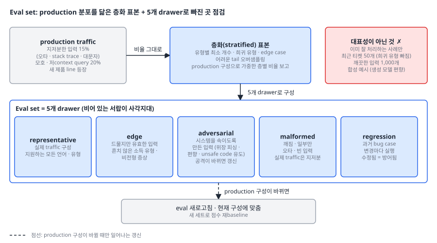
*그림: eval set은 크기가 아니라 production 분포 대표성으로 구성하고, drawer 5종 중 비어 있는 서랍이 사각지대다.*

근거: CCAR-P-jrajath94-0189, CCAR-P-jrajath94-0313, CCAR-P-jrajath94-0366, CCAR-P-jrajath94-0429, CCAR-P-jrajath94-0492, CCAR-P-jrajath94-0555

### 1-11. 혼합 평가와 사람 검토 표본
**자동 지표의 사각지대는 judge + 사람 표본으로 보강**

| 상황 | 정답 방향 |
|---|---|
| code agent: unit test 통과 82% 가독성 · 관례 불만 · 엉뚱한 문제 풀이도 통과 | LLM judge로 style guide 기준 채점 (가독성 · 관례, 전 과제 확장 가능) + 사람 spot-check로 표본의 의도 일치 확인 |
| 원칙 | 자동 test · judge · 사람 검토 병행 각각이 나머지의 빈틈 보완 |
| test를 300 → 3,000개로 확대 ✗ | 같은 지표의 사각지대 그대로 |
| token 효율 측정 ✗ | 불만과 무관 간결하나 읽기 어려운 code에 보상 가능 |

| 사람 검토의 역할 | 내용 |
|---|---|
| 판단 기준점 | 주관 품질은 사람 label로 anchor |
| 정기 audit | rubric 기반 model 채점 결과를 labeled 세트로 감사 |
| 표본 spot-check | 문제를 실제로 해결했는지(의도 일치) 확인 |
| judge 보정 | 대표 sample에 사람 label |

| 상황 | 정답 방향 |
|---|---|
| 자동 review 지적의 기각률 상승(29% → 46%) 지적 문구가 매번 달라 집계 불가 | schema에 `detected_pattern` 추가 지적을 낳은 code 구조 기록 → pattern별 지적 수 · 기각률 집계 |
| 운영 | 값 목록 고정 새 pattern은 `other`로 받아 정기 재검토 |
| 활용 | 기각률 높은 pattern → review 기준 재검토 · 일시 보고 중단 |
| 확신도 threshold 미만 지적 미게시 ✗ | 지적 종류를 구별 ✗ |
| 자유 기술 기각 사유 집계 ✗ | 집계 어려움 |
| PR별 기각률 · 작성자에게 확인 촉구 ✗ | 지적 종류를 구별 ✗ |
| 판별 기준 | 지적의 "종류"라는 분석 단위를 만드는가 |

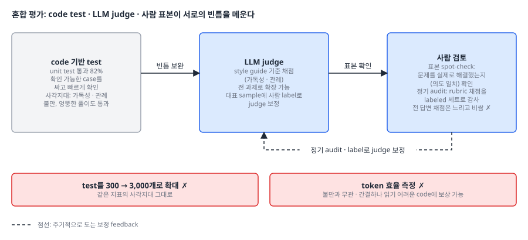
*그림: code test가 놓치는 가독성 · 관례는 LLM judge가, 의도 일치는 사람 표본이 보완하고, 사람 label이 judge를 보정한다.*

근거: CCAR-F-Udemy05-0057, CCAR-P-Amey-Thakur-0006, CCAR-P-Amey-Thakur-0039, CCAR-P-jrajath94-0031, CCAR-P-jrajath94-0187

### 1-12. 지표 정의: 모호한 요구를 측정 가능한 기준으로
**형용사는 지표 · 임계값 · 담당자로 바꾼 뒤 구축**

1. 형용사 → 작업 성공 지표로 변환
2. 지표별 임계값(숫자) 설정
3. 안전 · 비용 가드 지표 추가
4. 지표마다 담당자 지정

| 모호한 요구 | 측정 가능한 기준 |
|---|---|
| 더 도움이 됨 | 에스컬레이션 없이 해결 85% + 안전 · 비용 가드 · 담당자 |
| 몇 초 안에 (월 $2,000 · 50,000건) | p95 5초 미만 채팅당 비용 $0.04 이하 |
| 좋은 번역 | 사람 평가 adequacy 4/5 이상 표본 크기 · 평가자 간 일치도 명시 |
| "사기를 잡는다" | 확인된 사기 recall 95% 이상 오탐률 2% 이하 held-out 세트에서 측정 |
| 출시 가능한 요약 | 고정 test set rubric 4/5 이상 + 담당 lead 서명 |

| 구분 | 내용 |
|---|---|
| 성공 기준 요건 | 지표 · 임계값 · 지정된 책임자 |
| 임계값 확정 시점 | tuning · 다음 실행 전 |
| 주요 지표 | 목표를 직접 재는 지표 1개 (예: held-out 해결률) |
| 지표 여러 개 검토 후 선택 | dashboard 15개 나열 ✗ |
| 임계값만 있는 기준 | 샘플링 방법 · 표본 크기 · 주기 미정 → cherry-picking 위험 |
| 출시 결정용 기준 | 통과 · 실패 결과 + 서명자 |
| 주관 서술 | "잘 읽힘" · "팀이 좋다고 느낌" ✗ |
| 임계값 없는 점수 | 상승해도 출시 근거 ✗ |
| 구축 후 정의 | 목표 도달 여부 판단 불가 ✗ |
| 쉬운 지표 선택 | 평균 응답 길이 등 ✗ 의미가 아니라 쉬움이 기준 |
| 한계 | 첫 임계값 = 첫 추정 baseline은 나중에 측정 |

근거: CCAR-P-jrajath94-0182, CCAR-P-jrajath94-0364, CCAR-P-jrajath94-0427, CCAR-P-jrajath94-0489, CCAR-P-jrajath94-0553, CCAR-P-jrajath94-0597, CCAR-P-jrajath94-0653

### 1-13. 대리 지표(proxy)와 목표 지표
**지표가 녹색이어도 목표가 적색이면 proxy → 교체**

| 상황 | 정답 |
|---|---|
| 유창성 95 녹색 작업 성공 60% | 작업 성공 = 주요 지표 유창성 = 진단용으로 강등 |
| 유창성 +12% 해결률 불변 | held-out 해결률 = 주요 지표 임계값 · 담당자 먼저 확정 |
| ROUGE 3개월 고정 불만 티켓 3배 | 사람 평가 eval + 티켓 주제를 지표로 추적 |
| 지어낸 내용 금지 요구 ROUGE로 측정 | faithfulness로 교체 |

| 지표 | 재는 것 |
|---|---|
| ROUGE · BLEU | n-gram 중복(표현 유사) 유창한 날조도 고득점 |
| faithfulness | 전사본으로 검증 가능한 주장 비율 사람 표본 평가 + 자동 claim 검사 |
| 사람 평가 eval | production 요약 샘플링 작업 기반 기준(핵심 포인트 · 날조 인용 없음) |
| 티켓 주제 추적 | 사용자 불편 → 팀이 움직일 지표 |

| 오답 | 이유 |
|---|---|
| 녹색 proxy로 계속 출시 | 녹색 proxy는 목표 증명 ✗ |
| proxy 기준 상향(유창성 98) | 목표 아닌 기준 상승 → 60% 그대로 |
| proxy와 목표 지표 평균 | 77.5가 둘 다 가림 |
| 더 높은 ROUGE 목표 | 점수 상승 · 나쁜 요약 → 품질과 분리된 최적화 |
| ROUGE로 eval set 확대 | 틀린 숫자에 확신만 증가 |
| ROUGE → BLEU 교체 | 같은 overlap proxy 계열 proxy 교체는 proxy 문제 해결 ✗ |
| 길이 · 지연 시간으로 품질 대체 | 품질 지표 ✗ 짧은 요약도 날조 가능 |

- 한계: 작업 성공은 측정이 어려움 → 측정 투자 없으면 지표 부패

근거: CCAR-P-jrajath94-0024, CCAR-P-jrajath94-0085, CCAR-P-jrajath94-0183, CCAR-P-jrajath94-0653

### 1-14. 주요 지표 · 가드 지표 · 비즈니스 지표
**주요 지표는 제약 · 위험을 직접 재는 것**

| 요구 · 위험 | 주요 지표 |
|---|---|
| 지어낸 액션 아이템 금지 요약에 대한 신뢰 | groundedness (주장 → 원문 추적) |
| 보안 버그를 잡아야 함 | 알려진 취약점 클래스 recall (실제 버그 중 잡은 비율) |
| 사기 탐지 | recall + 오탐률 |
| 채용 순위 · 편향 규제 | groundedness + 하위 집단별 공정성 |
| 예산이 제약 | 성공한 작업당 비용 (비즈니스 지표) |
| 안전 · 보안이 걸림 | 임계값 0 가드 지표 |
| 오답 · 느림 · 청구액 증가 (계약 추출 불만 3종) | 필드 단위 정확도 (label 데이터셋) p95 · p99 지연 문서당 비용 · 작업당 토큰 |

| 구분 | 내용 |
|---|---|
| 주요 지표 선택 기준 | 제약이 고름 안전 → 가드 · 예산 → 비용 · SLA → p95 |
| 정확도 = 항상 주요 지표 | ✗ → 안전 · 예산이 제약이면 다른 지표 |
| 활동 지표 | 프롬프트 수정 횟수 · 응답 길이 → 불만 해결 증명 ✗ 분당 리뷰 줄 수 · 분당 추출 수 → 요구된 목표(버그 포착 · 사실성) 측정 ✗ |
| 속도 · 비용 · 가용성 지표 | 품질 · 위험 지표 대체 ✗ (uptime · token 비용 · 지연) |

**가드 지표**

| 구분 | 내용 |
|---|---|
| 가드 지표 | 피해를 직접 측정 임계값 0 · 위반 1건 → 출시 차단 |
| 정확도로 안전 대체 | ✗ 평균은 거짓말 · 피해는 집중 95%가 5% 중증 오배정을 숨길 수 있음 |
| 가드 표현 | 0 또는 정의된 검토 거친 0에 근접 |
| 가드 요건 | 도메인 정의 + label 모호한 가드 = 구호 |
| 지연 지표 추가(p99) · 토큰당 비용 추가 | 빠진 것이 안전이면 ✗ |

**비즈니스 · 공정성 · 지연 지표**

| 구분 | 내용 |
|---|---|
| 성공당 비용 지표 | 어려운 건 거부 유인 → 정확도 지표가 균형추 |
| 비용 지표 폐기 | 예산이 제약이면 ✗ |
| 하위 집단 공정성 | 순위 품질을 집단별 측정 집계값 하나 ✗ |
| 공정성 · groundedness 비용 | 집단 label → 개인정보 처리 요구 groundedness = 주장마다 검증 비용 |
| p50 중앙값 SLA | 느린 5% 은폐 · 사용자는 tail 체감 (p50 1.8초 · p95 9초 → 불만) |
| interactive SLA | p95 또는 p99 기준으로 재작성 |
| tail latency | 피크 시간대 느림 → p95 · p99 추적 |

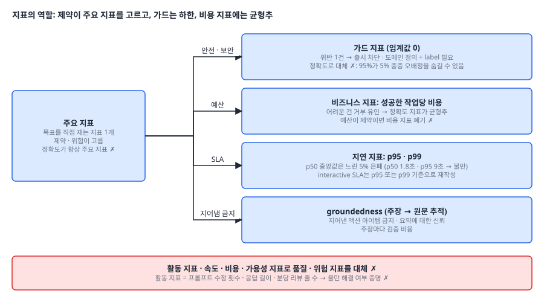
*그림: 안전은 임계값 0 가드, 예산은 작업당 비용(정확도가 균형추), SLA는 p95 · p99로 제약이 주요 지표를 고른다.*

근거: CCAR-P-jrajath94-0024, CCAR-P-jrajath94-0184, CCAR-P-jrajath94-0185, CCAR-P-jrajath94-0307, CCAR-P-jrajath94-0363, CCAR-P-jrajath94-0371, CCAR-P-jrajath94-0426, CCAR-P-jrajath94-0489, CCAR-P-jrajath94-0552, CCAR-P-preporato-0016

### 1-15. 집계 점수 분해: 세그먼트 · 카테고리별 precision/recall
**숫자 하나 뒤의 내역을 열어야 원인이 보임**

| 상황 | 정답 |
|---|---|
| 전체 정확도 97.4% → 사람 review 축소 요구 | review 축소 조건 = 세그먼트별 목표 정확도 목표를 먼저 정함 |
| 위 상황 (측정 단계) | 문서 종류 · 필드별 정확도를 신뢰할 건수로 측정 → 검증 세트 확대 |
| 정확도 94% | 나머지 6%의 양상 + 실패당 비용 확인 후 실행 |
| 품질 gate 한 카테고리 오탐 연발 → 보고서 전체 무시 | 그 카테고리만 일시 제외 정의 · 실례 · precision/recall eval로 재구축 |
| review 봇: 보안 수용 · style 기각 → 결과 전체 무시 | 카테고리별 precision/recall 측정 실례 기반으로 style 기준 축소 · 비활성화 |
| 채용 순위 공정성 | 하위 집단별 측정 (집계 ✗) |

- 원칙: 문제 범위만 분리 → 양호한 부분의 가치 유지
- 집계 평균은 편향 · 집중된 오류를 가림

| 오답 | 이유 |
|---|---|
| 같은 검증 세트로 prompt 재비교 exact-match 일률 전환 | 집계 하나로 판단하는 구조 그대로 |
| 주의 문구 달고 수동 무시 요청 | 신뢰 저하 방치 |
| 품질 gate 전체 중지 | 양호한 시그널까지 손실 |
| JSON schema 준수 = 주 신뢰 지표 | 형식과 내용 혼동 |
| 전체 수용률만 추적 | 편향을 평균으로 가림 |
| 전 카테고리 임계값 일괄 상향 | 양호한 카테고리까지 영향 |
| 보안 지적을 위로 이동 | 노이즈 양 그대로 |

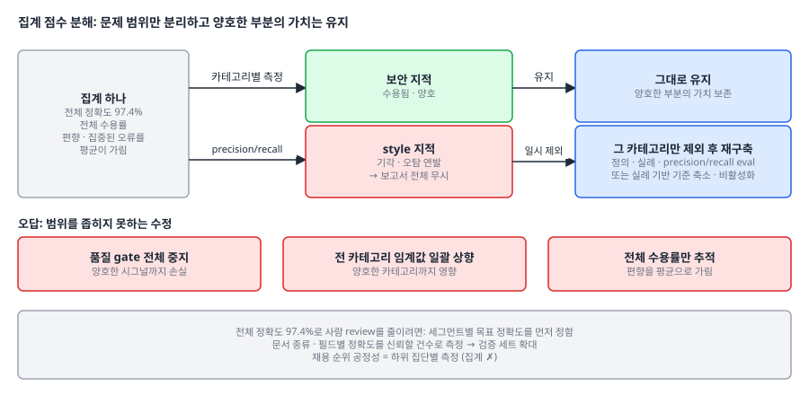
*그림: 집계 하나는 오탐 카테고리를 가리므로 분해해서 그 카테고리만 제외 · 재구축하고 양호한 부분은 유지한다.*

근거: CCAR-F-Udemy01-0022, CCAR-F-Udemy02-0011, CCAR-F-Udemy02-0030, CCAR-P-Amey-Thakur-0073, CCAR-P-jrajath94-0307

### 1-16. 통계적 유의성 vs 비즈니스 유의성
**p-value는 효과가 실재한다는 뜻 · 배포는 비용이 결정**

| 구분 | 내용 |
|---|---|
| p-value | 상승이 실재하는지 가르는 관문 가치가 있는지는 말하지 않음 |
| 전환에 실제 비용 | 비즈니스 유의성이 결정 p-value만으로 배포 ✗ |
| 전환이 무료 | 유의한 상승 → 그대로 배포 |
| "유의하면 무엇이든 배포" | 가격 무시 ✗ |
| "p-value는 의미 없음" | 관문 역할 무시 ✗ |
| 유의한 0.5pt 이득 | 비용 대비 손해 가능 |

| 계산 | 값 |
|---|---|
| 일 추가 성공 건수 | 일 요청 수 × 성공률 상승폭 (예: 1M × 0.6pt = 6,000건) |
| 일 추가 비용 | 일 요청 수 × 요청당 추가 비용 (예: 1M × $0.004 = $4,000) |
| 손익분기 | 일 추가 비용 ÷ 일 추가 성공 건수 (예: 약 $0.67 / 성공) |
| 판정 | 성공 1건 가치 > 손익분기 → 배포 성공의 가격을 매겨야 판정 가능 |

근거: CCAR-P-jrajath94-0192, CCAR-P-jrajath94-0193

### 1-17. A/B 테스트 설계: 공정한 비교
**동시 · 무작위 · 일관 할당 · 사전 정의**

| 설계 요소 | 내용 |
|---|---|
| 동시 무작위 분할 | 같은 기간 · 같은 트래픽 구성 시간 교란 제거 |
| 일관된 할당 | 사용자는 test 내내 한 arm 사용자별 · 고정 할당 규칙 |
| 반증 가능한 가설 | 데이터 보기 전에 명시 (예: 성공률 3pt 이상 상승) |
| 주요 지표 · baseline | 사전 정의 |
| 가드 지표 | 주요 지표가 놓치는 퇴보 포착 (안전 · 지연 시간) |
| 사전 등록 | 사후 지표 골라 쓰기 방지 |
| 최소 표본 수 | 승자 선언 전 요구 주장하는 상승폭에서 계산 |
| 한 번에 한 변경 | 두 변경 동시 배포 → 귀인 불가 |
| 전환에 비용 | 비즈니스 유의성 확인 (p-value만 ✗) |

| 잘못된 설계 | 문제 |
|---|---|
| 이번 주 vs 지난주 비교 | 트래픽 구성 · 외부 변화가 프롬프트 효과로 위장 |
| 월요일 A · 화요일 B | variant와 요일 교락 |
| page load마다 무작위 배정 | 한 사용자가 두 variant 노출 측정 · 경험 모두 손상 |
| 리전 추가 | 시간 교란 해결 ✗ (구조적 결함) |
| offline eval 통과 → live test 생략 | production 분포 변화 미포괄 |
| 하루 400건이면 충분 | 표본 크기는 주장 상승폭이 결정 |
| 스팟 체크 15건 더 · 선호 질문 | 측정 ✗ |
| 스팟 체크 우세로 변경 3개 일괄 배포 | 귀인 불가 · 측정 근거 부족 |

| 상황 | 정답 |
|---|---|
| chunker + prompt 동시 배포 지표 상승 → chunker 공으로 | 분리 · 테스트당 1 변경 eval set 고정 |
| 분리 테스트의 비용 | arm별 트래픽 · 시간 2배 arm 크기를 팀이 결정 |
| 지표 · baseline · 할당 계획 없음 ("줄일 것 같다") | 반증 가능 가설 + 주요 지표 · 일관 할당 · baseline |
| 가설 확정 + 검정력만 부족 | 이때만 더 긴 테스트 정답 |
| 여러 변경을 배포하고 싶음 | 성공 지표 · 표본 크기 사전 정의 한 번에 한 변수 → 유의한 변경만 배포 |
| 일 400 세션 · 1% 상승 · 1주 | 표본 크기 계산 → 판별 불가 대안: offline 평가 suite |
| offline suite 구성(서랍) | 대표 · edge · adversarial · malformed · regression |
| offline 한계 | 실제 비즈니스 성과 측정 ✗ 트래픽 · 기간 증가를 비용으로 계상 |
| ⚠️ 해설: "몇 달 돌려도 흔들림" | 같은 해설이 더 긴 기간도 대안으로 언급 → 과장 가능 · 시험: 표본 계산 선행으로 암기 (공식 문서 미확인) |

근거: CCAR-P-Amey-Thakur-0007, CCAR-P-jrajath94-0027, CCAR-P-jrajath94-0191, CCAR-P-jrajath94-0192, CCAR-P-jrajath94-0309, CCAR-P-jrajath94-0367, CCAR-P-jrajath94-0430, CCAR-P-jrajath94-0556, CCAR-P-jrajath94-0659, CCAR-P-preporato-0018

### 1-18. 변경 배포 순서: offline eval → shadow → 통제된 노출
**위험한 변경은 영향 범위(blast radius)부터 제한**

1. 회귀 평가 세트 실행 → 깨짐 포착
2. 위험한 변경 → shadow 먼저
3. 통제된 노출 → 미리 정의한 지표로 현재 prompt와 A/B (실제 traffic)
4. 개선 입증 후 전체 배포

| 상황 | 정답 |
|---|---|
| 데모에서 더 좋아 보이는 prompt 변경 | 회귀 eval + 정의된 지표 A/B → 전체 배포 |
| 위험한 자동 환불 변경 | shadow → 통제된 노출 첫날 전체 traffic ✗ (blast radius 최대) |
| 위험 낮은 문구 변경 | 빠른 test 가능 |

| 오답 | 이유 |
|---|---|
| 데모가 대표성 있다며 배포 | 일화 |
| 팀 투표 | 일화 |
| 피드백 배너 + 전체 배포 | 대조군 없는 실험 |
| offline eval 통과 → live test 생략 | production 분포 변화 미포괄 |

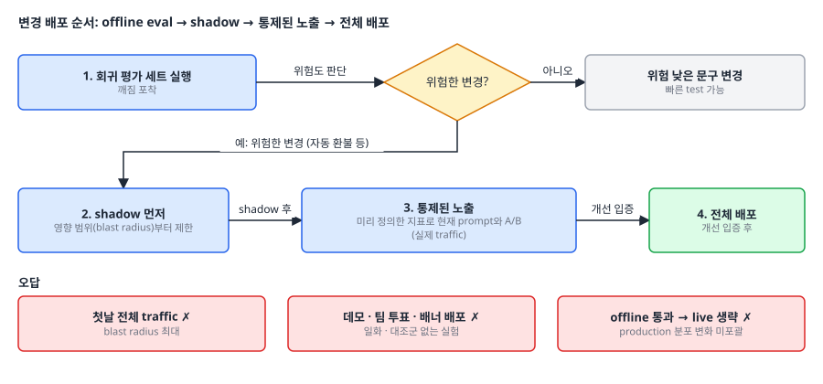
*그림: 위험한 변경은 회귀 평가 후 shadow와 통제된 노출로 영향 범위를 제한하고, 개선을 입증한 뒤에만 전체 배포한다.*

근거: CCAR-P-Amey-Thakur-0007, CCAR-P-jrajath94-0027, CCAR-P-jrajath94-0493

### 1-19. Latency 최적화: 단계별 측정 → 지배 단계
**p95를 단계별로 재고 비중 큰 단계부터**

| 구분 | 내용 |
|---|---|
| 측정 | 단계별 p95 · 전체 합계 SLA 대비 필요 감축량 계산 |
| 우선순위 | 비중 큰 단계 → 감축량을 채우는 단계 의견이 아닌 측정이 지목 |
| 지배 단계 | 단일 단계 과반(예: OCR 56% · vector search 58%) 또는 두 단계 합이 대부분(예: 89%) |
| 작은 단계 최적화 | 0.1~0.2초 감축 = 노이즈 격차 못 메움 |
| 중간 비중 단계만 | 감축량보다 작으면 격차 해소 ✗ |
| 단계 추가 | p95 증가 → 잘못된 방향 (안전 · 필터 · 번역 · 맞춤법 · cache 단계) |
| reasoning 축소 | 품질 · 안전 하한 유지 필요 |
| 지배 단계가 바뀌면 | 우선순위도 변경 (예: retrieval이 지배적이면 retrieval) |

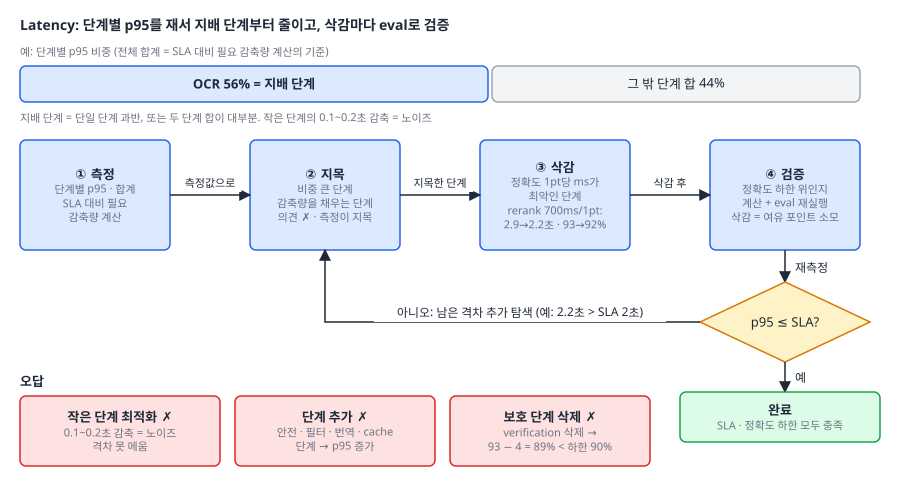
*그림: 지배 단계는 측정이 지목하고, 삭감마다 정확도 하한과 eval을 확인하며 SLA를 채울 때까지 반복한다.*

근거: CCAR-P-jrajath94-0299, CCAR-P-jrajath94-0355, CCAR-P-jrajath94-0418, CCAR-P-jrajath94-0481, CCAR-P-jrajath94-0544

### 1-20. Latency · 정확도 trade-off: 측정으로 고르고 eval로 검증
**하한을 지키며 비효율 단계부터 · 삭감마다 eval 재실행**

| 구분 | 내용 |
|---|---|
| 판단 도구 | 단계별 ms · 정확도 포인트 표 측정 · 추측 ✗ |
| p95가 SLA 초과 | 정확도 1pt당 ms가 최악인 단계 삭감 (예: rerank 700ms/1pt → 2.9→2.2초 · 93→92%) |
| 삭감 후 | 정확도 하한 위인지 계산 + eval 재실행 삭감은 여유 포인트 소모 |
| 1회 삭감 | 완전한 수정 아닐 수 있음 (2.2초 > SLA 2초) → 남은 격차 추가 탐색 |
| 가장 큰 ms 단계 삭제 | ✗ 원시 ms가 아니라 비율이 결정 |
| verification 같은 보호 단계 삭제 | ✗ 정확도 하한 붕괴 (93 − 4 = 89% < 90%) |
| 더 깊은 reasoning 추가 | p95 이미 초과 시 ✗ 정확도가 하한 아래 + SLA 느슨할 때만 |
| retrieval 결과 cache | 최악 비율 단계가 아님 cache 효과 = 안정적 prefix 필요 |

| 선택 | 판단 |
|---|---|
| 독립 단계 | 병렬화 먼저(latency 제약일 때) 정확도 불변 · trace로 독립성 확인 |
| 병렬화 반대 논거 "디버깅 어려움" | latency 논거 ✗ · 기준은 독립성 |
| 측정된 이득 없는 단계 | 제거 측정 못 하는 복잡성은 짐 |
| 이득 미측정 단계 추가 | 먼저 측정 · 추가 후 측정 ✗ |
| 제거한 단계 | 되돌릴 수 있음 문제 보고 시 eval 붙여 재추가 |
| 단계를 응답 뒤로 이동 | 가치 결정 없이 p95에서 숨김 ✗ (비동기에 안전 + 가치 증명 시만) |
| 단계 심화(두 번째 모델) | 미측정 단계에 비용 추가 ✗ |
| 느슨한 SLA + 비싼 오류 | latency 예산을 정확도에 지출 |
| 제약에 따라 규칙이 반대 | latency 제약 → 병렬화 · 삭감 정확도 제약 → 예산으로 정확도 구매 |

| 요구 · 현재 상태 | 정답 |
|---|---|
| 정확도 90% 이상 · p95 2초 미만 대형 모델: 93% · 6초 | 계층 라우팅 빠른 모델 먼저 → 신뢰도 낮으면 대형 모델 |
| 라우팅 검증 | 라벨 eval set으로 두 기준 동시 성립 확인 후 출시 |
| 전부 작은 모델 | 정확도 하한 위반 ✗ |
| 캐시로 해결 | 요청이 대부분 고유 → hit ≈ 0 ✗ |
| 출력 토큰 한도 절반 | 6초 → 2초 안정적 감소 ✗ 추론 잘림 · 정확도 위험 |

근거: CCAR-P-jrajath94-0005, CCAR-P-jrajath94-0163, CCAR-P-jrajath94-0164, CCAR-P-jrajath94-0165

### 1-21. RAG 실패의 계층별 수정: retrieval · chunking · grounding
**지목된 계층의 구성 요소를 고친다**

| 증상 | 수정 | 오답 |
|---|---|---|
| 최상위 chunk = 포럼 게시물 사양서는 5위 | ranking에서 권위 출처 우대 (또는 사양 corpus로 filter) source-type metadata 추가 → retrieval에서 우선 | 모델 tier 상향 ✗ system prompt 재작성 ✗ (proxy 수정) |
| 규칙 chunk만 retrieve 예외는 다음 문단에 있음 | 문서 구조(섹션 전체) 따라 re-chunk 약간의 overlap → 규칙과 예외 함께 유지 | chunk 5 → 30개 ✗(노이즈) 큰 모델 ✗(못 받은 문단 활용 불가) "예외 기억" 지시 ✗ |
| chunk가 조항을 문장 중간에서 분할 | chunking 계층 수정 | 계층은 증상이 아니라 trace가 결정 |
| 그럴듯한 가짜 판례 인용 (실제 같은 이름 · 올바른 형식) | 진단 = ungrounded generation (환각 하위 유형, parametric memory에서 생성) | "환각하지 말 것" 지시 ✗(검증 불가) 더 큰 모델 ✗ 재시도 ✗(같은 분포 표본) |
| 위 증상의 검증 가능한 수정 | 인용이 검색된 출처로 해소되도록 요구 인용-출처 검증 단계 groundedness 지표 = 판례의 corpus 내 존재 확인 | prompt 호소 = 검증 불가 |
| 180K 문서에서 100K 이후 위치 사실 정확도 급락 (200K window 모델) | 광고된 context ≠ 유효 context → retrieve-then-read 위치 구간별 정확도 평가 | 100K로 절단 ✗(사실 삭제) "끝부분 주의" prompt ✗ 다음 모델 릴리스 대기 ✗ |
| 위 원인 | 먼 위치에서 attention 저하 (lost in the middle · 후반부 위치 감쇠) | window에 들어간다고 균일하게 활용 ✗ |
| retrieve-then-read 원리 | 관련 섹션을 먼저 가져옴 작고 집중된 context에서 추론 → 균일한 신뢰도 회복 | 긴 context 모델의 알려진 특성 특정 릴리스의 결함 ✗ |

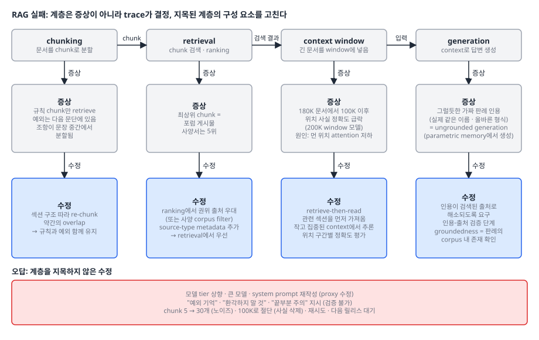
*그림: RAG 실패는 증상이 아니라 trace가 지목한 계층의 구성 요소(chunking · ranking · 검증 단계)를 고친다.*

근거: CCAR-P-jrajath94-0028, CCAR-P-jrajath94-0032, CCAR-P-jrajath94-0310, CCAR-P-jrajath94-0495, CCAR-P-preporato-0020

### 1-22. Trace 수집 범위: hop 단위 재구성과 run id
**최종 출력만으로는 실패 계층을 못 좁힘**

| 구분 | 내용 |
|---|---|
| 수집 ✓ | 출력 + tool call · 검색된 context · 의사결정 지점 trace |
| 최종 출력만 · 집계 latency만 사용자 feedback만 | 실패를 특정 계층으로 좁힐 수 없음 ✗ |
| 감사 가능성 | 결정을 추적 · 통제를 검사할 수 있는 아키텍처 속성 |
| 모델 패밀리 · 비용 · 리전만 | 동작을 설명할 수 있게 되지 않음 ✗ |
| 호출별 단계 이름 + token 수 | 모델 호출을 해당 단계에 연결 |
| stop reason 횟수 | 호출이 끝난 방식 확인 (예: `max_tokens` 중단) |
| 합계 오류 단계 찾기 | 단계 이름 · token 수 · stop reason 로그 → 모델 변경 전에 문제 단계 특정 |
| 더 큰 tier 전환 | 문제 단계를 가리고 비용 증가 ✗ |
| prompt caching | 단계 기록 수단으로 제시된 오답 ✗ |
| 고정 · 기록 | prompt · schema · 모델 버전 고정 출력과 함께 기록 → 비교 · 재현 |
| 일관성 오답 | 문서 순서 섞기 ✗(무관) token 한도 증가 ✗(길이에만 영향) 2회 실행 ✗(변동성 측정일 뿐) |

| 상황 | 조치 |
|---|---|
| prompt만 로깅 tool call · 검색 결과 · hop 결정 없음 | hop별 tracing 추가 · request id 하나로 연결 (모델 호출 · 검색 · tool call · 결정) hop별 token · 비용 기록 |
| 위 조치 이후 | 새 trace로 조사 남은 증거도 함께 보존 |
| 보존 기간 연장(7일 → 90일) | 이미 있는 것의 연장일 뿐 ✗ 보존 = 시간, trace = 내용 |
| prompt 로그 정독 · agent 재시작 | tool 결정이 로그에 없음 ✗ 재시작은 아무것도 알아내지 못함 ✗ |
| hop별 로그 존재 · 공통 id 없음 | 결제 tool · queue에 전파되는 run id 하나 |
| 배정 누락 · queue 이벤트 없음 | run id 전파로 end-to-end 재구성 누락 이벤트가 사슬의 틈으로 드러남 |
| queue가 correlation id를 drop | queue가 id를 받아서 전달 |
| run id 전파 조건 | 모든 hop(queue 포함)이 받아서 전달 시계 규율 · trace 저장소 필요 |
| timeout 원인이 queue인지 외부 API인지 불명 | run id 하나의 trace에 hop별 지연 시간 |
| hop 이벤트는 있으나 timing 없음 | hop별 timing 추가 → 느린 hop vs 누락 hop 구분 |
| 로그 line 추가 · 큰 모델 · 두 번째 queue | 연결 없는 로그 = noise ✗ 두 번째 queue = 손실 지점 추가 ✗ |
| 로그 추가가 맞는 예외 | 어떤 hop이 아무것도 로깅하지 않을 때 |

근거: CCAR-F-Amey-Thakur-0026, CCAR-P-Amey-Thakur-0048, CCAR-P-Amey-Thakur-0066, CCAR-P-jrajath94-0166, CCAR-P-jrajath94-0300, CCAR-P-jrajath94-0356, CCAR-P-jrajath94-0419, CCAR-P-jrajath94-0482, CCAR-P-jrajath94-0545, CCAR-P-jrajath94-0601

### 1-23. Trace 비용 · 보존 · 데이터 경계
**샘플링 · skeleton · redaction으로 비용과 비밀 통제**

| 상황 | 정답 | 오답 |
|---|---|---|
| 하루 1,000만 호출 full trace가 모델 호출보다 비쌈 | 일부 sample = deep trace 나머지 = skeleton trace 모든 오류 = full trace 보관 | trace 안 함 · 사용자 불만 의존 ✗ 모든 호출 full trace ✗(규모에서 비실현) |
| 위 설계의 비용 귀속 | 모든 호출에 hop별 token · 달러 기록 | 90일 full 보관 ✗ (skeleton이면 실패 재현 불가) |
| 위 설계의 조건 | sample은 대표성 필요 skeleton은 request id · 결과 포함 | full trace는 하루 1,000건 규모에서 ✓ |
| 위 설계의 한계 | sample은 드문 실패 모드 누락 가능 → 전체 보관된 오류 stream 감시 | 관측은 전부 아니면 전무 ✗ |
| trace에 계좌번호 · 비밀번호 포함 3rd-party 분석 서비스로 전송 | trust boundary 넘기 전에 비밀 · PII redact redaction을 코드로 유지 · 테스트 | tracing 중단 ✗(진단 신호 상실) vendor 약속 ✗(통제 아님) 암호화 ✗(vendor가 복호화) |
| 위 해결의 한계 | redaction pattern 유지보수 필요 새 비밀 형식은 pattern 학습 전까지 유출 | 암호화 = pipe 보호 redaction = 이동 가능 데이터 결정 |
| prompt 텍스트는 trace에 금지 tool hop 찾기 필요 | 실행마다 trace 하나 모델 hop · tool hop마다 span metadata only 모드 | span에 전체 prompt 저장 ✗ 시간별 usage 보고서 ✗ 하위 span 없는 단일 span ✗ |
| 데이터 규칙 = metadata만 허용 3개 service에 걸친 요청 실패 | metadata 전용 export 실패 요청의 hop별 trace 읽기 | 전체 content export 후 검색 ✗ custom span 형식 사전 구축 ✗ |
| metadata only 모드 | content mode `metadata_only`가 기본 → span은 기본으로 prompt text 제외 | prompt · 응답 포함 = `content` 모드 |

| 구분 | 내용 |
|---|---|
| 시간별 usage 보고서 | token 합계를 모델 · workspace · key별로 묶음 tool 단위 상세 ✗ |
| metadata 전용 span | 식별자 · 타이밍 포함 → 데이터 규칙 충족 |
| 단일 trace ID | 각 모델 hop · tool hop을 연결 → 동작을 수행한 hop 식별 |

근거: CCAR-P-jrajath94-0167, CCAR-P-jrajath94-0168, CCAR-P-jrajath94-0638, CCAR-P-jrajath94-0669

### 1-24. Claude Code telemetry · 비용 · 지연 관측
**요구하는 신호에 맞는 관측 수단 선택**

| 요구 | 수단 | 오답 |
|---|---|---|
| 개발자 전원의 OTLP 목적지 고정 | managed settings에 OTLP endpoint · 자격 증명 고정 | repo 설정 파일에서 telemetry 활성화 ✗ |
| 위 오답의 이유 | Claude Code는 project 설정의 OTel exporter 변수를 무시 | 간단해 보이는 함정 |
| MCP tool 인수를 감사 추적에 기록 | `OTEL_LOG_TOOL_DETAILS=1` (MCP server 이름 · tool 이름 · 입력 인수) | `OTEL_LOG_USER_PROMPTS=1` ✗ (tool 인수는 TOOL_DETAILS 몫) |
| prompt 변경 후 비용 증가 원인 확인이 먼저 | 영향받은 각 session에서 `/usage` 실행 → session별 비용 확인 | 즉시 작은 모델 전환 ✗(원인 놓침 · 품질 저하) session 확인 전 dashboard 구축 ✗ |
| 비용 원인에 session 지표 사용 | `claude_code.session.count` ✗ = session 시작 시점의 count일 뿐 | prompt별 비용 · hop timing 아님 |
| traffic 급증을 수 초 안에 확인 | 각 live 응답의 `usage` 필드를 반환 즉시 기록 | API 분당 polling ✗ · 월간 지출 alert ✗ 주간 비용 검토 ✗ |
| ⚠️ 집계 report 지연 | 해설: 집계는 요청보다 최대 5분 지연 공식 문서: legacy API는 보통 5분 이내(더 길 수 있음) 신규 Analytics API는 보통 4시간 · 최대 24시간 | 시점에 따라 바뀜 |
| streaming 기능의 비용 · latency · 품질 한 대시보드 | streaming 호출 = time to first token 다른 호출 = 전체 응답 기준 latency | Usage API에서 latency 읽기 ✗ (token 수 보고, 응답 시간 아님) |
| 위 대시보드의 비용 | 완료된 작업당 비용을 품질 임계값 옆에 표시 Usage · Cost API 일간 합계 사용 | 경로별 percentile 20개 ✗ 각각 별도 alert 담당자 ✗ |

근거: CCAR-P-jrajath94-0640, CCAR-P-jrajath94-0655, CCAR-P-jrajath94-0669, CCAR-P-jrajath94-0693, CCAR-P-jrajath94-0708

### 1-25. Monitoring 설계: watch 대상과 drift 감지
**dashboard가 아니라 감지 · 알림 · 담당자**

| 상황 | 정답 | 오답 |
|---|---|---|
| 하루 2M 요청 24시간 내 hallucination drift 감지 전체 저장은 비용 초과 | 구조화 trace(호출당 span, token · latency 포함) transcript 일부 sampling 샘플에 매일 자동 faithfulness 평가 | 오류 로그만 + 주간 검토 ✗(환각은 오류 안 냄) latency · 비용 dashboard만 ✗ 전부 저장 + 검토자 ✗ |
| 승인율이 2개월간 상승 drift alert 없음 · 불만으로 발견 | drift detection(기준선 비교) 지정 담당자에게 alert 대표 eval data의 regression suite | 큰 모델 · 로그 추가 ✗ 두 번째 어시스턴트 ✗ |
| 위 해결의 역할 | regression suite = drift가 품질 변화인지 모집단 변화인지 구분 | 필요 조건: baseline 기간 · threshold 한계: alert 피로 → threshold 조정 · runbook 권한 |
| 경쟁사 sale 후 전환율 하락 추적 watch 없음 | business outcome watch (baseline · window · 담당자 · alert) | 큰 모델 ✗ · 로그 추가 ✗ |
| 위 watch의 원칙 | 시스템이 존재하는 이유인 성과가 첫 watch | system 지표만 보기 ✗ |
| 유해성 비율이 3개월 서서히 상승 latency · 비용만 모니터링 | 안전 지표 monitoring (baseline · window · 담당자 · alert) | latency monitoring 추가 ✗ |
| 위 watch의 원칙 | 시스템의 위험이 monitoring 목록 결정 | 큰 모델 ✗ |

| 상황 | 정답 | 오답 |
|---|---|---|
| dashboard 6주 녹색 설문 = 한 달 전부터 악화 suite 4개월 불변 · 주제 이동 | suite가 stale → 담당자 호출 · suite 갱신 새 제품 line case 추가 · baseline 재설정 녹색이 drift를 놓친 이유 post-mortem | 녹색 = 정상 ✗ 설문 영향력 낮추기 ✗(suite가 놓친 신호) |
| 위 상황의 모델 튜닝 | suite 갱신으로 model 계층 결함이 확인된 뒤에만 ✓ | 지금 튜닝 ✗(사각지대 남음) |
| 위 해결의 조건 · 한계 | 새 line case 라벨링 필요 갱신에는 labeling 비용 suite review를 달력에 일정화 | stale을 사용자가 발견하게 둠 ✗ |
| 장애는 분 단위, drift는 주 단위 | 빠른 line + 느린 line 짝 빠른: 오류율 · traffic 분 단위 alert 느린: 사람 라벨 sample 성공률 주 단위 추세 | 일일 평균 1개 ✗(장애 하루 지연) 일일 평균 10개 ✗(여전히 일 단위) 실패마다 alert ✗(alert 피로) |
| 위 설계의 한계 | 두 threshold · 두 담당자 필요 느린 line label은 지속 비용 | 일일 평균은 위험도 낮은 제품에서만 ✓ |
| claims assistant 요구 성공률 95% 하한 · p95 2초 월 비용 예산 · 규제 감사 | 단계별 지표 계측(모델 · retrieval · tool · 의존성) 담당자가 대표성을 유지하는 eval suite 변경마다 regression suite + 하락 시 page | 월 1회 수동 dashboard 검토 ✗ latency만 alert ✗ 비용 아끼려 trace 미보관 ✗ |
| 위 오답의 이유 | 수동 검토 = 품질 하락을 42일 뒤 발견 압박 시 가장 먼저 버려짐 | latency만 = 품질 · 비용은 조용히 drift trace 없으면 "any decision" 감사 불가 |
| 위 설계의 조건 | 단계별 지표 = request id 필요 page = threshold 필요 | suite 대표성 유지 예산 없으면 썩음 |
| 모델 · prompt 불변인데 같은 질문에 수치 불일치 새 모델 없이 ungrounded 답 flag | 같은 prompt를 여러 번 실행 핵심 수치가 다른 답변 표시 | 큰 tier ✗ Messages API 일관성 flag ✗(문서에 없음) |
| 위 검사의 의미 | 핵심 수치 불일치 = hallucination 가능성 | 새 모델 불필요 |

근거: CCAR-P-jrajath94-0006, CCAR-P-jrajath94-0202, CCAR-P-jrajath94-0203, CCAR-P-jrajath94-0206, CCAR-P-jrajath94-0312, CCAR-P-jrajath94-0498, CCAR-P-jrajath94-0561, CCAR-P-jrajath94-0663

### 1-26. Alert 운영: 담당자 · runbook · 위생
**담당자 없는 alert = monitoring 아님**

| 상황 | 조치 | 오답 |
|---|---|---|
| 품질 alert 지난달 3회 발동 담당자 없음 · chat thread 논의 후 망각 | 먼저 담당자 지정 (튜닝 · 대응 · 폐기 책임 1명) | threshold 조정 ✗(유지할 사람 없음) alert 추가 ✗(noise 증가) alert 끄기 ✗(유일한 신호 상실) |
| 위 조치의 조건 · 한계 | 담당자에게 튜닝 권한 · 대응 시간 필요 1명은 병목 → 대리인 · 순환 근무 | 담당자 없는 instrument = dashboard일 뿐 |
| precision 6주 하락 아무도 dashboard를 안 봄 | 지정 담당자에게 가는 precision alert 대응 runbook | 더 좋은 · 더 많은 dashboard ✗ 큰 모델 ✗ |
| 위 조치의 원리 | 보는 사람 없는 dashboard = 가구 행동하려면 runbook 필요 | 지표가 없을 때만 dashboard 개선 ✓ |
| latency alert가 매주 월요일 발동 배치 작업이 수치 왜곡 · 2개월 무시 | alert 재튜닝 또는 폐기 배치 시간대 제외 · 업무 시간 traffic으로 이동 | 유지 ✗(무시되는 alert = coverage 아님) 더 크게 page ✗ threshold 낮춤 ✗(같은 거짓 원인) |
| 위 조치의 원리 | 매주 발동하며 조치 없음 = 잘못된 line 조용하고 신뢰받는 채널 > 시끄럽고 무시되는 채널 | alert 많음 = 안전 많음 ✗ |
| 위 조치의 한계 | 배치 시간대에 실제 인시던트 가능 → 제외 자체를 별도 검토 | 발동이 실제였다면 line이 아니라 대응 수정 |
| 음성 봇 p95 2초 미만 threshold 책임지는 사람 없음 | 요구사항 체인의 빠진 고리 = 책임자 (요구사항 → 지표 → 임계값 → 책임자) | "팀"은 지정된 책임자 아님 체인이 갖춰졌다고 답 ✗ |
| 위 상황의 위험 | 책임자 없으면 traffic 구성 변경 시 임계값이 표류 | 정답이 되는 경우: 지정 역할이 소유 + 정기 검토 |

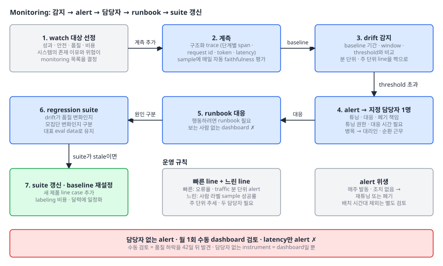
*그림: drift는 baseline과 비교해 지정 담당자에게 alert로 보내고, runbook 대응과 suite 갱신까지 이어져야 monitoring이다.*

근거: CCAR-P-jrajath94-0204, CCAR-P-jrajath94-0205, CCAR-P-jrajath94-0372, CCAR-P-jrajath94-0490

## 2. 상황별 정답 판단 규칙

| 상황 | 정답 |
|---|---|
| prompt 변경이 몇 개 example에서 좋아 보임 | 대표성 있는 held-out eval set + defined criteria로 비교 → ship |
| free-form prose의 품질 · faithfulness 평가 | rubric 기반 LLM-as-judge human label로 judge validation |
| prompt · model 변경마다 생기는 회귀 포착 | versioned regression suite를 변경 때마다 실행 production 실패를 case로 추가 |
| 새 모델 release | model ID pin 유지 → regression eval 통과 → 계획적 migration |
| 모델 추론은 맞는데 받은 문서가 틀림 | retrieval/integration layer (search · indexing) 수정 |
| 400과 200 이후 parse 실패 혼재 | API 경계에서 분류: 4xx → request 조립 코드 200 이후 → `stop_reason` · 원본 본문 확인 → 모델 vs parser 구분 |
| 429 · 500 · 529 발생 | backoff + jitter + `retry-after`로 retry |
| 400 · 401 · 403 · 404 발생 | retry ✗ → 요청 수정 |
| tool 추가 후 모든 요청이 400 | tool name pattern 위반 확인 → rename |
| prompt를 자주 고치는 팀 | repository 관리 + PR에서 review · eval 후 merge |
| 대규모 legacy code refactoring | characterization test → 작은 단계별 변경 · 검증 |
| release 이후 운영 단계 | 품질 · 이용 현황 monitoring 모델 · 외부 변경 영향 eval → 계획적 수정 |
| pilot 결함 발견 후 대량 batch 앞둠 | 대표 eval set · 기준으로 개선·재평가 → 동기 dry run → 전체 투입 |
| 희귀 유형까지 보여야 하는 eval 구성 | 층화 표본 · 유형별 최소 개수 희귀 유형 · edge case 포함 |
| eval은 green · production 품질 나쁨 | production 구성에 맞춰 eval 새로고침 층화 후 재baseline |
| 집계 수치(예: 환각 1%)가 어려운 tail을 가림 | 난이도 층화 · tail 오버샘플링 production 가중 층별 비율 보고 |
| eval에 정직 · 전형 case만 있음 | 빠진 drawer 추가 (edge · adversarial · malformed · regression) |
| production 대화로 eval case 구성 | boundary 벗어나기 전 PII 제거 수정된 bug는 regression drawer에 유지 |
| 높은 점수의 신뢰성 확인 | held-out 세트 + judge를 사람 label로 보정 같은 example로 tuning · 보고 ✗ |
| judge 점수 상승 · 불만 증가 · judge 미검증 | 대표 sample에 사람 label → calibrate drift 기간 re-baseline |
| 주관 품질(요약 · 법률 검토) 평가 | rubric + labeled 세트 + model 채점 + 정기 사람 audit |
| 확인 가능한 field + 어조 판단 혼재 | field → code grader 어조 → 신뢰성 확인된 LLM judge |
| 자동 지표(test 통과율)의 사각지대 | LLM judge(style) + 사람 spot-check(의도) |
| 자동 review 지적의 기각 분석 | schema에 `detected_pattern` 추가 값 목록 고정 · 새 값은 `other` |
| 목표 지표 개선 · 다른 동작 저하 | 잃어선 안 되는 동작의 regression suite |
| 재평가 시점 | model · prompt · data 분포 · 요구사항 변경 시 |
| prompt 수정 후 악화 원인 논쟁 | 고정 eval set을 이전 · 새 prompt에 실행 category별 비교 |
| regression drawer가 red | ship ✗ · 원인 수정 또는 의도적 case update 삭제 ✗ |
| prompt 편집이 downstream 형식 파손 | version 관리 · CI eval gate 회귀 시 배포 차단 · changelog |
| prompt 변경 배포 순서 | regression eval → 통제된 A/B → 배포 |
| model version 업데이트 | traffic 도달 전 eval suite 재실행 |
| 변경 없는데 어조만 변함(vendor update) | 원인 = model version pin 또는 변경 후 regression 재실행 |
| 사용자 · 돈에 해를 줄 수 있는 변경 | shadow → 통제된 노출 → 전체 rollout |
| canary 롤백 판단 | 시작 전 trigger 사전 등록 · 자동 rollback 지표 · 최소 실행 시간 · 표본 크기 사전 정의 |
| 전체 정확도 97.4% → review 축소 요구 | 세그먼트별 목표 정확도 먼저 문서 종류 · 필드별로 측정 |
| 정확도 94% 보고 | 나머지 6% 양상 · 실패당 비용 확인 |
| 품질 gate 한 카테고리만 오탐 | 그 카테고리만 제외 정의 · 실례 · precision/recall로 재구축 |
| 카테고리별 수용 편차 큰 review 봇 | 카테고리별 precision/recall noisy 기준만 축소 · 비활성화 |
| "더 도움이 됨" 같은 형용사 요구 | 지표 · 임계값 · 가드 · 담당자로 변환 후 구축 |
| 지표 녹색 · 목표 적색 | proxy → 작업 성공 지표로 교체 |
| 지어낸 내용 금지 요구 | groundedness · faithfulness 주요 지표 |
| 보안 버그 포착 요구 | 취약점 클래스 recall |
| 안전 · 보안이 걸림 | 임계값 0 가드 지표 → 위반 시 출시 차단 |
| 예산이 제약 | 성공한 작업당 비용 = 주요 지표 |
| 채용 등 편향 규제 | 하위 집단별 공정성 측정 |
| interactive SLA 설계 | p95 · p99 기준 (p50 ✗) |
| 유의한 p-value + 전환에 비용 | 손익분기 계산으로 배포 결정 |
| 두 변경이 함께 배포 | 분리 · 테스트당 1 변경 |
| prompt A/B 비교 | 동시 무작위 · 일관 할당 사전 등록 지표 + 가드 · 최소 표본 |
| 트래픽이 주장 상승폭 판별 불가 | 표본 계산 → offline suite 대안 |
| 위험한 변경 배포 | shadow → 통제된 노출 |
| p95가 SLA 초과 | 단계별 p95 측정 → 지배 단계 최적화 |
| SLA + 정확도 하한 동시 충족 | ms/정확도 포인트 최악 단계 삭감 독립 단계 병렬화 · 삭감마다 eval |
| 측정된 이득 없는 단계 | 제거 (되돌릴 수 있음) |
| 매일 eval 비용 부담 | code → 보정 judge → 사람 표본 사다리 |
| production-ready 선언 | 성공 기준 + 대표 데이터 측정 성능 |
| 실패 시작일에 변경이 2건 | 시작일과 일치하는 계층 먼저 의심 → trace로 확인 prompt는 두 번째 용의자 |
| trace가 한 계층을 지목 | 그 계층을 가장 작은 수정으로 고침 tier 상향은 대리 수정 ✗ |
| chunk 도착 · 답 틀림 | model · prompt 계층 grounding · 인용 지시 · 검증 gate faithfulness 평가 |
| 답이 chunk에 없는 내용 인용 | verification 계층 수리 인용 ↔ 출처 대조 · groundedness 지표 |
| 오래된 사실 인용 | index 계층 re-ingestion + freshness check |
| 규칙과 예외가 다른 chunk로 분리 | 문서 구조 단위로 overlap 두고 re-chunk |
| 최상위 chunk가 비권위 출처 | ranking · source-type metadata로 권위 출처 우대 |
| 긴 context 위치별 정확도 저하 | retrieve-then-read 위치 구간별 정확도 평가 |
| trace 어디에도 오류 없음 · 사용자 평점 하락 | 먼저 instrument(결과 tracing · 라벨 sampling) 증거 없이 수정 ✗ |
| 어느 hop에서 사라졌는지 불명 | 모든 hop에 run id 전파 + hop별 timing |
| 대규모에서 trace 비용이 호출 비용 초과 | deep sample + skeleton + 전체 오류 trace 모든 호출에 hop별 token · 달러 |
| trace가 3rd-party로 나감 | trust boundary 전에 redact(코드로 유지 · 테스트) |
| 환각 drift를 24시간 내 감지 · 전체 저장 불가 | 구조화 trace + sampling 매일 자동 faithfulness 평가 |
| 장애는 분 단위 · drift는 주 단위 | 빠른 line + 느린 line 짝 |
| dashboard 녹색인데 사용자는 악화 | suite stale 의심 → 담당자 호출 suite 갱신 · baseline 재설정 |
| 지표는 있는데 아무도 안 봄 | 지정 담당자 + runbook이 있는 alert |
| 매주 발동하는 무조치 alert | 재튜닝 또는 폐기 |
| 성과 · 안전 지표 watch 없음 | watch 추가 (baseline · window · 담당자 · alert) |
| 전원 OTLP 목적지 고정 | managed settings에 고정 project 설정은 무시됨 |
| MCP tool 인수를 감사 추적에 기록 | `OTEL_LOG_TOOL_DETAILS=1` |
| 수 초 내 spend · traffic 급증 확인 | 응답별 `usage` 필드 기록 집계 report는 지연 |
| pin한 model ID · infra update 후 품질 하락 | update 이전 baseline과 비교 + model ID 기록 같은 기간 prompt · data 변경 확인 |

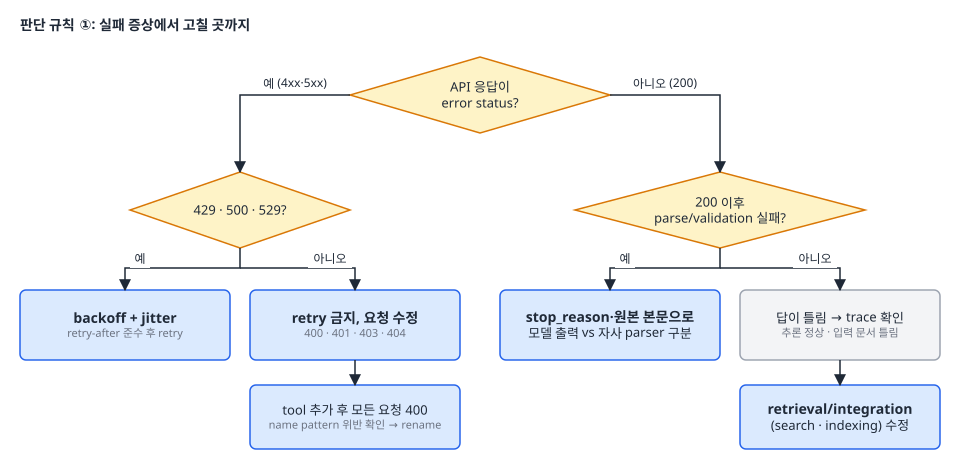
*그림: API status와 parse 결과, trace를 차례로 보면 고칠 곳이 retry 정책, request, parser, retrieval 중 어디인지 정해진다.*

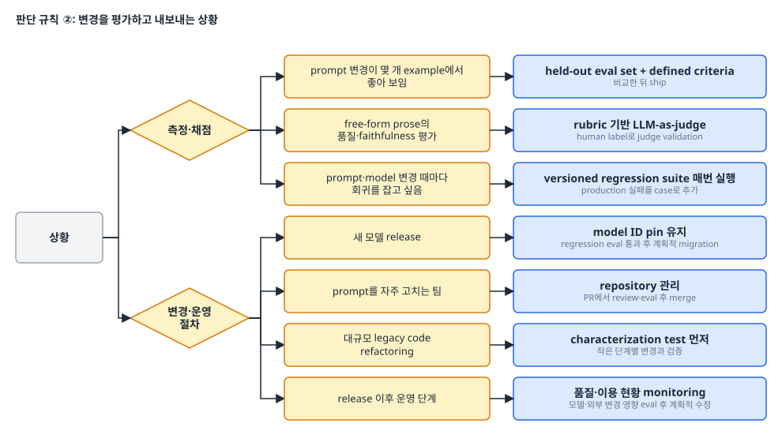
*그림: 변경을 평가하거나 내보내는 상황은 모두 eval·review로 측정한 뒤 계획적으로 진행하는 방향이 정답이다.*

근거: Amey-0010, Amey-0035, Amey-0050, Amey-0065, Amey-0080, CCAR-F-Udemy01-0010, CCAR-F-Udemy01-0022, CCAR-F-Udemy02-0011, CCAR-F-Udemy02-0030, CCAR-F-Udemy03-0051, CCAR-F-Udemy05-0057, CCAR-P-Amey-Thakur-0006, CCAR-P-Amey-Thakur-0007, CCAR-P-Amey-Thakur-0020, CCAR-P-Amey-Thakur-0021, CCAR-P-Amey-Thakur-0022, CCAR-P-Amey-Thakur-0023, CCAR-P-Amey-Thakur-0039, CCAR-P-Amey-Thakur-0040, CCAR-P-Amey-Thakur-0057, CCAR-P-Amey-Thakur-0058, CCAR-P-Amey-Thakur-0073, CCAR-P-Amey-Thakur-0074, CCAR-P-jrajath94-0005, CCAR-P-jrajath94-0006, CCAR-P-jrajath94-0024, CCAR-P-jrajath94-0025, CCAR-P-jrajath94-0026, CCAR-P-jrajath94-0027, CCAR-P-jrajath94-0028, CCAR-P-jrajath94-0031, CCAR-P-jrajath94-0032, CCAR-P-jrajath94-0085, CCAR-P-jrajath94-0086, CCAR-P-jrajath94-0088, CCAR-P-jrajath94-0089, CCAR-P-jrajath94-0090, CCAR-P-jrajath94-0163, CCAR-P-jrajath94-0164, CCAR-P-jrajath94-0165, CCAR-P-jrajath94-0167, CCAR-P-jrajath94-0168, CCAR-P-jrajath94-0182, CCAR-P-jrajath94-0183, CCAR-P-jrajath94-0184, CCAR-P-jrajath94-0185, CCAR-P-jrajath94-0187, CCAR-P-jrajath94-0188, CCAR-P-jrajath94-0189, CCAR-P-jrajath94-0190, CCAR-P-jrajath94-0191, CCAR-P-jrajath94-0192, CCAR-P-jrajath94-0193, CCAR-P-jrajath94-0194, CCAR-P-jrajath94-0195, CCAR-P-jrajath94-0196, CCAR-P-jrajath94-0197, CCAR-P-jrajath94-0202, CCAR-P-jrajath94-0203, CCAR-P-jrajath94-0204, CCAR-P-jrajath94-0205, CCAR-P-jrajath94-0299, CCAR-P-jrajath94-0300, CCAR-P-jrajath94-0307, CCAR-P-jrajath94-0308, CCAR-P-jrajath94-0309, CCAR-P-jrajath94-0310, CCAR-P-jrajath94-0313, CCAR-P-jrajath94-0355, CCAR-P-jrajath94-0363, CCAR-P-jrajath94-0365, CCAR-P-jrajath94-0371, CCAR-P-jrajath94-0372, CCAR-P-jrajath94-0418, CCAR-P-jrajath94-0426, CCAR-P-jrajath94-0481, CCAR-P-jrajath94-0482, CCAR-P-jrajath94-0493, CCAR-P-jrajath94-0494, CCAR-P-jrajath94-0495, CCAR-P-jrajath94-0498, CCAR-P-jrajath94-0544, CCAR-P-jrajath94-0545, CCAR-P-jrajath94-0552, CCAR-P-jrajath94-0554, CCAR-P-jrajath94-0561, CCAR-P-jrajath94-0640, CCAR-P-jrajath94-0657, CCAR-P-jrajath94-0670, CCAR-P-jrajath94-0693, CCAR-P-preporato-0017, CCAR-P-preporato-0019, CCAR-P-preporato-0020, Patrick-0006, Patrick-0014, Patrick-0027, Patrick-0030, Patrick-0032, Preporato-0030, Udemy-0003, Udemy-0018, Udemy-0023, Udemy-0027, Udemy-0037

## 3. 자주 나오는 오답 함정

| 오답 | 이유 |
|---|---|
| 더 큰 모델로 교체 | 잘못된 입력 · 잘못된 request(400)는 모델 교체로 해결 ✗ 실패 빈도만 지켜봐서는 원인 layer 파악 ✗ |
| prompt에 정확성 강조 문구 추가 | 입력 오류엔 효과 ✗ |
| 모델에게 어느 prompt가 나은지 질문 | self-assessment = 측정 ✗ |
| flag · 일부 traffic으로 먼저 내보내고 관찰 release 당일 교체, 문제 시 되돌림 | 사용자를 test set으로 사용 ✗ |
| golden answer와 exact string match | prose는 정답도 표현 다름 → match ✗ |
| 새 모델이 더 나음 / vendor benchmark가 증명 | 개별 prompt에서의 동작 보장 ✗ |
| 모든 error를 retry | 400은 retry 효과 ✗ (매번 실패) |
| 즉시 retry | 과부하 증가 |
| retry가 우연히 성공하면 해결 | 근본 원인 은폐 |
| `max_tokens` 올려 400 해결 | 출력 길이는 request 형식 오류와 무관 → 해결 ✗ |
| 사용자 피드백으로 모델 자동 재학습 | Claude API 모델은 운영 중 학습 ✗ |
| uptime · server 재시작 절차만 정비 변경 동결 | 답변 내용이 지금도 맞는지 확인 ✗ |
| refactoring에 기능 추가 동시 진행 big-bang rewrite | 원인 분리 ✗ · 되돌리기 ✗ |
| eval 세트를 크게 만들어 편향 해소 | 편향 표본은 크기로 안 고쳐짐 실패 유형이 계속 가려짐 |
| 같은 종류 case 추가 · training set 재사용 | 분량만 늘고 사각지대 유지 |
| 최근 티켓 · 합성 예시로 eval 구성 | 희귀 유형 누락 · 생성 모델 편향 |
| 구성 각주 · 어려운 case 삭제 · 쉬운 case 추가 | 오해 소지 헤드라인 유지 실패 숨김 |
| 옛 티켓 추가 · 옛 점수 올리려 tuning 한 분기 대기 | stale-evaluation 함정 현재 production 예측 ✗ |
| 지저분한 입력 필터링 · 기준 낮춤 | 실제 사용자 삭제 · 기준 후퇴 |
| judge prompt로 점수 낮추기 · 더 큰 judge judge 3개 평균 | 숫자만 이동 · 크기 ≠ ground truth 틀린 것 셋의 평균도 틀림 |
| 신뢰성 테스트 없이 LLM 전량 채점 두 번째 LLM 교차 검증 | 신뢰성 확인이 선행 조건 |
| 모든 답변을 사람 panel로 채점 | 느리고 비쌈 |
| unit test 수 확대 · token 효율 측정 | 사각지대(가독성 · 의도) 그대로 |
| 확신도 threshold · 자유 기술 사유 · PR별 기각률 | 지적 종류를 집계 못 함 |
| ⚠️ Console 샘플러 · 판정 cache 설정 | 해설이 "문서에 설명 없음"으로 배제 문서 변경 시 달라질 수 있음 (공식 문서 미확인) |
| ⚠️ "60% 일치 = 우연 수준" | 척도 의존 표현 · 공식 문서에 수치 기준 없음 (공식 문서 미확인) |
| PII 유지 · bucket만 이동 · 고친 bug case 삭제 | 노출 지속 · 회귀 방어 상실 |
| 한 번에 하나 변경 · 신중 review · 변경 빈도 제한 | 위험 감소일 뿐 회귀 탐지 ✗ |
| 사고 · 연간 일정 · 비용을 재평가 trigger로 사용 | 늦거나 실제 변경과 무관 |
| 시점 상관관계로 revert · 사용자 인상 확인 | 증거 아님 · 노이즈 · 느림 |
| 사람 눈 review · 요일 제한 · 시니어 제한 | 측정 없음 · 회귀 증명 ✗ |
| 호환 가정 · monitoring 강화 · 불만 후 자동 rollback | 사용자 영향 후에야 감지 |
| 즉시 50% 배포 · 전체 배포 후 dashboard | shadow 생략 · 측정 전 피해 |
| 모델에게 prompt 안전성 질문 | test 아님 |
| canary 중 on-call 판단 · 감시 인원 증원 | 관찰만 개선 · 결정 개선 ✗ |
| 데모 · 팀 합의 · 투표 · 비용 추정으로 준비 판정 | 시스템이 작동한다는 입증 ✗ |
| 전체 정확도 · 전체 수용률 하나로 판단 | 세그먼트 · 카테고리 편향을 평균으로 가림 |
| 녹색 proxy의 임계값 상향 · 평균 · 대체 proxy(BLEU) | 목표 지표 개선 ✗ proxy 문제 그대로 |
| 모델 자체 평점 · 신뢰도 점수를 지표로 | 같은 모델이 자기 출력 채점 보정 안 됨 · prompt injection 가능 |
| gate 전체 중지 · 주의 문구만 추가 | 양호한 시그널 손실 · 신뢰 저하 방치 |
| schema 준수 = 품질 신뢰 지표 | 형식과 내용 혼동 |
| 정확도 하나로 안전 검증 | 평균이 집중된 피해를 숨김 |
| p-value만으로 배포 | 효과 실재 ≠ 비용 대비 가치 |
| 이번 주 vs 지난주 · 요일별 variant 비교 | 시간 · 트래픽 구성과 교락 |
| 페이지 로드마다 variant 무작위 | 한 사용자가 두 variant 경험 |
| 하루 400건이면 충분하다는 가정 | 표본 크기는 상승폭이 결정 |
| 위험한 변경을 첫날 전체 traffic A/B | blast radius 최대 |
| 가장 큰 ms 단계 · 익숙한 단계 최적화 | 측정된 비율 · 비중이 결정 |
| verification · guard 단계 삭제 | 정확도 하한 붕괴 |
| 전부 작은 모델 · cache · 출력 토큰 절반 | 정확도 하한 위반 · hit ≈ 0 · 추론 잘림 |
| 미측정 단계를 응답 뒤로 이동해 p95 숨김 | 가치 결정 없이 숨기기만 함 |
| 스팟 체크 추가 · 이해관계자 선호 · 일괄 배포 | 측정 · 귀인 ✗ |
| 비용 아끼려 eval 월 1회 · 보정 없는 judge | 회귀를 몇 주 놓침 · 채점자 아님 |
| 지목되지 않은 계층에 대리 수정 (tier 상향 · index 재구축 · prompt 재작성) | 비용만 증가 · 지목 계층은 그대로 깨진 chunk · 잘린 text는 큰 tier도 동일 |
| 더 큰 tier로 잘린 입력 해결 | 모든 tier에 세부 정보 없음 |
| 추론 추가 · 잘린 형식용 학습 data 수집 | 잃은 세부 정보 복구 ✗ 형식이 bug, data는 bug 아님 |
| 흔한 용의자(prompt)부터 의심 | 변경 로그가 습관보다 우선 |
| 하락 원인을 "질문이 어려워졌다"로 돌림 | 증거 없음 · 변경 로그가 증거 |
| 증거 없이 prompt 재작성 · index 재구축 | 추측 · layer 추측이 가장 비싼 느림 |
| "환각하지 말 것" prompt · 큰 모델 · 재시도 | 검증 불가 · parametric 환각 지속 · 같은 분포 표본 |
| 100K 절단 · "끝부분 주의" prompt · 릴리스 대기 | 사실 삭제 · attention 감쇠는 prompt로 불가 · 알려진 특성 |
| chunk 수만 5 → 30 | 노이즈 증가 · 빠진 문단 보장 ✗ |
| 보존 기간 연장 · prompt 로그 정독 · 재시작 | 없는 hop은 생기지 않음 · 조사 진전 없음 |
| hop 로그 양만 증가 · 두 번째 queue | 연결 없는 로그 = noise · 손실 지점 증가 |
| trace 전부 안 함 · 불만에 의존 | 불만은 monitoring 아님 |
| 모든 호출 full trace · 90일 full 보관만 | 규모에서 비실현 · skeleton은 재현 불가 |
| 암호화로 비밀 보호 · vendor 약속 | vendor가 복호화 · 약속은 통제 아님 |
| tracing 완전 중단 | 진단 신호 상실 |
| 전체 content export 후 prompt 검색 | metadata만 허용하는 data 규칙 위반 |
| 시간별 usage 보고서로 hop 추적 `claude_code.session.count`로 hop 추적 | token 합계 · session 시작 count일 뿐 |
| Usage API로 latency 읽기 분당 polling으로 초 단위 감지 | token 수 보고 · 집계는 요청보다 지연 |
| project 설정에서 OTel 활성화 `OTEL_LOG_USER_PROMPTS`로 tool 인수 | project 설정 무시 · tool 인수는 TOOL_DETAILS |
| 오류 로그만 + 주간 검토 | 환각은 오류를 거의 안 냄 · 24시간 기준 miss |
| latency · 비용 dashboard만 | 답변 품질 무관 |
| dashboard 녹색 = 정상 · 설문 영향력 낮추기 | 녹색 = suite 통과일 뿐 · 설문은 suite가 놓친 신호 |
| 일일 평균 1개 · 10개 · 실패마다 alert | 장애 하루 지연 · 여전히 일 단위 · alert 피로 |
| 담당자 없이 threshold 조정 · alert 추가 · alert 끄기 | 유지할 사람 없음 · noise 증가 · 유일한 신호 상실 |
| 무시되는 alert 유지 · 더 크게 page threshold 낮춤 | 같은 거짓 원인으로 더 자주 발동 |
| 더 좋은 · 더 많은 dashboard | 보는 사람이 없음 |
| infra 동결 | 문서에 그런 설정 설명 없음 |
| 지표 비교 전 prompt 재작성 · grader 재학습 | 증거 확보 전 변경 |
| Messages API 일관성 flag로 근거 없는 답 차단 | 해당 flag는 문서에 없음 |
| 월 1회 수동 dashboard 검토 latency만 alert · trace 미보관 | 42일 뒤 발견 · 품질 · 비용은 조용히 drift · 감사 불가 |
| 문서 순서 섞기 · token 한도 증가 · 2회 실행 | 일관성과 무관 · 길이에만 영향 · 변동성 측정일 뿐 |

근거: Amey-0010, Amey-0035, Amey-0050, Amey-0065, CCAR-F-Amey-Thakur-0026, CCAR-F-Udemy01-0022, CCAR-F-Udemy02-0011, CCAR-F-Udemy02-0030, CCAR-F-Udemy05-0057, CCAR-P-Amey-Thakur-0006, CCAR-P-Amey-Thakur-0007, CCAR-P-Amey-Thakur-0020, CCAR-P-Amey-Thakur-0021, CCAR-P-Amey-Thakur-0022, CCAR-P-Amey-Thakur-0023, CCAR-P-Amey-Thakur-0040, CCAR-P-Amey-Thakur-0057, CCAR-P-Amey-Thakur-0058, CCAR-P-Amey-Thakur-0074, CCAR-P-jrajath94-0005, CCAR-P-jrajath94-0006, CCAR-P-jrajath94-0025, CCAR-P-jrajath94-0026, CCAR-P-jrajath94-0027, CCAR-P-jrajath94-0028, CCAR-P-jrajath94-0031, CCAR-P-jrajath94-0032, CCAR-P-jrajath94-0085, CCAR-P-jrajath94-0086, CCAR-P-jrajath94-0088, CCAR-P-jrajath94-0089, CCAR-P-jrajath94-0090, CCAR-P-jrajath94-0163, CCAR-P-jrajath94-0164, CCAR-P-jrajath94-0166, CCAR-P-jrajath94-0167, CCAR-P-jrajath94-0168, CCAR-P-jrajath94-0183, CCAR-P-jrajath94-0185, CCAR-P-jrajath94-0186, CCAR-P-jrajath94-0187, CCAR-P-jrajath94-0188, CCAR-P-jrajath94-0189, CCAR-P-jrajath94-0190, CCAR-P-jrajath94-0192, CCAR-P-jrajath94-0193, CCAR-P-jrajath94-0194, CCAR-P-jrajath94-0195, CCAR-P-jrajath94-0197, CCAR-P-jrajath94-0202, CCAR-P-jrajath94-0203, CCAR-P-jrajath94-0204, CCAR-P-jrajath94-0205, CCAR-P-jrajath94-0206, CCAR-P-jrajath94-0299, CCAR-P-jrajath94-0300, CCAR-P-jrajath94-0307, CCAR-P-jrajath94-0309, CCAR-P-jrajath94-0310, CCAR-P-jrajath94-0314, CCAR-P-jrajath94-0366, CCAR-P-jrajath94-0372, CCAR-P-jrajath94-0429, CCAR-P-jrajath94-0430, CCAR-P-jrajath94-0435, CCAR-P-jrajath94-0491, CCAR-P-jrajath94-0492, CCAR-P-jrajath94-0493, CCAR-P-jrajath94-0555, CCAR-P-jrajath94-0556, CCAR-P-jrajath94-0597, CCAR-P-jrajath94-0638, CCAR-P-jrajath94-0640, CCAR-P-jrajath94-0655, CCAR-P-jrajath94-0656, CCAR-P-jrajath94-0657, CCAR-P-jrajath94-0658, CCAR-P-jrajath94-0659, CCAR-P-jrajath94-0663, CCAR-P-jrajath94-0669, CCAR-P-jrajath94-0670, CCAR-P-jrajath94-0688, CCAR-P-jrajath94-0693, CCAR-P-jrajath94-0708, CCAR-P-preporato-0018, CCAR-P-preporato-0020, Patrick-0006, Patrick-0014, Patrick-0030, Patrick-0032, Udemy-0003, Udemy-0023, Udemy-0027, Udemy-0037

## 4. 암기 목록

| 이름 | 의미 |
|---|---|
| 400 `invalid_request_error` | request 형식 · 내용 오류 retry ✗ → 요청 수정 |
| 401 `authentication_error` | 인증 오류 retry ✗ |
| 403 · 404 | client error retry ✗ |
| 429 `rate_limit_error` | rate limit → backoff 후 retry `retry-after` 준수 SDK 자동 retry · `RateLimitError` |
| 500 `api_error` | server error → backoff 후 retry |
| 529 `overloaded_error` | 과부하 → backoff 후 retry |
| `request-id` header | 모든 응답에 부착 trace와 API 측 기록 대조용 |
| `stop_reason: max_tokens` | 응답 잘림 200 이후 parse 실패의 원인 후보 |
| `^[a-zA-Z0-9_-]{1,128}$` | tool name pattern |
| eval drawer 5종 | representative · edge · adversarial malformed · regression |
| grading 순서 | code → LLM judge → 사람 표본 |
| stratified 표본 | 유형 · 난이도 · 최신성별로 나눠 추출 희귀 유형 최소 개수 보장 |
| held-out 세트 | tuning · 학습에 쓰지 않은 평가 세트 |
| judge calibration | 사람 label과 대조해 judge 보정 |
| re-baseline | drift 기간의 기준선 재설정 |
| stale-evaluation 함정 | production이 변했는데 eval이 옛 세계에 머묾 |
| shadow 모드 | 새 prompt 실행 · 결정 기록 · 조치 ✗ |
| blast radius | 변경 노출 시 피해가 미치는 범위 |
| canary 사전 정의 4종 | 주요 지표 · guardrail 지표 최소 실행 시간 · 최소 표본 크기 |
| `detected_pattern` | 지적을 낳은 code 구조를 기록하는 schema 필드 기각 pattern 집계용 |
| ROUGE · BLEU | n-gram 중복 proxy 진실성 · 사용자 경험 측정 ✗ |
| faithfulness | 전사본으로 검증 가능한 주장 비율 |
| groundedness | 주장된 각 사실이 원문으로 추적됨 |
| recall | 실제 대상(버그 · 사기) 중 잡은 비율 |
| 가드 지표 | 임계값 0 · 위반 시 출시 차단 |
| 성공한 작업당 비용 | 예산 제약 시 주요 비즈니스 지표 |
| 하위 집단 공정성 | 순위 품질을 집단별로 측정 |
| p50 · p95 · p99 | 중앙값 · tail interactive SLA = p95 · p99 |
| 손익분기 | 일 추가 비용 ÷ 일 추가 성공 건수 |
| blast radius | 변경 노출 범위 위험한 변경 → shadow로 먼저 제한 |
| 채점 사다리 | code → 보정된 judge → 사람 표본 |
| ms/정확도 포인트 | 삭감 우선순위 비율 최악 단계부터 |
| offline 평가 서랍 | 대표 · edge · adversarial · malformed · regression |
| run id (correlation id) | 모든 hop에 전파되는 식별자 흩어진 hop 이벤트를 하나의 실행으로 연결 |
| hop별 timing | 느린 hop vs 누락 hop 구분 |
| skeleton trace | request id · 결과만 담은 경량 trace deep sample · 전체 오류 trace와 짝 |
| metadata only export | prompt text 제외 · 식별자 · 타이밍 유지 |
| redaction | trust boundary 전에 비밀 · PII 제거 코드로 유지 · 테스트 |
| 변경 날짜 규칙 | 실패가 변경일에 시작 → 그 계층 먼저 의심 |
| 요구사항 → 지표 → 임계값 → 책임자 | 요구사항 체인 책임자 누락 시 임계값 표류 |
| 빠른 line · 느린 line | 장애(분 단위) · drift(주 단위) 짝 설계 |
| `OTEL_LOG_TOOL_DETAILS` | tool 입력 · MCP server · tool 이름 기록 |
| `OTEL_LOG_USER_PROMPTS` | tool 인수 캡처용 ✗ (tool 인수 = `OTEL_LOG_TOOL_DETAILS`) |
| `claude_code.session.count` | session 시작 시 count |
| `/usage` | 현재 session 비용 확인 |
| 응답의 `usage` 필드 | 호출 완료 즉시 token 보고 |
| time to first token | streaming 호출의 핵심 latency |
| effective context vs advertised context | window에 들어가도 균일하게 활용 ✗ |
| retrieve-then-read | 관련 섹션 먼저 → 작은 context에서 추론 |
| groundedness 지표 | 인용 · 판례가 corpus에 존재하는지 확인 |

근거: CCAR-F-Udemy05-0057, CCAR-P-jrajath94-0024, CCAR-P-jrajath94-0025, CCAR-P-jrajath94-0028, CCAR-P-jrajath94-0032, CCAR-P-jrajath94-0085, CCAR-P-jrajath94-0086, CCAR-P-jrajath94-0088, CCAR-P-jrajath94-0089, CCAR-P-jrajath94-0163, CCAR-P-jrajath94-0167, CCAR-P-jrajath94-0168, CCAR-P-jrajath94-0184, CCAR-P-jrajath94-0185, CCAR-P-jrajath94-0187, CCAR-P-jrajath94-0188, CCAR-P-jrajath94-0190, CCAR-P-jrajath94-0193, CCAR-P-jrajath94-0194, CCAR-P-jrajath94-0203, CCAR-P-jrajath94-0300, CCAR-P-jrajath94-0307, CCAR-P-jrajath94-0308, CCAR-P-jrajath94-0309, CCAR-P-jrajath94-0313, CCAR-P-jrajath94-0356, CCAR-P-jrajath94-0363, CCAR-P-jrajath94-0371, CCAR-P-jrajath94-0426, CCAR-P-jrajath94-0489, CCAR-P-jrajath94-0490, CCAR-P-jrajath94-0493, CCAR-P-jrajath94-0545, CCAR-P-jrajath94-0552, CCAR-P-jrajath94-0554, CCAR-P-jrajath94-0638, CCAR-P-jrajath94-0640, CCAR-P-jrajath94-0655, CCAR-P-jrajath94-0657, CCAR-P-jrajath94-0669, CCAR-P-jrajath94-0693, CCAR-P-jrajath94-0708, Patrick-0006, Patrick-0027, Patrick-0032, Preporato-0030, Udemy-0023

## 5. 시험 직전 체크리스트

- [ ] 몇 개 example로 판단 ✗
- [ ] held-out eval set + defined criteria로 비교
- [ ] prose 품질 → rubric 준 LLM-as-judge
- [ ] judge → human label로 validation
- [ ] regression suite → prompt · model 변경 시마다 실행
- [ ] production 실패 → regression case로 추가
- [ ] model ID pin → regression eval 통과 후에만 → migration
- [ ] trace "추론 맞음 · 입력 틀림" → retrieval layer 수정
- [ ] 4xx = request 조립 문제
- [ ] 200 이후 실패 = `stop_reason` · 원본 출력 문제
- [ ] 429 · 500 · 529 → backoff 후 retry
- [ ] 400 · 401 · 403 · 404 → 요청 수정
- [ ] prompt → repository · PR · eval 거쳐 merge
- [ ] refactoring → characterization test → 작은 단계
- [ ] eval 점검 → 대표성 · 층화 · 최신성 · 빠진 drawer
- [ ] judge 점수 → 사람 label로 보정한 뒤에만 신뢰
- [ ] 변경(prompt · model) → regression suite 재실행 · red면 ship ✗
- [ ] 해를 줄 수 있는 변경 → shadow → 통제된 노출 · rollback trigger 사전 등록
- [ ] 형용사 요구 → 지표 · 임계값 · 가드 · 담당자
- [ ] 녹색 proxy · 집계 점수 → 목표 · 세그먼트별 재측정
- [ ] A/B → 동시 · 무작위 · 일관 할당 · 변경 1개
- [ ] p95 초과 → 단계별 측정 → 지배 단계부터
- [ ] 실패 시작일 변경 계층 먼저 → trace 확인 → 수정
- [ ] chunk 도착 · 답 틀림 → model · prompt 계층
- [ ] hop 연결 = run id 전파 · 로그 양 ✗
- [ ] alert = 담당자 + runbook · 무조치 alert 폐기

근거: CCAR-F-Udemy01-0022, CCAR-P-jrajath94-0025, CCAR-P-jrajath94-0026, CCAR-P-jrajath94-0027, CCAR-P-jrajath94-0088, CCAR-P-jrajath94-0163, CCAR-P-jrajath94-0182, CCAR-P-jrajath94-0183, CCAR-P-jrajath94-0187, CCAR-P-jrajath94-0190, CCAR-P-jrajath94-0191, CCAR-P-jrajath94-0194, CCAR-P-jrajath94-0204, CCAR-P-jrajath94-0205, CCAR-P-jrajath94-0299, CCAR-P-jrajath94-0310, CCAR-P-jrajath94-0313, CCAR-P-jrajath94-0365, CCAR-P-jrajath94-0372, CCAR-P-jrajath94-0419, CCAR-P-jrajath94-0430, CCAR-P-jrajath94-0556
