# 8. Tools and MCPs — 반드시 알아야 할 지식
> 시험 비중 10% · 약 3문항 · 근거 문항 21개

> 커버: CCDV-F D8 · CCAR-F D2 · CCAR-P D3(일부)

## 1. 핵심 개념

### 1-1. tool_use ↔ tool_result 왕복 (client tools)
**결과 = user 메시지의 `tool_result`**

| 구분 | 내용 |
|---|---|
| 응답 | `stop_reason: tool_use`로 종료 content에 `tool_use` 블록(id, name, input) |
| 실행 주체 | 앱 |
| 다음 요청 ① | `tool_use` 블록이 든 assistant 턴 그대로 첨부 |
| 다음 요청 ② | 이어서 user 메시지에 `tool_result` 블록 각 `tool_result` = 같은 `tool_use_id`로 짝 맞춤 |
| stateless | Messages API → 모델 "기억" ✗ |
| 누락 시 | assistant 턴 · id 누락 → 에러 (graceful recovery ✗) |
| 오답 | 전용 SDK 메서드(예: `submit_result()`) ✗ system · assistant 메시지로 전송 ✗ |

| 구분 | 내용 |
|---|---|
| 실행 구조 | 앱이 tool 정의 → Claude가 `tool_use` 요청 → 앱이 실행 → `tool_result` 반환 loop |
| 실행 경계 | Claude = 어떤 tool · 어떤 인자 결정 앱 = 실행 |
| 권한 검사 뒤 실행해야 할 때 | 앱 코드가 각 tool 실행 출력 → `tool_result` 블록으로 반환 |
| loop 제어 | `stop_reason: tool_use`인 동안 요청 반복 `end_turn` 등 다른 stop reason에서 종료 |
| 문서마다 다음 행동이 다를 때 | description · schema가 명확한 tool 정의 위 loop를 앱이 실행 |

| 구분 | 내용 |
|---|---|
| 수동 loop 이력 | assistant `tool_use` 턴 유지 바로 다음 user 메시지에 `tool_result` (같은 `tool_use_id`) |
| 사이에 다른 메시지 | 확인 메시지 등 삽입 ✗ (배열 규칙 위반) |
| 결과를 prefill 요약으로 전송 | `tool_result`로 인식 ✗ Claude 4.6 이상 = prefill 400 오류 (이전 모델은 prefill 허용) |
| 서버 호출 성공 + Claude가 결과 모름 | 결과가 이력의 올바른 위치 · 형태에 없음 → trace로 로그 저장본과 실제 전송 이력 대조 |

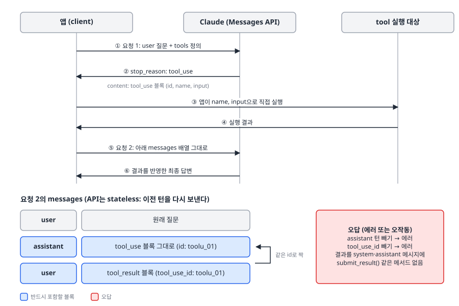
*그림: 앱이 tool_use를 실행하고, 다음 요청에서 assistant 턴을 그대로 둔 채 user 메시지의 tool_result(같은 tool_use_id)로 결과를 돌려줍니다.*

근거: CCAR-F-Udemy01-0056, CCAR-F-Udemy03-0021, CCAR-P-jrajath94-0589, Patrick-0002, Patrick-0017, Udemy-0013, Udemy-0016

### 1-2. Parallel tool use
**병렬 `tool_result`는 한 user 메시지에 모음**

| 구분 | 내용 |
|---|---|
| 기본 동작 | 한 assistant 턴에 `tool_use` 블록 여러 개 가능 |
| 반환 | 모두 실행 → 모든 `tool_result`를 한 user 메시지에 모음 |
| 여러 메시지로 분할 | 모델의 병렬 호출 감소 → 이후 latency 증가 |
| 한 턴 1호출 제한 | `disable_parallel_tool_use` |

| 구분 | 내용 |
|---|---|
| 위치 | `tool_result` user 메시지 = `tool_use` 포함 assistant 메시지의 바로 다음 사이에 다른 메시지 삽입 ✗ |
| content 순서 | `tool_result` 블록 = 배열 맨 앞 덧붙이는 텍스트 = 그 뒤 |
| 요약 텍스트만 전송 | 결과 ↔ 호출 대응 · 실행 여부 파악 ✗ assistant 턴 유지 + `tool_use_id` 짝 필요 |
| 점검 3가지 | 역할(user) · 순서(앞) · 메시지 수(하나) |

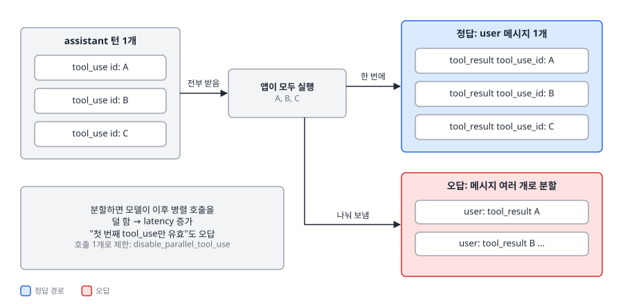
*그림: 여러 tool_use의 결과는 한 user 메시지에 모아 돌려주고, 메시지를 나누면 이후 병렬 호출이 줄어듭니다.*

근거: CCAR-F-Udemy01-0006, Patrick-0018

### 1-3. Tool 에러 처리
**실패 = `is_error: true`인 `tool_result`로 반환**

| 구분 | 내용 |
|---|---|
| 방법 | content에 에러 기재 + `is_error: true` |
| 효과 | 모델이 인자 수정 · 다른 방법 선택 · 사용자에게 설명 |
| 에러 내용 | 구체 기술 = 발생 내용 · 다음 시도 → 추측 없는 회복 |
| 빈 `tool_result` | 실제 결과 없음일 때만 |
| `is_error` 한계 | 호출 뒤의 회복 수단 잘못된 tool 선택 자체 방지 ✗ 되돌리기 어려운 작업(예약 확정 · 취소) = 호출 순간 영향 발생 |

| 처리 | 판정 |
|---|---|
| 실패를 빈 결과로 위장 | ✗ 모델이 "해당 데이터 없음"으로 오해 (예: 알레르겐 없음으로 착각) |
| 같은 호출 무한 재시도 | ✗ |
| raw 에러를 최종 사용자에게 노출 | ✗ |
| 실행 전체 중단 | ✗ |
| 일시적 장애 → 제한된 재시도 | 상황에 따라 ✓ |
| 복구 불가능한 장애(예: 인증 만료) → 중단 | 상황에 따라 ✓ |

| 구분 | 내용 |
|---|---|
| 일률적 에러 문구 | 모든 실패에 같은 "Operation failed" → 재시도 가능 여부 판단 불가 |
| `is_error: true`만 부착 | 판단 재료 부족 → 불필요 재시도 · 비일관 escalate |
| 올바른 응답 | 실패 분류 · 재시도 가능 여부 메시지 · 시정 힌트를 구조화해 반환 |
| 에러 코드 · 스택 트레이스만 | 다음 수 결정 불가 → 구체적 · 실행 가능한 개선점 필요 |
| 두 독자 | agent용 = 분류 · 재시도 가능 여부 사람용 = 고객이 이해할 설명 |
| 비즈니스 규칙 위반 | 재시도 불가 플래그 + 이해하기 쉬운 설명 |
| 입력 오류 | 시정 힌트 = 유효 형식 · 후보 ID ID 조회 tool 안내 |
| 처리 불가 인자 | 정보 담긴 에러 반환 가장 비슷한 결과 추측 · 빈 결과 ✗ (조용히 틀린 결과) |
| 필드 이름 | `errorCategory` · `isRetryable` = tool 측이 설계하는 metadata의 예 MCP 사양이 정한 값 ✗ |
| 설계 점검 질문 | "이 응답만 읽고 다음 인자를 정할 수 있는가" |

| 증상 | 원인 | 조치 |
|---|---|---|
| 같은 호출 4~5회 반복 + "시스템 장애" 오안내 | 한도 초과 · 규칙 위반 · 입력 오류를 일시 장애와 구별 ✗ | 분류 · 재시도 불가 · 사유 설명 반환 |
| 접근 거부 후 검색어만 바꿔 반복 보고서에 "일부 취득 불가"만 기재 | 분류 · 재시도 가능 여부 · 사유 부재 | 시도 중단 + 취득 못 한 이유 정확히 보고 |
| 정책 차단을 성공처럼 반환 → 표현만 바꿔 같은 요청 반복 | 실패 신호 부재 | `isError: true` + 재시도 가능 여부 구조화 |
| "검증 실패" 텍스트를 일반 결과로 반환 | 같은 호출 반복 · 하위 시스템이 성공으로 처리 | `isError: true` + 종류 · 수정 힌트 |

| 에러 종류 | 예 | 대응 |
|---|---|---|
| 일시적 | timeout · 429 · 서비스 불가 | 대기 후 재시도 |
| 검증 | 존재 않는 ID · 형식 불량 · 불가능한 날짜 | 입력 수정 후 재호출 |
| 비즈니스 | 한도 초과 · 마감 규칙 · 정책 차단 | 재시도 ✗ 사유 안내 · escalate |
| 권한 | 접근 거부 · 계약 외 데이터 · 라이선스 만료 | 재시도 ✗ 다른 정보원 탐색 · 부족으로 보고 |

| 구분 | 내용 |
|---|---|
| 한도 초과 → 일시적으로 분류 | 시간 지나도 안 풀림 → 잘못된 정보 · 재시도 조장 |
| 모든 실패에 같은 재시도 | 검증 오류엔 낭비 횟수 · 간격 · 캐시 조정만으로 해결 ✗ |
| 일률적 지수 백오프 | 종류 구분 없는 재시도 고착 |
| 재시도 위치 | 일시적 실패 = tool · subagent 내부 재시도 (횟수 상한) |
| 상위 전파 대상 | 로컬에서 못 푼 에러만 부분 결과 + 시도한 내용 + 마지막 에러와 함께 |
| 일시 에러를 coordinator에 전달 | 위임 반복 · context · 토큰 낭비 |
| tool 수준 처리 근거 | tool = 에러 유형을 확정적으로 앎 agent의 플래그 해석 · prompt 준수에 의존 ✗ |
| 영구 에러(구문 오류 등) | 재시도 ✗ → 에러로 반환 |
| 오답 | 전용 retry subagent = 처리 위치만 이동 전체 중단 = 일시 실패에 과잉 반응 |
| 받는 쪽 방침 | 재시도 가능 여부에 따라 재시도 · 전환 · escalate 지시 slash command에도 에러 종류별 동작 명시 |
| 필요 조합 | 에러 정보량(tool) + 행동 방침(호출 측) 둘 다 |

| 상황 | 반환 | 의미 |
|---|---|---|
| 검색 성공 · 일치 0건 | 성공 + 빈 결과 | "없음" 확인 완료 |
| timeout · 접근 실패 | `is_error: true` 에러 | "확인 못 함" · 재시도 판단 대상 |
| 둘 다 빈 배열 | ✗ | 실패가 "확인된 부재"로 보고됨 |
| 둘 다 에러 | ✗ | 유효한 빈 결과 소실 |
| 실패 시 캐시 반환 | ✗ | 낡은 정보가 새 결과처럼 보임 |
| 실패 시 관련성 지어내기 | ✗ | 적용 안 되는 정책 인용 |
| 빈 결과에 검색 조건 첨부 | 제품명 · 대상 DB | 어디서 못 찾았는지 보고 가능 |
| 하위 시스템 전달 | 조회 결과를 레코드의 독립 상태 항목으로 보존 | 구분 유지 |
| `stop_reason` | tool 성공 여부 표시 ✗ | 구분 수단 아님 |

| 경로 | 대상 | 모델 전달 |
|---|---|---|
| JSON-RPC 프로토콜 에러 | 알 수 없는 tool · 잘못된 형식 요청 | 요청 구조 문제 모델이 고치기 어려움 |
| tool 실행 에러 (`isError: true`) | API 실패 · 입력 검증 · 비즈니스 로직 | 실행 가능한 피드백 포함 client가 모델에 전달 → 자가 수정 |
| 오용 | 형식 불량 번호 · 취소된 예약을 JSON-RPC 에러로 | 이유 전달 보장 ✗ → "시스템 장애"로 답하고 종료 |

| 구분 | 내용 |
|---|---|
| 필수 절차 (검증 성공 전 제출 ✗) | 앱이 실행 전 게이트로 판정 Claude = `tool_use` 요청만 · 실행 = 앱 |
| 게이트 거부 응답 | `is_error: true` + 이유 + 다음 절차 → 검증 · 검토 ticket으로 복귀 |
| 오답 | 문구로 loop 중단 · `tool_choice` 일시 강제 → 제출 자체 저지 ✗ |

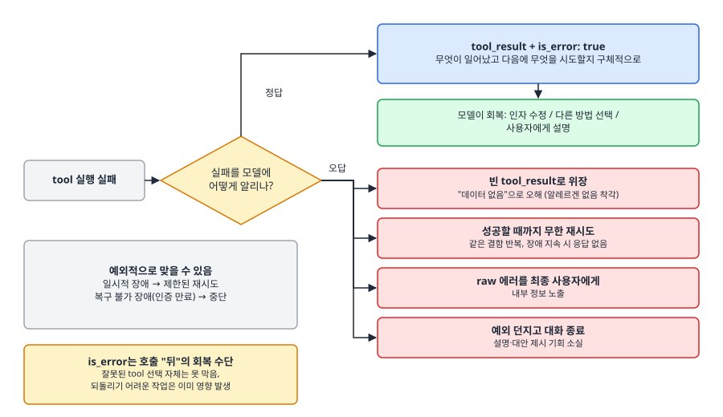
*그림: 실패는 is_error: true인 tool_result로 알려야 모델이 회복하며, 빈 결과·무한 재시도·raw 에러 노출·대화 종료는 오답입니다.*

근거: Amey-0032, CCAR-F-Amey-Thakur-0037, CCAR-F-Amey-Thakur-0076, CCAR-F-MyPractice-0062, CCAR-F-Udemy01-0013, CCAR-F-Udemy01-0027, CCAR-F-Udemy01-0031, CCAR-F-Udemy02-0002, CCAR-F-Udemy02-0054, CCAR-F-Udemy03-0015, CCAR-F-Udemy03-0054, CCAR-F-Udemy03-0055, CCAR-F-Udemy04-0027, CCAR-F-Udemy04-0030, CCAR-F-Udemy04-0036, CCAR-F-Udemy05-0004, CCAR-F-Udemy05-0028, CCAR-F-Udemy05-0033, CCAR-F-Udemy06-0009, CCAR-F-Udemy06-0024, CCAR-F-preporato-0003, Udemy-0025, Udemy-0036, Udemy-0045

### 1-4. tool_choice
**강제 호출 = `tool_choice` · 미지원 모델은 대체 조합**

| 값 | 의미 |
|---|---|
| `auto` | 기본값 · 호출 여부를 모델이 판단 |
| `any` | 어떤 tool이든 사용 강제 |
| `tool` | 지정 tool 사용 강제 |
| `none` | tool 사용 ✗ |

| 상황 | 조치 |
|---|---|
| "답 전 특정 tool 호출 강제" | 지원 모델 = `tool_choice`로 그 tool 지정 `auto` → 보장 ✗ |
| 일부 신규 모델 (Claude Opus 5.5, Claude Fable 5.1 등) | `any`/`tool`에 400 반환 → `auto` + 프롬프트 지시 + strict tool use 조합 |
| `tool_choice: auto` 설정 | 기본값 → 변화 없음 입력 형식 문제 해결 ✗ |

- 400 변경 = 시험 가이드(2026년 7월판) 이후
- 시험 = 강제 가능 전제로 출제 가능

| 요구 | 설정 | 이유 |
|---|---|---|
| 텍스트만 응답 제거 출구 tool 여럿 | `any` | 어느 tool이든 호출 선택은 모델 |
| 문서 유형 미정 추출 schema 여럿 | `any` | `tool` = 한 schema로 고정 `auto` = 대화 응답 여지 |
| 출력용 tool 여럿 (표 · 텍스트 등) | `any` | 텍스트만으로 끝나는 응답 차단 |
| 출구가 하나 특정 tool 필수 | `tool` + `name` | 지정 tool 호출 보장 |
| workflow 첫 단계만 고정 | 첫 요청 `tool` → 이후 `auto` | 강제 = 요청 단위 설정 후속 단계 = 이후 turn |
| 직접 답하기도 하는 coordinator | `auto` | `any` = 매번 호출 강제 |
| 문서마다 다음 행동이 다름 | `auto` | 호출 여부도 Claude 판단 |

| 증상 | 원인 | 조치 |
|---|---|---|
| 모든 요청에 `tool` 고정 → 같은 tool만 반복 | 강제가 후속 tool 호출 차단 | 첫 요청만 `tool` 이후 `auto` |
| 텍스트만 응답이 간헐 발생 | `auto`에서 tool 미호출 가능 | `any` + 출구 tool 정의 |
| 텍스트 응답 대부분 = "해당 없음" 결과 | 기록할 출구 tool 부재 | 빈 결과 보고 tool 추가 + `any` |
| `any`만 적용 | "해당 없음"을 기존 tool에 억지 기록 → 추측 기록 | 빈 결과 보고 tool 추가 |

| 문제 | 처방 |
|---|---|
| 잘못된 tool 선택 | description · 이름 · system prompt 수정 강제 = 선택 문제를 우회 · 입력별 선택 포기 |
| 올바른 tool + 잘못된 입력 | 입력 형식 · 필수 파라미터 · schema 수정 `tool_choice` 강제 ✗ |

| 구분 | 내용 |
|---|---|
| 미지원 설정 | 수동 extended thinking 활성 → `any` · `tool` 오류 · `auto`/`none`만 사용 공식 문서: adaptive는 허용 · 일부 신규 모델은 항상 400 |
| 순서 담보 대안 | 첫 요청에서 제공하는 tool 목록을 좁힘 `auto` + strict + prompt 유도 |

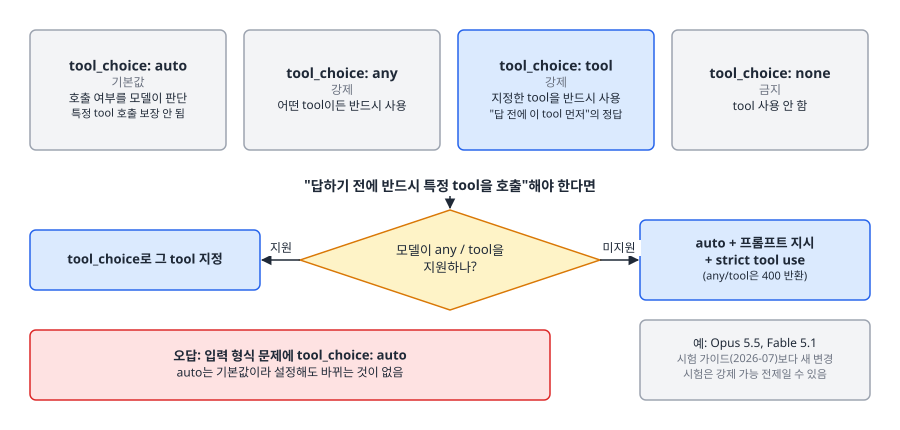
*그림: 특정 tool을 반드시 호출해야 하면 tool_choice로 지정하고, any/tool을 지원하지 않는 모델은 auto + 프롬프트 + strict로 대신합니다.*

근거: CCAR-F-Udemy01-0056, CCAR-F-Udemy02-0016, CCAR-F-Udemy02-0057, CCAR-F-Udemy03-0027, CCAR-F-Udemy03-0032, CCAR-F-Udemy03-0042, CCAR-F-Udemy03-0056, CCAR-F-Udemy04-0018, CCAR-F-Udemy04-0044, CCAR-F-Udemy05-0002, CCAR-F-Udemy06-0007, CCAR-F-Udemy06-0039, CCAR-F-Udemy06-0048, Preporato-0025, Udemy-0036

### 1-5. Strict tool use (입력 스키마 보장)
**입력 형식 보장 수단 = `strict: true`뿐**

| 수단 | 효과 |
|---|---|
| `strict: true` (tool 정의) | 입력이 `input_schema`를 따르도록 스키마 검증 타입 오류(문자열로 온 숫자) · 필수 필드 누락 근원 차단 |
| 더 긴 description | tool 선택 · 입력 작성에 도움 형식 보장 ✗ |
| temperature 낮춤 | 타입 보장 ✗ |

| 수단 | 보장 수준 |
|---|---|
| prompt로 형식 요청 | 확률적 말미 주석 · 필드 누락 · 타입 오류 재발 |
| 사후 검증 · 재시도 | 잘못된 출력의 발생 자체 방지 ✗ |
| API 기능으로 생성 시 제약 | 가장 확실 `strict: true` = tool 입력 Structured outputs = 응답 본문 |

| 목적 | 방법 |
|---|---|
| 대시보드가 tool 호출을 받는 설계 | `input_schema` client tool + `strict: true` 응답을 `tool_use`로 수신 |
| 인계 데이터 일관 | 전용 tool(예: `escalate_to_human`) `input_schema`의 `required` 필드로 지정 |
| 인계 tool 사용 유도 | 인계로 끝나는 대응 → 그 tool 호출 지시 schema + 호출 지시 = 둘 다 필요 |
| 모호한 입력이 그대로 전달 | 식별자 유형을 필수 파라미터로 선언 → 입구에서 차단 |
| backend 변경 불가 | tool 정의(description · schema)는 앱에서 수정 가능 |
| 형식이 엄격한 파라미터 | `input_examples` = schema에 맞는 입력 예시 |
| "해당 없음" 보고 tool | 검색 범위 · 이유를 필수 필드로 → coordinator가 추가 조사 판단 |
| 작업 범위 제한(최소 권한) | schema 상한(예: 100행)으로 tool 범위 한정 로깅 = 관찰 · 통제 ✗ |
| 상한 강제의 한계 | strict는 `maximum` 등 수치 제약 미지원 → 상한 통제는 앱 · SDK의 응답 검증 병행 전제 |
| prefill(응답 선두 `{` 채우기) | 신규 모델에서 사용 불가 공식 문서: Claude 4.6 이상은 prefill 400 오류 |

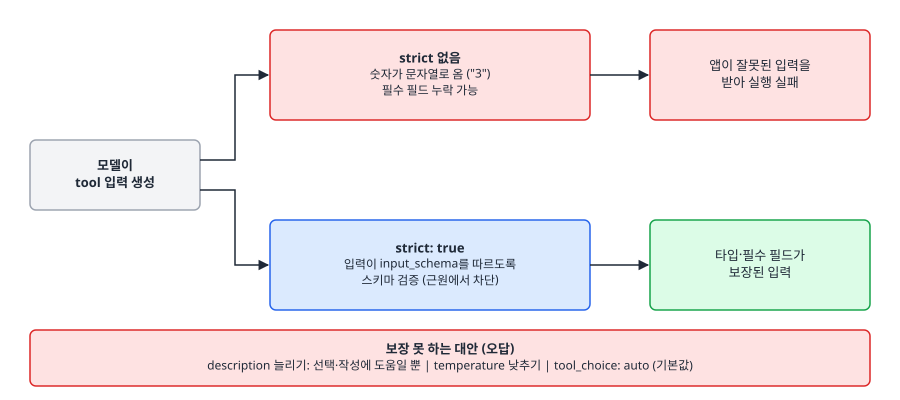
*그림: strict: true만 input_schema 검증으로 타입 오류와 필수 필드 누락을 근원에서 막고, description·temperature·auto는 보장하지 못합니다.*

근거: CCAR-F-Udemy01-0016, CCAR-F-Udemy01-0054, CCAR-F-Udemy03-0027, CCAR-F-Udemy03-0032, CCAR-F-Udemy04-0044, CCAR-F-Udemy05-0046, CCAR-P-jrajath94-0477, Preporato-0025

### 1-6. Tool description과 tool surface 설계
**정확도 = description · 겹침 = 설계로 해결**

| 구분 | 내용 |
|---|---|
| 올바른 tool 호출의 최대 요인 | description · 파라미터 설명의 명확성 |
| description 역할 | 모델이 tool을 고르고 쓰는 유일한 근거 |
| 좋은 description 요소 | ① 하는 일 ② 언제 쓰고 언제 쓰지 말지 ③ 각 파라미터의 의미 · 영향 ④ 제약(반환하지 않는 정보 등) |
| 공식 권장 | tool당 3~4문장 이상 |
| 우선순위 | 명확함 > 간결함 |

| 요인 | 영향 |
|---|---|
| 구현 언어 · 함수명 일치 | 선택에 도움 ✗ |
| 의미 있는 이름(서비스명 접두어 등) | 도움 · description 대체 ✗ |
| 모든 tool에 같은 범용 설명 | 구별 단서 소멸 |
| tool 개수 · 선언 순서 | description보다 영향 훨씬 작음 |
| JSON 반환 여부 | tool 선택엔 영향 ✗ · 결과 소비에 영향 |
| "신중히 고르라" 지시 더 큰 context window · 정렬 순서 | 오선택 해결 ✗ |
| MCP 서버 추가 후 uptime · latency 의심 | 먼저 볼 원인 ✗ (uptime · latency 문제는 에러 · 지연으로 드러남 · 모델은 바뀌지 않음) |

| 상황 | 조치 |
|---|---|
| tool끼리 겹쳐 오선택 | 원인 = interface 설계 문제 → 관련 작업 통합 · 목적이 뚜렷하게 tool surface 정리 |
| MCP 서버 추가 후 성공률 하락 | 먼저 새 tool의 기존 tool 중복 · description 구별성 확인 |

| 구분 | 내용 |
|---|---|
| 오선택 진단 | 첫 확인 = description이 용도 · 경계를 구분하는지 증상 구분 = 잘못된 tool 선택 vs 올바른 tool의 잘못된 입력 |
| 입력 | 허용 입력 형식 · 예시 질의 · edge case |
| 경계 | 유사 tool 대비 언제 쓰고 언제 쓰지 말지 |
| 출력 | 반환 항목 · 반환하지 않는 정보 |
| 읽기 · 쓰기 | 읽기 전용 명시 레코드 변경 = 다른 tool 사용 안내 |
| 범위 | 데이터 소스 · 수록 기간 · 검색어 예시 |
| 넣지 않을 내용 | 구현 언어 · framework · SLA · 소유 팀 → 선택 단서 ✗ |
| 한 줄 description | 유사 tool 간 선택 신뢰도 하락 신규 tool이 안 불리는 원인 |
| 새 tool 추가 시 | 기존 유사 tool description에도 구분 사용법 추가 |

| 구분 | 내용 |
|---|---|
| tool 이름 | 대상 · 범위가 드러나게 예: `extract_web_results` 예: `search_own_archive_1990_2015` |
| 파라미터 이름 | 모호한 `id` → `line_id` · `machine_id` 허용 ID 형식을 description에 기재 |
| 이름만 변경 | description 그대로면 정보량 불변 → 효과 미미 |
| 이름 · description 거의 동일한 tool 둘 | 모델이 고를 근거 부재 = 결함 코드 중복 · latency · 비용 = 부차적 |

| 증상 | 원인 | 조치 |
|---|---|---|
| 읽기 tool이 변경 요청 처리 (조회 후 "변경 완료" 응답) | description 경계 부재 | 각 tool 용도 · 전환 조건 기재 읽기 전용 명시 |
| 같은 일을 하는 tool 여럿 (파일 읽기 3종) | 선택 근거 부재 | 하나로 통합 또는 description 구분 |
| 분리 유지 요건 있음 (출력 사양 · 감사 로그) | 통합 불가 | 대상 드러낸 이름 + 사용 · 비사용 경계 description |
| 내장 tool(Grep)이 MCP tool보다 우선 | MCP description 최소 | 반환 값 · 내장보다 나은 상황 기재 |
| 신규 tool이 거의 안 불림 | 범위 없는 이름 · 한 줄 설명 | 수록 범위 · 검색어 예시 + 범위 드러낸 이름 |
| 올바른 tool에 잘못된 입력 | 선택이 아닌 입력 형식 문제 | 입력 형식 · `input_examples` 필수 파라미터 |
| 모호한 표현이 검색 tool로 전달 | 허용 입력 정보 부재 | 허용 형식 · 입력 예 · edge case 사용 범위 기재 |

**재설계 신호 · 비신호**

| 관찰 | 판정 |
|---|---|
| 요청 처리 불가 tool을 반복 선택 | 재설계 신호 description만으로 tool 구별 불가 = 설계 결함 |
| tool 개수(5개 · 10개 초과) | 그 자체로 결함 ✗ |
| tool이 JSON · 큰 payload 반환 | 신호 ✗ (tool 선택 문제와 별개) |
| 구현이 여러 서비스에 분산 | 신호 ✗ |
| 두 tool 설명이 겹침 (둘 다 "고객 찾기"를 처리하는 듯 보임) | capability bloat 신호 |
| 노출 45개 중 호출 로그에 9개만 사용 | capability bloat 신호 (미사용 tool도 매 요청에 실림) |
| subagent별 tool 범위 한정 · 읽기 전용 자격 증명 description 속 "쓰지 말 때" 명시 | bloat 아님 = 해결책 |

**중복 tool 정리**

| 상황 | 조치 |
|---|---|
| 이름만 다른 동일 기능 tool 2~3개 (`quote_rate` · `get_rate_quote` `rate_lookup`) | 하나만 남기고 제거 설명 하나 + 명확한 schema |
| "안전을 위해" 중복 유지 | ✗ 같은 동작에 이름 둘 = 오선택 확률 2배 |
| 중복 tool 추가 · 이름 주기적 변경 | ✗ bloat 악화 |
| 겹치는 조회 tool 2개 + 거의 같은 설명 | 구별되는 설명의 tool 하나로 병합 |
| 병합 · 제거 시 숨은 의존성 | 호출 측을 병합 tool로 갱신 숨은 workflow 호출 여부 확인 |
| 두 tool이 다른 백엔드 · 다른 SLA | 진짜 중복 아님 → 병합 전 확인 |
| 정리 후 | bloat 주기 검토 필요 담당자 없으면 tool 재증가 |

| 증상 | 의미 |
|---|---|
| 특정 키워드가 있을 때만 특정 tool 선호 (예: 78% 대 93%) | system prompt에 키워드 기반 routing 지시 존재 신호 description이 명확해도 prompt 지시가 동작을 이끎 |
| 불필요한 tool 호출 | 원인 후보 3가지 description · `tool_choice` · system prompt 지시 |
| description이 용도 명시 + `tool_choice: auto` | 남는 원인 = system prompt의 지시 |
| "find · search라 하면 반드시 검색 tool" | 광범위 키워드 지시 → 호출 과다(overtrigger) |
| 조치 | 실제 조사가 필요할 때만으로 규칙 축소 (Opus 4.5 · 4.6은 system prompt 반응성 높음) |
| 오답 | description 보강 · tool 이름 변경 = 원인 밖 `tool_choice: any` = 호출 강제 → 악화 |

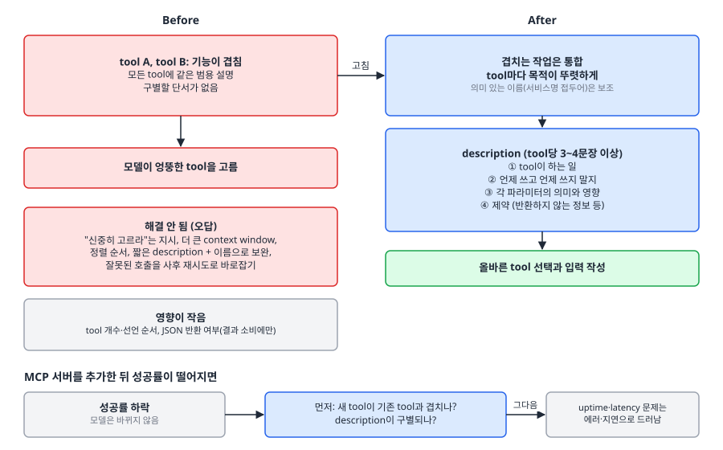
*그림: 엉뚱한 tool 선택은 겹치는 tool 통합과 4요소 description으로 고치며, 지시문·context 확장·정렬로는 고쳐지지 않습니다.*

근거: Amey-0030, Amey-0031, Amey-0063, Amey-0078, CCAR-F-Amey-Thakur-0010, CCAR-F-Amey-Thakur-0028, CCAR-F-Amey-Thakur-0031, CCAR-F-Amey-Thakur-0039, CCAR-F-Amey-Thakur-0061, CCAR-F-Amey-Thakur-0075, CCAR-F-MyPractice-0007, CCAR-F-MyPractice-0046, CCAR-F-MyPractice-0057, CCAR-F-Udemy01-0026, CCAR-F-Udemy01-0052, CCAR-F-Udemy02-0016, CCAR-F-Udemy02-0057, CCAR-F-Udemy03-0027, CCAR-F-Udemy04-0018, CCAR-F-Udemy04-0021, CCAR-F-Udemy04-0060, CCAR-F-Udemy05-0046, CCAR-F-Udemy05-0052, CCAR-F-Udemy06-0007, CCAR-F-Udemy06-0018, CCAR-F-Udemy06-0052, CCAR-F-paullarionov-0007, CCAR-F-paullarionov-0046, CCAR-F-paullarionov-0056, CCAR-F-paullarionov-0057, CCAR-F-preporato-0016, CCAR-P-jrajath94-0158, CCAR-P-jrajath94-0297, CCAR-P-jrajath94-0352, CCAR-P-jrajath94-0414, CCAR-P-jrajath94-0478, CCAR-P-jrajath94-0541, CCAR-P-jrajath94-0630, CCAR-P-preporato-0012, Udemy-0045

### 1-7. Tool 결과 크기 설계
**큰 객체를 다음 호출에만 쓰면 identifier 반환**

| 상황 | 반환 |
|---|---|
| 큰 객체 + 모델이 다음 호출에만 필요 | identifier(handle) → context 절약 |
| 그 외 | 필요한 전체 |
| "항상 전체" / "항상 id만" | 둘 다 ✗ 전체 vs identifier = 작업에 따라 결정 |

| 상황 | 반환 | 이유 |
|---|---|---|
| 큰 payload가 context 대부분 차지 | 작업 관련 결과만 상세는 별도 요청으로 제공 | 추론에 쓸 context 확보 |
| 사용자 설명에 쓸 값이 UUID · 코드뿐 | 의미 있는 이름 · 상태 우선 | 자연어 이름 → 정확도 상승 hallucination 감소 |
| 이름(설명용) + ID(후속 호출용) 둘 다 필요 | `response_format` enum `concise` = 이름 · 상태(기본) `detailed` = ID 포함 | 한 tool로 두 수요 충족 |
| 검색 후보 여럿(모호) | 후보 전부 + 식별 정보 (ID · 상태 · 등록일) | 모호함을 드러내 추측 방지 |
| 후보 여럿일 때의 동작 | description에 "작업 전 확인 요청" 명시 | 한 건 임의 채택 방지 |

| 구분 | 내용 |
|---|---|
| 설계 기준 | agent가 결과만 읽고 다음 행동을 정할 수 있는가 |
| 반환 원칙 | 다음 판단에 필요한 식별자 · 정보만 |
| identifier만 반환 | ✓ 다음 호출에만 쓰는 값 ✗ 사용자 설명에 필요한 값 |

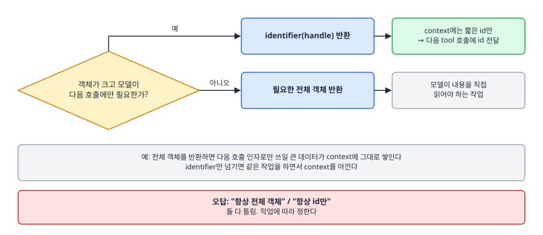
*그림: 큰 객체가 다음 호출에만 필요하면 identifier를 반환하고, 아니면 필요한 전체를 반환합니다.*

근거: Amey-0077, CCAR-F-Amey-Thakur-0030, CCAR-F-Udemy01-0007, CCAR-F-Udemy03-0057

### 1-8. 워크플로 순서를 코드로 강제 (state machine + tool gating)
**필수 순서는 프롬프트가 아니라 코드로 강제**

| 구분 | 내용 |
|---|---|
| 필수 순서 예 | 본인 확인 → 정보 수집 → 확인 · 동의 → 실행 |
| 방법 | 앱이 현재 단계를 상태로 보유 상태별 허용 tool만 `tools`에 포함 |
| 효과 | 본인 확인 전 요청엔 변경 tool 부재 → 호출 불가 |
| 상태 전환 기준 | 코드로 검증 가능한 사실 (예: 본인 확인 tool 성공) |
| 역할 분담 | 대화 유연성 = Claude 깨지면 안 되는 순서 = 코드 |
| 대안 | tool 정의 변경 → prompt cache 전체 무효화 → 정의 고정 + 상태에 안 맞는 호출을 앱이 거부 · 에러 반환 |
| 보장 ✗ | 번호 목록 · few-shot effort 상향 · "다음 단계 이름 JSON 출력" → 최종 판단이 모델에 남음 = 확률적 |

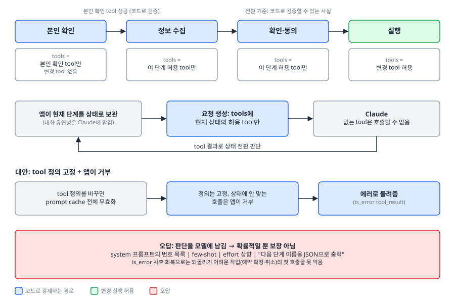
*그림: 앱이 단계를 상태로 갖고 상태별 허용 tool만 tools에 넣어 필수 순서를 코드로 강제합니다.*

근거: Udemy-0016

### 1-9. Client tools vs Server tools
**구분 기준 = 코드가 실행되는 위치**

| 구분 | Client tools | Server tools |
|---|---|---|
| 예 | 직접 정의한 tool Anthropic 스키마 tool(`bash` · `text_editor`) | `web_search` · `web_fetch` `code_execution` · `tool_search` 등 |
| 실행 위치 | 앱 | Anthropic 인프라 |
| 결과 처리 | `tool_use` 수신 → 앱 처리 → `tool_result` 반환 | 같은 응답에 결과 바로 포함 앱 실행 ✗ · `tool_result` 전송 ✗ |
| 사내 시스템(SIEM 등) | client tool로 접근 | 사용자 정의 ✗ (Anthropic 제공 기능) 사내 네트워크 도달 ✗ |
| 선언 | `tools`에 정의 | 일반 요청의 `tools`에 선언 MCP · Batch API 전용 ✗ |

| 구분 | 내용 |
|---|---|
| Message Batches API | Messages API와 같은 파라미터 · tool 사용 포함 가능 비동기 일괄 처리 |
| batch 안에서 Anthropic이 실행 | server tool(예: 웹 검색)뿐 |
| client tool 호출 | 결과에 `tool_use` 포함 → 결과를 받은 쪽(앱)이 실행 |
| 처리 순서 | `custom_id`로 어느 요청인지 특정 → tool 실행 → `tool_result` 포함 후속 요청 |
| 오답 | server tool(`web_search`)로 대체 = 검증 대상 달라짐 `tool_choice` 강제 = 실행 주체 불변 예측한 `tool_result` = 실행 결과 아님 |

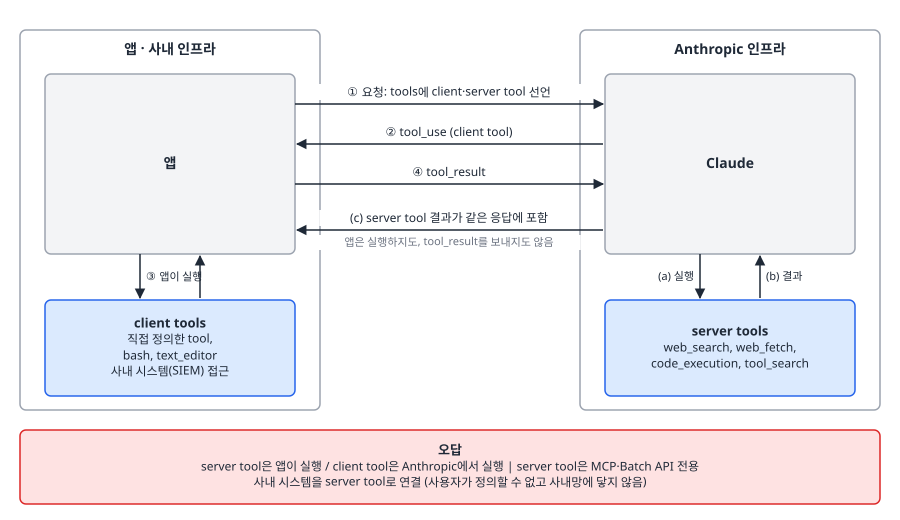
*그림: client tool은 앱이 실행해 tool_result를 보내고, server tool은 Anthropic 인프라에서 실행되어 결과가 같은 응답에 들어옵니다.*

근거: CCAR-F-Udemy01-0012, Preporato-0023, Udemy-0013

### 1-10. 확장 수단 선택: MCP server vs Tool vs Skill
**공유 · 독립 유지보수 = MCP server · 절차 = Skill**

| 수단 | 쓰는 경우 | 특징 |
|---|---|---|
| Tools | 행동(action) · 데이터 접근 추가 | MCP server와 공통 |
| MCP server | 여러 앱이 같은 기능 공유 + 플랫폼 팀이 앱과 독립 유지보수 | 서버가 tools/resources 노출 여러 client 연결 |
| Skill | 외부 시스템 없이 "절차 따르게 하기"만 | 지시 · 템플릿 · 절차(know-how) 묶음 · 작업 일치 시 로드 claude.ai · Claude Code · API 공통 live connection ✗ |

| 오답 | 이유 |
|---|---|
| 앱마다 서버 코드 복사 | 복사본끼리 어긋남 |
| 문서 하나로 충분한 절차에 fine-tuning | 과함 |
| 데이터를 매일 system prompt에 붙여 넣기 | 데이터 낡음 · context 낭비 |
| MCP server가 Messages API 대체 모델과 같은 프로세스 필요 | 둘 다 ✗ |

| 수단 | 쓰는 경우 | 특징 |
|---|---|---|
| 기성 MCP server | 표준 서비스의 표준 조작 (GitHub · Slack · GitLab ServiceNow · Jira) | 연결만으로 사용 유지보수 = 제공처(upstream) |
| custom MCP server | 팀 고유 workflow (2단계 승인 · 예약 절차 · release 판정) | 범위를 좁혀 고유 로직만 구현 |

**기성 vs custom 분리 기준**

| 구분 | 내용 |
|---|---|
| 판별 | 많은 조직이 공통 사용 = 기성 서버 자사에만 존재 = custom 서버 |
| 요건 분해 | 표준 조작 · 자체 로직으로 나눔 각각 가장 수고가 적은 수단 적용 |
| 혼합 구성 예 | 표준 조작 = 기성 서버 release 판정 · 승인 준비 = custom 서버 |
| 인력 제약 | 개발자 1명 · 보수 최소화 = 기성 서버 우선 |
| 기성 서버 채택 전 확인 | 제공처 · 업데이트 상황 · 요구 권한 범위 |
| 공유 · 인증 | 팀 서버 = project scope `.mcp.json` custom 서버 토큰 = 환경 변수 확장 |

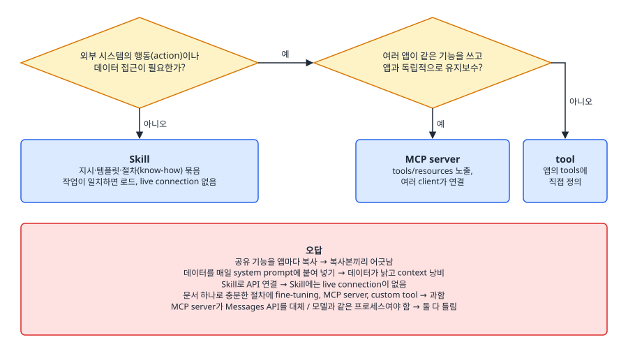
*그림: 행동·데이터 접근이 없으면 Skill, 여러 앱이 공유하고 독립 유지보수하면 MCP server, 그 외에는 앱의 tool입니다.*

근거: Amey-0009, Amey-0044, CCAR-F-Udemy02-0049, CCAR-F-Udemy03-0028, CCAR-F-Udemy04-0004, CCAR-F-Udemy06-0003, Preporato-0024

### 1-11. MCP primitives: tools / resources / prompts
**주도 = tools 모델 · resources 앱 · prompts 사용자**

| primitive | 주도 | 내용 |
|---|---|---|
| tools | 모델 | 상황에 따라 찾아 호출 |
| resources | 앱 | 참조 데이터(파일 · DB 스키마 · 문서)를 URI로 노출 context 포함 여부 = 앱 결정 tool 사양서를 resource로 읽혀도 호출 가능 tool 등록 ✗ |
| prompts | 사용자 | 재사용 가능한 프롬프트 템플릿 slash command 등으로 명시 선택 모델의 자동 tool 탐색 용도 ✗ |

**요구 → primitive 대응**

| 요구 | primitive |
|---|---|
| 동작 수행 (Jira 티켓 생성) | tool |
| 사용자가 첨부하는 읽기 전용 데이터 (API schema 파일) | resource |
| 재사용 템플릿 · 노하우 (심각도 기준이 담긴 triage 템플릿) | prompt |
| host에서 목록 탐색 + 선택분만 context 첨부 + 탐색 turn 회피 | resources (`resources/list` → `resources/read`) |
| 정적 카탈로그 + 조작 | 카탈로그 = resource tool = 조작만(예: `create_return`) |

| 구분 | 내용 |
|---|---|
| 선택 단서 | 문제문에서 "누가 언제 쓰는가" 확인 모델 = tool · host = resource · 사용자 = prompt |
| 카탈로그를 tool로 조회 | 모델의 탐색 turn 발생 (예: 작업마다 7회 호출) |
| 카탈로그를 `CLAUDE.md`에 복사 | 상시 로딩 |
| Claude Code 첨부 | 연결 서버의 resource를 `@`로 참조 |
| 운영 | 내용 개정 시 resource 갱신 변경을 client에 알림 |

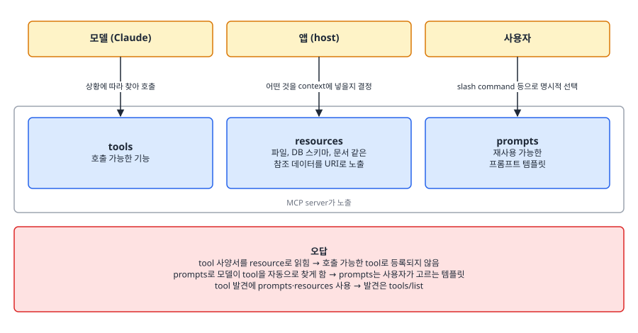
*그림: tools는 모델이, resources는 앱이, prompts는 사용자가 주도합니다.*

근거: CCAR-F-Udemy02-0008, CCAR-F-Udemy05-0008, CCAR-F-preporato-0014, Udemy-0011, Udemy-0025

### 1-12. MCP tool discovery (tools/list, tools/call)
**발견 = `tools/list` · 실행 = `tools/call`**

| 구분 | 내용 |
|---|---|
| `tools/list` | tools capability 선언 서버가 응답 각 tool의 `name` · `description` `inputSchema`(JSON Schema) |
| 변환 | client가 모델용 tool 정의로 변환 · 전달 → 서버에 tool 추가 시 앱 코드 그대로 모델에 노출 |
| `tools/call` | 모델이 고른 tool을 client가 실행 |
| 입력 검증 에러 | `isError` 붙은 tool 실행 에러로 모델에 반환 → 자가 수정용 (발견 수단 ✗) |
| 목록 변경 | `listChanged` 선언 서버 → `notifications/tools/list_changed` 전송 → client 재조회 |
| 2026-07-28판 사양 | 프로토콜 session ✗ (stateless) 연결별 tool 목록 변경 금지 · 요청 인가에 따른 변경 허용 → 공식 MCP 사양과 일치 |

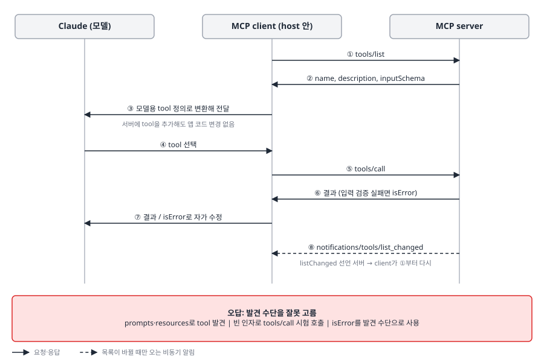
*그림: client가 tools/list로 받은 inputSchema를 모델용 tool 정의로 바꿔 노출하고, 모델이 고른 tool을 tools/call로 실행합니다.*

근거: Udemy-0025

### 1-13. MCP transport: stdio vs Streamable HTTP
**로컬 = stdio · 원격 = Streamable HTTP**

- 구조 = host가 서버마다 client 생성 · 연결
- host 예 = Claude Code
- 통신 경로 = transport 계층

| 항목 | stdio | Streamable HTTP |
|---|---|---|
| 방식 | 같은 머신 프로세스끼리 표준 입출력 직접 연결 서버를 subprocess로 실행 | client→server HTTP POST + 선택적 Server-Sent Events(SSE) |
| 용도 | 로컬 파일 · CLI 접근 | 원격 서버를 여러 client에 제공 |
| 특성 | 네트워크 오버헤드 없음 보통 client 하나에 제공 네트워크 너머 통신 ✗ | 표준 HTTP 인증 (Bearer 토큰 · API key · 커스텀 헤더) 토큰 획득 = OAuth 권장 |
| 오용 | 원격 서버를 각 단말에 배포해 stdio → 업데이트 · 인증 중앙 관리 ✗ | 로컬 subprocess 서버에 HTTP → 오버헤드 · 포트 노출 · 인증 부담만 증가 |

| 구분 | 내용 |
|---|---|
| host-client-server | host가 서버마다 MCP client 하나 생성 각 client = 대응 서버와 전용 연결 유지 |
| 다중 서버 | 한 host가 여러 서버에 동시 연결 = 표준 형태 |
| tool 목록 통합 | 서버마다 `tools/list` → host가 모아 제시 · 호출은 소유 서버로 분배 |
| subagent 할당 | 필요한 서버 동시 연결 + 역할별 서버만 할당 연결 유지 |
| 오답 | subagent당 서버 1개만 활성 + 필요 시 재연결 = 단계마다 중단 자체 서버로 집약 = 불필요한 개발 부담 |

**Claude Code transport 선택**

| transport | 용도 | 인증 · 비고 |
|---|---|---|
| stdio | 자기 머신의 로컬 프로세스 | 로컬 실행 |
| `http` | 원격 MCP server 연결(권장) | OAuth 2.0 사용 가능 `claude mcp add --transport http <URL>` → `/mcp`에서 브라우저 인증 |
| `sse` | 구방식 | deprecated → HTTP 가능하면 HTTP |
| WebSocket | 서버가 이벤트를 자발 전송 양방향 지속 연결 | 헤더 인증만 · OAuth ✗ |

| 선택 순서 | 확인 내용 |
|---|---|
| ① 연결 대상 위치 | 로컬 프로세스 · 원격 |
| ② 통신 방향 | 요청 응답만 · 서버 push |
| ③ 인증 방식 | OAuth 필요 여부 |

- 사내 클라우드 · 응답만 · OAuth 로그인 = 3조건 모두 HTTP
- 로컬 프로세스 → 사내 클라우드 이전 = 각자 `--transport http`로 URL 추가

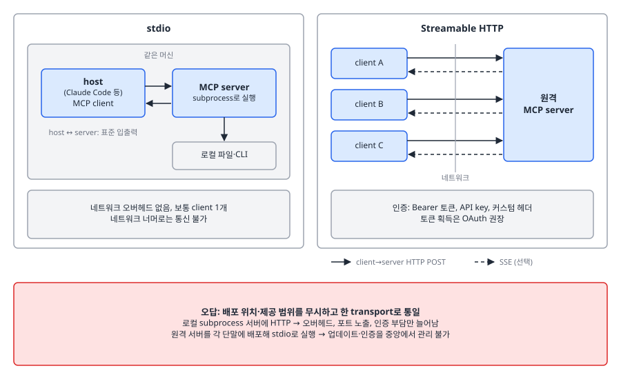
*그림: 같은 머신의 subprocess는 stdio, 원격 서버를 여러 client에 제공할 때는 Streamable HTTP를 씁니다.*

근거: CCAR-F-Udemy01-0044, CCAR-F-Udemy02-0046, CCAR-P-jrajath94-0649, Udemy-0011, Udemy-0033

### 1-14. MCP connector (Messages API의 `mcp_servers`)
**MCP connector = API가 tool 목록 조회 · 호출 대행**

- 전제 = 앱이 MCP client 직접 구현 ✗
- beta 기능 → beta 헤더 첨부

| 구분 | 내용 |
|---|---|
| 서버 정의 | `mcp_servers`에 서버 접속 정보 `type` · `url` · `name` `authorization_token`(필요 시) |
| toolset 참조 | `tools` 배열의 `mcp_toolset` → `mcp_server_name`으로 서버 참조 |
| tool별 설정 | `default_config` = 전체 기본값 `configs` = tool별 `enabled` 덮어쓰기 |
| 읽기 전용 | 쓰기 tool만 `enabled: false` (denylist) allowlist 형태도 가능 |

| 구분 | 내용 |
|---|---|
| 동작 | API가 서버에서 tool 목록 조회 → Claude에 제시 → 호출 대행 |
| 응답 | `mcp_tool_use` · `mcp_tool_result` 함께 수신 앱의 `tools/call` 재전송 · `tool_result` 반환 불필요 |
| 앱이 재실행 | ✗ 쓰기 작업 중복 위험 |

| 제약 | 내용 |
|---|---|
| 지원 범위 | MCP 사양 중 tool 호출만 resources · prompts ✗ |
| 연결 대상 | HTTP(Streamable HTTP 또는 SSE) 공개 서버만 로컬 stdio 서버 ✗ |
| 미제공 | Amazon Bedrock Google Cloud(Google managed) |
| 문서를 읽혀야 할 때 | 앱이 직접 가져와 메시지에 포함 또는 문서 반환 tool을 서버에 구현 |

| 구분 | 내용 |
|---|---|
| 서버 ↔ toolset | `mcp_servers`의 서버마다 `mcp_toolset` 정확히 1개가 참조 |
| 다중 서버 | 서버마다 `mcp_toolset` 1개 → 한 요청에서 여러 서버 tool을 횡단 선택 |
| 역할 분담 | `mcp_servers` = 접속(URL · 인증) `mcp_toolset` = tool 활성화 |
| `mcp_toolset` 생략 | 규칙 위반 · 자동 검출 의존 ✗ |
| 실시간 원격 데이터 | API가 원격 서버 tool 호출 → 앱의 MCP client 불필요 |
| 활성화 | `mcp_servers` 정의 + `mcp_toolset` 참조 + beta 헤더 |
| 실시간 요건 | 저장 스냅샷 · 주기 복사 인덱스 ✗ |

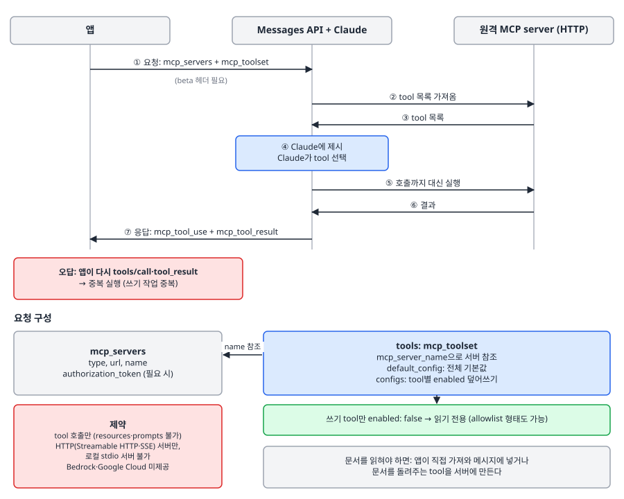
*그림: mcp_servers와 mcp_toolset을 적으면 API가 tool 목록 조회와 호출을 대신하므로 앱은 mcp_tool_use를 다시 실행하지 않습니다.*

근거: CCAR-F-Udemy03-0031, CCAR-P-jrajath94-0646, Udemy-0011

### 1-15. system prompt 지시가 만드는 tool 선택 왜곡
**description이 명확해도 키워드 지시가 덮어씀**

| 증상 | 원인 | 조치 |
|---|---|---|
| description 보강 · 경계 명기 후에도 특정 단어 포함 요청만 오선택 | system prompt의 키워드 반응형 지시 | 질문 대상에 따라 고르는 표현으로 지시 수정 |
| 특정 단어 유무로 첫 호출 tool이 갈림 | 단어 → tool 매핑 지시 | 같은 조치 |
| 규제 · 확인 어구 등장 시 전용 tool 과호출 | "CRITICAL: You MUST" 류 강한 표현 + 넓은 적용 범위 | 평이한 표현(`Use this tool when...`) 정식 대상으로 범위 축소 prompt · description 양쪽 수정 |
| "먼저 로그 검색" 지시 → 내장 Grep 편중 | 일반 지시가 MCP tool 사용 억제 | 지시의 대상 한정 + MCP description 보강 |
| 한 단어("검색")로 tool 지정 → 한 tool 편중 | 키워드 지시 + 겹치는 이름 | 이름 · description 정비 지시를 질문 대상 기준으로 수정 |

| 구분 | 내용 |
|---|---|
| 점검 순서 | ① description 구분성 ② system prompt의 tool 이름 · 키워드 지시 |
| 단서 | "쓸 수 없다"가 아니라 "쓸 수 있는데 선택 안 됨" description 개선 후에도 특정 단어에서만 오류 = prompt 지시 의심 |
| tool 추가 시 | 기존 description · system prompt의 충돌 표현 점검 |
| 모델 의존 | 최근 모델(Opus 4.5 · 4.6) = prompt 반응성 높음 이전 모델용 강한 표현 → 과호출 |

근거: CCAR-F-MyPractice-0056, CCAR-F-Udemy03-0056, CCAR-F-Udemy04-0021, CCAR-F-Udemy05-0020, CCAR-F-Udemy06-0007

### 1-16. 범용 tool 분할 vs 통합
**입출력이 다르면 분할 · 같은 일이면 병합**

| 상황 | 방향 |
|---|---|
| 범용 tool 하나(`analyze_document`)가 추출 · 요약 · 검증을 인자로 선택 | 목적별 tool로 분할 예: `extract_data_points` `summarize_content` `verify_claim_against_source` |
| 증상 = 같은 요청인데 출력 형식이 매번 다름 | 원인 = tool 입자도 → 분할 + 각 tool 입출력 사양 명시 |
| 하위 단계가 특정 필드 구조를 기대 | 목적별 tool의 output schema로 형식 고정 |
| 필수 입력 누락 (검증 tool이 source 발췌 없이 호출됨) | `input_schema`에서 필수 파라미터로 지정 → schema 단계에서 호출 불성립 |
| 분할 후 tool 수 | 역할이 안 겹치는 소수의 workflow 전용 tool 불필요한 tool 추가 ✗ |
| 한 API 호출에 여러 목적 + 전체 tool 노출 (리뷰 · 테스트 생성 · 메타 갱신) | 증상 = 목적 밖 tool 호출 · 구조화 객체 대신 평문 → 단계를 역할별로 분리 |
| 같은 일 · 같은 입력 형태의 tool 둘 | `action` 파라미터 + 명확한 설명의 tool 하나로 병합 가능 |
| 유사 조회 tool 다수 + 위험한 범용 tool | 좁은 이름의 파라미터화 tool 몇 개로 통합 (명시적 쿼리 유형을 가진 reporting tool) |
| 40개 동작을 mode 파라미터 하나로 | ✗ 동작이 선택 단계에서 숨음 |
| 18개 tool을 `action` 파라미터 범용 tool 하나로 | ✗ 목적이 모호한 tool |

**분할을 받쳐 주는 장치**

| 장치 | 효과 |
|---|---|
| description에 쓸 때 · 쓰지 말 때 경계 | tool 선택 안정 |
| 입출력을 JSON schema로 정의 | 결과 형태 고정 |
| 단계별로 필요한 tool만 노출 | 단계 밖 tool 호출 원천 차단 |
| 구조화 출력이 필수인 단계 | `tool_choice`로 보고용 tool 지정 신규 모델 일부 `any`/`tool` 400 → `strict` |
| tool 이름의 namespace | 보조 수단 · 노출 범위는 못 좁힘 |
| output schema를 coordinator 측 검증에도 사용 | 형식이 깨진 결과 조기 검출 |
| tool 반환값에 출처 문서명 · 발췌 위치 | 통합 단계의 출처 보존 |

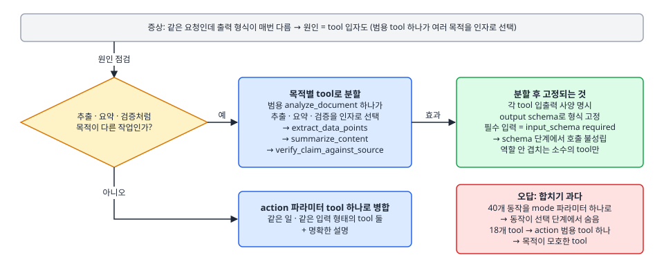
*그림: 목적이 다른 작업은 목적별 tool로 분할하고, 같은 일 · 같은 입력 형태의 tool만 action 파라미터로 병합합니다.*

근거: CCAR-F-Amey-Thakur-0028, CCAR-F-Udemy02-0048, CCAR-F-Udemy03-0004, CCAR-F-Udemy04-0029, CCAR-F-Udemy06-0030, CCAR-F-Udemy06-0056, CCAR-P-Amey-Thakur-0003, CCAR-P-Amey-Thakur-0038, CCAR-P-jrajath94-0078, CCAR-P-jrajath94-0630

### 1-17. 역할별 tool 범위 (subagent tool 제한)
**agent마다 맡은 역할의 tool만 부여**

| 구분 | 내용 |
|---|---|
| 원칙 | agent별 tool set = 그 역할에 필요한 것만 |
| tool 과다의 증상 | 판단 복잡도 증가 → tool 선택 신뢰성 저하 전문 밖 tool 오용 (문서 분석 agent의 웹 검색 · 서식 tool) |
| 가이드 예시 | 18개 공유 → 역할당 4~5개로 축소 ⚠️ 4~5개 = 가이드 예시 수치 공식 문서: 30~50개 초과 시 tool 선택 정확도 저하 |
| Agent SDK | subagent별 `tools`로 사용 가능 tool 지정 (`AgentDefinition`의 `tools`) |
| 운영 확인 | tool 호출 로그 정기 점검 → 역할 밖 호출 모니터링 |

**오류 유형별 1차 수단**

| 오류 유형 | 1차 수단 |
|---|---|
| 비슷한 tool 사이 혼동 | description 개선 |
| 역할 밖 tool 사용 | tool 배분 재검토(역할별 제한) |

**역할 횡단 · 역할 경계 처리**

| 상황 | 방향 |
|---|---|
| 전문 agent가 타 역할 tool(web_search) 보유 → 미검증 출처 혼입 · 필요 빈도 낮음(약 10%) | tool 제거 추가 조사는 coordinator 경유 routing |
| 타 역할 필요가 빈번 · 대부분 단순 확인(예: 85%) | 범위 제한 tool(`verify_fact`) 부여 |
| 복잡 · 깊은 조사(예: 15%) | 기존 경로 유지 coordinator → 전문 agent |
| 전문 agent에 타 역할 tool 전체 부여 | ✗ 역할 확대 · 오용 가능성 유지 |
| 추가 조사가 필요한 이유 | 구조화해 coordinator에 반환 → 초점 좁힌 위임 |
| 역할 안에서 빈번한 조회(예: 직종 코드 60%) | 읽기 전용 · 조회 한정 tool(`lookup_job_code`) 추가 tool 전부 박탈 ✗ (coordinator 왕복 증가) |
| 범용 tool(`fetch_url`)이 역할 밖 기능 허용 | 용도 한정 tool(`load_document`)로 교체 → interface 단계에서 기능 제한 |
| 전문 agent의 쓰기 작업 (DB 직접 쓰기 · 티켓 등록 · CRM 갱신) | 쓰기 = coordinator · 별도 단계 담당 전문 agent = 읽기 + 구조화 결과 반환까지 |

**역할별 tool 범위 사례**

| agent | 부여 범위 |
|---|---|
| 저장소 scanner subagent | 읽기 전용(`Read` · `Grep` · `Glob` · 의존성 검사) 티켓 등록 = 합쳐진 결과 기반 coordinator만 |
| 추출 subagent | 문서 읽기 + 추출 결과 제출만 웹 검색 · 검증 전 DB 쓰기 ✗ |
| 추출 agent의 CRM · 메일 · 캘린더 | 별도 agent · 별도 단계로 분리 |
| 여러 MCP server 연결 agent | agent마다 책임에 필요한 server만 제공 |

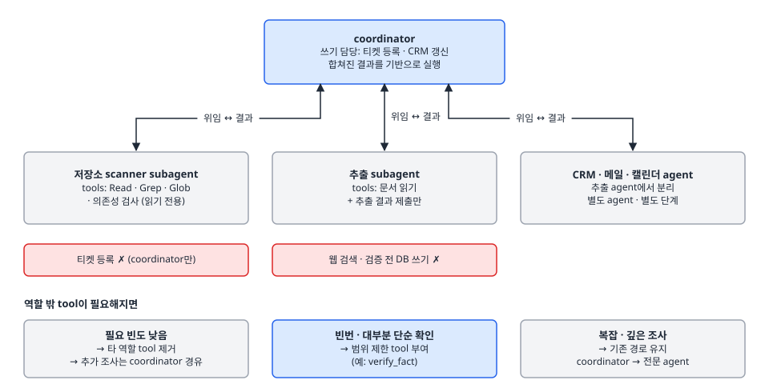
*그림: 각 subagent는 자기 역할의 tool만 갖고, 쓰기와 역할 밖 조사는 coordinator를 거칩니다.*

근거: CCAR-F-MyPractice-0010, CCAR-F-MyPractice-0015, CCAR-F-Udemy04-0019, CCAR-F-Udemy04-0047, CCAR-F-Udemy05-0040, CCAR-F-Udemy06-0030, CCAR-F-paullarionov-0010, CCAR-F-paullarionov-0015, CCAR-F-preporato-0007, CCAR-P-preporato-0013

### 1-18. 최소 권한 tool surface (불필요 기능 제거)
**필요 없는 권한은 감시가 아니라 제거**

| 통제 수단 | 판정 |
|---|---|
| 불필요 tool · 기능 제거 (update · delete · 쓰기 작업) | ✓ 공격 · 오류 표면 자체를 없앰 |
| 로깅 · 감사 추적 · 대시보드 · 모니터링 | 포렌식 · observability용 권한 제거 ✗ → 로그는 유지하되 해결책으로 보지 않음 |
| 문서화 · 이름 변경 · 숨김 | ✗ 기능 접근 그대로 |
| 더 긴 system prompt · 자가 재확인 | ✗ 확률적 |

**제거 · 유지 판정**

| 상황 | 판정 |
|---|---|
| 어떤 작업도 안 쓰는 위험 tool (`drop_table` · `delete_*` `wire_transfer` · `mass_email`) | 제거 |
| "나중에 유용할지도" | 작업 기준 아님 → 지금 제거 필요해지면 검토 후 재추가 |
| 매일 쓰는 정당한 tool | 유지 |
| 사용 중이어도 필요 이상 데이터 반환 (전체 SSN · 결제 정보 포함 프로필) | 반환 필드를 작업 필요분으로 축소 다른 작업이 필요하면 tool 분리 |
| 하루 1회 쓰는데 스키마 4,000 토큰 | 사용 여부만으로 유지 정당화 ✗ 호출마다 스키마 토큰 계산 → 스키마 축소 대상 |
| "미사용" 판정 전 | 장기 trace(예: 6개월)로 확인 숨은 호출자 · workflow 확인 |

**범용 tool → 범위 제한 tool**

| 범용 tool | 교체 방향 |
|---|---|
| 임의 SQL(`run_sql` · raw SQL) | 검증된 고객 ID만 받아 그 범위만 반환 (`get_account_summary`) |
| DB 전체를 노출하는 범용 query tool 하나 | model 권한이 무제한 → least privilege 적용 불가 |
| 교체 효과 | 조회 범위를 코드로 결정론적 제한 |
| 이중 방어 | 교체 tool 내부에서 전달 ID = 본인 확인 결과인지 검사 |
| 낮은 오류율(예: 0.4%) | 면제 사유 ✗ · 범용 tool이 남는 한 타 고객 데이터 도달 가능 |
| 이 용도에 불필요한 쓰기 작업을 노출한 MCP tool | 제거 |

근거: CCAR-F-Amey-Thakur-0063, CCAR-F-Amey-Thakur-0077, CCAR-F-Udemy06-0041, CCAR-P-Amey-Thakur-0001, CCAR-P-Amey-Thakur-0050, CCAR-P-jrajath94-0078, CCAR-P-jrajath94-0157, CCAR-P-jrajath94-0158, CCAR-P-jrajath94-0159, CCAR-P-jrajath94-0297, CCAR-P-jrajath94-0351, CCAR-P-jrajath94-0352, CCAR-P-jrajath94-0415, CCAR-P-jrajath94-0478, CCAR-P-jrajath94-0540, CCAR-P-jrajath94-0541

### 1-19. Tool 과다 대응 (progressive discovery · tool search)
**전부 노출하지 않고 필요할 때 로드**

| 증상 | 내용 |
|---|---|
| 정의만으로 토큰 소비 | 예: 220개 ≈ 60,000 토큰 200개 ≈ 100,000 스키마 토큰/호출 |
| 이름이 비슷한 tool 혼동 증가 | 표면이 클수록 오선택 증가 공식 문서: 30~50개 초과 시 정확도 저하 |
| 다수 agent · 다수 MCP server (예: 6 server 300개 · 8 시스템 45개) | 전부 선로드 → 비용 증가 + 선택 부정확 |

| 해법 | 내용 |
|---|---|
| tool search tool + `defer_loading: true` | deferred 정의는 검색에서 발견될 때만 context에 전개 모든 tool 계속 사용 가능 |
| 자주 쓰는 3~5개 | non-deferred 유지 → 검색 왕복 없음 |
| tool search tool 자체 | `defer_loading` 적용 ✗ |
| deferred tool + `cache_control` | 400 오류 |
| progressive discovery | 이름 목록 먼저 → 전체 스키마는 필요 시 작업별 가시 선택지 축소 |
| 판정 시점 | 표면 약 20개 초과 + 토큰이 제약이면 사용 ⚠️ 약 20개 = 해설 자체 기준 공식 문서: tool 10개 이상 · 정의 10k 토큰 초과 시 권장 |
| 책임별 범위 지정 | agent마다 필요한 server · tool 집합만 제공 나머지는 점진적 발견 |
| 그룹화 | 이름 잘 지은 소수 함수 · namespace 있는 MCP server 구분되는 소수의 진입점 + 세부는 필요 시 |
| 트레이드오프 | 조회 단계 추가 이름 색인이 부정확하면 올바른 tool 못 찾음 |

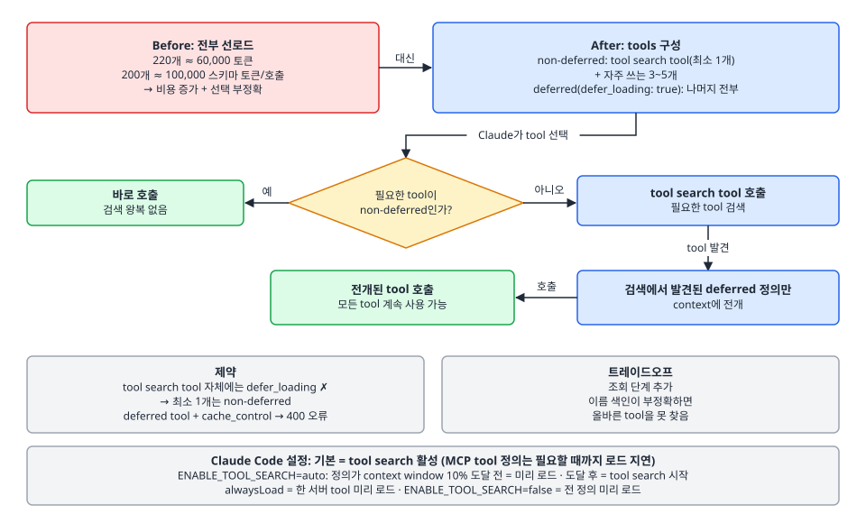
*그림: 자주 쓰는 tool은 바로 호출하고, 나머지는 tool search tool로 발견될 때만 정의가 context에 전개됩니다.*

근거: CCAR-F-Udemy01-0035, CCAR-P-Amey-Thakur-0003, CCAR-P-Amey-Thakur-0038, CCAR-P-jrajath94-0003, CCAR-P-jrajath94-0179, CCAR-P-jrajath94-0629, CCAR-P-jrajath94-0650, CCAR-P-preporato-0013

### 1-20. 내장 도구 선택 (Read · Write · Edit · Bash · Grep · Glob)
**이름은 Glob · 내용은 Grep · 일부는 Edit · 전체는 Write**

| 도구 | 대상 | 쓰는 경우 |
|---|---|---|
| `Glob` | 파일 경로(이름 · 확장자 패턴) | 명명 규칙으로 파일 열거(`**/*.test.tsx`) |
| `Grep` | 파일 내용 패턴 | 함수명 · 에러 메시지 · import 검색 호출처 · 출력 위치 특정 |
| `Read` | 개별 파일 읽기 | Grep으로 찾은 파일 확인 · import 추적 |
| `Edit` | 정확히 한 곳과 일치하는 텍스트 | 범위를 좁힌 변경 |
| `Write` | 파일 전체 | 전체 재생성 · 파일 전체 작업 |
| `Bash` | 셸 명령 | macOS · Linux = Bash `find` · `grep`으로 검색 대체하는 구성 존재 |

| 상황 | 선택 |
|---|---|
| 에러 메시지가 출력되는 위치 | `Grep` |
| 함수의 모든 호출처 | `Grep` |
| 함수명 단서가 있는 정의 · 진입점 | `Grep` |
| `contract.template.spec.ts` 같은 이름 규칙 파일 열거 | `Glob` |
| 오답: 흔한 단어("template")를 Grep | 무관한 일치 대량 · 누락 |
| 오답: Glob · `find`로 내용 정보 추정 | 이름만으론 불확실 · 누락 |

| 구분 | 내용 |
|---|---|
| 판별 기준 | 찾는 정보가 파일 이름에 있나 · 내용에 있나 |
| subagent `tools`에 Glob · Grep 지정 + Bash 제외 | 그 subagent에서 Glob · Grep 사용 가능 |
| macOS · Linux 기본 | Glob · Grep 대신 Bash `find` · `grep` 사용 |

대규모 코드베이스 탐색 순서

1. 경로로 좁히기: `Glob`으로 후보 디렉터리
2. 내용으로 찾기: `Grep`으로 식별자 · 진입점
3. 필요한 것만 읽기: 일치한 파일을 `Read` → import 따라 흐름 추적

| 구분 | 내용 |
|---|---|
| 전체 파일을 처음부터 통독(수백 파일) | context 소진 · 노이즈 · 느림 |
| 처리 흐름의 연결 고리 | 파일 이름 ✗ · 함수 호출 관계와 import |
| 파일명으로만 좁히기 · `cat` 일괄 읽기 · 분할 통독 | 읽는 양 안 줄어듦 · 관계 파악 어려움 |
| 설계 문서로 추정 | 구현 확인 ✗ |
| 탐색 결과 기록 | 진입 파일 · 경유 모듈 · 출력 위치를 메모 · scratchpad 파일에 저장 → 같은 조사 반복 ✗ |

별칭 re-export 사용처 전수 추적

1. wrapper 모듈을 `Read` → export된 이름(별칭 포함) 파악
2. 각 이름으로 코드베이스 전체 `Grep`
3. 발견한 별칭이 다시 re-export되는지 같은 절차로 확인

| 구분 | 내용 |
|---|---|
| 별칭 신호 | 원래 이름 검색 결과가 실제보다 적음 |
| 대소문자 무시 검색 | 표기 흔들림에만 효과 · 별칭 ✗ |
| Glob · 파일 통독 | 검색 대체 ✗ |
| 테스트 실행으로 추적 | 실행된 경로만 보임 → 망라성 부족 |
| 위치 목록 파일 저장 | 교체 후 목록과 대조 → 누락 확인 |
| 변경 전 | Grep 위치를 Read로 열어 전후 문맥 확인 → 같은 이름의 다른 함수 · 문자열 오변경 방지 |

| 구분 | 내용 |
|---|---|
| `Edit` 동작 | 완전 일치 문자열 치환 정규식 · 모호한 일치 ✗ |
| `old_string` 조건 | 파일 안에 정확히 한 번 |
| 여러 번 일치할 때 | ① 앞뒤 문맥을 포함해 한 곳으로 유일화 ② `replace_all: true`로 모두 치환 |
| 둘 다 불가 | `Read`로 현재 내용 → 완성본 조립 → `Write` |

| 상황 | 정답 |
|---|---|
| 모든 일치를 똑같이 변경 + 비슷한 문자열은 유지 | `replace_all` + `old_string`에 닫는 따옴표까지 포함 (`class="salary"` ✓ · `salary-note` 제외) |
| 한쪽만 변경 + 반복 문구라 유일화 불가 + 완성본 조립 가능 | `Read` → `Write`로 전체 덮어쓰기 |
| 자동 생성 파일 전체 재생성 | `Write` 한 번 |
| 같은 문자열 수십 곳을 `Edit` 수십 회 | 일부 실패 → 중간까지 갱신된 파일 잔존 ✗ |
| 오답 | `replace_all`(한쪽만 변경) = 범위 과다 `old_string` 단축 · 정규식 Grep으로 줄 지정 = 일치 방식 불변 |
| `Read` + `Write` | 단순 일괄 치환엔 과함 |
| 사후 확인 | 치환 후 Grep으로 건수 확인 Write 후 JSON 파싱 가능 여부 검증 |

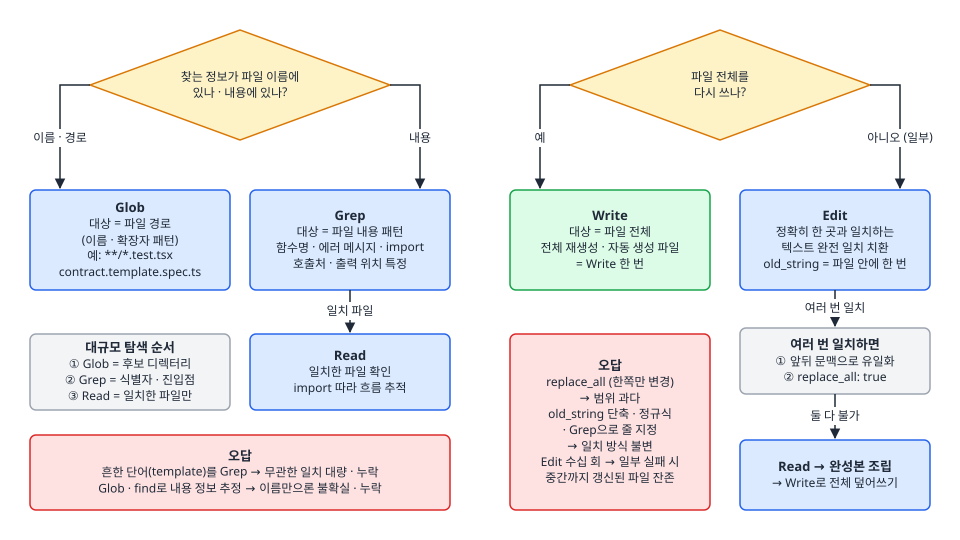
*그림: 파일 이름이면 Glob, 내용이면 Grep, 일부 변경은 Edit, 전체 재생성은 Write를 고릅니다.*

근거: CCAR-F-Udemy01-0050, CCAR-F-Udemy02-0039, CCAR-F-Udemy03-0059, CCAR-F-Udemy04-0012, CCAR-F-Udemy04-0052, CCAR-F-Udemy04-0057, CCAR-F-Udemy05-0009, CCAR-F-Udemy05-0011, CCAR-F-Udemy05-0018, CCAR-F-Udemy06-0008, CCAR-F-Udemy06-0032, CCAR-F-Udemy06-0046

### 1-21. 도구 경계에서 강제하는 통제 (정책 한도 · 파괴적 작업)
**예외 없는 통제는 prompt가 아니라 도구 경계에서 강제**

| 상황 | 강제 위치 |
|---|---|
| 정책 한도(예: 직접 환불 상한) 초과 시 사람이 처리 | 도구 계층에서 결정적으로 검사 |
| 되돌릴 수 없는 작업 · 삭제 | 모델을 둘러싼 시스템이 권한 · 범위 · 확인 통제 |
| 실행 중 편집 · 셸 금지 skill | skill 프런트매터 `disallowed-tools`로 도구 풀에서 제외 |
| 필수 절차 위반 방지 | 앱이 실행 전 코드로 판정하는 게이트 |

| 수단 | 효과 |
|---|---|
| prompt 문구 · 경고 · description | 요청일 뿐 · 확률적 · 보장 ✗ |
| 모델의 판단 | 확률적 → 예외 없는 요구와 불일치 |
| 직원 교육 | agent 제약 ✗ |
| parameter 추가 · 선언 순서 변경 | 권한 제약 ✗ |
| CLAUDE.md 지시 · slash command 안의 요청 | 모델 guidance · 강제력 ✗ |

| 항목 | `allowed-tools` | `disallowed-tools` |
|---|---|---|
| 의미 | 호출 turn 동안 확인 없이 사용 (사전 승인) | skill 활성 동안 도구 풀에서 제외 |
| 도구 제한 효과 | ✗ (사용 가능 도구를 제한하지 않음) | ✓ |
| 전체 적용 | — | `permissions`의 `deny` |

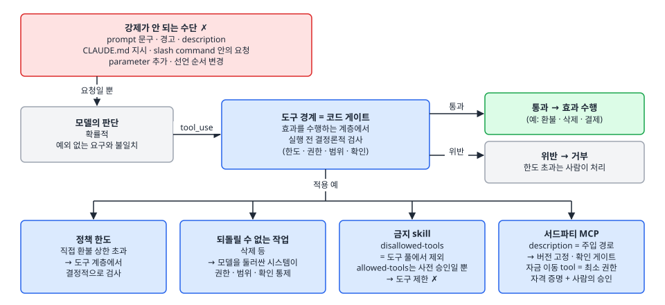
*그림: prompt는 요청일 뿐이므로, 예외 없는 통제는 효과를 수행하는 도구 경계의 코드가 실행 전에 검사합니다.*

근거: CCAR-F-Amey-Thakur-0002, CCAR-F-Amey-Thakur-0029, CCAR-F-Amey-Thakur-0062, CCAR-F-Udemy03-0054, CCAR-F-Udemy03-0058

### 1-22. MCP server scope와 `.mcp.json` credential (Claude Code)
**공유 = project · 개인 = user · 비밀 = `${VAR}`**

| scope | 저장 위치 | 공유 · 로드 범위 |
|---|---|---|
| local (기본값) | `~/.claude.json` (현재 프로젝트용) | 본인만 · 현재 프로젝트에서만 로드 |
| project | 프로젝트 루트 `.mcp.json` | 버전 관리로 팀 공유 |
| user | `~/.claude.json` | 공유 ✗ 본인의 모든 프로젝트에서 로드 |

| 상황 | 정답 |
|---|---|
| 팀 전원이 쓰는 서버 | `--scope project` → `.mcp.json` commit |
| 기본 명령으로 추가한 서버가 동료에게 안 보임 | local scope 저장이 원인 → `--scope project`로 재추가 |
| 개인 · 실험 서버를 여러 repo에서 사용 | `claude mcp add --scope user` |
| 시험 서버가 팀용으로 굳어짐 | project scope로 이동 |
| 특정 프로젝트에서만 개인 시험 | local scope |
| 팀 공유 서버 + 개인별 token | project `.mcp.json` + `${VAR}` 참조 |

| credential 처리 | 내용 |
|---|---|
| `${VAR}` | 환경 변수 확장 (예: `headers`의 `Bearer ${PR_API_TOKEN}`) |
| `${VAR:-default}` | 기본값을 붙이는 확장 형태 |
| 실제 값 | 각 개발자 · 각 환경에서 설정 |
| 필요 변수명 | README · 온보딩 문서에 기재 |
| `$VAR` (중괄호 없음) | 문서화된 확장 구문 ✗ |
| Claude Code · 알려진 credential 변수명 | 원격 서버 url · headers에서 의도적으로 빈 값 처리 → 자체 변수명 사용 |
| token 직접 삽입 | 접근 제한과 무관하게 유출 |

| 증상 | 원인 | 조치 |
|---|---|---|
| 일부 멤버만 401 `claude mcp list`에 미설정 변수 경고 | 해당 환경에 `${VAR}` 미설정 | 각자 환경 변수에 token 설정 후 Claude Code 시작 |
| 변수 미설정 + default 없음 | config는 로드 경고 표시 · `${VAR}` 원문 그대로 사용 | 변수 설정 또는 `:-default` |
| project scope 서버 승인 거부 | 대화형 session 첫 사용 시 승인 요구 | `claude mcp reset-project-choices` (문항에선 오답 보기로만 등장) |

- 신규 멤버 절차서 = 필요 환경 변수 목록 · `claude mcp list` 경고 확인 · 승인 조작

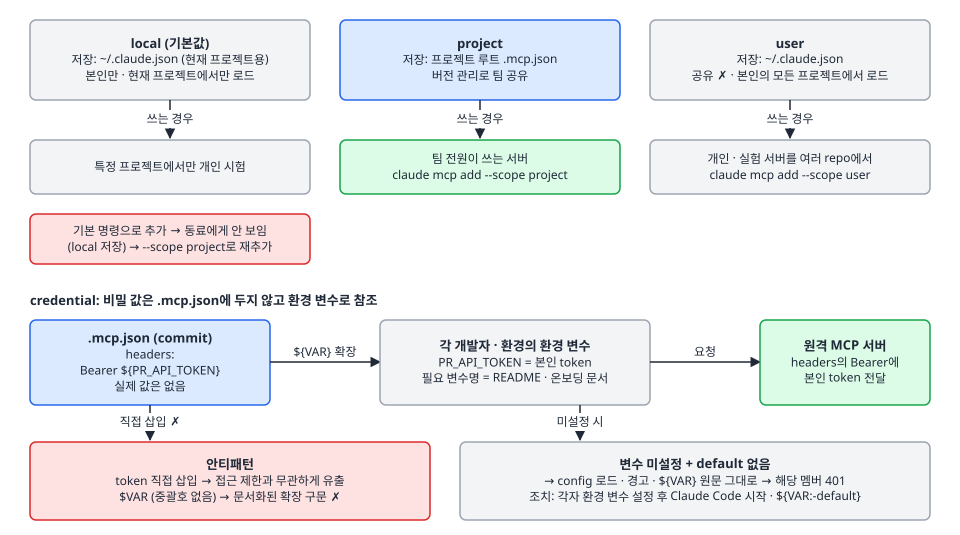
*그림: 공유 서버는 project scope의 .mcp.json에 두고, 비밀은 ${VAR}로 참조해 각자 환경에서 채웁니다.*

근거: CCAR-F-MyPractice-0044, CCAR-F-Udemy01-0037, CCAR-F-Udemy02-0013, CCAR-F-Udemy04-0010, CCAR-F-Udemy05-0006, CCAR-F-Udemy06-0010, CCAR-F-paullarionov-0044, CCAR-F-preporato-0015

### 1-23. 여러 MCP server를 한 session에 연결 (Agent SDK) · tool search
**서버를 나누거나 합치지 않고 한 session에 연결**

| 구분 | 내용 |
|---|---|
| 연결 시 | 설정된 모든 MCP server의 tool 검색 → agent에서 동시 사용 |
| 설정 | Agent SDK `mcpServers` 옵션 또는 `.mcp.json` → 여러 서버 등록 |
| tool 이름 | `mcp__서버이름__tool이름` 한 session에 나열 |
| 서버 횡단 요청 | 서버 하나만 연결한 session ✗ (요청이 매번 중간에 중단) |
| 권한 | 허용되지 않은 MCP tool 호출 = 권한 확인으로 이동 `allowedTools`에 서버 단위 와일드카드로 허용 (예: `mcp__caselaw__*`) |
| 상태 확인 | `system/init` 메시지의 서버별 연결 상태 `failed` · `needs-auth` 감지 |

| tool search 설정 | 동작 |
|---|---|
| 기본 | tool search 활성 MCP tool 정의 = 필요할 때까지 로드 지연 |
| `ENABLE_TOOL_SEARCH=auto` | 정의가 context window 10% 도달 전 = 미리 로드 도달 후 = tool search 시작 |
| `alwaysLoad` | 한 서버의 tool을 미리 로드 임계값 설정 ✗ |
| `ENABLE_TOOL_SEARCH=false` | 임계값 규칙 충족 ✗ (오답 보기) |
| 임계값 규칙 충족 | 기본 설정 + `auto` 별도 랭킹 서비스 작성 ✗ |

근거: CCAR-F-Udemy05-0015, CCAR-P-jrajath94-0651

### 1-24. 통합 방식 선택: MCP · 직접 API · CLI wrapper · agent-to-agent
**재사용이 실제로 있을 때만 MCP**

| 상황 | 방식 |
|---|---|
| 호스트 1 · 언어 1 · 소비자 1 (재사용 명시 ✗) | 직접 API/SDK 프로토콜 계층 생략 |
| 호스트 · 언어 · 팀 여러 개가 같은 기능 | MCP server 1개 · schema 1개 |
| 공유 기능 + 소비자 8개 (예: 로깅) | MCP server 또는 공유 library · service |
| 독점 SDK만 존재 + 여러 팀 | SDK를 MCP server 하나로 감쌈 벤더 특이 사항을 한 곳에 격리 |
| 기능이 CLI로만 존재 · 일회성 · 소비자 1 | CLI wrapper |
| 벤더가 안정적 typed API 출시 | CLI wrapper → 직접 API 이전 |
| 하위 작업이 자체 plan · tools · context 필요 | agent-to-agent + handoff 계약 |
| 별개 벤더 agent 간 목표 · 상태 교환 | agent-to-agent |
| 운영 부담 0 요구 | 관리형 런타임 |
| 필요한 것이 tool 하나 | tool만 노출한 MCP server 하나 |

| 프로토콜 | 연결 대상 |
|---|---|
| MCP | agent ↔ tool · 데이터 소스 |
| agent-to-agent | agent ↔ agent 작업 인계 · 상태 업데이트 · 협상 |
| 직접 REST · function calling | 안정적 단일 API · 소비자 하나 |

| 구분 | 내용 |
|---|---|
| 비교 기준 | 재사용 · 보안 경계 · 소유권 · 운영 복잡도 |
| MCP가 효과적인 경우 | tool 많음 · 동적 탐색 agent 간 공유 서버 |
| MCP server 비용 | 새로 소유할 service (구축 · 호스팅 · 보안 · 버전 관리 · 가동 시간) |
| MCP 비용 보상 조건 | 재사용이 실제로 존재 |
| 직접 API 비용 | 소비자마다 client 업데이트 API 인증은 여전히 필요 |
| CLI wrapper 비용 | 취약한 parsing 형식 변경 테스트 필요 |
| agent-to-agent 비용 | 담당자 · 계약 필요 없으면 감독 없는 두 번째 loop |
| 재평가 시점 | 두 번째 팀 · 언어 등장 |

| 대안 | 정답이 되는 조건 |
|---|---|
| 직접 API | 호스트 1 · 언어 1 |
| MCP server | 소비자 여러 개 (예: 3팀 · 5팀 · 6서비스 · 8서비스) |
| CLI wrapper | 기능이 CLI로만 존재 · 소비자 1 |
| agent-to-agent | 하위 작업이 자체 plan · tools 필요 |
| 소비자별 개별 구현 | 규제로 schema 공유 불가 |
| 공유 library · service | 소비자 여러 개 (MCP의 대안) |

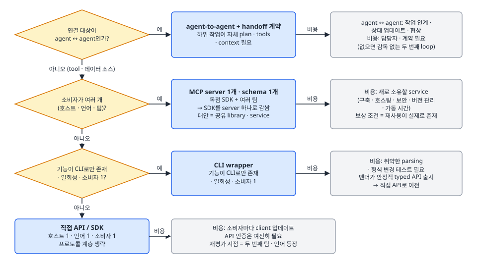
*그림: agent 간 연결이면 agent-to-agent, 소비자가 여럿이면 MCP server, CLI뿐이면 CLI wrapper, 아니면 직접 API를 고릅니다.*

근거: CCAR-P-jrajath94-0002, CCAR-P-jrajath94-0012, CCAR-P-jrajath94-0077, CCAR-P-jrajath94-0175, CCAR-P-jrajath94-0176, CCAR-P-jrajath94-0177, CCAR-P-jrajath94-0178, CCAR-P-jrajath94-0303, CCAR-P-jrajath94-0360, CCAR-P-jrajath94-0361, CCAR-P-jrajath94-0423, CCAR-P-jrajath94-0424, CCAR-P-jrajath94-0486, CCAR-P-jrajath94-0487, CCAR-P-jrajath94-0549, CCAR-P-jrajath94-0550, CCAR-P-jrajath94-0647, CCAR-P-jrajath94-0648, CCAR-P-preporato-0011

### 1-25. MCP 연결 인증 방침 · connector tool 제어
**인증은 신뢰 경계가 있는 곳에만**

| 연결 대상 | 인증 방침 |
|---|---|
| 로컬 stdio server (사용자가 spawn) | 사용자 신뢰 상속 OAuth는 얻는 것 없음 |
| 원격 MCP server (네트워크 경유) | OAuth 필수 ⚠️ 1-13은 OAuth '권장' · 해설 표현 차이 공식 문서: MCP 인증은 OPTIONAL · HTTP는 SHOULD |
| 로컬 server가 socket listen | 방침 반전 → 인증 필요 |
| 한 머신에서 여러 사용자가 공유하는 로컬 server | OAuth 필요 |
| 모든 server에 OAuth | 경계 없는 곳 = 보안 쇼 · 구성 비용 |
| 인증 없음 | 네트워크 = principal ✗ |
| 로컬 API key + 원격 무인증 | 배치 반대 |

| claude.ai connector tool 제어 | 내용 |
|---|---|
| 조직 제어 `blocked` | Claude가 보기 전에 목록에서 tool 제거 |
| allow 규칙 | 프롬프트 없이 실행 허용 · 차단 ✗ |
| idle timeout | tool 숨김 수단 ✗ |

근거: CCAR-P-jrajath94-0162, CCAR-P-jrajath94-0649

## 2. 상황별 정답 판단 규칙

| 상황 | 정답 |
|---|---|
| `stop_reason: tool_use` 뒤 결과 전송 | assistant 턴 유지 + user 메시지에 `tool_result` (같은 `tool_use_id`) |
| 한 턴에 `tool_use` 여러 개 | 모두 실행 → `tool_result`를 한 user 메시지에 모음 |
| tool 실행 실패 | `is_error: true` 붙은 `tool_result`로 모델에 반환 |
| 답변 전 특정 tool 호출 강제 | 지원 모델 = `tool_choice`로 지정 미지원 모델 = `auto` + 프롬프트 + strict |
| tool 입력 타입 오류 · 필수 필드 누락 | tool 정의에 `strict: true` |
| 모델이 엉뚱한 tool 선택 | description 구체화 + 겹치는 tool 통합 · 역할 구분 |
| MCP 서버 추가 후 성공률 하락 | 새 tool의 중복 · description 구별성부터 확인 |
| 큰 객체 반환 + 다음 호출에만 필요 | identifier(handle)만 반환 |
| 업무 순서 필수(본인 확인 먼저) | 앱 측 state machine → 상태별 허용 tool만 전달 |
| 사내망 시스템 조회 + 일반 웹 검색 | 사내 시스템 = client tool 웹 검색 = server tool(`web_search`) |
| 여러 앱이 같은 기능 공유 + 독립 유지보수 | MCP server |
| 외부 시스템 없이 정해진 절차 · 템플릿 | Skill |
| 서버에 tool 추가 + 앱 코드 변경 없이 노출 | client의 `tools/list` → `inputSchema`로 tool 정의 생성 |
| 로컬 파일 · CLI용 subprocess 서버 | stdio transport |
| 네트워크로 여러 client에 제공 | Streamable HTTP transport |
| Messages API에서 원격 MCP 서버 직접 사용 (client 직접 구현 ✗) | `mcp_servers`에 정의 → `tools`의 `mcp_toolset`에서 참조 |
| MCP connector 읽기 전용 제한 | `mcp_toolset`의 `configs` → 쓰기 tool `enabled: false` |
| 지속적 tool 오선택 | 첫 확인 = description의 용도 · 경계 구분 입력 형식 · 예시 · 비교 경계까지 확장 |
| 읽기 tool이 변경 요청 처리 | 각 tool 용도 · 전환 조건 기재 읽기 전용 명시 |
| 같은 일 하는 tool 여럿 | 하나로 통합 또는 description 구분 |
| 출력 사양 · 감사 로그로 tool 분리 유지 | 대상 드러낸 이름 + 사용 · 비사용 경계 description |
| 내장 tool만 쓰고 MCP tool 미사용 | MCP description 보강 + 일반 지시의 대상 한정 |
| 신규 tool이 거의 안 불림 | 범위 드러낸 이름 + 수록 범위 · 검색어 예시 |
| description 명확한데 특정 단어에서만 오선택 | system prompt 키워드 지시 수정 |
| 올바른 tool에 잘못된 입력 | 입력 형식 · `input_examples` · 필수 파라미터 |
| 텍스트만 응답 제거 + 출구 tool 여럿 | `tool_choice: any` |
| 문서 유형 미정 + 추출 schema 여럿 | `tool_choice: any` |
| workflow 첫 단계만 고정 | 첫 요청 `tool` → 이후 `auto` |
| 해당 없음 결과가 텍스트로 샘 | 빈 결과 보고 tool 추가 + `any` |
| tool 호출 결과를 schema 준수로 수신 | `strict: true` client tool + `tool_use` 수신 |
| 인계 데이터 일관성 | 필수 필드 지정 tool + 호출 지시 |
| tool 작업 범위 제한 | schema 상한 + 앱 검증 (수치 제약은 strict 미지원) |
| 큰 payload가 context 점유 | 작업 관련 결과만 + 상세는 별도 요청 |
| UUID만 반환해 이름 재조회 반복 | `response_format` enum(`concise` · `detailed`) |
| 검색 결과가 모호 | 후보 전부 + 식별 정보 + description에 확인 요청 |
| 권한 검사 뒤 앱 코드에서 tool 실행 | `tool_result` 반환 + `tool_use`인 동안 loop |
| tool을 반복해서 잘못 고름 | description만으로 구별 불가 → tool surface 재설계(중복 병합 · 역할 분리) |
| 범용 tool 하나에 여러 목적 + 출력 형식 불안정 | 목적별 tool 분할 + 입출력 schema 명시 |
| 검증 tool이 필수 입력 없이 호출됨 | `input_schema`의 필수 파라미터로 지정 |
| 한 호출에서 리뷰 · 생성 · 갱신 혼재 | 단계 분리 + 단계별 필요 tool만 노출 구조화 필수 단계 = `tool_choice`로 보고용 tool 지정 |
| 같은 일을 하는 tool 둘 | 하나 제거 · 또는 `action` 파라미터 tool로 병합 |
| 모든 subagent에 같은 18개 tool + 역할 밖 호출 | agent별 역할 tool(4~5개)로 제한 |
| 비슷한 tool 혼동 vs 역할 밖 tool 사용 | 혼동 = description 개선 역할 밖 = 배분 재검토 |
| 범용 `fetch_url`이 검색까지 수행 | 용도 한정 `load_document`로 교체 |
| 전문 agent의 단순 확인 빈도 높음 | 범위 제한 tool 부여 · 복잡 건은 coordinator 경유 |
| 전문 agent의 타 역할 tool 필요 빈도 낮음 | tool 제거 + coordinator routing |
| 읽기 위주 scanner agent | 읽기 전용 tool만 · 쓰기(티켓)는 coordinator만 |
| 작업에 안 쓰는 위험 tool(delete · drop · wire) | 제거 (로깅 · 모니터링 ✗) |
| 임의 SQL tool이 타 고객 데이터 노출 | 검증 ID 범위만 반환하는 tool로 교체 |
| 작업에 필요 없는 필드(SSN · 결제 정보) 반환 | 반환 필드 축소 |
| tool 수십~수백 개 + 전부 사용 가능 유지 + 토큰 · 혼동 문제 | tool search + `defer_loading` 자주 쓰는 3~5개는 non-deferred |
| 여러 팀 agent에 40~45개 tool 노출 | 작업 · 역할별 범위 + progressive discovery |
| tool이 모든 실패에 같은 문구 반환 + agent가 재시도 · 오안내 | `is_error: true` + 분류 · 재시도 가능 여부 · 사람용 설명 |
| 실패 종류가 섞임 (timeout · 입력 오류 · 한도 초과 · 접근 거부) | 일시적만 재시도 · 나머지는 재시도 ✗ + 사유 보고 · escalate |
| 같은 빈 배열이 timeout과 0건에 모두 쓰임 | 0건 = 성공 빈 결과 · timeout = 에러 |
| subagent가 429 · timeout을 coordinator에 계속 전파 | subagent 내부 로컬 재시도(상한) 못 푼 것만 부분 결과 · 시도 내용과 함께 전파 |
| 영구 에러와 일시 에러가 한 tool에 섞임 | tool 수준에서 결정적 retry 처리 |
| MCP tool의 업무 실패(형식 불량 번호 · 취소된 예약) | `isError: true` tool 실행 에러 JSON-RPC 에러 = 요청 구조 문제용 |
| 정책 차단을 성공처럼 반환 + agent가 표현만 바꿔 재시도 | `isError: true` + 재시도 가능 여부 |
| 처리할 수 없는 인자를 받음 | 정보 담긴 에러 반환 |
| 필수 절차를 건너뛴 호출 | 앱 게이트가 거부 → `is_error: true` + 이유 + 다음 절차 |
| 함수 호출처 · 에러 메시지 위치 찾기 | `Grep` |
| 명명 규칙 파일 열거 | `Glob` |
| 대규모 repo에서 처리 흐름 파악 | `Grep`으로 진입점 → `Read`로 import 추적 |
| 별칭 re-export로 사용처 누락 | wrapper `Read` → 노출 이름마다 `Grep` |
| `Edit` 다중 일치 + 모두 동일 변경 | `replace_all` (`old_string`은 닫는 따옴표까지 포함) |
| `Edit` 다중 일치 + 한쪽만 변경 + 유일화 불가 | `Read` → `Write` 전체 |
| 자동 생성 파일 재생성 | `Write` |
| 불필요한 tool 호출 + description · `tool_choice` 정상 | system prompt의 광범위 키워드 지시 축소 |
| 정책 한도 · 파괴적 작업 · 도구 사용 금지 | 도구 경계 · 도구 풀 제외로 강제 (prompt ✗) |
| Batches API + client tool | `custom_id`로 특정 → 앱이 실행 → `tool_result` 후속 요청 |
| 여러 MCP 서버 + 여러 subagent | 동시 연결 · 통합 registry · 역할별 서버 할당 |
| 수동 loop에서 Claude가 tool 결과를 모름 | assistant `tool_use` 턴 유지 + 결과를 `tool_result`에 저장 |
| 팀 공유 MCP server + 개인별 token | project `.mcp.json` + `${VAR}` 참조 필요 변수는 README에 기재 |
| 기본 명령으로 추가한 서버가 동료에게 안 보임 | `--scope project`로 재추가 → `.mcp.json` commit |
| 개인 · 실험 서버를 여러 repo에서 사용 | `--scope user` |
| 원격 HTTP MCP + Authorization 헤더 + 설정 공유 | `.mcp.json` `headers` → `Bearer ${VAR}` commit |
| 일부 멤버만 401 + 미설정 변수 경고 | 해당 환경에 변수 설정 |
| 사내 클라우드 서버 + 요청 응답만 + OAuth 로그인 | `claude mcp add --transport http` → `/mcp` 인증 |
| 서버가 이벤트를 자발 전송 | WebSocket (헤더 인증만) |
| 여러 MCP server를 가로지르는 요청 (Agent SDK) | `mcpServers`에 모두 등록 `allowedTools`에 서버 와일드카드 |
| 정의가 window 일정 비율일 때만 tool search | `ENABLE_TOOL_SEARCH=auto` |
| 표준 서비스(GitHub · Slack · GitLab)의 표준 조작 | 기성 MCP server |
| 팀 고유 workflow (승인 · 예약 절차 · release 판정) | custom MCP server (범위 한정) |
| 동작 · 첨부 데이터 · 재사용 템플릿 | tool · resource · prompt 순 |
| host 목록 탐색 + 선택분만 첨부 | resources (`resources/list` · `resources/read`) |
| 정적 카탈로그 때문에 탐색 호출 반복 | 카탈로그 = resource · tool = 조작만 |
| Messages API에서 여러 원격 MCP server 한 요청 사용 | 서버마다 `mcp_toolset` 1개 |
| 앱에 MCP client 없이 실시간 원격 데이터 | `mcp_servers` + `mcp_toolset` + beta 헤더 |
| 호스트 1 · 언어 1 · 안정적 API | 직접 API · MCP ✗ |
| 호스트 · 언어 · 팀 여러 개가 같은 기능 | MCP server 1개 · schema 1개 |
| 기능이 CLI로만 존재 | CLI wrapper + 형식 변경 테스트 |
| 하위 작업이 자체 plan · tools 필요 | agent-to-agent + handoff 계약 |
| 별개 벤더 agent 간 위임 | agent-to-agent (MCP ✗) |
| 로컬 stdio vs 원격 MCP 인증 | stdio = 사용자 신뢰 상속 원격 = OAuth |
| Claude가 보기 전에 connector tool 차단 | 조직 제어 `blocked` |

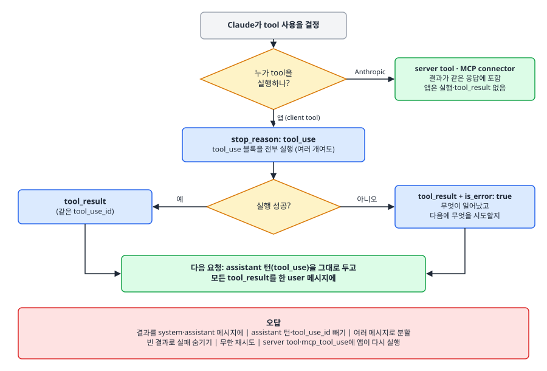
*그림: 실행 주체와 성공 여부에 따라 tool_result 형태가 정해지고, 결과는 모두 한 user 메시지로 돌려줍니다.*

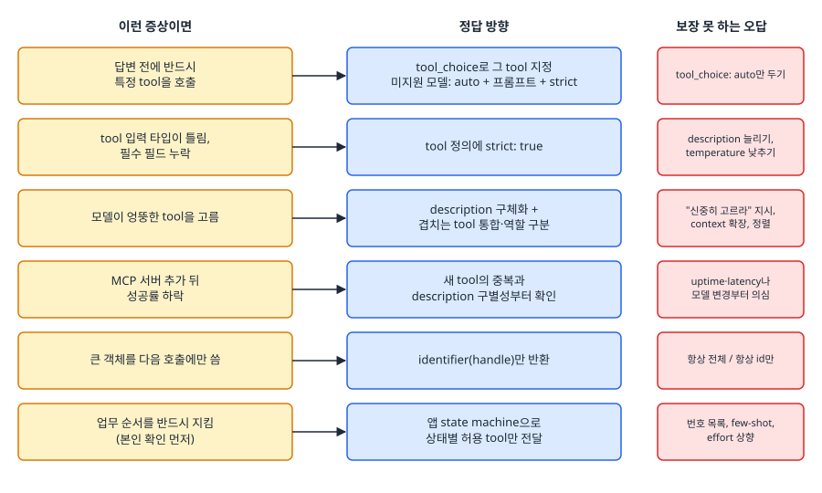
*그림: tool 정의·설계 문제는 증상마다 tool_choice, strict, description·통합, identifier, state machine 같은 보장 수단이 정해져 있습니다.*

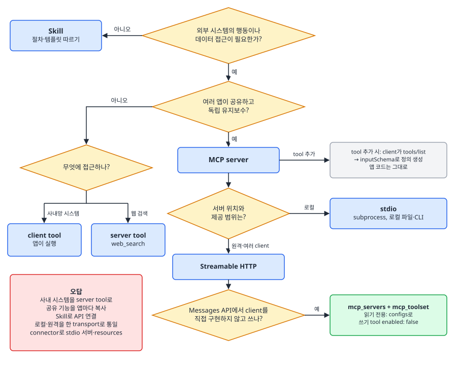
*그림: Skill/tool/MCP server를 먼저 고르고, MCP server는 위치에 따라 stdio/Streamable HTTP, client 미구현이면 MCP connector를 씁니다.*

근거: Amey-0009, Amey-0031, Amey-0032, Amey-0044, Amey-0077, Amey-0078, CCAR-F-Amey-Thakur-0002, CCAR-F-Amey-Thakur-0010, CCAR-F-Amey-Thakur-0028, CCAR-F-Amey-Thakur-0029, CCAR-F-Amey-Thakur-0030, CCAR-F-Amey-Thakur-0037, CCAR-F-Amey-Thakur-0039, CCAR-F-Amey-Thakur-0061, CCAR-F-Amey-Thakur-0062, CCAR-F-Amey-Thakur-0063, CCAR-F-Amey-Thakur-0076, CCAR-F-Amey-Thakur-0077, CCAR-F-MyPractice-0044, CCAR-F-MyPractice-0056, CCAR-F-MyPractice-0062, CCAR-F-Udemy01-0007, CCAR-F-Udemy01-0012, CCAR-F-Udemy01-0013, CCAR-F-Udemy01-0016, CCAR-F-Udemy01-0027, CCAR-F-Udemy01-0035, CCAR-F-Udemy01-0037, CCAR-F-Udemy01-0044, CCAR-F-Udemy01-0050, CCAR-F-Udemy01-0052, CCAR-F-Udemy01-0054, CCAR-F-Udemy02-0002, CCAR-F-Udemy02-0008, CCAR-F-Udemy02-0013, CCAR-F-Udemy02-0016, CCAR-F-Udemy02-0039, CCAR-F-Udemy02-0046, CCAR-F-Udemy02-0048, CCAR-F-Udemy02-0049, CCAR-F-Udemy02-0054, CCAR-F-Udemy03-0004, CCAR-F-Udemy03-0021, CCAR-F-Udemy03-0027, CCAR-F-Udemy03-0028, CCAR-F-Udemy03-0031, CCAR-F-Udemy03-0032, CCAR-F-Udemy03-0054, CCAR-F-Udemy03-0055, CCAR-F-Udemy03-0057, CCAR-F-Udemy03-0058, CCAR-F-Udemy03-0059, CCAR-F-Udemy04-0010, CCAR-F-Udemy04-0012, CCAR-F-Udemy04-0019, CCAR-F-Udemy04-0021, CCAR-F-Udemy04-0027, CCAR-F-Udemy04-0029, CCAR-F-Udemy04-0030, CCAR-F-Udemy04-0036, CCAR-F-Udemy04-0044, CCAR-F-Udemy04-0047, CCAR-F-Udemy04-0052, CCAR-F-Udemy04-0057, CCAR-F-Udemy05-0006, CCAR-F-Udemy05-0008, CCAR-F-Udemy05-0009, CCAR-F-Udemy05-0011, CCAR-F-Udemy05-0015, CCAR-F-Udemy05-0018, CCAR-F-Udemy05-0028, CCAR-F-Udemy05-0033, CCAR-F-Udemy05-0040, CCAR-F-Udemy05-0046, CCAR-F-Udemy06-0003, CCAR-F-Udemy06-0008, CCAR-F-Udemy06-0010, CCAR-F-Udemy06-0018, CCAR-F-Udemy06-0030, CCAR-F-Udemy06-0032, CCAR-F-Udemy06-0039, CCAR-F-Udemy06-0041, CCAR-F-Udemy06-0046, CCAR-F-Udemy06-0048, CCAR-F-Udemy06-0052, CCAR-F-Udemy06-0056, CCAR-F-paullarionov-0010, CCAR-F-paullarionov-0015, CCAR-F-paullarionov-0044, CCAR-F-paullarionov-0046, CCAR-F-paullarionov-0056, CCAR-F-paullarionov-0057, CCAR-F-preporato-0003, CCAR-F-preporato-0007, CCAR-F-preporato-0014, CCAR-F-preporato-0015, CCAR-F-preporato-0016, CCAR-P-Amey-Thakur-0001, CCAR-P-Amey-Thakur-0003, CCAR-P-Amey-Thakur-0038, CCAR-P-jrajath94-0002, CCAR-P-jrajath94-0003, CCAR-P-jrajath94-0012, CCAR-P-jrajath94-0159, CCAR-P-jrajath94-0162, CCAR-P-jrajath94-0175, CCAR-P-jrajath94-0176, CCAR-P-jrajath94-0177, CCAR-P-jrajath94-0179, CCAR-P-jrajath94-0351, CCAR-P-jrajath94-0414, CCAR-P-jrajath94-0477, CCAR-P-jrajath94-0541, CCAR-P-jrajath94-0589, CCAR-P-jrajath94-0629, CCAR-P-jrajath94-0630, CCAR-P-jrajath94-0646, CCAR-P-jrajath94-0649, CCAR-P-jrajath94-0650, CCAR-P-jrajath94-0651, Patrick-0002, Patrick-0017, Patrick-0018, Preporato-0024, Preporato-0025, Udemy-0011, Udemy-0013, Udemy-0016, Udemy-0025, Udemy-0033, Udemy-0036, Udemy-0045

## 3. 자주 나오는 오답 함정

| 오답 | 이유 |
|---|---|
| tool 결과를 system 프롬프트 · system 메시지 assistant 메시지로 전송 | `tool_result` = user 메시지 assistant 턴 · `tool_use_id` 없으면 에러 |
| 모델이 어떤 tool을 불렀는지 기억 | API = stateless → assistant 턴 재전송 필요 |
| 대화 요약 후 새로 시작 | `tool_use`/`tool_result` 짝 끊김 |
| 병렬 `tool_result`를 여러 메시지로 분할 첫 번째 `tool_use`만 유효 | 한 user 메시지에 모두 담아야 함 |
| 성공할 때까지 같은 호출 무한 재시도 | 같은 결함 반복 · 장애 지속 시 응답 없음 |
| 실패를 빈 `tool_result`로 숨김 | 모델이 "결과 없음"으로 오해 → 잘못된 답 지속 |
| 실패마다 예외 던지고 대화 종료 | 모델의 설명 · 대안 제시 기회 소멸 |
| raw 에러를 최종 사용자에게 노출 | 내부 정보 유출 |
| 입력 형식 문제에 temperature 낮춤 description 늘림 · `tool_choice: auto` | 보장 수단 = `strict: true`뿐 |
| tool 선택 문제에 "신중히 고르라" 지시 context window 확장 · 알파벳 정렬 | 중복이라는 설계 문제 해결 ✗ |
| description은 짧게, 정확도는 이름으로 보완 | description이 가장 중요 이름만으론 사용 시점 · 파라미터 의미 전달 ✗ |
| 잘못된 tool 호출을 사후 재시도로 교정 | 첫 호출 자체 방지 ✗ 되돌리기 어려운 작업은 이미 영향 발생 |
| 필수 순서를 system 프롬프트 · few-shot effort 상향 · JSON 단계 출력으로 강제 | 판단이 모델에 남음 → 보장 ✗ |
| server tool은 앱이 실행 · `tool_result` 전송 | 실행 위치 혼동 server tool = Anthropic 실행 |
| client tool은 Anthropic 쪽에서 실행 | 실행 위치 혼동 client tool = 앱 실행 |
| server tool = MCP 전용 또는 Batch API 전용 | 일반 요청의 `tools`에 선언 |
| 사내 시스템을 server tool로 연결 | server tool = Anthropic 제공 → 사용자 정의 ✗ 사내망 도달 ✗ |
| 공유 기능을 앱마다 복사 | 복사본끼리 어긋남 |
| 데이터를 system 프롬프트에 매일 붙여 넣기 | 붙여 넣은 데이터 낡음 |
| Skill로 API 연결 | Skill엔 live connection 없음 |
| 외부 시스템 없는 절차 → MCP server · custom tool · fine-tuning | 절차 · know-how = Skill |
| tool 발견에 prompts · resources 빈 인자로 `tools/call` 시험 호출 | 발견 = `tools/list` |
| 로컬 · 원격 모두 stdio 또는 모두 HTTP | 배포 위치 · 제공 범위에 따라 구분 |
| MCP connector로 resources(약관 문서) 읽힘 | tool 호출만 지원 |
| MCP connector로 stdio 서버 연결 | HTTP 서버만 연결 |
| MCP connector `mcp_tool_use` 수신 후 앱이 `tools/call` 재실행 | API가 이미 실행 → 중복 실행 |
| MCP server가 Messages API 대체 모델과 같은 프로세스 필요 | 둘 다 ✗ |
| 선택 혼동에 네 번째 tool 추가 fine-tuning · 무작위 선택 | 겹침 악화 · 과함 · 혼란을 제도화 |
| 첫 대응으로 tool 통합 (mode 플래그 · `lookup_entity`) | 근본 원인 = description 정보 부족 분리 요건(출력 사양 · 감사 로그) 위반 가능 |
| 사전 routing classifier · 전처리 · routing 계층 | 선택 단서(description) 미개선 구조만 복잡 |
| system prompt 한 문장 · few-shot 추가로 교정 | description 수정보다 약한 신호 모순 지시가 남으면 근본 해결 ✗ |
| 원인을 description 부족 · tool 수 few-shot 부족으로 진단 | description 명확 · tool 5개로 이미 부정된 사실 원인 = prompt 키워드 지시 |
| 기본 학습 연관 · fine-tuning · 부정 예시로 설명 | description 이미 명확 원인 = prompt 수준 지시 |
| tool 수 축소 · 유사 tool 삭제 | 첫 확인 아님 정상 조회 기능 상실 |
| `tool_choice` 강제(고정 · 매 턴 `any`)로 오선택 교정 | 선택 문제를 우회 · 입력별 선택 포기 잘못된 tool 강제 가능 |
| 오선택 결과를 hook으로 폐기 · loop에서 재실행 | 원인 방치 · 증상 처치 |
| 내장 tool(Grep) · `search_web` 비활성화 | 선택 문제를 강제로 억제 · 필요 기능 상실 |
| `CLAUDE.md` "항상 사용" 지시 · 요청마다 tool 지정 | 확률적 준수 · 수작업 의존 |
| 서버 등록 스코프 이동 · 개발자에게 tool 선택 위임 | 선택 판단 재료 불변 |
| 이름만 변경 · 파라미터 이름만 변경 | description 그대로 → 정보량 불변 |
| description을 1줄로 통일(토큰 절약) | 구별 단서 소실 |
| "~ 단어 → 이 tool" 키워드 규칙 추가 | 새로운 오라우팅 유발 |
| 입력 예를 JSON Schema 필드 설명에만 추가 | 선택 후 인수 개선 · "무엇을 고르나"에 영향 ✗ |
| description에 구현 언어 · SLA · 소유 팀 기재 | 선택과 무관한 정보 |
| 이름 거의 같은 tool 둘의 결함을 코드 중복 · latency · 비용으로 지목 | 결함 = 선택 시점의 근거 부재 나머지는 부차적 |
| 텍스트만 응답을 아래로 해결 `any` 단독 · `tool` 고정 텍스트 후처리 · prompt 강조 | `any` 단독 = 추측 기록 `tool` 고정 = 해당 없음 보고처 소멸 후처리 · 강조 = 사후 수습 · 확률적 |
| 매 요청 `tool` 고정 + description에 "다음에 호출" 기재 또는 반복 전환 | 강제를 description이 못 이김 번갈아 강제 = loop 종료 불가 |
| `none` · `tool_choice` 생략 · 매 턴 강제로 순서 확보 | `none` = 필요 tool까지 차단 생략 = `auto` 기본값 · 순서 보장 ✗ |
| 구조화 출력에 `tool` 고정 · `auto` · prefill | 문서 유형 무시 고정 · 대화 응답 여지 prefill = 신규 모델 사용 ✗ |
| 구조 출력을 사후 검증 server · 지시 강화 + 재시도로 보장 | 잘못된 출력 발생 자체 방지 ✗ |
| 자유 서술 + 항목 bullet 지시 · 무관한 tool 강제 | 형식 보장 ✗ · 강제 대상이 다른 처리 |
| system prompt에 성공 예시만 추가 · 메타데이터 최소 유지 | "모호하면 확인" 판단 지원 ✗ |
| 고정 순서 controller · 응답 텍스트 키워드 파싱 | 적응성 상실 · 구조화 호출 미사용 |
| 모델이 자체 네트워크로 API 직접 호출 | client tool = 앱 실행 · 권한 검사 우회 |
| `stop_reason`을 `tool_result`로 설정 | `tool_result` = 블록 유형 · stop reason ✗ |
| 요약 텍스트만 새 요청 · 요약 먼저 결과 분할 · assistant에 결과 | 결과 ↔ 호출 대응 소실 · 순서 · 묶음 · 역할 규칙 위반 |
| context window 확대 두 번째 모델 호출로 요약 · 호출 횟수 감소 | 문제 지연 · 비용과 실패 지점 증가 · payload 불변 |
| UUID 문제에 pagination · `strict` `resolve_ids` 추가 | 양 · 입력 형식 문제만 해결(값 의미 문제 ✗) `resolve_ids` = 왕복만 증가 |
| 후보 여럿 중 최신 · 유사도 자동 선택 | 확인 없는 추측 |
| 무제한 export 유지 + 로깅 export 전체 제거 · 두 번째 tool 추가 | 로깅 = 관찰 · 통제 ✗ 제거 = 기능 상실 · 추가 = 범위 문제 미해결 |
| tool 개수 · JSON 반환 · 구현 분산 · payload 크기를 재설계 신호로 판단 | 그 자체로 결함 아님 신호 = 엉뚱한 tool의 반복 선택 |
| 역할 밖 tool 오용을 prompt 금지로 처리 (`web_search`를 쓰지 말라는 지시 등) | 확률적 · tool 접근 그대로 용도 한정 tool 교체 · 제거가 정답 |
| `fetch_url`에 검색 엔진 도메인 차단 필터 | 해설 정답 = 용도 한정 tool 교체 |
| 전문 agent에 타 역할 tool 전체 부여 (synthesis에 web-search 전부) | 역할 확대 · 미검증 출처 혼입 유지 |
| 검증 결과에 출처 신뢰도 표기만 추가 | 혼입 자체를 못 막음 |
| 추출 agent에 DB 전체 읽기 · 쓰기 권한 부여 | 필요 최소 초과 |
| 위험 tool 유지 + 로깅 · 모니터링 · 대시보드 | 가시성 ≠ 통제 · 권한 활성 상태 |
| 쓰지 않는 tool을 "나중에 쓸지도"로 유지 문서화 · 이름 변경 · 숨김 | 기능 접근 그대로 최소 권한 = 현재 작업 기준 |
| SQL 오류를 자가 재확인 · prompt 지시 · 사후 검토로 방어 | 확률적 준수 · 사후 검출 |
| 중복 tool을 "안전용"으로 유지 · 추가 이름 주기적 변경 | 오선택 확률 증가 · bloat 악화 |
| 더 긴 description · prompt 문서화로 겹침 해결 | 중복 · 과다 데이터는 못 고침 description 개선 = 구별되는 tool에만 유효 |
| tool recommender · 분류기 · 보조 tool 추가 | tool 수 증가 + 실패 경로에 모델 판단 추가 |
| 더 큰 모델 · 최고 등급 큰 context window · temperature 상향 | 증상 대응 · 구분 안 되는 선택지 그대로 토큰 과금 유지 · temperature = 무작위 증가 |
| tool 절반 무작위 제거 · 플랫폼 기능을 10개로 제한 | 필요 tool 제거 · 요구사항 희생 |
| 모든 description을 일률적으로 한 줄로 단축 | 토큰만 절감 · 선택 품질 하락 |
| 40개 · 18개 동작을 mode · `action` tool 하나로 | 동작이 선택 단계에서 숨음 · 목적 모호 |
| 범용 tool 유지 + 지시를 system prompt로 이동 enum에 작업명 추가 | 필수 조건을 schema로 표현 불가 |
| 자유 형식 응답 + 받는 쪽 해석 · 지시문 예시 10개 추가 | 편차를 소비 측으로 이동 · 자유 기술 구조 유지 |
| `tool_choice: none` + 텍스트에서 JSON 파싱 | 구조화 출력 수단 포기 |
| namespace만 정리 | 노출 범위를 못 좁힘 |
| 정의 과다에 description 단축 · `cache_control` `tool_choice: any` | 단축 = 토큰만 · cache = 요금 · latency만 any = 호출 여부만 → 점유 · 혼동 둘 다 해결 ✗ |
| 모든 tool에 `defer_loading: true` (tool search 포함) | 자주 쓰는 tool도 검색 왕복 발생 |
| deferred tool에 `cache_control` | 400 오류 |
| tool 선택 개선용 few-shot · 예시를 prompt에 추가 | tool이 많은 상태 그대로 · 토큰만 증가 |
| 역할 밖 tool 호출에 `tool_choice: any` 설정 | 호출 여부만 제어 · 선택 문제와 무관 |
| 전체 description 재작성 · 오선택 감시 후 재분석 | 역할 밖 사용 = 배분 재검토가 직접 해결 감시 · 재분석 = 사후 대응 |
| 고정 문구 "Operation failed" + `is_error: true`만 | 원인 구별 ✗ · 재시도 오판 |
| 실패를 빈 배열 · 빈 JSON · 성공 결과로 변환 | "해당 없음"과 "실패" 혼동 |
| timeout과 0건을 둘 다 에러로 반환 | 유효한 빈 결과 소실 |
| 실패 시 캐시 반환 | 낡은 정보가 새 결과처럼 보임 |
| 한도 초과를 일시적 오류로 분류 | 재시도 조장 · 시간이 지나도 해소 안 됨 |
| 오류 구분 없이 횟수 · 간격 · 백오프 조정 | 어느 한 유형엔 부적절 |
| description에 경고 추가 · 설명 확장 | 실행 시 응답을 못 바꿈 · 예방에 그침 |
| 전용 retry subagent | 처리 위치만 이동 · 왕복 안 줄어듦 |
| 업무 실패를 JSON-RPC 에러로 | 이유 전달 보장 ✗ → "시스템 장애"로 종료 |
| 가장 비슷한 결과를 짐작해 반환 | 조용히 틀린 결과 |
| 문구로 loop 중단 `tool_choice` 일시 강제로 필수 절차 보장 | 제출 자체를 저지하는 구조 ✗ |
| 흔한 단어를 Grep · 파일 통독 | 무관한 일치 대량 · context 소진 |
| Glob · `find`로 내용 정보 추정 | 이름만으론 불확실 |
| 대소문자 무시 검색으로 별칭 사용처 추적 | 별칭엔 효과 ✗ |
| 테스트 실행으로 사용처 추적 | 실행된 경로만 보임 |
| `Edit`에서 `old_string` 단축 · 정규식 · Grep으로 줄 지정 | `Edit` 일치 방식 불변 |
| 한쪽만 바꿀 때 `replace_all` | 변경 범위 과다 |
| 단순 일괄 치환에 `Read` + `Write` | 과함 |
| 자동 생성 파일을 `Edit` 수십 회로 갱신 | 유일 일치 실패 → 중간 갱신 파일 잔존 |
| 불필요한 tool 호출을 `tool_choice: any`로 교정 | 호출 강제 → 악화 |
| 도구 제한에 `allowed-tools` | 사전 승인일 뿐 · 제한 ✗ |
| 도구 제한을 CLAUDE.md · slash command 요청으로 | guidance뿐 · 강제력 ✗ |
| 정책 한도를 prompt · 직원 교육 · parameter 추가로 | 결정적 강제 ✗ |
| Batches API에서 `web_search` 대체 `tool_choice` 강제 · 예측 `tool_result` | 검증 대상 변경 · 실행 주체 불변 · 실행 결과 아님 |
| subagent당 서버 1개 + 필요 시 재연결 | 단계마다 중단 |
| tool 결과를 prefill 요약으로 · 사이에 확인 메시지 삽입 | `tool_result` 인식 ✗ · 배열 규칙 위반 |
| token을 `.mcp.json`에 직접 기재 (`.gitignore` · 접근 제한 병행) | 접근 제한과 무관하게 유출 공유 설정 구조 붕괴 |
| token을 `CLAUDE.md`에 기재 | 모델 context에 들어가 출력 · 로그로 유출 |
| 개인 `~/.claude.json`을 repo에 check-in | 인증 정보 유출 |
| 팀 공유를 user scope 재등록으로 해결 | user scope = 본인만 |
| 개발자마다 local scope 수동 추가 | 다른 사람에게 전파 ✗ · 수동 단계 반복 |
| placeholder token + 로컬 override `.env` 읽는 wrapper server | 버전 관리되는 단일 기준 · 환경 변수 방식(관례)이 아님 |
| 개인 · 실험 서버를 `.mcp.json` + `.gitignore` | 공유용 구조를 개인용으로 전용 |
| 개인 서버를 `.mcp.json`에 commit | 개인 설정을 팀에 떠넘김 |
| `$PR_API_TOKEN` (중괄호 없음) | 문서화된 확장 구문 ✗ |
| 일부 멤버의 401을 scope · 승인 문제로 진단 | 일부 멤버만 + 미설정 변수 경고 = 개인 환경 부족 |
| 서버별 session · 라우터 · 서버 통합 | 동시 사용 전제를 모른 불필요한 구조 변경 |
| `sse` transport 선택 | deprecated |
| WebSocket으로 OAuth 로그인 | WebSocket = 헤더 인증만 |
| 카탈로그 목록을 tool로 조회 | 모델의 탐색 turn 발생 |
| 카탈로그를 prompt로 공개 | prompt = 사용자가 기동하는 템플릿 |
| 카탈로그를 `CLAUDE.md`에 복사 | 상시 로딩 |
| 목록 tool 한 번에 반환 건수 확대 tool description에 목록 전문 기재 | 대량 정보를 매번 context에 투입 |
| `mcp_toolset` 생략 후 자동 검출 의존 | 서버마다 1개 참조 규칙 위반 |
| 서버별로 요청을 나눠 JSON 수동 전달 | 한 요청 안 횡단 선택 요건 미충족 |
| 범용 proxy tool로 서버 tool 메타데이터 숨김 | tool 선택 단서 박탈 |
| 주기 복사 인덱스 검색 | 저장 스냅샷 · 실시간 ✗ |
| `alwaysLoad`로 임계값 구현 | 한 서버 tool을 미리 로드할 뿐 |
| 별도 랭킹 서비스 작성 | 기본 설정 + `auto`로 충족 |
| 표준 서비스까지 custom MCP server로 직접 구축 | 표준 조작의 유지보수까지 떠안음 |
| 여러 통합을 custom server 하나로 통합 | 표준 연동 유지보수 부담 잔존 |
| GitHub Issue 대신 웹 검색 · 정적 export | 구조화 데이터 · 자체 workflow 희생 |
| `CLAUDE.md` 절차서 + curl · Bash | 구조화된 tool 정의 없음 절차 순서 · 인증 처리를 prompt에 의존 |
| 작업별 slash command | API 선택을 Claude prompt에 위임 |
| "MCP는 표준" · "미래 재사용" 근거로 MCP 구축 | 서버 구축 · 호스팅 · 보안 비용 · 얻는 기능 없음 |
| MCP server + 직접 REST tool 병행 | 유지보수 범위 2배 |
| agent-to-agent로 REST API · CRM 연결 | CRM은 agent ✗ |
| 별개 벤더 agent에 MCP로 연결 | MCP = agent ↔ tool |
| 공유 REST polling으로 agent 협업 | 데이터 교환만 · 위임 의미 체계 ✗ |
| 별개 벤더 두 agent를 하나로 합침 | 기술 · 계약상 불가 |
| 팀마다 SDK 직접 호출 · 기능 재구현 | 유지보수 N배 · 벤더 특이 사항 분산 |
| 모델이 SDK 소스를 읽고 임의 호출 | 검토 · 테스트 불가 |
| 호스트별 client 라이브러리 | 사본마다 두 번째 schema |
| 언어별 CLI wrapper parsing | 취약한 parsing이 언어 수만큼 증가 |
| 소비자별 검색 agent | planning 불필요 → 조율 비용만 추가 |
| API를 CLI로 감싼 뒤 MCP를 위에 얹음 | 계층마다 parsing · 실패 모드 추가 |
| CLI 전용 메인프레임에 MCP server | 화면 스크래핑을 감싼 wrapper에 불과 |
| 단일 호스트에 stdio 서버 등록 · MCP wrapper | 불필요한 프로토콜 계층 |
| 속도를 위해 MCP 서버 인증 생략 | 회사 데이터 노출 직접 client도 API 인증 필요 |
| 직접 만든 Kubernetes operator로 운영 부담 0 | 운영 부담이 가장 큼 |
| 일회성 · 단일 쌍에 MCP | 한 번 쓰려고 protocol 비용 부담 |
| "모든 통합은 MCP" · 소규모 앱에 fine-tuning | 더 단순한 동작 옵션을 건너뜀 |
| 모든 server에 OAuth · 모두 무인증 · 로컬 key + 원격 무인증 | 신뢰 경계와 통제 짝이 어긋남 |
| allow 규칙 · idle timeout 0으로 connector tool 차단 | 차단 수단 ✗ · 조직 제어 `blocked`만 제거 |

근거: Amey-0009, Amey-0031, Amey-0032, Amey-0044, Amey-0063, CCAR-F-Amey-Thakur-0002, CCAR-F-Amey-Thakur-0010, CCAR-F-Amey-Thakur-0028, CCAR-F-Amey-Thakur-0029, CCAR-F-Amey-Thakur-0030, CCAR-F-Amey-Thakur-0031, CCAR-F-Amey-Thakur-0039, CCAR-F-Amey-Thakur-0061, CCAR-F-Amey-Thakur-0062, CCAR-F-Amey-Thakur-0075, CCAR-F-Amey-Thakur-0076, CCAR-F-Amey-Thakur-0077, CCAR-F-MyPractice-0007, CCAR-F-MyPractice-0044, CCAR-F-MyPractice-0046, CCAR-F-MyPractice-0056, CCAR-F-MyPractice-0057, CCAR-F-MyPractice-0062, CCAR-F-Udemy01-0006, CCAR-F-Udemy01-0007, CCAR-F-Udemy01-0012, CCAR-F-Udemy01-0013, CCAR-F-Udemy01-0016, CCAR-F-Udemy01-0026, CCAR-F-Udemy01-0027, CCAR-F-Udemy01-0031, CCAR-F-Udemy01-0035, CCAR-F-Udemy01-0037, CCAR-F-Udemy01-0044, CCAR-F-Udemy01-0050, CCAR-F-Udemy01-0052, CCAR-F-Udemy01-0054, CCAR-F-Udemy01-0056, CCAR-F-Udemy02-0002, CCAR-F-Udemy02-0008, CCAR-F-Udemy02-0013, CCAR-F-Udemy02-0016, CCAR-F-Udemy02-0039, CCAR-F-Udemy02-0046, CCAR-F-Udemy02-0048, CCAR-F-Udemy02-0049, CCAR-F-Udemy02-0054, CCAR-F-Udemy02-0057, CCAR-F-Udemy03-0004, CCAR-F-Udemy03-0015, CCAR-F-Udemy03-0021, CCAR-F-Udemy03-0027, CCAR-F-Udemy03-0028, CCAR-F-Udemy03-0031, CCAR-F-Udemy03-0032, CCAR-F-Udemy03-0042, CCAR-F-Udemy03-0054, CCAR-F-Udemy03-0055, CCAR-F-Udemy03-0056, CCAR-F-Udemy03-0057, CCAR-F-Udemy03-0058, CCAR-F-Udemy03-0059, CCAR-F-Udemy04-0004, CCAR-F-Udemy04-0010, CCAR-F-Udemy04-0012, CCAR-F-Udemy04-0018, CCAR-F-Udemy04-0019, CCAR-F-Udemy04-0021, CCAR-F-Udemy04-0027, CCAR-F-Udemy04-0029, CCAR-F-Udemy04-0030, CCAR-F-Udemy04-0036, CCAR-F-Udemy04-0044, CCAR-F-Udemy04-0047, CCAR-F-Udemy04-0052, CCAR-F-Udemy04-0057, CCAR-F-Udemy04-0060, CCAR-F-Udemy05-0002, CCAR-F-Udemy05-0006, CCAR-F-Udemy05-0008, CCAR-F-Udemy05-0009, CCAR-F-Udemy05-0011, CCAR-F-Udemy05-0015, CCAR-F-Udemy05-0018, CCAR-F-Udemy05-0020, CCAR-F-Udemy05-0033, CCAR-F-Udemy05-0040, CCAR-F-Udemy05-0046, CCAR-F-Udemy05-0052, CCAR-F-Udemy06-0003, CCAR-F-Udemy06-0007, CCAR-F-Udemy06-0010, CCAR-F-Udemy06-0018, CCAR-F-Udemy06-0024, CCAR-F-Udemy06-0030, CCAR-F-Udemy06-0032, CCAR-F-Udemy06-0039, CCAR-F-Udemy06-0041, CCAR-F-Udemy06-0046, CCAR-F-Udemy06-0048, CCAR-F-Udemy06-0052, CCAR-F-Udemy06-0056, CCAR-F-paullarionov-0007, CCAR-F-paullarionov-0010, CCAR-F-paullarionov-0015, CCAR-F-paullarionov-0044, CCAR-F-paullarionov-0046, CCAR-F-paullarionov-0057, CCAR-F-preporato-0003, CCAR-F-preporato-0007, CCAR-F-preporato-0015, CCAR-F-preporato-0016, CCAR-P-Amey-Thakur-0001, CCAR-P-Amey-Thakur-0003, CCAR-P-Amey-Thakur-0050, CCAR-P-jrajath94-0002, CCAR-P-jrajath94-0003, CCAR-P-jrajath94-0012, CCAR-P-jrajath94-0077, CCAR-P-jrajath94-0078, CCAR-P-jrajath94-0157, CCAR-P-jrajath94-0158, CCAR-P-jrajath94-0159, CCAR-P-jrajath94-0162, CCAR-P-jrajath94-0175, CCAR-P-jrajath94-0176, CCAR-P-jrajath94-0177, CCAR-P-jrajath94-0178, CCAR-P-jrajath94-0179, CCAR-P-jrajath94-0414, CCAR-P-jrajath94-0423, CCAR-P-jrajath94-0424, CCAR-P-jrajath94-0477, CCAR-P-jrajath94-0486, CCAR-P-jrajath94-0540, CCAR-P-jrajath94-0589, CCAR-P-jrajath94-0629, CCAR-P-jrajath94-0630, CCAR-P-jrajath94-0646, CCAR-P-jrajath94-0647, CCAR-P-jrajath94-0648, CCAR-P-jrajath94-0649, CCAR-P-jrajath94-0650, CCAR-P-jrajath94-0651, CCAR-P-preporato-0011, CCAR-P-preporato-0013, Patrick-0002, Patrick-0017, Patrick-0018, Preporato-0023, Preporato-0024, Preporato-0025, Udemy-0011, Udemy-0013, Udemy-0016, Udemy-0025, Udemy-0033, Udemy-0036, Udemy-0045

## 4. 암기 목록

| 이름 | 의미 |
|---|---|
| `stop_reason: tool_use` | 모델이 client tool 호출을 요청하며 멈춘 상태 |
| `tool_use` 블록 | assistant content의 tool 호출 (id, name, input) |
| `tool_result` 블록 | user 메시지에 넣는 실행 결과 |
| `tool_use_id` | `tool_result`를 해당 `tool_use`와 짝짓는 id |
| `is_error: true` | `tool_result`의 실행 실패 표시 |
| `disable_parallel_tool_use` | 한 턴 tool 호출을 하나로 제한 |
| `tool_choice: auto` | 기본값 · 호출 여부를 모델이 판단 |
| `tool_choice: any` | 어떤 tool이든 사용 강제 |
| `tool_choice: tool` | 지정 tool 사용 강제 |
| `tool_choice: none` | tool 사용 ✗ |
| `strict: true` | tool 입력이 `input_schema`를 따르도록 검증 |
| `input_schema` | tool 입력의 JSON Schema(API tool 정의) |
| `description` | tool 선택 · 사용의 핵심 근거 하는 일 · 사용 시점 · 파라미터 · 제약 |
| client tools | 앱에서 실행(사용자 정의 tool, `bash`, `text_editor`) |
| server tools | Anthropic 인프라에서 실행 (`web_search`, `web_fetch` `code_execution`, `tool_search`) |
| MCP server | tools/resources 제공자 여러 client 공유 · 독립 유지보수 |
| Skill | 작업 일치 시 로드되는 지시 · 템플릿 묶음 (live connection 없음) |
| MCP tools | 모델이 주도해 호출하는 primitive |
| MCP resources | URI로 노출되는 참조 데이터 context 포함 여부 = 앱 결정 |
| MCP prompts | 사용자가 slash command 등으로 고르는 프롬프트 템플릿 |
| `tools/list` | 서버의 tool 목록 조회 (`name` · `description` · `inputSchema`) |
| `tools/call` | client의 tool 실행 요청 |
| `inputSchema` | MCP tool 인자를 정의하는 JSON Schema |
| `isError` | MCP tool 실행 에러 표시(입력 검증 실패 포함) |
| `listChanged` / `notifications/tools/list_changed` | tool 목록 변경을 client에 알림 |
| host / client / server | host(Claude Code 등)가 서버마다 client 생성 · 연결 |
| transport: stdio | 같은 머신 subprocess와 표준 입출력 통신 로컬 · 단일 client |
| transport: Streamable HTTP | HTTP POST + 선택적 SSE 원격 · 다수 client · HTTP 인증과 OAuth |
| `mcp_servers` | MCP connector 서버 정의 (`type`, `url`, `name`, `authorization_token`) |
| `mcp_toolset` | `tools` 배열 안의 항목 `mcp_server_name`으로 서버 참조 |
| `default_config` / `configs` | `mcp_toolset`의 전체 기본값 / tool별 `enabled` 덮어쓰기 |
| `mcp_tool_use` / `mcp_tool_result` | MCP connector 응답에 함께 오는 호출 · 결과 블록 (API가 실행) |
| `input_examples` | tool 정의의 선택 필드 `input_schema`에 맞는 입력 예시 |
| `required` | `input_schema`의 필수 필드 지정 Claude가 채워 호출 |
| `response_format` | 결과 상세도 enum 파라미터 `concise`(이름 · 상태) / `detailed`(ID 포함) |
| `tool_choice: {"type": "tool", "name": ...}` | 지정 tool 강제 · 요청 단위 설정 |
| `stop_reason: end_turn` | loop 종료 신호의 하나 (`tool_use`인 동안 반복) |
| 빈 결과 보고 tool | "해당 없음"을 기록하는 출구 tool 검색 범위 · 이유를 필수 필드로 |
| tool surface | 모델에 노출되는 tool 전체 집합 (이름 · description · 스키마) |
| capability bloat | 겹치는 설명 · 미사용 tool이 쌓인 상태 |
| least privilege | agent마다 맡은 책임에 필요한 권한만 부여 |
| 범위 제한 tool | 한 용도만 허용하는 tool |
| `load_document` · `verify_fact` | 문서 URL 한정 · 단순 사실 확인 한정 tool |
| `lookup_job_code` | 직종 코드 조회 한정 · 읽기 전용 tool |
| `get_account_summary` | 검증된 고객 ID 범위만 반환하는 tool |
| 역할 횡단 tool | 빈도 높은 타 역할 필요를 범위 제한으로 충족 |
| `AgentDefinition`의 `tools` | Agent SDK에서 subagent별 사용 tool 지정 |
| progressive discovery | 이름 먼저 · 스키마는 필요 시 로드 |
| `defer_loading: true` | tool search로 발견될 때만 context에 전개 `cache_control`과 함께 쓰면 400 |
| JSON-RPC 에러 | MCP 프로토콜 에러 (알 수 없는 tool · 잘못된 형식 요청) |
| `errorCategory` · `isRetryable` | tool 측이 설계하는 에러 metadata의 예 (MCP 사양이 정한 값 ✗) |
| `Glob` | 파일 이름 · 확장자 패턴으로 파일 검색 |
| `Grep` | 파일 내용에서 패턴 검색 |
| `Read` | 개별 파일 읽기 |
| `Edit` | 완전 일치 문자열 치환 (`old_string`은 파일 안에 한 번) |
| `replace_all` | `Edit`의 모든 일치 치환 옵션 |
| `Write` | 파일 전체 쓰기 |
| `allowed-tools` | skill 호출 turn 동안의 사전 승인 (도구 제한 ✗) |
| `disallowed-tools` | skill 활성 동안 도구 풀에서 제외 |
| `custom_id` | Batch 요청 식별자 (결과가 어느 요청의 것인지 특정) |
| `.mcp.json` | project scope 설정 파일 · commit 대상 |
| `~/.claude.json` | local · user scope 저장 위치 |
| `--scope local\|project\|user` | `claude mcp add` scope 옵션 (기본 local) |
| `${VAR}` · `${VAR:-default}` | `.mcp.json` 환경 변수 확장 |
| `claude mcp list` | 서버 상태 · 미설정 변수 경고 확인 |
| `claude mcp reset-project-choices` | project scope 서버 승인 선택 초기화 |
| `claude mcp add --transport http` | 원격 HTTP 서버 추가 |
| WebSocket transport | 서버가 이벤트 자발 전송 · 헤더 인증만 |
| `resources/list` · `resources/read` | resource 목록 · 내용 조회 |
| `@` | Claude Code에서 resource 참조 · 첨부 |
| `mcpServers` | Agent SDK의 MCP server 등록 옵션 |
| `mcp__서버이름__tool이름` | Agent SDK의 MCP tool 이름 규칙 |
| `allowedTools` | 허용 tool 지정 · 서버 와일드카드 가능 |
| `system/init` | 서버별 연결 상태 메시지 (`failed` · `needs-auth`) |
| `ENABLE_TOOL_SEARCH=auto` | 정의가 window 10% 도달 시 tool search 시작 |
| `alwaysLoad` | 한 서버의 tool을 미리 로드 |
| agent-to-agent | agent ↔ agent 위임 · 상태 · 협상 |
| CLI wrapper | CLI-only 기능을 subprocess로 감싸 parsing |
| 조직 제어 `blocked` | connector tool을 Claude가 보기 전에 제거 |

근거: Amey-0044, CCAR-F-Udemy01-0012, CCAR-F-Udemy01-0013, CCAR-F-Udemy01-0016, CCAR-F-Udemy01-0035, CCAR-F-Udemy01-0037, CCAR-F-Udemy02-0008, CCAR-F-Udemy02-0039, CCAR-F-Udemy02-0046, CCAR-F-Udemy03-0027, CCAR-F-Udemy03-0031, CCAR-F-Udemy03-0042, CCAR-F-Udemy03-0057, CCAR-F-Udemy03-0058, CCAR-F-Udemy03-0059, CCAR-F-Udemy04-0010, CCAR-F-Udemy04-0044, CCAR-F-Udemy04-0047, CCAR-F-Udemy04-0052, CCAR-F-Udemy05-0004, CCAR-F-Udemy05-0006, CCAR-F-Udemy05-0008, CCAR-F-Udemy05-0009, CCAR-F-Udemy05-0015, CCAR-F-Udemy05-0040, CCAR-F-Udemy05-0046, CCAR-F-Udemy06-0010, CCAR-F-Udemy06-0024, CCAR-F-Udemy06-0039, CCAR-F-Udemy06-0041, CCAR-F-Udemy06-0046, CCAR-F-paullarionov-0010, CCAR-F-paullarionov-0015, CCAR-F-paullarionov-0044, CCAR-P-jrajath94-0002, CCAR-P-jrajath94-0012, CCAR-P-jrajath94-0177, CCAR-P-jrajath94-0179, CCAR-P-jrajath94-0361, CCAR-P-jrajath94-0589, CCAR-P-jrajath94-0629, CCAR-P-jrajath94-0649, CCAR-P-jrajath94-0650, CCAR-P-jrajath94-0651, CCAR-P-preporato-0012, CCAR-P-preporato-0013, Patrick-0002, Patrick-0017, Patrick-0018, Preporato-0024, Preporato-0025, Udemy-0011, Udemy-0013, Udemy-0025, Udemy-0033, Udemy-0036, Udemy-0045

## 5. 시험 직전 체크리스트

- [ ] `tool_result` = user 메시지
- [ ] assistant 턴 유지
- [ ] 짝 = 같은 `tool_use_id`
- [ ] 병렬 `tool_use` 결과 = 한 user 메시지에 모두
- [ ] tool 실패 = `is_error: true`로 모델에 알림
- [ ] 실패 숨기기 · 무한 재시도 · 중단 ✗
- [ ] `tool_choice` 네 가지 = auto/any/tool/none
- [ ] 강제 호출 = `tool`로 지정 (지원 모델)
- [ ] 입력 타입 · 필수 필드 보장 = `strict: true`
- [ ] 선택 정확도 = description
- [ ] description = 하는 일 · 사용 시점 · 파라미터 · 제약
- [ ] tool 겹침 → 통합 · 역할 분리
- [ ] 지시문 · context 확장 · 정렬 ✗
- [ ] 큰 객체가 다음 호출에만 필요 → identifier 반환
- [ ] 필수 순서 = 앱 측 state machine으로 tool을 걸러 강제
- [ ] 필수 순서를 프롬프트로 보장 ✗
- [ ] client tool = 앱 실행
- [ ] server tool = Anthropic 실행
- [ ] server tool `tool_result` 전송 ✗
- [ ] 공유 + 독립 유지보수 = MCP server
- [ ] 절차 · know-how = Skill
- [ ] 행동 · 데이터 접근 = tool/MCP
- [ ] primitive 주도 = tools 모델 · resources 앱 · prompts 사용자
- [ ] tool 발견 = `tools/list`(`inputSchema`)
- [ ] tool 실행 = `tools/call`
- [ ] 로컬 subprocess = stdio
- [ ] 원격 · 다수 client = Streamable HTTP
- [ ] connector 설정 = `mcp_servers` + `mcp_toolset`
- [ ] MCP connector 제약 = tool만 지원 · HTTP 서버만
- [ ] MCP connector 결과 → 앱 재실행 ✗
- [ ] 오선택 첫 확인 = description 구분성 · prompt 키워드 지시
- [ ] 텍스트만 응답 제거 = `any` · 첫 단계 고정 = 첫 요청만 `tool`
- [ ] 구조 보장 = 생성 시 제약(`strict`) > 사후 검증
- [ ] 결과 반환 = 필요한 것만 · 이름 포함 · 모호하면 후보 전부
- [ ] 반복 오선택 = tool surface 재설계 신호 (개수 · JSON · 구현 분산은 아님)
- [ ] 목적 · 입출력이 다르면 분할 · 같은 일의 중복은 병합 또는 제거
- [ ] agent별 tool = 역할 범위만 · 빈도 높은 단순 요구는 범위 제한 tool
- [ ] 불필요한 위험 tool = 제거 (로깅 · 모니터링 ✗)
- [ ] 에러 = 분류 · 재시도 가능 여부 · 설명, 빈 결과와 구분
- [ ] 이름 = Glob · 내용 = Grep
- [ ] `Edit` 다중 일치 = 유일화 · `replace_all` · `Write`
- [ ] 별칭 re-export = wrapper `Read` → 노출 이름마다 `Grep`
- [ ] 예외 없는 통제 = 도구 경계 강제 (prompt ✗)
- [ ] 공유 MCP = project `.mcp.json` + `${VAR}` · 개인 = user scope
- [ ] 재사용이 실제 있을 때만 MCP · 호스트 1 · 언어 1 = 직접 API
- [ ] 정적 카탈로그 = resource

근거: CCAR-F-Amey-Thakur-0002, CCAR-F-Amey-Thakur-0030, CCAR-F-Amey-Thakur-0061, CCAR-F-Udemy01-0007, CCAR-F-Udemy01-0054, CCAR-F-Udemy03-0057, CCAR-F-Udemy04-0010, CCAR-F-Udemy04-0029, CCAR-F-Udemy04-0036, CCAR-F-Udemy04-0044, CCAR-F-Udemy04-0047, CCAR-F-Udemy04-0057, CCAR-F-Udemy05-0004, CCAR-F-Udemy05-0008, CCAR-F-Udemy05-0009, CCAR-F-Udemy05-0011, CCAR-F-Udemy05-0020, CCAR-F-Udemy06-0048, CCAR-F-paullarionov-0015, CCAR-F-paullarionov-0044, CCAR-F-paullarionov-0046, CCAR-P-jrajath94-0176, CCAR-P-jrajath94-0351, CCAR-P-jrajath94-0414, CCAR-P-jrajath94-0630
