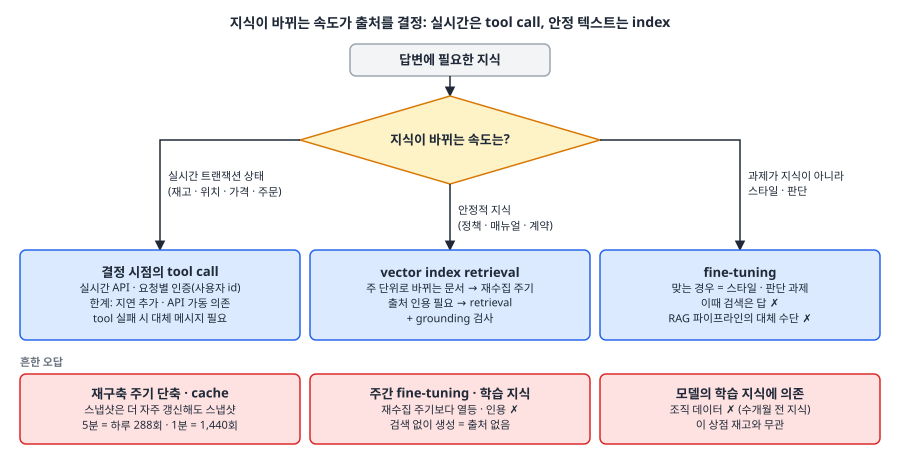
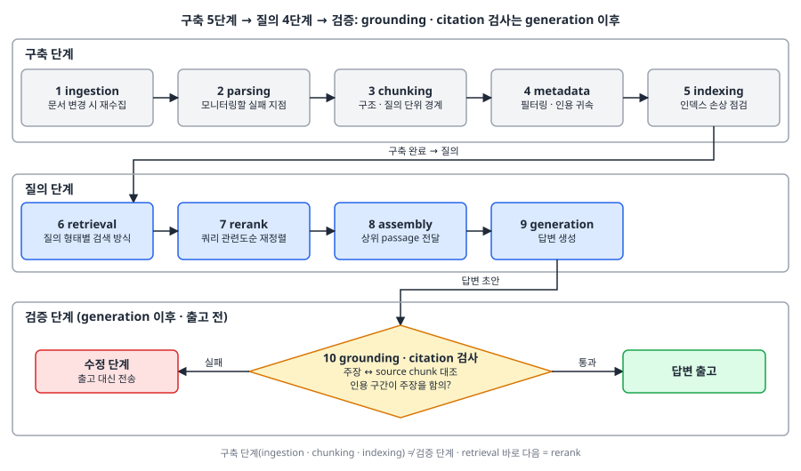
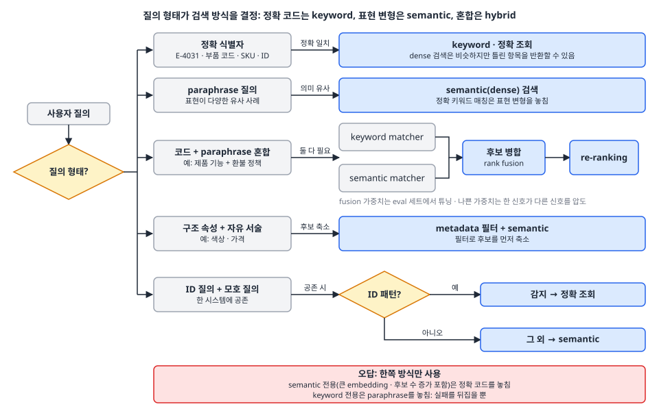
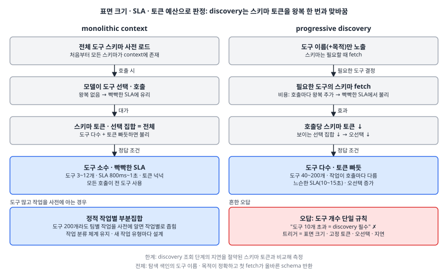
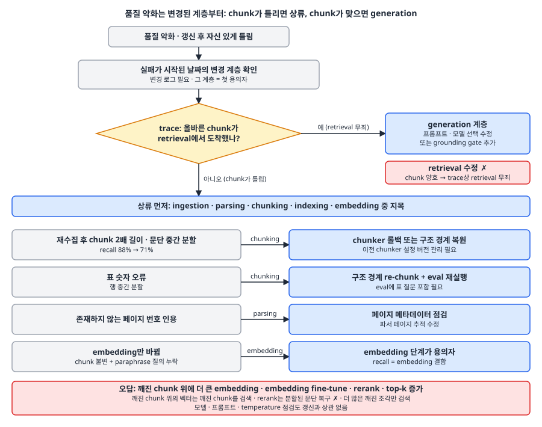
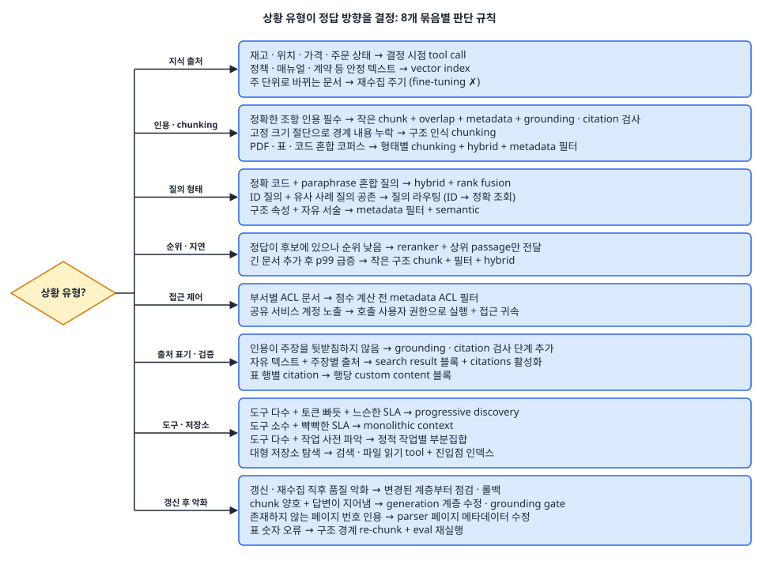

# 9. RAG & Retrieval — 반드시 알아야 할 지식
> 커버: CCAR-P D3(일부) · 근거 문항 44개

## 1. 핵심 개념

### 1.1 지식 출처 선택: index · tool · fine-tuning
**지식이 바뀌는 속도가 출처를 결정**

| 지식 유형 | 출처 |
|---|---|
| 안정적 지식 (정책 텍스트 · 매뉴얼 · 계약) | vector index retrieval |
| 실시간 트랜잭션 상태 (재고 · 위치 · 가격 · 주문) | 결정 시점의 tool call (→ 1.2) |
| 주 단위로 바뀌는 문서 | 재수집(re-ingestion) 주기로 대응 |
| 출처 인용이 필요한 답변 | retrieval + grounding 검사 (→ 1.9) |
| 모델의 학습 지식 | 해당 조직 데이터 ✗ (수개월 전 지식 · 이 상점 재고와 무관) |

| 대안 | 한계 |
|---|---|
| 주간 fine-tuning | 재수집 주기보다 열등 튜닝된 모델도 인용 ✗ |
| 검색 없이 학습 데이터로 생성 | 출처 없음 → 인용 불가 |
| fine-tuning이 맞는 경우 | 과제가 지식이 아니라 스타일 · 판단 (그때는 검색이 답 ✗) |

- fine-tuning = 모델이 암기할 지식의 대체 수단, RAG 파이프라인의 대체 수단 ✗

*그림: 실시간 상태는 결정 시점 tool call, 안정 텍스트는 vector index, 스타일 · 판단 과제만 fine-tuning이고 재구축 주기 단축 · cache · 주간 fine-tuning은 오답이다*

근거: CCAR-P-jrajath94-0082, CCAR-P-jrajath94-0170, CCAR-P-jrajath94-0302

### 1.2 실시간 상태는 tool call 뒤
**스냅샷은 더 자주 갱신해도 스냅샷**

| 상황 | 정답 |
|---|---|
| 재고 수량 · 좌석 재고(매분) 주문 상태 · 소포 위치(몇 분) 항공편 위치(30초) · 주가(매초) | 결정 시점에 tool call로 조회 |
| 같은 앱의 정책 · 안정 텍스트 | index 유지 (index = 안정 지식 용도) |
| 과거 이력 보고서 천천히 바뀌는 데이터(주소 등) | index · export · cache 가능 |
| 시간 단위 변화 + 지연 허용 질문 | index 가능 |
| 사용자가 마지막 알려진 상태를 명시 요구 | 캐시된 답변 가능 |

| 오답 | 이유 |
|---|---|
| 재구축 주기 단축 (60분 → 5분 · 1분 · 30분 갱신) | 오래됨의 구간만 축소, 구조는 스냅샷 5분 = 하루 288회 · 1분 = 1,440회 |
| 시간 · 주 단위 cache | 빠른 틀린 답 빠름과 틀림은 트레이드오프 ✗ |
| 재고를 vector store에 넣고 매시간 갱신 | 지난 한 시간 판매 미반영 → 과잉 판매 |
| 모델 추측 · 어제의 좌석 배치도 | 지어낸 재고 · 오래된 재고 |
| 사용자별 마지막 답변 cache | 오래된 답 반복 |

- tool 설계 조건 = 실시간 API · 요청별 인증(사용자 id)
- 한계 = 지연 추가 · API 가동 의존 → tool 실패 시 대체 메시지 필요
- 절충안 = 수 초 단위의 짧은 cache (수 시간 ✗)
- 정책 질문까지 read tool로 보냄 ✗ (정책은 index 유지)
- 사내 HR 숫자(인원수 · 급여) = HR 시스템 tool call, 야간 재구축 ✗

근거: CCAR-P-jrajath94-0082, CCAR-P-jrajath94-0173, CCAR-P-jrajath94-0174, CCAR-P-jrajath94-0302, CCAR-P-jrajath94-0422, CCAR-P-jrajath94-0485, CCAR-P-jrajath94-0548, CCAR-P-jrajath94-0644

### 1.3 파이프라인 단계와 순서
**구축 5단계 → 질의 4단계 → 검증 단계**

1. ingestion
2. parsing
3. chunking
4. metadata
5. indexing
6. retrieval
7. rerank
8. assembly
9. generation
10. grounding · citation checks

| 구분 | 단계 |
|---|---|
| 구축 단계 | ingestion · parsing · chunking · metadata · indexing |
| 질의 단계 | retrieval → rerank → assembly → generation |
| 검증 단계 | grounding checks · citation checks (generation 이후, 출고 전) |

- retrieval 바로 다음 = rerank
- 구축 단계(ingestion · chunking · indexing) ≠ 검증 단계

*그림: retrieval 바로 다음은 rerank이고 grounding · citation 검사는 구축 단계가 아니라 generation 이후 · 출고 전 검증 단계다*

근거: CCAR-P-jrajath94-0306, CCAR-P-jrajath94-0357, CCAR-P-jrajath94-0420, CCAR-P-jrajath94-0484

### 1.4 Chunking: 구조 · 질의 단위에 맞춤
**chunk 경계 = 문서 구조 · 질의 단위**

| 상황 | 정답 |
|---|---|
| 계약서 조항 정확 인용 (수만 건 · 작은 오류 불허) | 400~600토큰 chunk + 10% overlap + 계약 ID · 섹션 제목 metadata |
| 매뉴얼을 고정 500토큰으로 절단 → 경계에 걸친 내용 누락 | 구조 인식 chunking(섹션 단위) + 경계 overlap 또는 metadata |
| 산문 회의록 + 이미지 지도 | 안건 단위 · 구역 타일 단위 + 구조 metadata |
| 구조 없는 균일 산문 | 고정 크기 chunk 가능 |
| 문서가 아주 작음 | 문서당 chunk 하나 가능 |
| chunk가 질의 단위보다 단순히 작음 | 더 큰 chunk가 정답 |

| 요소 | 효과 |
|---|---|
| 작은 chunk | 검색 정밀도 ↑ → 인용할 조항이 실제 반환 |
| overlap | 경계에 걸쳐 나뉜 조항 누락 방지 |
| metadata | 필터링 · 인용 귀속(계약 ID · 섹션) |
| 구조 인식 경계 | chunk가 완결된 단위로 유지 |

| 오답 | 이유 |
|---|---|
| 2,000토큰 chunk | 정밀도 ↓ 같은 chunk 안 엉뚱한 조항 인용 가능 |
| 100토큰 고정 · overlap · metadata 없음 | 조항 절단 · 계약 귀속 불가 |
| 계약 전체 = 벡터 1개 · 문서당 chunk 1개 | 검색 단위 과대 수만 문서 속 조항 탐색 불가 |
| 더 큰 고정 chunk | 더 큰 깨진 조각 |
| 무작위 chunk | 전략 ✗ |

- 한계 = 구조 인식 chunking은 문서 유형마다 parser 필요 → parsing 단계 = 모니터링할 실패 지점
- 지도 타일 경계 = 구역 라벨과 정렬

근거: CCAR-P-jrajath94-0001, CCAR-P-jrajath94-0301, CCAR-P-jrajath94-0421

### 1.5 표 · 코드 · 혼합 코퍼스
**데이터 형태마다 chunking이 다름**

| 데이터 | chunking · 인덱싱 |
|---|---|
| 긴 PDF 정책 문서 | 섹션별 chunking |
| 관계형 표 | 구조화된 행으로 인덱싱 + metadata 필터 |
| 코드 | 함수별 chunking |
| 혼합 코퍼스 질의 (제품 기능 + 환불 정책) | dense + keyword 하이브리드 결합된 인덱스 위에서 수행 |
| 표가 chunk 사이 분할 | 구조 경계에서 re-chunk → eval 재실행 |
| 표 행마다 정확한 citation | 행당 custom content 블록 (→ 1.10) |

| 오답 | 이유 |
|---|---|
| 모든 데이터에 500토큰 윈도우 + dense 인덱스 | 표 행 구조 파괴 함수 중간 절단 시 의미 파괴 |
| 더 작은 embedding 모델 | 실패 원인 = 검색 품질, 비용 ✗ |
| 인메모리 캐시 | 지연 문제 ✗, 깨진 경계 미해결 |
| 쿼리당 chunk 5 → 15 | 분할된 행 15개 ≠ 온전한 표 |
| 금융 텍스트로 embedding fine-tune | 결함 = 절단 위치, 벡터 의미 ✗ |

- 균일 chunking(산문 · 표 · 코드 공통) = 알려진 검색 품질 함정
- 구조 경계 chunking은 문서 구조 파싱 필요 · eval에 표 질문 포함 필요
- 조건 반전: 온전한 chunk에서도 금융 전문 용어가 base embedding을 무력화 → fine-tune 정답

근거: CCAR-P-jrajath94-0011, CCAR-P-jrajath94-0169, CCAR-P-jrajath94-0642

### 1.6 Retrieval 방식: keyword · semantic · hybrid · 정확 조회
**질의 형태가 검색 방식을 결정**

| 질의 형태 | 방식 |
|---|---|
| 정확 식별자 (오류 코드 `E-4031` · 부품 코드 · SKU · ID) | keyword · 정확 조회 사내 KB 코드 검색 정답 = hybrid (keyword를 semantic에 결합) |
| paraphrase · 표현이 다양한 유사 사례 | semantic(dense) |
| 코드 + paraphrase 혼합 | hybrid + rank fusion |
| 구조 속성(색상 · 가격) + 자유 서술 | metadata 필터 + semantic |
| ID 질의와 모호 질의가 한 시스템에 공존 | 질의 라우팅 ID 패턴 감지 → 정확 조회 그 외 → semantic |

| 오답 | 이유 |
|---|---|
| semantic 전용 + 더 큰 embedding | 정확 코드를 모호한 의미로 취급 |
| semantic 인덱스에서 후보 수 · chunk 수 증가 | 벡터 매칭은 정확 코드를 여전히 놓침 노이즈 ↑ |
| semantic matcher 2개 병합 | 둘 다 정확 코드 공백 그대로 |
| 오류 코드로 생성 모델 fine-tuning | 검색되지 않은 문서는 생성 모델이 못 고침 |
| ID 질의에도 dense 검색 | 비슷하지만 틀린 항목 반환 가능 |
| 모호 질의에 정확 키워드 매칭 | 표현 변형을 놓침 결정론이 놓친 매칭의 대가 ✗ |
| keyword 전용 | paraphrase 놓침, 실패를 뒤집을 뿐 |
| 인덱스 5분마다 재구축 | 결함 = 신선도 ✗, 쿼리 형태 ✓ |

- hybrid = keyword matcher + semantic matcher → 후보 목록 병합, 이후 re-ranking
- keyword = 정확 SKU가 중요할 때 hybrid의 한 축
- 한계 = fusion 가중치를 eval 세트에서 튜닝, 나쁜 가중치는 한 신호가 다른 신호를 압도
- 조건 반전: 모든 질의에 코드 → keyword만으로 충분
- 조건 반전: 온전한 chunk에서 paraphrase recall만 문제 → embedding 개선이 정답

*그림: 정확 식별자는 keyword, paraphrase는 semantic, 혼합은 keyword와 semantic 후보를 rank fusion으로 병합한 뒤 re-ranking한다*

근거: CCAR-P-jrajath94-0007, CCAR-P-jrajath94-0172, CCAR-P-jrajath94-0359, CCAR-P-jrajath94-0645, CCAR-P-preporato-0015

### 1.7 Metadata 필터와 접근 제어
**필터는 점수 계산 전에 코드로 실행**

| 용도 | 방식 |
|---|---|
| 구조 제약(색상 · 가격 · 제품 모델 · 문서 유형) | metadata 필터로 후보 축소 |
| 인용 · 귀속(계약 ID · 섹션 · 날짜 · 당사자) | chunk metadata |
| 범위 한정(부품 계열) | 계열 metadata 필터 + hybrid |
| 부서별 ACL 문서 | 점수 계산 전 ACL 필터 |
| 사용자별 권한 | 호출 사용자의 신원 · 권한으로 실행 모든 접근을 해당 사용자에게 귀속 |

| 오답 | 이유 |
|---|---|
| ACL 필터 제거 + 모델이 비밀 유지 | 모델은 ACL ✗ 검색 후 필터링 = context로 유출 |
| 시스템 프롬프트로 급여 논의 금지 | 확률적 임시방편 |
| 응답에서 `salary` 단어 필터 | 우회 쉬움 · 정당한 답변 차단 |
| 인덱스에서 HR 문서 제거 | 정당한 HR 사용 파괴 |
| 전 폴더 읽는 공유 서비스 계정 | 사용자별 인가 소멸 · 접근 귀속 불가 |

- 한계 = ACL metadata는 최신 유지 필요 (오래된 ACL → 유출 또는 과차단)
- HR tool = 사용자별 인증 필요 (한 직원이 타인 급여 조회 방지)
- source-system ACL 보존
- 근본 원인 = 공유된 과도한 권한 계정 → 해결 = 호출자로서 동작

근거: CCAR-P-jrajath94-0001, CCAR-P-jrajath94-0080, CCAR-P-jrajath94-0170, CCAR-P-jrajath94-0172, CCAR-P-jrajath94-0174, CCAR-P-jrajath94-0359, CCAR-P-preporato-0014

### 1.8 Reranking · top-k · retrieval latency
**순위 문제는 reranker, 후보 문제는 앞 단계**

| 증상 | 조치 |
|---|---|
| 정답 passage가 후보에 있으나 순위 낮음 | reranker로 쿼리 관련도순 재정렬 |
| 답변 모델이 상위 passage를 사용해야 함 | reranking된 상위 passage만 전달 |
| 잘못된 chunk가 1위 | 더 강한 reranker가 정답 |
| precision 낮음 | rerank (precision 단계) |
| eval이 검색 chunk 부족을 보임 | chunk 수 증가가 정답 |

| 오답 | 이유 |
|---|---|
| 동일 후보 목록 + 더 큰 생성 모델 | 후보 순서를 바꾸지 못함 |
| 원시 유사도 순위 사용 | reranker가 아님 |
| 깨진 chunk 위에 rerank 추가 | 분할된 문단 복구 ✗ |

| 구분 | 내용 |
|---|---|
| 증상 | 긴 PDF 매뉴얼 색인 후 p99 400ms → 4초 (쿼리는 짧고 문서는 김) |
| 원인 | 거대 chunk → 매칭 희석 · reranking 비대 |
| 해결 | 구조 인식 작은 chunk (정밀도 회복) + metadata 필터 + hybrid |
| 효과 | 비싼 단계 이전에 후보 집합 축소 → p99 ↓ |
| 오답: top-k 10 → 100 | reranking 작업 ↑ → 지연 ↑ 정밀도 문제를 recall 문제로 취급 |
| 오답: 더 큰 embedding | 쿼리당 연산 ↑, chunk 크기 불일치 미해결 |

근거: CCAR-P-jrajath94-0080, CCAR-P-jrajath94-0169, CCAR-P-jrajath94-0171, CCAR-P-jrajath94-0306, CCAR-P-jrajath94-0358, CCAR-P-jrajath94-0643

### 1.9 Grounding · citation 검증 단계
**retrieval 품질 ≠ 답변의 진실성**

| 증상 | 빠진 단계 |
|---|---|
| 인용 조항이 주장과 정반대 내용을 뒷받침 | grounding · citation 검사 |
| 인용 문단이 주장을 뒷받침하지 않음 | grounding · citation 검사 |
| 직원이 신뢰할 출처 표시 답변 필요 | grounding + citation 검사 |
| 감사에서 검증 단계 누락 발견 | grounding · citation 검사 (ingestion · chunking · indexing = 구축 단계 ✗) |
| 모든 주장에 정확한 조항 인용 + 주간 업데이트 | 전체 파이프라인 + grounding 검사 + 구조 chunking · metadata |

| 단계 | 검사 내용 |
|---|---|
| grounding check | 주장을 source chunk와 대조해 검증 |
| citation check | 인용 구간이 주장을 함의(entailment) |
| 위치 | generation 이후 · 출고 전 차단 |
| 실패 시 | 출고 대신 수정 단계로 전송 |

| 오답 | 이유 |
|---|---|
| 더 큰 chunk · 더 많은 문서 | retrieval 개선, 검증 ✗ |
| 더 강한 reranker · 더 강한 모델 | 순위 · 생성 개선, 검증 ✗ |
| 인용 표식만 부착 | 표식 있음 ≠ 뒷받침 |

- 검사기 입력 = 조항 번호만 ✗, 인용된 chunk 텍스트 필요 · trace에 chunk id 필요
- 한계 = 주장마다 검증 비용 → 중대한 주장으로 범위 한정
- 조건 반전: chunk가 조항을 문장 중간에서 절단 → chunking 수정
- 조건 반전: 잘못된 chunk가 1위 → reranker · 조항이 인덱스에 없음 → 문서 추가
- 전체 파이프라인은 비용이 큰 선택지, 인용 요구가 정당화

근거: CCAR-P-jrajath94-0170, CCAR-P-jrajath94-0306, CCAR-P-jrajath94-0357, CCAR-P-jrajath94-0358, CCAR-P-jrajath94-0420, CCAR-P-jrajath94-0484, CCAR-P-jrajath94-0547

### 1.10 Citations 기능으로 출처 표기
**자유 텍스트 + 출처 = search result 블록 + citations 활성화**

| 요구 | 구현 |
|---|---|
| 주장별 출처 명시 응답은 JSON 스키마 없는 자유 텍스트 | chunk를 `source` · `title` 있는 search result 블록으로 전달 + citations 활성화 |
| 표 행마다 citation | 행당 content 블록 1개 → custom content 문서로 전달 |
| citations 기본값 | 비활성 → 요청에서 활성화 |

| 오답 | 이유 |
|---|---|
| 프롬프트로 출처 나열 요청 | 이름이 검색 블록에 연결 ✗ → 확인 불가 |
| structured outputs + `source` 필드 | JSON 스키마 필요 → 자유 텍스트 제약 위반 |
| citations 비활성 + reranker 추가 | 출처 연결 없음 |
| contextual retrieval 활성화 | 표 행 묶음 해결책으로 문서에 설명 없음 |
| 큰 생성 · embedding 모델 | 표 분할 · 행 단위 인용과 무관 |

- custom content 문서 = 사용자 블록을 그대로 유지, 추가 chunking ✗ → 각 행 블록을 개별 인용
- citation 상세 = 2장 담당

근거: CCAR-P-jrajath94-0641, CCAR-P-jrajath94-0642

### 1.11 Progressive discovery vs monolithic: 판정
**표면 크기 · 지연 SLA · 토큰 예산으로 판정**

| 상황 | 정답 |
|---|---|
| 도구 45개 · 이름 겹침 · 토큰 빠듯 SLA 10초 · 오선택 증가 | progressive discovery |
| 도구 50개 · 토큰 빠듯 SLA 12초 · 작업이 호출마다 다름 | progressive discovery |
| 도구 40개 · SLA 15초 토큰 비용 불만 + 오선택 증가 | progressive discovery |
| 도구 150개 · 느린 호출(스키마 토큰) + 오선택 두 불만 | progressive discovery (한 번의 변경으로 둘 다 해결) |
| 도구 200개 · ad-hoc 작업 · 고정 토큰 | progressive discovery |
| 도구 200개 · 팀별로 작업 사전 파악 | 정적 작업별 부분집합 |
| 도구 12개 · 지연 > 토큰 | monolithic |
| 도구 6개 · SLA 800ms · 토큰 넉넉 | monolithic |
| 도구 5개 · SLA 1초 · 토큰 문제 없음 | monolithic |
| 도구 20개 초과 + 고정 토큰 (해설 기준) ⚠️ 공식 문서: 도구 30~50개 초과 시 선택 정확도 저하 (tool search 문서) | progressive discovery |

| 방식 | 내용 |
|---|---|
| progressive discovery | 도구 이름(+목적)만 먼저 노출 스키마는 필요할 때 fetch |
| 효과 | 호출당 스키마 토큰 ↓ 보이는 선택 집합 ↓ → 오선택 ↓ |
| 비용 | 호출마다 왕복 추가 → 빡빡한 SLA에서 불리 |
| monolithic | 전체 스키마 사전 로드 · 왕복 없음 |

| 사실 | 유리한 쪽 |
|---|---|
| 도구 범위 큼(50개) | discovery |
| 느슨한 SLA(12초) | discovery (왕복 흡수) |
| 호출마다 다른 작업 | discovery |
| 모든 호출이 전 도구 사용 | monolithic |
| 토큰 예산 무제한 | monolithic |
| 도구 집합 3개 | monolithic |

| 오답 | 이유 |
|---|---|
| 도구 10개 초과 시 discovery 필수 | 단일 개수 규칙 없음 트리거 = 표면 크기 · 고정 토큰 · 오선택 지연 SLA는 discovery에 불리 |
| 설명 전면 재작성(3주) | 불만의 절반(오선택)만 해결, 토큰 비용 유지 |
| 재작성 + discovery(5주) | 재작성의 한계 이득이 3주를 정당화 ✗ |
| 200개 모두 노출 | 알려진 작업이 안 쓰는 유연성 = 공격 표면 |
| 도구 제거 · 추측 | 제품 기능 삭제 |
| 도구 추가 | 표면 확대 |
| 스키마 + 전체 문서 로드 | 토큰 ↑ · 혼란 그대로 |
| 도구 150개 "그대로 괜찮음" | 측정된 불만 부정 |

- 한계 = discovery 조회 단계의 지연을 절약된 스키마 토큰과 비교해 측정
- 전제 = 탐색 색인의 도구 이름 · 목적 정확, 첫 fetch가 올바른 schema 반환
- 정적 부분집합 = 작업 분류 체계 유지 필요, 새 작업 유형마다 부분집합 설계
- 조건 반전: 토큰 여유 + 오선택만 문제 → 설명 재작성
- 조건 반전: 설명 자체가 모호 → 재작성 병행 정당

*그림: discovery는 왕복 한 번을 치르고 스키마 토큰과 선택 집합을 줄이므로 도구 수 · SLA · 토큰 예산을 종합해 판정하고 단일 개수 규칙은 없다*

근거: CCAR-P-jrajath94-0180, CCAR-P-jrajath94-0181, CCAR-P-jrajath94-0304, CCAR-P-jrajath94-0362, CCAR-P-jrajath94-0425, CCAR-P-jrajath94-0488, CCAR-P-jrajath94-0551

### 1.12 Progressive discovery 적용: 코드베이스 · skill
**사전 로드 대신 온디맨드 로드**

| 상황 | 정답 |
|---|---|
| 200만 줄 monorepo 전 파일 요약 사전 로드 → context 초과 · 비용 3배 | progressive discovery 검색 tool · 파일 읽기 tool · 진입점 인덱스 제공 → 필요한 코드만 필요할 때 fetch |
| 1,500줄 지침 + 요청마다 짧은 메타데이터만 | skill 이름 · 설명만 시작 시 로드 참고 파일은 작업이 읽을 때만 |
| `SKILL.md` 크기 | 500줄 미만 상세 섹션은 관련 작업용 별도 파일 |

| 오답 | 이유 |
|---|---|
| 100만 토큰 윈도우 + 요약 전부 로드 | 실패를 늦출 뿐 토큰당 비용 ↑ · 낭비 패턴 그대로 |
| 작은 모델로 요약 압축 후 로드 | 정확한 API · 엣지 케이스 손실 안 건드릴 코드 비용 선지급 |
| 50개 고정 파티션 · agent 50개 | 비용 · 조율 오버헤드 배증 대부분 파티션이 작업과 무관 |
| 1,500줄 전체를 system prompt에 삽입 | 요청마다 전체 로드 → 제약 위반 |
| skill 샌드박스 네트워크 활성화 + URL fetch | API skills는 네트워크 접근 없이 실행 |

근거: CCAR-P-jrajath94-0009, CCAR-P-jrajath94-0652

### 1.13 RAG 실패 진단: 단계 지목 · 상류 먼저
**실패한 구성 요소를 고침, 대리 지표 ✗**

| 증상 | 의심 단계 · 조치 |
|---|---|
| 야간 문서 갱신 후 자신 있게 틀림 (모델 · 프롬프트 · 지연 불변) | 검색 · 인덱싱 계층 먼저 인덱스 손상 · chunking 변경 · embedding 불일치 |
| 재인덱싱 후 의미는 비슷하나 상업적으로 틀린 제품 반환 | chunking · embedding 구성 인덱스 일관 재구축 여부 조사 |
| 재수집 후 악화 · chunk 2배 길이 문단 중간 분할 · recall 88% → 71% | chunker 롤백 또는 구조 경계 복원 |
| 표 숫자 오류 · 행 중간 분할 | 구조 경계 re-chunk + eval 재실행 |
| 존재하지 않는 페이지 번호 인용 | parsing · chunking의 페이지 메타데이터 → 파서 페이지 추적 수정 |
| 좋은 chunk 도착 + 답변이 무시하고 정책 지어냄 | generation 계층 프롬프트 · 모델 선택 수정 또는 grounding gate 추가 |

| 원칙 | 내용 |
|---|---|
| 변경 날짜 | 실패가 시작된 날짜의 변경 계층 = 첫 용의자 |
| 상류 우선 | ingestion · chunking을 먼저 고침 |
| trace | retrieval 무죄 · generation 유죄 판정 |
| 회귀 | 필요한 것 = 변경 로그 (새 기능 ✗) |
| 롤백 | 이전 chunker 설정이 버전 관리되어야 함 없으면 구조 경계 재구현 + 재수집 |

| 오답 | 이유 |
|---|---|
| 더 큰 embedding 교체 · embedding fine-tune | 깨진 chunk 위의 벡터는 깨진 chunk를 검색 |
| rerank 단계 추가 | 분할된 문단을 되돌리지 못함 |
| 검색 chunk 수 증가 | 더 많은 깨진 조각만 검색 |
| 모델 · 프롬프트 · temperature 점검 | 갱신과 상관 없음 |
| chunk가 양호한데 retrieval 수정 | trace상 retrieval 무죄 |

- 조건 반전: embedding만 바뀜 → embedding 단계가 용의자
- 조건 반전: chunk 불변 + paraphrase 질의 누락 → recall = embedding 결함
- 조건 반전: chunk가 틀림 → retrieval이 실패 계층

*그림: 올바른 chunk가 도착했으면 generation 계층을, 아니면 chunking · parsing · embedding 같은 상류를 먼저 고치고 깨진 chunk 위의 embedding · rerank · top-k는 오답이다*

근거: CCAR-P-Amey-Thakur-0002, CCAR-P-Amey-Thakur-0037, CCAR-P-jrajath94-0169, CCAR-P-jrajath94-0171, CCAR-P-jrajath94-0483, CCAR-P-jrajath94-0546

## 2. 상황별 정답 판단 규칙

| 상황 | 정답 방향 |
|---|---|
| 재고 · 위치 · 가격 · 주문 상태 | 결정 시점 tool call |
| 정책 · 매뉴얼 · 계약 등 안정 텍스트 | vector index |
| 주 단위로 바뀌는 문서 | 재수집 주기 (fine-tuning ✗) |
| 정확한 조항 인용 필수 | 작은 chunk + overlap + metadata + grounding · citation 검사 |
| 고정 크기 절단으로 경계 내용 누락 | 구조 인식 chunking |
| PDF · 표 · 코드 혼합 코퍼스 | 형태별 chunking + hybrid + metadata 필터 |
| 정확 코드 + paraphrase 혼합 질의 | hybrid + rank fusion |
| ID 질의 + 유사 사례 질의 공존 | 질의 라우팅 (ID → 정확 조회) |
| 구조 속성 + 자유 서술 | metadata 필터 + semantic |
| 정답이 후보에 있으나 순위 낮음 | reranker + 상위 passage만 전달 |
| 긴 문서 추가 후 p99 급증 | 작은 구조 chunk + 필터 + hybrid |
| 인용이 주장을 뒷받침하지 않음 | grounding · citation 검사 단계 추가 |
| 부서별 ACL 문서 | 점수 계산 전 metadata ACL 필터 |
| 공유 서비스 계정 노출 | 호출 사용자 권한으로 실행 + 접근 귀속 |
| 자유 텍스트 + 주장별 출처 | search result 블록 + citations 활성화 |
| 표 행별 citation | 행당 custom content 블록 |
| 도구 다수 + 토큰 빠듯 + 느슨한 SLA | progressive discovery |
| 도구 소수 + 빡빡한 SLA + 토큰 여유 | monolithic context |
| 도구 다수 + 작업 사전 파악 | 정적 작업별 부분집합 |
| 대형 저장소 탐색 | 검색 · 파일 읽기 tool + 진입점 인덱스 |
| 갱신 · 재수집 직후 품질 악화 | 변경된 계층부터 점검 · 롤백 |
| chunk 양호 + 답변이 지어냄 | generation 계층 수정 · grounding gate |
| 존재하지 않는 페이지 번호 인용 | parser 페이지 메타데이터 수정 |
| 표 숫자 오류 | 구조 경계 re-chunk + eval 재실행 |

*그림: 지식 출처 · 인용 · 질의 형태 · 순위 · 접근 제어 · 출처 표기 · 도구 · 갱신 후 악화의 8개 묶음마다 정답 방향이 정해진다*

근거: CCAR-P-Amey-Thakur-0002, CCAR-P-Amey-Thakur-0037, CCAR-P-jrajath94-0001, CCAR-P-jrajath94-0007, CCAR-P-jrajath94-0009, CCAR-P-jrajath94-0011, CCAR-P-jrajath94-0080, CCAR-P-jrajath94-0082, CCAR-P-jrajath94-0169, CCAR-P-jrajath94-0170, CCAR-P-jrajath94-0171, CCAR-P-jrajath94-0172, CCAR-P-jrajath94-0173, CCAR-P-jrajath94-0174, CCAR-P-jrajath94-0180, CCAR-P-jrajath94-0181, CCAR-P-jrajath94-0301, CCAR-P-jrajath94-0302, CCAR-P-jrajath94-0304, CCAR-P-jrajath94-0306, CCAR-P-jrajath94-0357, CCAR-P-jrajath94-0358, CCAR-P-jrajath94-0359, CCAR-P-jrajath94-0362, CCAR-P-jrajath94-0420, CCAR-P-jrajath94-0421, CCAR-P-jrajath94-0422, CCAR-P-jrajath94-0425, CCAR-P-jrajath94-0483, CCAR-P-jrajath94-0484, CCAR-P-jrajath94-0485, CCAR-P-jrajath94-0488, CCAR-P-jrajath94-0546, CCAR-P-jrajath94-0547, CCAR-P-jrajath94-0548, CCAR-P-jrajath94-0551, CCAR-P-jrajath94-0641, CCAR-P-jrajath94-0642, CCAR-P-jrajath94-0643, CCAR-P-jrajath94-0644, CCAR-P-jrajath94-0645, CCAR-P-jrajath94-0652, CCAR-P-preporato-0014, CCAR-P-preporato-0015

## 3. 자주 나오는 오답 함정

| 오답 | 이유 |
|---|---|
| 인덱스 재구축 주기 단축 · cache | 스냅샷은 스냅샷, 실시간은 tool call |
| fine-tuning으로 지식 · 인용 해결 | 인용 = 검색 필요, 주간 변경 = 재수집 |
| 더 큰 embedding으로 검색 품질 개선 | 병목이 chunking · 키워드 공백이면 무효 |
| chunk 수(top-k) 증가 | 깨진 조각만 증가, 지연 ↑ |
| reranker 추가로 절단 보상 | 분할된 문단 복구 ✗ |
| 더 큰 생성 모델로 순위 · 인용 해결 | 후보 순서 · 검증과 무관 |
| semantic 전용 / keyword 전용 | 한쪽 질의 형태를 놓침 |
| 균일 500토큰 chunking | 표 · 코드 · 조항 구조 파괴 |
| 문서 전체를 한 chunk로 | 검색 단위 과대 · 정밀도 ↓ |
| 모델에게 비밀 유지 · 프롬프트 금지 | 모델 ≠ ACL, 필터는 코드로 |
| 인용 표식 · 프롬프트 출처 나열 | 뒷받침 검증 ✗ · 블록에 연결 ✗ |
| 단일 규칙 "도구 10개 초과 = discovery" | 개수 규칙 없음 지연 · 토큰 · 오선택 종합 판단 |
| 소규모 도구 + 빡빡한 SLA + 토큰 여유에 discovery | 왕복만 추가, 토큰 이득 없음 |
| 큰 윈도우 · 요약 압축 · 파티션 분할 | 사전 로드 낭비를 안 고침 |
| 둘 다 하는 것이 항상 안전 | 두 번째 해결책이 자기 비용을 정당화해야 함 |
| 변경과 무관한 계층 점검 | 변경 날짜의 계층이 첫 용의자 |

근거: CCAR-P-Amey-Thakur-0002, CCAR-P-jrajath94-0001, CCAR-P-jrajath94-0009, CCAR-P-jrajath94-0011, CCAR-P-jrajath94-0080, CCAR-P-jrajath94-0082, CCAR-P-jrajath94-0169, CCAR-P-jrajath94-0170, CCAR-P-jrajath94-0171, CCAR-P-jrajath94-0172, CCAR-P-jrajath94-0173, CCAR-P-jrajath94-0174, CCAR-P-jrajath94-0180, CCAR-P-jrajath94-0181, CCAR-P-jrajath94-0306, CCAR-P-jrajath94-0358, CCAR-P-jrajath94-0425, CCAR-P-jrajath94-0551, CCAR-P-jrajath94-0641, CCAR-P-jrajath94-0642, CCAR-P-jrajath94-0643, CCAR-P-jrajath94-0645, CCAR-P-preporato-0014, CCAR-P-preporato-0015

## 4. 암기 목록

| 이름 | 의미 |
|---|---|
| ingestion → parsing → chunking → metadata → indexing | 구축 5단계 |
| retrieval → rerank → assembly → generation | 질의 4단계 |
| grounding check | 주장 ↔ source chunk 대조 |
| citation check | 인용 구간이 주장을 함의하는지 검증 |
| structure-aware chunking | 섹션 · 행 · 함수 · 안건 경계 보존 |
| overlap | 경계에 걸친 내용 누락 방지 |
| hybrid search | keyword + semantic 결합 후보 병합 |
| rank fusion | keyword · semantic 순위를 병합하는 방식 |
| metadata filter | 구조 제약 · 범위 · ACL 적용 |
| ACL filter | 점수 계산 전 실행, 모델에 위임 ✗ |
| reranker | 후보를 쿼리 관련도순 재정렬 |
| top-k | 검색 chunk 수, 증가 = 지연 ↑ |
| re-ingestion | 문서 변경 시 재수집 · 인덱스 갱신 |
| progressive discovery | 이름 먼저, 스키마 · 코드는 필요할 때 |
| monolithic context | 전체 사전 로드, 왕복 없음 |
| 정적 작업별 부분집합 | 작업이 사전에 알려진 팀에 좁힌 도구 목록 |
| search result 블록 | `source` · `title` + citations 활성화 단위 |
| custom content 문서 | 사용자 블록 유지 · 추가 chunking ✗ |
| p99 latency | 99번째 백분위 지연 |

근거: CCAR-P-jrajath94-0009, CCAR-P-jrajath94-0011, CCAR-P-jrajath94-0080, CCAR-P-jrajath94-0170, CCAR-P-jrajath94-0172, CCAR-P-jrajath94-0174, CCAR-P-jrajath94-0181, CCAR-P-jrajath94-0301, CCAR-P-jrajath94-0357, CCAR-P-jrajath94-0420, CCAR-P-jrajath94-0421, CCAR-P-jrajath94-0641, CCAR-P-jrajath94-0642, CCAR-P-jrajath94-0643, CCAR-P-jrajath94-0645

## 5. 시험 직전 체크리스트

- [ ] 실시간 상태(재고 · 위치 · 가격)는 tool call, 재구축 주기 단축 ✗
- [ ] chunk 경계는 구조(조항 · 행 · 함수 · 안건)에 맞춤
- [ ] 정확 식별자는 keyword, paraphrase는 semantic, 혼합은 hybrid + fusion
- [ ] 접근 제어는 점수 계산 전 코드 필터, 모델 위임 ✗
- [ ] 순위 문제 = reranker, 후보 부재 = 앞 단계 수정
- [ ] 인용 신뢰 = grounding · citation 검사 단계 (generation 이후)
- [ ] 자유 텍스트 출처 = search result 블록 + citations 활성화
- [ ] discovery vs monolithic = 도구 수 · SLA · 토큰 예산 종합 판정
- [ ] 품질 악화 = 변경 날짜 계층부터 · 상류 먼저 · 대리 지표 ✗
- [ ] 깨진 chunk 위의 더 큰 embedding · rerank · top-k ✗

근거: CCAR-P-jrajath94-0009, CCAR-P-jrajath94-0169, CCAR-P-jrajath94-0171, CCAR-P-jrajath94-0172, CCAR-P-jrajath94-0173, CCAR-P-jrajath94-0174, CCAR-P-jrajath94-0181, CCAR-P-jrajath94-0301, CCAR-P-jrajath94-0306, CCAR-P-jrajath94-0641, CCAR-P-jrajath94-0643, CCAR-P-preporato-0014
