# 1. Agents and Workflows — 반드시 알아야 할 지식
> 시험 비중 15% · 약 4문항 · 근거 문항 27개

## 1. 핵심 개념

### 1.1 Workflow vs Agent — 다음 단계를 누가 정하나
**구분 기준 = 다음 단계 결정 주체 (코드 vs 모델)**

| 구분 | 정의 |
|---|---|
| Workflow | LLM · tool을 predefined code path로 엮은 시스템 |
| Workflow 흐름 | control flow = 설계 시점 고정 |
| Workflow 모델 호출 | 정해진 지점에서만 호출 |
| Agent | 모델이 실행 중 다음 단계 · tool 사용법 결정 |

| 오답 | 이유 |
|---|---|
| 길이 · tool 개수 · structured output 필요 여부로 구분 | 구분 기준 아님 |
| "workflow는 모델 못 부름" · "agent는 tool 못 씀" | workflow도 모델 호출 · agent도 tool 사용 |

| 상황 | 판단 |
|---|---|
| 중간 결과를 보기 전엔 필요한 단계를 모름 (= 경로를 실행 중 발견) | agent 필요 (유일한 신호) |
| 경로 고정 | 결정론적 orchestration → 저렴 · 빠름 테스트 · 감사 · 디버깅 용이 |
| 경로 고정 시 agent의 대가 | 비용 · 지연 · 비결정성 · 오류 연쇄 위험만 증가 |

**판단 순서**
1. 복잡도 · 경로 고정 여부 · 코드로 싼 오류 방지 가능 여부 확인
2. 요구를 만족하는 **가장 단순한 구성** 선택

| 상황 | 가장 단순한 구성 |
|---|---|
| 매핑 고정 변환 | deterministic script (agent loop ✗) |
| 해석 필요 필드 존재 | schema 둔 단일 모델 호출 |

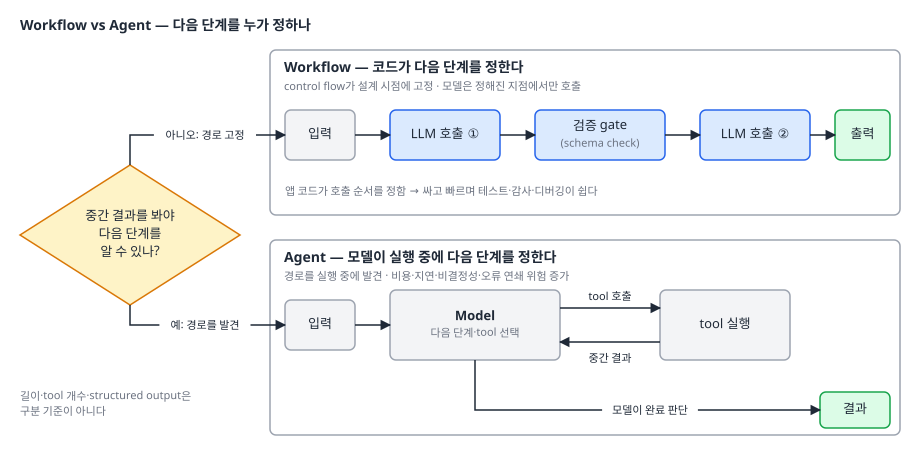
*그림: 중간 결과를 봐야 다음 단계를 알 수 있을 때만 agent이고, 경로가 고정이면 코드가 순서를 정하는 workflow가 맞다*

근거: Amey-0004, Amey-0023, Amey-0024, Amey-0040, Amey-0074, Patrick-0012, Patrick-0022, Preporato-0016, Udemy-0014, Udemy-0053

### 1.2 Workflow 패턴 구분
**패턴 차이 = 분해를 누가 · 언제 정하나**

| 패턴 | 동작 | 특징 |
|---|---|---|
| prompt chaining | 고정 subtask 순차 호출 각 단계가 앞 단계 출력 수신 호출 순서 = 앱 코드 | 단계 사이 programmatic gate 삽입 가능 (schema 검증 · 필수 항목 검사) 지연 소폭 증가 → 정확도 · 예측 가능성 향상 |
| routing | 입력 분류 → 전용 후속 처리로 보내고 끝 | 분해 · 결과 통합 ✗ |
| parallelization (voting) | 같은 작업 여러 번 실행 → 다수결 등으로 확신도 향상 | 작업 분해 ✗ |
| orchestrator-workers | 중심 LLM이 입력 보고 즉석에서 subtask 결정 → worker LLM 위임 → 결과 통합 | 결정적 차이 = subtask 사전 정의 ✗ 입력마다 분해가 달라지는 작업용 |
| evaluator-optimizer | 평가자 LLM 채점 → 기준 넘을 때까지 생성 · 수정 반복 | 명확한 평가 기준 + 하나의 출력 다듬기 (번역 퇴고 등) 서로 다른 단계 순차 처리 ✗ |

- 단계 사이 checkpoint 필요 시 거대 prompt 1개 ✗ → 검증 지점 소실

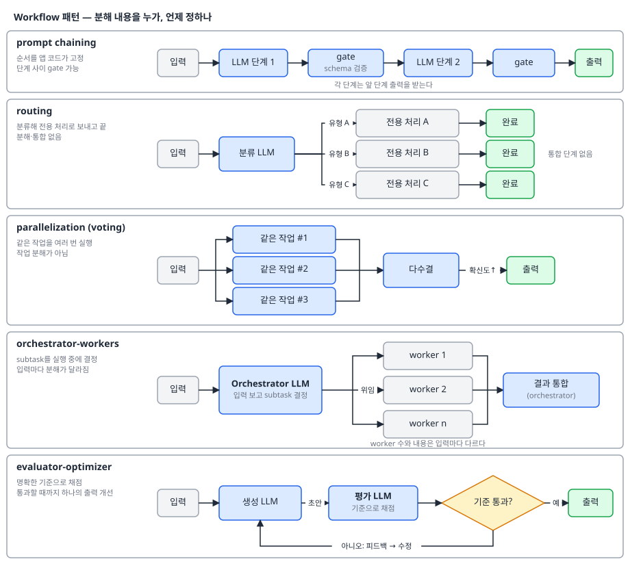
*그림: 패턴은 분해를 코드가 미리 정하는지(chaining, routing, voting), 실행 중에 LLM이 정하는지(orchestrator-workers), 기준 통과까지 반복하는지(evaluator-optimizer)로 갈린다*

근거: Amey-0023, Patrick-0012, Patrick-0022, Udemy-0006, Udemy-0053

### 1.3 Coordinator(orchestrator) 1개 + Subagent n개 구조
**위임 prompt + subagent 정의에 적은 것만 전달 · 요약만 반환**

**Coordinator 역할**

| 역할 | 내용 |
|---|---|
| 작업 분해 | 입력에 맞춰 subtask 결정 |
| 위임 | 독립 · 자기완결 subtask를 subagent에 전달 독립이면 병렬 실행 |
| 결과 통합 | subagent의 compact 요약 수집 → 최종 결과 (비교 · 계획 등) 실패 격리 |

**Subagent 역할**

| 역할 | 내용 |
|---|---|
| 격리된 컨텍스트 | 부모와 별도 대화 컨텍스트에서 실행 자료 읽기 · 중간 tool 호출 · 결과는 subagent 안에만 |
| 좁은 범위 | 자기완결 subtask 하나만 (PDF 한 개 요약, 검사 항목 하나 등) |
| 요약 반환 | 최종 메시지만 Agent tool 결과로 부모에 반환 → 부모 context window가 장황한 중간 결과로 안 참 = subagent의 주된 구조적 가치 |

**Coordinator → Subagent 전달 범위**

| 구분 | 내용 |
|---|---|
| 넘길 것 | 위임 prompt에 subtask용 컨텍스트 명시 (file path, 판단 근거, 이전 결정 등) |
| 전달 경로 | Agent tool의 prompt 문자열 + subagent 자신의 정의 (`AgentDefinition`의 `prompt`)뿐 |
| 안 넘어감 | 부모 대화 이력 · tool 결과 · 부모 system prompt 일반 subagent = 빈 컨텍스트에서 시작 |
| 예외 | fork형 subagent(현재 대화 분기)만 부모 이력 상속 |
| 공통 방침 | 각 subagent 정의 또는 설정에 따라 로드되는 프로젝트 `CLAUDE.md`에 기재 |
| 품질 저하 원인 | 최유력 = handoff 컨텍스트 누락 |
| 위임의 성격 | 컨텍스트를 내주고 격리를 얻는 거래 |
| 품질 저하 대책 | 큰 모델 · subagent 추가로 해결 ✗ |

**Subagent → Coordinator 반환 범위**

| 구분 | 내용 |
|---|---|
| 돌려줄 것 | compact 요약 · 결론 |
| 돌려주지 말 것 | 원문 자료 · 중간 tool 출력 → 그대로 반환 시 격리 의미 소실 |

**구조상 주의점**

| 상황 | 판단 |
|---|---|
| 컨텍스트 격리 | 총 토큰 감소 ✗ subagent마다 자료 별도 읽기 · API 별도 호출 → 증가 가능 |
| 비용 절감 | 별도 수단 필요 예: subagent별 `model`에 가벼운 모델 지정 |
| subagent 수 증가 | handoff 결함도 비례 증가 |

| 오답 | 이유 |
|---|---|
| subagent끼리 직접 결과 교환 | 결과 통합 · 실패 격리하는 coordinator 소실 |
| 합의용 같은 prompt 2회 실행 · rate limit 우회 메인 모델 장애 대비 fallback | subagent의 올바른 용도 아님 |

**단일 agent · workflow가 나은 경우**

| 상황 | 판단 |
|---|---|
| 단계 고정 | subagent · orchestrator 모두 ✗ → 동적 분해 대상 없음 |
| supervision hierarchy | 위임이 필요한 문제 전용 · 고정된 몇 단계엔 ✗ |

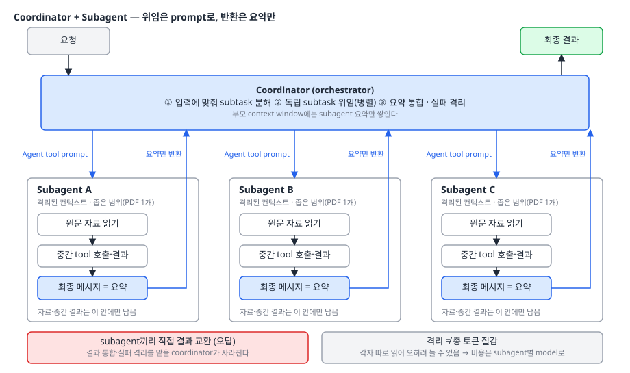
*그림: coordinator는 위임 prompt를 내려보내고, 자료와 중간 tool 결과는 각 subagent 안에 남으며 요약만 올라온다*

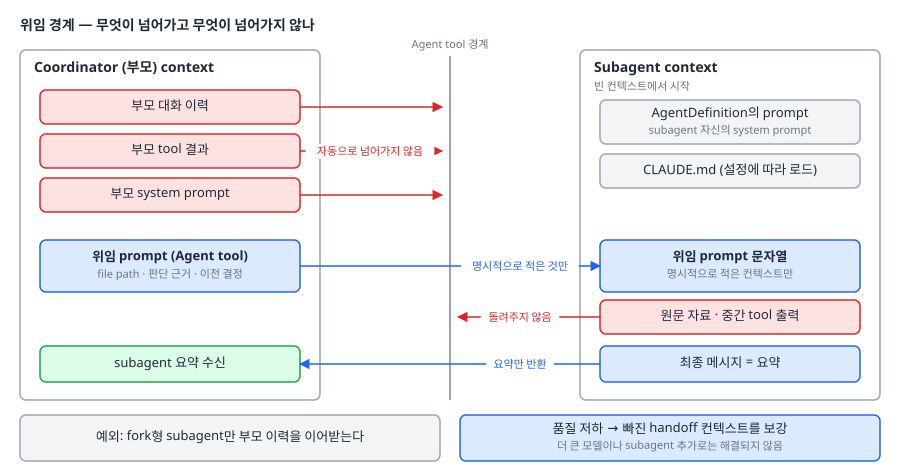
*그림: 부모 이력·tool 결과·system prompt는 넘어가지 않고 위임 prompt에 명시한 것만 넘어가며, 돌아오는 것은 요약뿐이다*

근거: Amey-0004, Amey-0023, Amey-0025, Amey-0041, Patrick-0012, Preporato-0019, Udemy-0004, Udemy-0006

### 1.4 Agentic loop (Messages API 직접 사용 시)
**`tool_use` → 재호출 · `end_turn` → 반환**

| `stop_reason` | 처리 |
|---|---|
| `"tool_use"` | 요청 tool 실행 → `tool_result` 추가 → API 재호출 모델 = tool 결과 대기 중 |
| `"end_turn"` + `tool_use` block 없음 | 턴 종료 → content를 호출자에 반환 |
| `tool_use` 아님 | loop 탈출 |
| `max_tokens` 등 | 별도 처리 필요 |
| ⚠️ `pause_turn` | 공식 문서: server tool 사용 중 발생 종료 ✗ → 응답 그대로 다시 보내 이어감 → "`tool_use` 아니면 무조건 종료" = 지나친 단순화 |

| 오해 | 사실 |
|---|---|
| text block = 종료 신호 ✗ | text · tool 호출 공존 가능 |
| `max_tokens` 상향 = 컨텍스트 부족 해결 ✗ | `max_tokens` = 출력 제한 tool dispatch · 입력 컨텍스트와 무관 |

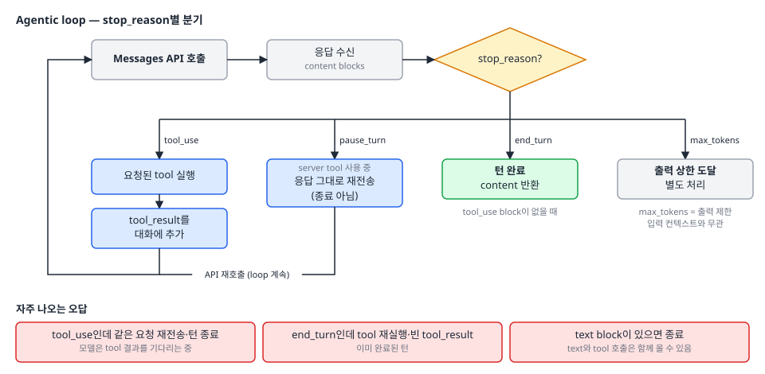
*그림: tool_use와 pause_turn은 다시 API를 호출해 loop를 잇고, end_turn은 반환, max_tokens는 별도 처리한다*

근거: Amey-0005, Amey-0036, Patrick-0038, Preporato-0019, Udemy-0019

### 1.5 Loop 종료, 안전장치, 상태
**종료 = success condition + ceiling · 결정은 명시적 state**

| 구분 | 내용 |
|---|---|
| 정상 종료 | 명시적 success condition |
| 안전망 | step ceiling (hard 상한) |
| step ceiling 주된 목적 | agent 비수렴 시 피해 · 비용 제한 |
| 목적 아님 | 성공한 실행의 비용 절감 · 속도 · prompt 단순화 |
| 오답 종료 조건 | 고정 반복 횟수 · wall-clock timeout만 사용 컨텍스트 소진 (= 실패) |
| ⚠️ `end_turn` 종료 | 공식 loop 예제 = `end_turn`(모델 판단)으로 종료 문항 해설(Amey 0060번) = 모델 판단만으론 보장 ✗ → 앱 수준 success condition 강조 |
| 시험 대응 | "success condition + ceiling" 선택 `end_turn` 처리도 숙지 |

**장기 실행 결정 유지**

| 구분 | 내용 |
|---|---|
| 기록 위치 | compaction과 무관하게 전달되는 명시적 state |
| 이유 | context window 유한 · compaction = 정보 손실 |

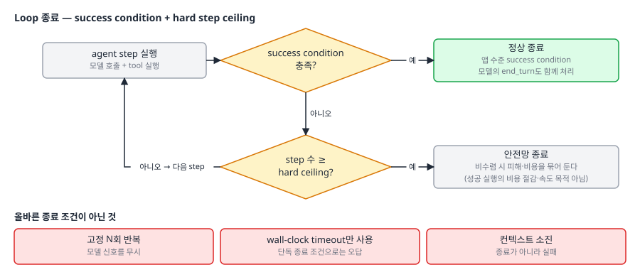
*그림: loop는 success condition으로 정상 종료하고, 수렴하지 못하면 hard ceiling이 안전망으로 끊는다*

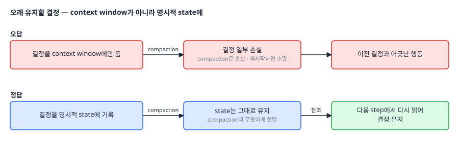
*그림: context window에만 둔 결정은 compaction과 재시작으로 사라지고, 명시적 state에 둔 결정은 유지된다*

근거: Amey-0026, Amey-0036, Amey-0060, Amey-0073, Patrick-0038

### 1.6 Tool 설계
**목적 겹치는 tool → 잘못된 tool 선택 증가**

| 구분 | 내용 |
|---|---|
| 겹치는 tool | 선택 모호 → 잘못된 tool 선택 빈발 |
| 속도 · 비용 · 오류 처리 | 이득 ✗ |

근거: Amey-0059

### 1.7 구현 수단 비교
**직접 = Client SDK**
**라이브러리 = Agent SDK**
**호스팅 = Managed Agents**

| 수단 | 동작 | 비고 |
|---|---|---|
| Client SDK (Messages API 직접) | `tool_use` 수신 → tool 실행 → `tool_result` 전송 loop loop · tool 구현 = 개발자 몫 | loop는 beta tool runner 위임 가능 `messages.stream()` · `stream: true` 지원 streaming · tool use = Agent SDK만의 장점 ✗ |
| Claude Agent SDK | Claude Code 동일 harness Python · TypeScript 라이브러리 | loop · tool 직접 만들기 싫을 때 |
| Managed Agents | Anthropic이 agent loop · sandbox 호스팅 sandbox 선택: Anthropic cloud · self-hosted session · event log = 항상 Anthropic 쪽 저장 | 실행 기반 없이 빠른 production 장시간 비동기 작업 |
| Message Batches API | 즉시성 불필요 대량 요청 → 비동기 · 저렴 | agent loop · 세션 저장소 ✗ |
| LangGraph 등 orchestration 프레임워크 | 장시간 stateful agent용 저수준 프레임워크 control flow = graph(node · edge)로 명시 설계 | 아래 LangGraph 표 |

| 오답 | 이유 |
|---|---|
| token counting endpoint로 계획 수립 | 크기 추정만 · 계획 수립 ✗ |
| prompt에 tool 설명만 | 실행 ✗ |

| Agent SDK 항목 | 내용 |
|---|---|
| 포함 | agent loop · context management built-in tool(Read · Edit · Bash · 검색) |
| 포함 (제어 · 확장) | hooks · permissions(결정론적 제어) subagents · MCP · sessions |
| 미제공 | hosted vector DB · 자동 fine-tuning 시각적 drag-and-drop designer Anthropic 인프라 호스팅 |
| 실행 위치 | 사용자 운영 프로세스 안 → tool이 자사 인프라 파일 · 명령 직접 처리 |
| 세션 | 실행 머신 디스크에 JSONL 저장 `SessionStore` adapter → 자사 스토리지 가능 |
| 인증 | API key 제3자 제품에 claude.ai 로그인 제공 ✗ (사전 승인 없이 · rate limit 포함) |

| LangGraph 항목 | 내용 |
|---|---|
| 제공 | durable execution(장애 후 재개) human-in-the-loop · state 영속화 → 직접 구현 불필요 |
| 한계 | prompt · 아키텍처 추상화 ✗ · 비용 절감 도구 ✗ |
| 사용 조건 | 요구가 위 기능과 일치 + 내부 동작 이해 가능할 때만 |
| 단순 agent | API 직접 사용이 나음 (Anthropic 권장: 단순 구현부터) |

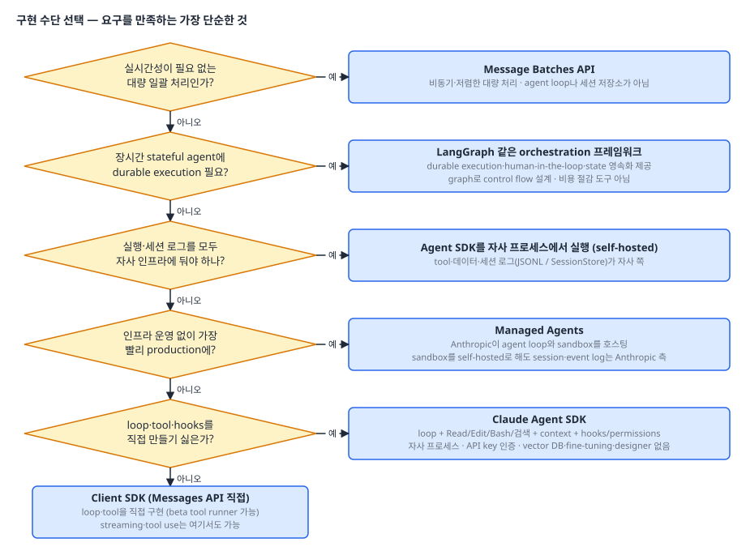
*그림: 요구 조건을 위에서부터 확인해 Batches, LangGraph, self-hosted Agent SDK, Managed Agents, Agent SDK, Client SDK 중 가장 단순한 것을 고른다*

근거: Patrick-0039, Preporato-0016, Preporato-0017, Preporato-0018, Udemy-0014, Udemy-0019, Udemy-0051

### 1.8 Deployment 선택 — 3축 확인
**loop · tool · state 위치 3축 확인**

| 축 | 확인 항목 |
|---|---|
| loop | loop 실행 주체 |
| tool | tool 실행 위치 |
| state | 대화 로그 저장 위치 |

| 상황 | 정답 |
|---|---|
| data residency (실행 · 데이터 · 세션 로그까지 자사 네트워크) | self-hosted (Agent SDK) |
| production 출시 속도 우선 | Managed Agents |

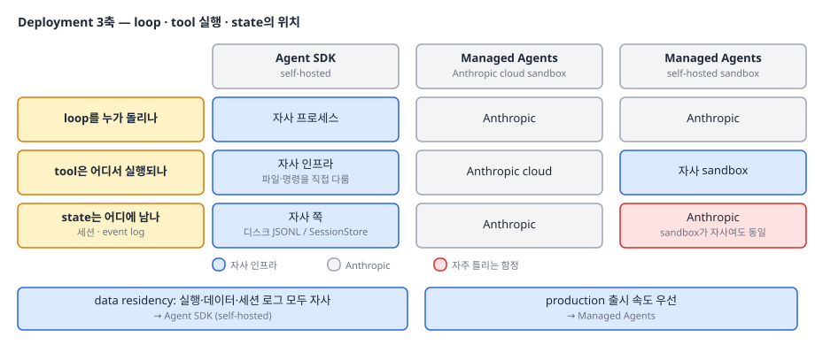
*그림: Managed Agents는 sandbox를 자사에 두어도 session과 event log가 Anthropic에 남으므로 residency 요구에는 self-hosted Agent SDK다*

근거: Preporato-0018, Udemy-0051

## 2. 상황별 정답 판단 규칙

**패턴 선택**

| 상황 | 정답 |
|---|---|
| 단계 고정 · 순서 동일 · 모든 입력에서 동일 | 결정론적 workflow (prompt chaining) 모델은 필요한 지점에서만 호출 |
| 고정 단계 사이 검증 필요 | 단계 사이 validation gate (programmatic · schema check) |
| 매핑 고정 형식 변환 | deterministic script 해석 필요 시 schema 둔 단일 호출 agent loop ✗ |
| 중간 결과를 봐야 다음 단계 결정 | agent |
| 입력마다 조사 · subtask가 다름 + 결과 통합 필요 | orchestrator-workers (orchestrator가 동적 분해 · 위임 · 통합) |
| 입력 유형별 다른 처리로 보내기만 | routing |
| 같은 작업을 여러 관점으로 돌려 확신도 향상 | parallelization (voting) |
| 명확한 평가 기준 + 하나의 출력 반복 개선 | evaluator-optimizer |

**Subagent · 컨텍스트**

| 상황 | 정답 |
|---|---|
| 독립 문서 여러 개 → 단일 agent 컨텍스트 초과 | orchestrator가 문서별 subagent 병렬 실행 → 요약만 받아 통합 |
| 대량 자료 읽는 전문 검사 위임 + 부모 컨텍스트 보호 | subagent로 격리 부모에는 최종 결과만 |
| subagent 도입 후 품질 저하 | handoff prompt에 빠진 컨텍스트 명시 |

**Loop · state**

| 상황 | 정답 |
|---|---|
| `stop_reason: "tool_use"` | tool 실행 → `tool_result` 추가 → API 재호출 |
| `stop_reason: "end_turn"` + `tool_use` 없음 | 턴 완료 → content 반환 |
| loop 종료 시점 | success condition (또는 `tool_use` 아님) + step ceiling(최대 반복 cap) |
| step ceiling 이유 | 비수렴 시 피해 · 비용 제한 |
| 오래전 결정 유지 | compaction과 무관한 명시적 state |
| tool 목적 겹침 | 잘못된 tool 선택 증가 → 겹침 제거 |

**구현 수단**

| 상황 | 정답 |
|---|---|
| 파일 · shell · context 관리 · permission 갖춘 agent (loop 구현 없이) | Claude Agent SDK |
| 인프라 운영 없이 최단 production | Managed Agents |
| 실행 환경 · 세션 로그 모두 자사 인프라 | Agent SDK를 자사 프로세스에서 실행 (self-hosted) |
| durable execution · human-in-the-loop · state 영속화 필요한 장시간 agent | LangGraph 등 orchestration 프레임워크 |
| 실시간성 불필요 대량 일괄 처리 | Message Batches API (agent 용도 ✗) |

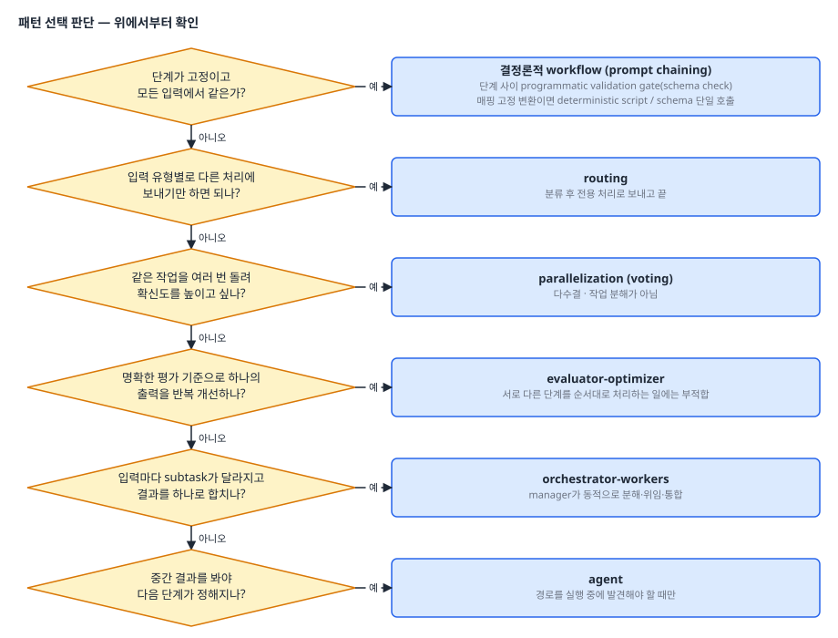
*그림: 고정 단계부터 확인하고, agent는 중간 결과를 봐야 다음 단계가 정해질 때만 고른다*

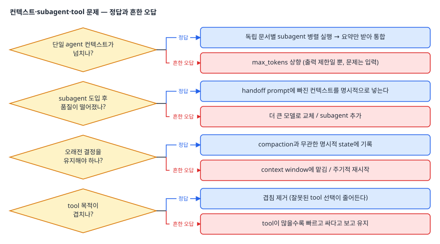
*그림: 컨텍스트 문제마다 정답(격리, handoff 보강, 명시적 state, 겹침 제거)과 흔한 오답이 짝을 이룬다*

근거: Amey-0004, Amey-0005, Amey-0023, Amey-0024, Amey-0025, Amey-0026, Amey-0036, Amey-0040, Amey-0041, Amey-0059, Amey-0060, Amey-0073, Patrick-0012, Patrick-0022, Patrick-0038, Patrick-0039, Preporato-0016, Preporato-0017, Preporato-0018, Preporato-0019, Udemy-0004, Udemy-0006, Udemy-0014, Udemy-0019, Udemy-0051, Udemy-0053

## 3. 자주 나오는 오답 함정

**패턴 선택**

| 오답 | 이유 |
|---|---|
| agent가 fixed code보다 유능 · 고품질 | 경로가 알려진 작업에서 자율성 → 비용 · 비결정성만 증가 |
| agent는 불필요 단계 건너뛰기 가능 | validation 건너뛰기 = 결함 (기능 ✗) |
| 작업 길다 · tool 많다 · structured output 필요 → agent | 모두 고정 workflow로 충족 |
| 고정 단계에 orchestrator-workers · 단계별 agent | 동적 분해 대상 없음 orchestrator 호출만큼 비용 · 불확실성 증가 |
| 고정 단계를 evaluator-optimizer로 | 반복 횟수 미지 → 시간 · 비용 불안정 하나의 출력 다듬는 구조도 아님 |
| 하나의 거대한 prompt로 전부 처리 | 단계 사이 checkpoint · 검증 소실 |
| 서로 감독하는 agent 2개 | supervision hierarchy = 위임 필요 문제 전용 |

**Subagent · 컨텍스트**

| 오답 | 이유 |
|---|---|
| subagent가 부모 이력 · system prompt 상속 → 지시 짧게 써도 됨 | 상속은 fork형뿐 일반 subagent = 빈 컨텍스트에서 시작 |
| context 격리로 시스템 전체 토큰 감소 | 각자 따로 읽음 → 증가 가능 격리 이점 = 부모 컨텍스트 보호 |
| subagent 품질 저하 → 더 큰 모델 · subagent 추가 | 빠진 컨텍스트는 모델 크기로 못 채움 subagent 증가 → 결함도 증가 |
| subagent로 합의 · rate limit 우회 · fallback | subagent 가치 = 위임 · 컨텍스트 격리 |
| subagent끼리 직접 통신 | 결과 통합 · 실패 격리하는 coordinator 소실 |

**Loop · state**

| 오답 | 이유 |
|---|---|
| 컨텍스트 부족 → `max_tokens` 상향 | `max_tokens` = 출력 제한 · 문제는 입력 |
| `tool_use`인데 같은 요청 재전송 · 턴 종료 | 모델이 tool 결과 대기 중 |
| `end_turn`인데 마지막 tool 재실행 · 빈 `tool_result` 전송 | 이미 완료된 턴 |
| 응답에 text 있으면 종료 | text · tool 호출 공존 가능 |
| 정확히 N회 반복 후 종료 | 고정 횟수 → 모델 신호 무시 |
| step ceiling 목적 = 성공한 실행의 비용 절감 · 속도 | 비수렴(무한 loop) 방지 안전 상한 |
| context window가 기억 | 컨텍스트 유한 · compaction 손실 |
| 주기적으로 재시작 | 재시작 → 결정 소실 |
| tool 많을수록 빠르고 저렴 | 겹치는 tool → 선택 오류 증가 |
| 장시간 승인 대기 state를 프로세스 메모리에 | 장애 · 재시작 시 소실 → 재개 불가 |

**구현 수단**

| 오답 | 이유 |
|---|---|
| Agent SDK 장점 = streaming | streaming은 Client SDK에서도 가능 |
| Agent SDK로 Anthropic 인프라 호스팅 | 호스팅 = Managed Agents Agent SDK = 사용자 프로세스 실행 |
| Agent SDK 제품을 claude.ai 로그인으로 사용 | API key 인증 필요 |
| Agent SDK가 vector DB · fine-tuning · 시각 designer 제공 | 미제공 |
| Managed Agents + self-hosted sandbox → 세션 로그도 자사 | session · event log = Anthropic 쪽 저장 |
| Message Batches API로 agent 실행 | 비동기 일괄 요청용 · loop · 세션 미제공 |
| LangGraph → 호출 · 토큰 감소 | 비용 절감 도구 ✗ |
| LangGraph → prompt · 구성 직접 작성 불필요 | 저수준 → 구성은 개발자 설계 |

근거: Amey-0004, Amey-0005, Amey-0023, Amey-0024, Amey-0025, Amey-0026, Amey-0036, Amey-0041, Amey-0059, Amey-0073, Patrick-0012, Patrick-0022, Patrick-0038, Patrick-0039, Preporato-0017, Preporato-0019, Udemy-0004, Udemy-0014, Udemy-0019, Udemy-0051, Udemy-0053

## 4. 암기 목록

| 이름 | 의미 |
|---|---|
| `stop_reason: "tool_use"` | tool 실행 → `tool_result` 추가 → 재호출 (loop 계속) |
| `stop_reason: "end_turn"` | 모델이 턴 종료 → 결과 반환 |
| `stop_reason: "max_tokens"` | 출력 상한 도달 → 별도 처리 필요 (종료 신호 ✗) |
| `max_tokens` | 출력 길이 제한 · 입력 컨텍스트와 무관 |
| `tool_result` | tool 실행 결과를 대화에 붙여 돌려주는 block |
| step ceiling = max iteration cap | 비수렴 loop에 대한 안전 상한 |
| prompt chaining | 고정 순서 + 단계 사이 gate |
| routing | 분류 → 전용 처리로 보냄 |
| parallelization (voting) | 같은 작업 여러 번 실행 → 다수결 |
| orchestrator-workers | 실행 중 동적 분해 → 위임 → 통합 |
| evaluator-optimizer | 채점 → 수정 반복 |
| Agent tool | subagent 호출 · 부모에는 최종 메시지만 반환 |
| `AgentDefinition`의 `prompt` | subagent 자신의 system prompt (부모 system prompt 상속 ✗) |
| `model` (subagent 정의) | subagent별 가벼운 모델 지정 → 비용 절감 |
| fork형 subagent | 현재 대화 분기 → 부모 이력 상속 (예외) |
| `CLAUDE.md` | 설정에 따라 로드되는 프로젝트 공통 방침 |
| Claude Agent SDK | loop · context management built-in tool(Read · Edit · Bash · 검색) |
| Agent SDK 제어 · 확장 | hooks · permissions subagents · MCP · sessions |
| Agent SDK 실행 위치 | 자사 프로세스 |
| tool runner (beta) | Client SDK에서 tool loop 대행 |
| Managed Agents | Anthropic이 loop · sandbox 호스팅 session · event log = Anthropic 쪽 저장 |
| 세션 JSONL · `SessionStore` | Agent SDK 세션 저장 (디스크 · 자사 스토리지 adapter) |
| Message Batches API | 비동기 대량 처리 · agent 용도 ✗ |
| LangGraph | 저수준 stateful orchestration durable execution · human-in-the-loop state 영속화 |

근거: Amey-0005, Amey-0026, Amey-0036, Patrick-0038, Preporato-0017, Preporato-0019, Udemy-0004, Udemy-0006, Udemy-0014, Udemy-0019, Udemy-0051, Udemy-0053

## 5. 시험 직전 체크리스트

- [ ] workflow vs agent = 다음 단계 결정 주체(코드 vs 모델)
- [ ] 단계 고정 → prompt chaining + validation gate
- [ ] 단계 고정에 agent · orchestrator ✗
- [ ] agent 필요 신호 = 중간 결과를 봐야 다음 단계를 앎 (유일)
- [ ] 동적 분해 → 위임 → 통합 = orchestrator-workers
- [ ] 분류만 = routing · 다수결 = voting
- [ ] coordinator = 분해 · 위임 · 통합
- [ ] subagent = 격리 컨텍스트에서 좁은 작업 → 요약만 반환
- [ ] subagent 상속 ✗ (부모 이력 · system prompt)
- [ ] 필요한 컨텍스트 → 위임 prompt에 명시
- [ ] subagent 도입 후 품질 저하 → handoff 컨텍스트 누락 의심
- [ ] context 격리 = 부모 window 보호 · 총 토큰 감소 ✗
- [ ] `tool_use` → 실행 · `tool_result` · 재호출
- [ ] `end_turn` → 반환
- [ ] loop 종료 = success condition + ceiling
- [ ] step ceiling = 비수렴 대비
- [ ] `max_tokens` = 출력 제한 · 컨텍스트 부족 해법 ✗
- [ ] 오래 유지할 결정 → compaction과 무관한 명시적 state
- [ ] 겹치는 tool → 잘못된 tool 선택 증가
- [ ] Agent SDK = loop · built-in tool · context 관리
- [ ] Agent SDK = hooks · permissions 포함
- [ ] Agent SDK = 자사 프로세스 실행 · API key 인증
- [ ] Managed Agents = 호스팅 · 세션 로그 모두 Anthropic
- [ ] data residency → self-hosted Agent SDK
