# 2. Applications and Integration — 반드시 알아야 할 지식
> 시험 비중 33% · 약 10문항 · 근거 문항 65개

## 1. 핵심 개념

### 1.1 Messages API 기본 구조
**stateless → 매 요청 전체 이력 재전송**

| 구분 | 내용 |
|---|---|
| 상태 | 서버에 대화 상태 없음 session ID · conversation token 없음 |
| 이력 | 매 요청 `messages` 배열 전체 재전송 (user · assistant 교대) |
| 첫 메시지 | user 필수 |
| 비용 | 이력 증가 → 입력 토큰(비용) 증가 재전송 비용 → prompt caching으로 절감 |
| system prompt | 최상위 `system` 파라미터로 전송 `messages`에 `"role": "system"` → 오류 |
| window 계산 대상 | system prompt · tool 정의 `messages` 전체(tool result · 이미지 포함) 그 턴의 출력(thinking 포함) |
| `max_tokens` | 출력 상한 window 크기와 별개 개념 |
| 실제 사용량 | 응답 `usage`(`input_tokens` · `output_tokens`)로 확인 |
| 사전 측정 | token counting endpoint에 실제 요청 그대로 입력 (system · tools · messages) → window 적합 여부 · 비용 확인 |

| 오답 | 이유 |
|---|---|
| system을 assistant 턴 삽입 · 매 user 턴 반복 | 지시 약화 · 토큰 낭비 |
| "4글자 = 1토큰" 어림셈 · Claude에게 직접 세게 하기 | 토큰 수 부정확 |

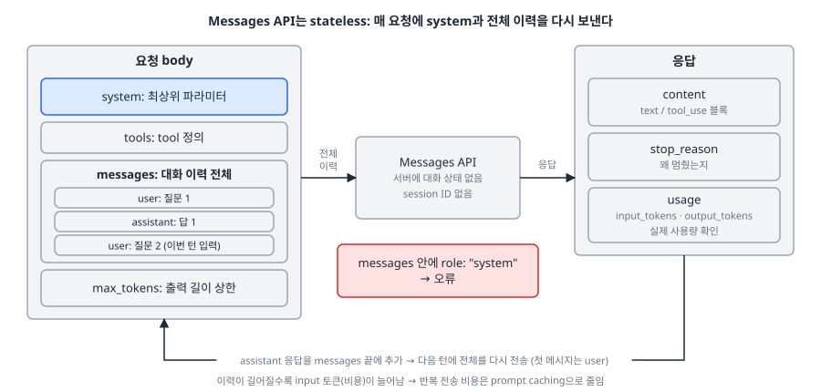
*그림: 서버는 대화 상태를 기억하지 않으므로 system은 최상위 파라미터로, 이력은 messages 전체로 매번 다시 보낸다.*

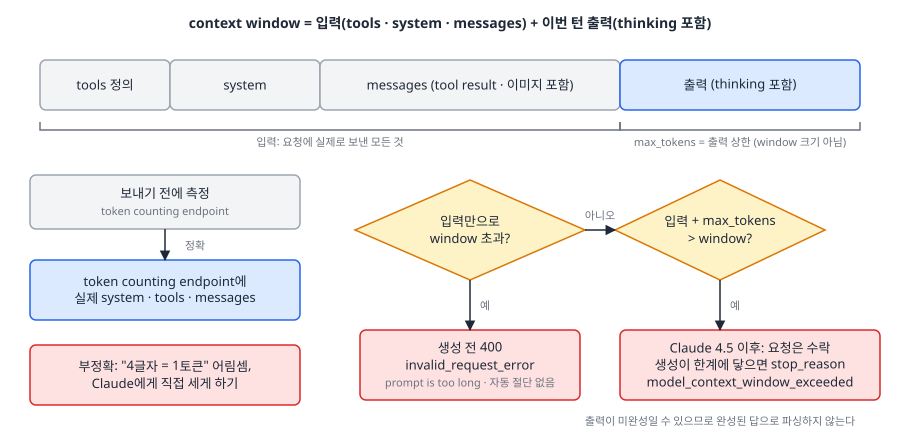
*그림: window에는 입력과 출력이 모두 계산되며, 입력만으로 넘으면 400, 생성 중 한계에 닿으면 model_context_window_exceeded로 멈춘다.*

근거: Patrick-0001, Patrick-0015, Patrick-0040, Preporato-0001, Preporato-0010, Udemy-0001, Udemy-0030

### 1.2 stop_reason 해석
**`stop_reason`으로 완성 · 이어가기 · 미완성 구분**

| `stop_reason` | 의미 |
|---|---|
| `end_turn` | 자연 종료 |
| `max_tokens` | 요청에서 정한 출력 상한에 걸려 잘림 (문장 중간 끊김 증상) |
| `stop_sequence` | 지정 문자열에서 멈춤 |
| `tool_use` | tool 결과 대기 |
| `pause_turn` | server-side tool loop 일시 정지 → 재전송으로 이어감 |
| `refusal` | 거부 |
| `model_context_window_exceeded` | 사용자 `max_tokens`가 아닌 모델 context window 한계로 생성 멈춤 |

| 구분 | 내용 |
|---|---|
| Claude 4.5 이후 모델 | 입력 + `max_tokens` > window 요청도 수락 → 생성이 window 한계 도달 시 `model_context_window_exceeded` |
| 미완성 출력 | `max_tokens` · `model_context_window_exceeded` → 완성된 답으로 파싱 ✗ |
| 입력 자체 window 초과 | 오래된 부분 자동 절단 ✗ → 생성 전 400 `invalid_request_error` (prompt is too long) |
| `tool_use` 멈춤 | 오류 아님 · 앱이 넘겨받은 작업 → 앱이 tool 실행 · 결과 반환 → 루프 계속 |

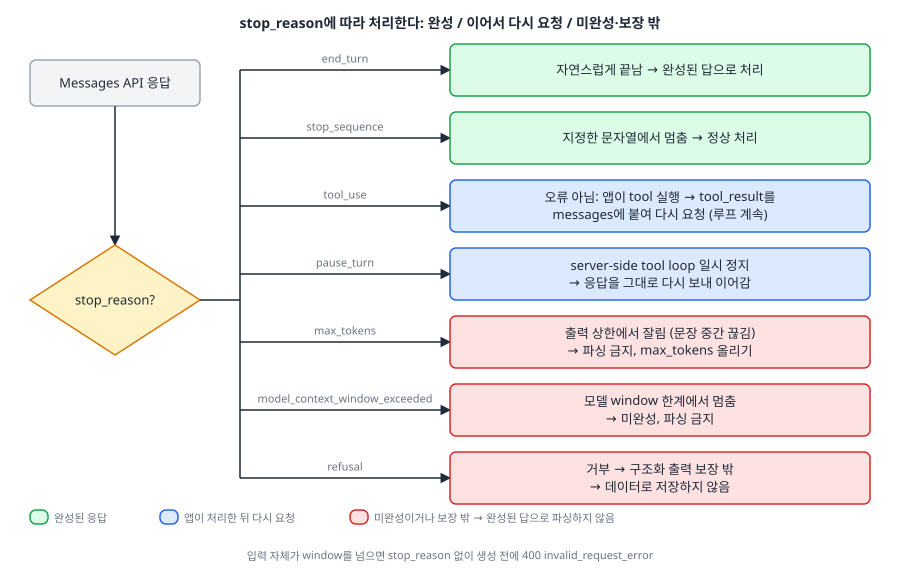
*그림: stop_reason에 따라 완성 처리, 다시 요청해 이어가기, 미완성으로 보고 파싱하지 않기로 나뉜다.*

근거: Amey-0018, Amey-0053, Amey-0068, Patrick-0016, Preporato-0002, Udemy-0001, Udemy-0030, Udemy-0044

### 1.3 Streaming
**streaming = TTFT · timeout 해결 · 단가 불변**

| 구분 | 내용 |
|---|---|
| 활성화 | `stream: true` → HTTP 위 server-sent events(SSE)로 분할 수신 |
| 방향 | 서버 → 클라이언트 단방향 WebSocket ✗ |
| 중간 입력 추가 | 새 요청 전송 |
| tools | streaming에서 지원 |

| 이벤트 · 데이터 | 내용 |
|---|---|
| 이벤트 순서 (메시지) | `message_start` → (블록 반복) → `message_delta` → `message_stop` |
| 이벤트 순서 (블록마다) | `content_block_start` → `content_block_delta`… → `content_block_stop` |
| `ping` | 중간 삽입 가능 · 연결 유지용 |
| 텍스트 | `content_block_delta` 안의 `text_delta` |
| `message_delta` | 최종 `stop_reason` · 누적 output token usage 포함 |
| `message_start` | 생성 종료 전 도착 → 최종 reason 모름 |
| tool 입력 | `input_json_delta`의 `partial_json` 조각 조각 단위로는 올바른 JSON ✗ → 모두 이어 붙여 `content_block_stop` 후 1회 파싱 |
| SDK streaming helper | 조각 조립 대행 |

| 효과 · 한계 | 내용 |
|---|---|
| 해결 1 | 첫 글자까지 체감 지연 (perceived latency · TTFT) |
| 해결 2 | 큰 `max_tokens` 요청의 HTTP timeout |
| 바꾸지 않는 것 | 토큰 단가 · 정확도 · rate limit |
| SDK 요구 | 큰 `max_tokens` non-streaming 요청 → timeout 회피 위해 streaming 요구 가능 |
| ⚠️ 해설 보충 (`max_tokens` 잘림) | 해설: "raise the limit or stream" streaming 자체로 잘림 해결 ✗ streaming = 큰 `max_tokens`를 HTTP timeout 없이 사용 해결책 = limit 상향 |

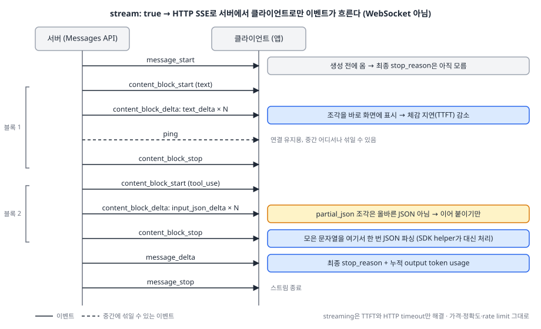
*그림: 최종 stop_reason은 message_delta에서 오고, input_json_delta 조각은 content_block_stop 뒤에 한 번 파싱한다.*

근거: Amey-0012, Patrick-0007, Patrick-0016, Patrick-0031, Patrick-0033, Preporato-0003, Udemy-0026, Udemy-0038, Udemy-0040

### 1.4 Prompt caching
**고정 prefix + 끝 breakpoint → 요금 · 지연만 절감**

| 구분 | 내용 |
|---|---|
| 1순위 검토 상황 | 같은 대용량 prefix 반복 전송 (system prompt · 정책 문서 · 계약서 등) |
| 방식 | prefix 일치 breakpoint(`cache_control`)까지 이전 요청과 완전 일치 → hit |
| prefix 순서 | tools → system → messages 고정 · 변경 불가 |
| 설계 기본형 | 불변 내용 앞 + 그 끝에 `cache_control` 매번 바뀌는 내용(질문 · 시각 등) → breakpoint 뒤 |
| tool 목록 변동 | 구성 · 순서가 요청마다 바뀜 → prefix 맨 앞 깨짐 → 뒤의 system prompt까지 캐시 무효 |
| tool 목록 대응 | 요금제(plan)별 tool 목록 고정 · 정렬 순서 일정 유지 |

| 비용 · TTL | 내용 |
|---|---|
| minimum cacheable length | 모델별 상이 (현재 모델 512~4,096토큰, 예: 1,024) 미달 → `cache_control` 붙여도 오류 없이 캐시 ✗ |
| 캐시 여부 확인 | `usage` 필드 `cache_creation_input_tokens` `cache_read_input_tokens` |
| beta header | 불필요 |
| write 배율 (base input 대비) | 5분 TTL 1.25배 1시간 TTL 2배 |
| read 배율 (base input 대비) | 0.1배 Opus 5.5 · Sonnet 5.5 → 0.05배 Fable 5.2 · Fable 5.1 → 0.025배 |
| write 할증 | 재사용 많을수록 빠르게 회수 |
| TTL 기산 | write 또는 read 요청 시작 시점부터 사용할 때마다 추가 비용 없이 연장 |
| TTL 선택 | 요청이 끊임없이 유입 → 5분 TTL 재사용 간격 5분 초과 → 1시간 TTL |
| Batch | 1시간 TTL 권장 이유 1: 처리 5분 초과 가능 이유 2: batch cache hit = best-effort |
| caching + batch | 병용 가능 → 할인 중첩 |
| 캐시 범위 | workspace 단위 분리 |
| 캐시 공유 | 같은 workspace 내 prefix 같으면 사용자 달라도 공유 → 사용자별 write 불필요 |

| 효과 · 한계 | 내용 |
|---|---|
| 효과 | 내용 손실 없이 비용 · time-to-first-token 동시 절감 |
| 바꾸는 것 | 요금 · 지연뿐 |
| 바꾸지 않는 것 | 캐시된 prefix도 context window 그대로 차지 매 요청에 포함 전송 필요 → window 한계 · 요청 크기 문제 해결 ✗ |
| ITPM | 많은 모델에서 cache hit 부분 ITPM 미계산 window 용량과는 별개 개념 |
| 적용 범위 | 실제로 보낸 내용에만 적용 이전 턴 "기억" 기능 ✗ |

| 오답 | 이유 |
|---|---|
| 바뀌는 블록에 breakpoint | hit 0회 · write 비용만 계속 |
| 지시 축소 · 모델 교체로 대응 | 품질 희생 |

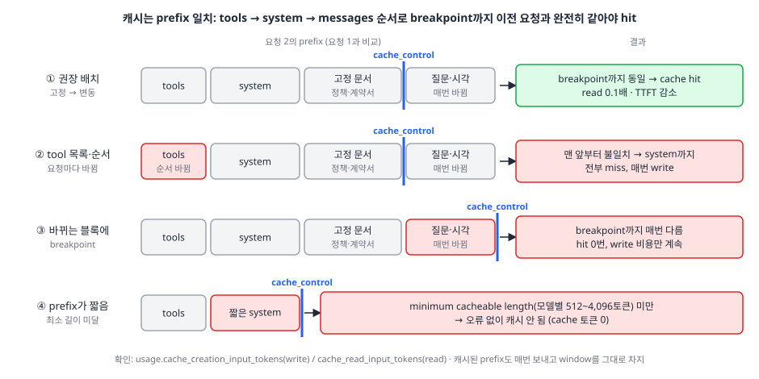
*그림: breakpoint까지의 prefix가 완전히 같을 때만 hit가 나므로 고정 내용을 앞에, 바뀌는 내용을 breakpoint 뒤에 둔다.*

근거: Amey-0001, Amey-0011, Amey-0038, Amey-0051, Patrick-0005, Patrick-0023, Preporato-0001, Preporato-0004, Preporato-0005, Preporato-0006, Udemy-0001, Udemy-0034, Udemy-0043, Udemy-0047

### 1.5 Message Batches API
**대량 · 지연 허용 → 50% 할인 · 실시간 ✗**

| 구분 | 내용 |
|---|---|
| 용도 | 대량 · 지연 허용 작업 (야간 분류 · "다음 날 아침까지" 조건) |
| 가격 | 입력 · 출력 모두 표준 가격의 50% |
| 처리 시간 | 대부분 1시간 이내 · 최대 24시간 |
| 상한 | batch 1개당 100,000 requests 또는 256 MB |
| 만료 | 24시간 내 미처리 request → expired · 과금 ✗ |
| 결과 보관 | 29일 |
| 진행 확인 | `processing_status` polling → `ended` 시 `results_url`에서 `.jsonl` 수신 (stream 수신 가능) |
| 결과 순서 | 제출 순서 보장 ✗ → 각 request의 `custom_id`로 입력과 매칭 |
| 불가 | batch 내 `stream` · multi-turn tool calling |
| 속도 | 개별 응답 속도 보장 ✗ 수요 많으면 더 느려질 수 있음 |
| 부적합 | 화면 앞 대기 · 1초 내 표시 같은 실시간 요구 |

| 오답 | 이유 |
|---|---|
| 위치(순서)로 결과 매칭 | 레코드 간 결과 뒤바뀜 |
| batch 대신 전체 입력을 요청 1개에 몰기 | context window 초과 |

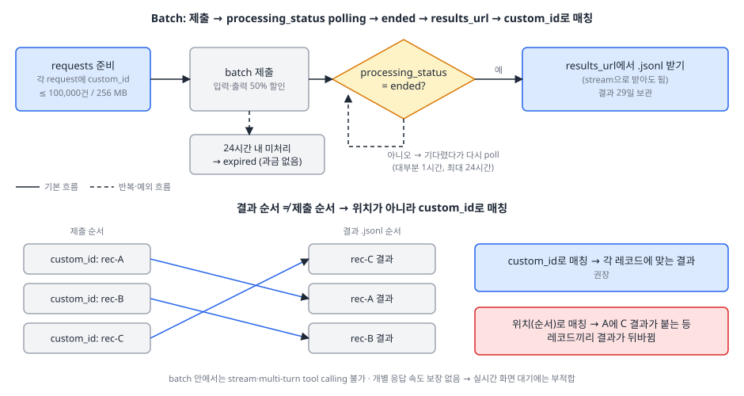
*그림: batch는 제출 후 ended까지 polling하고, 순서가 보장되지 않는 결과를 custom_id로 입력과 매칭한다.*

근거: Amey-0002, Amey-0013, Amey-0037, Amey-0048, Patrick-0023, Patrick-0034, Preporato-0007, Udemy-0008, Udemy-0010, Udemy-0026, Udemy-0048

### 1.6 Files API · 이미지 · PDF 입력
**반복 파일 = `file_id` · 큰 이미지 = 미리 resize**

| 구분 | 내용 |
|---|---|
| 용도 | 같은 PDF · 이미지를 여러 요청 · 여러 턴에서 참조 → Files API에 1회 업로드 후 `file_id`로 참조 |
| 지정 방법 | PDF = `document` block 이미지 = `image` block `source`에 `type: file` 지정 |
| 보관 | 삭제 시까지 유지 |
| 과금 | `file_id` 참조여도 포함될 때마다 문서 토큰 input 과금 → 안정적 prefix면 prompt caching 병용 |
| Bedrock · Google Cloud(Google managed) | 현재 base64만 가능 |
| 큰 이미지 | 모델 최대 native resolution 초과 → Anthropic 측 축소 → 업로드 시간 · 지연만 증가 |
| 대응 | 정확도 유지되면 앱에서 미리 resize |
| 이미지 토큰 | 픽셀 면적에 비례 증가 |
| 배치 순서 | 이미지를 텍스트보다 앞에 두기 권장 |

| `image` source | 의미 |
|---|---|
| `base64` | 요청 본문에 포함 이력에 남는 한 매 턴 재전송 |
| `url` | 온라인 이미지 |
| `file` | Files API |

| 오답 | 이유 |
|---|---|
| URL을 프롬프트 텍스트로 기재 | Claude가 링크 열지 않음 |

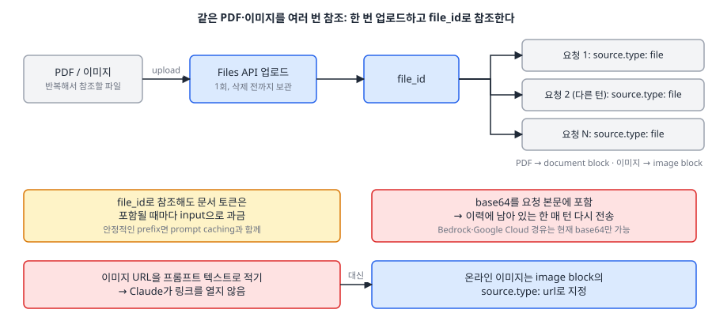
*그림: 반복 참조할 파일은 한 번 업로드해 file_id로 참조하지만, 문서 토큰은 포함될 때마다 과금된다.*

근거: Patrick-0025, Preporato-0009, Udemy-0043

### 1.7 Citations
**출처 표시 = `document` block + `citations` 활성화**

| 구분 | 내용 |
|---|---|
| 용도 | 주장마다 출처 문서 · 구절 표시 필요 (RAG · 감사 대응) |
| 정답 | 문서를 `document` content block으로 전달 + `citations: {enabled: true}` |
| 결과 | 원문 구간에 연결된 구조화 citation span 반환 |

| 오답 | 이유 |
|---|---|
| 프롬프트로 `[source]` · 페이지 번호 쓰게 하기 JSON `sources` 배열 받기 | 검증 안 된 자유 텍스트 |
| 별도 호출로 출처 추론 | 신뢰 불가 |

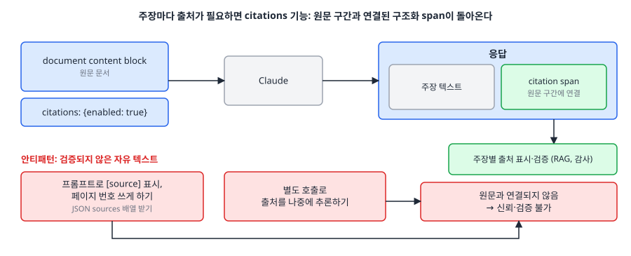
*그림: document block에 citations를 켜야 원문 구간에 연결된 citation span이 오고, 프롬프트로 쓰게 한 출처는 검증할 수 없다.*

근거: Patrick-0010, Patrick-0035

### 1.8 구조화 출력 (Structured outputs)
**스키마 제약 + `stop_reason` 확인 + 검증 후 재시도**

| 구분 | 내용 |
|---|---|
| 용도 | 타입 있는 DB 레코드처럼 정해진 형태 필요 |
| 응답 본문 | `output_config.format`(JSON schema) |
| tool 입력 | strict tool use(`strict: true`) |
| 구버전 | `output_format` = deprecated |
| 원리 | constrained decoding → 파싱 오류 · 필수 필드 누락 · 타입 불일치 방지 |
| 보장 범위 | 정상 종료 응답만 `refusal` · `max_tokens` 종료 → 스키마 불일치 가능 → 데이터 투입 전 `stop_reason` 확인 |
| 모델 출력 취급 | 신뢰할 수 없는 입력 tool schema로 형태 강제 → 검증 → 실패 시 오류 내용 함께 넘겨 재시도 |
| `max_tokens` 과소 | JSON 중간 잘림 |

| 오답 | 이유 |
|---|---|
| 검증 실패 조용히 건너뛰기 | 데이터 소실 |
| 지시문 대문자 강조 · temperature 0 정규식 후처리 · `max_tokens` 축소 | 형식 보장 ✗ |

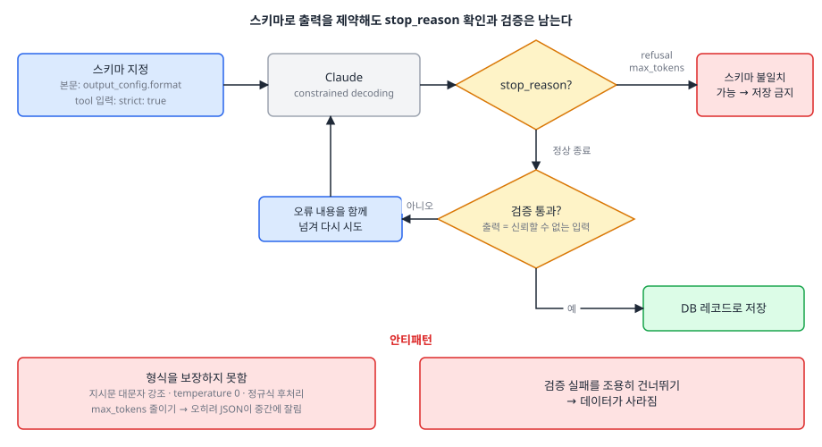
*그림: 스키마로 제약해도 refusal과 max_tokens는 보장 밖이므로 stop_reason을 확인하고, 검증 실패는 오류와 함께 재시도한다.*

근거: Amey-0003, Amey-0015, Udemy-0044

### 1.9 Extended thinking 제약
**수동: budget < `max_tokens` · tool 강제 ✗**

| 구분 | 내용 |
|---|---|
| `budget_tokens` | 출력 일부로 계산 → `max_tokens`보다 작아야 함 |
| budget 최솟값 | 100,000보다 훨씬 작음 |
| system prompt | thinking과 병용 가능 |
| 수동 extended thinking | `thinking: {type: "enabled", budget_tokens}` |
| 수동 thinking `tool_choice` | `auto` · `none`만 허용 `any` · 특정 tool 강제 → 400 |
| tool 사용 유도 | 프롬프트에 언제 쓸지 기재 |
| adaptive thinking | 대부분 모델에서 강제 tool 허용 Opus 5.5 · Sonnet 5.5는 강제 tool 항상 거부 |

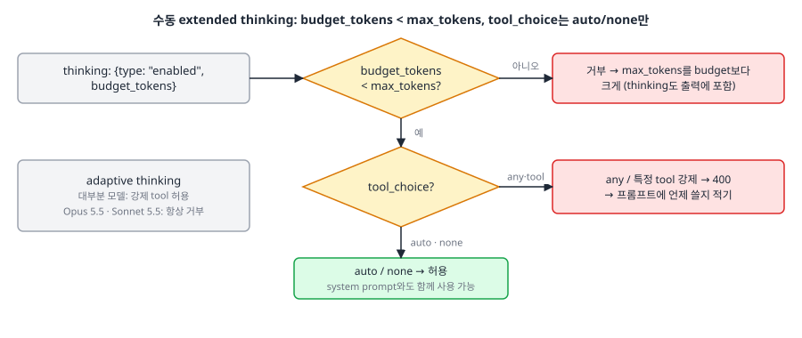
*그림: 수동 thinking은 budget_tokens가 max_tokens보다 작아야 하고 tool_choice는 auto와 none만 허용한다.*

근거: Patrick-0036, Patrick-0042

### 1.10 오류 처리 · retry · rate limit
**일시적 오류만 backoff 재시도 · 나머지 4xx는 원인 수정**

| 구분 | 대상 | 처리 |
|---|---|---|
| retry ✓ (일시적 · 기다리면 풀림) | 429 `rate_limit_error` · 529 `overloaded_error` 500 계열 · 연결 오류 | jitter 넣은 exponential backoff 시도 횟수 상한 `retry-after` header 있으면 그만큼 대기 |
| retry ✗ (요청 · 설정 수정 필요) | 400 `invalid_request_error` (잘못된 파라미터 · prompt is too long 등) 401(인증) 등 429 제외 4xx | 그대로 재전송 → 매번 같은 이유로 실패 |

| 구분 | 내용 |
|---|---|
| 갑작스러운 인증 오류 | 잘 되던 요청에서 발생 → payload 아닌 credential 의심 (만료 · rotation · 권한 회수) |
| SDK 자동 재시도 | 연결 오류 · 429 · 5xx 기본 2회(`retry-after` 준수) `max_retries`로 횟수 조정 |
| 지출 한도 429 | 사용 tier 월 지출 한도 → `retry-after` 없음 한도 회복까지 계속 실패 → 재시도와 별도 감지 필요 |
| 트래픽 급증 | 한도 내에서도 429 가능 → 단계적 증가 |

| 오답 | 이유 |
|---|---|
| 즉시 반복 재시도 | 부하 증가 |
| 429를 치명적 오류 처리 | 복구 가능한 작업 폐기 |
| 고정 간격 재시도 | 과부하 시 재시도 집중 |
| 여러 API key 분산 | 설계 아닌 한도 회피 |

| rate limit · 용량 | 내용 |
|---|---|
| rate limit 측정 | RPM · ITPM · OTPM |
| 용량 계획 | 동시 사용자 수 요구 → 세 값의 용량 계획으로 변환 부족 시 사전 상향 신청 |
| 429 재시도 | 사후 복구책 → 용량 확보 대체 ✗ |
| ⚠️ 해설 보충 (rate limit 측정) | 해설: "호출 수로 측정" 공식 rate limit = RPM + ITPM · OTPM(토큰) 요청 크기 축소 → 토큰 한도에 영향 가능 정답(backoff + 상한)은 유효 |

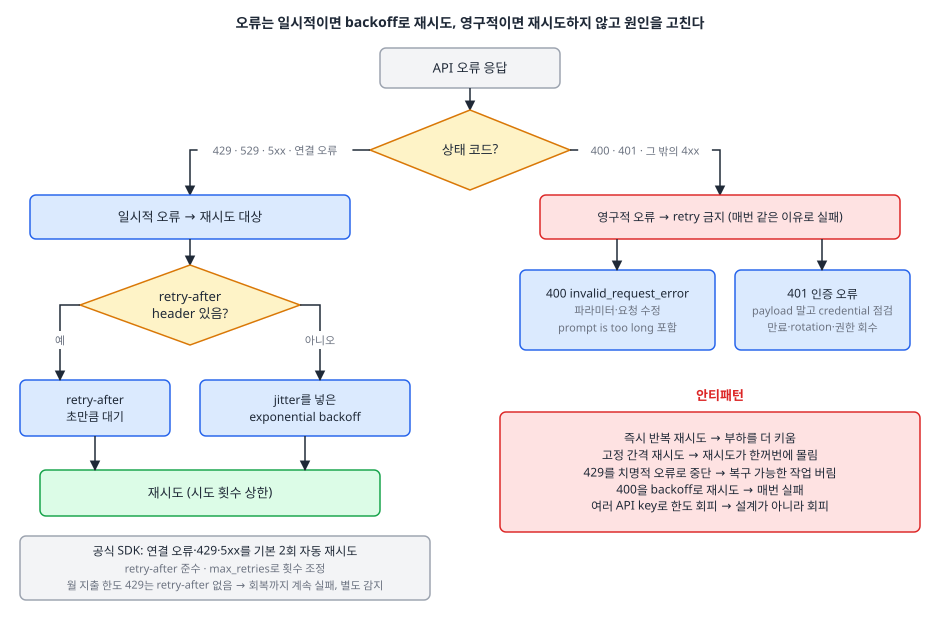
*그림: 429·529·5xx·연결 오류는 retry-after나 jitter backoff로 상한까지 재시도하고, 400·401은 재시도하지 않고 원인을 고친다.*

근거: Amey-0013, Amey-0014, Amey-0017, Amey-0055, Amey-0066, Udemy-0001, Udemy-0007, Udemy-0008, Udemy-0026, Udemy-0028, Udemy-0038

### 1.11 동시성 · 비동기 통합 패턴
**병렬 · ack+통지 · POST 재전송은 idempotency key**

| 느린 원인 | 수단 |
|---|---|
| 직렬 대기 | 병렬화 |
| 1건의 체감 속도 | streaming |
| 처리량 · 비용 | batch |

| 구분 | 내용 |
|---|---|
| 병렬 처리 | 독립 호출이 직렬이라 느림 → `AsyncAnthropic` + `asyncio.gather` |
| `AsyncAnthropic` | 동기 `Anthropic`과 인터페이스 동일 |
| 동시 실행 제한 | `asyncio.Semaphore`로 rate limit 안에 제한 + SDK 자동 재시도 병용 |
| 효과 | 총 시간 → 가장 느린 1건 수준 |
| queue | 최대 이유 = burst 흡수 → 작업 폐기 없이 rate limit 내 유지 retry 대체 ✗ · retry도 필요 |
| 지연 SLA 초과 | endpoint 지정 시간(예: 500 ms) < 모델 처리 시간 → 수락 · 완료 분리 → 즉시 ack + callback · poll로 결과 전달 |
| 몇 시간 걸리는 작업 | 동기 HTTP 연결 유지 → idle timeout · 연결 끊김 위험 → 비동기 job + polling · callback(webhook) |

| 완료 통지 | 장점 | 비용 |
|---|---|---|
| polling | 클라이언트만으로 완결 · 단순 | 간격 따라 감지 지연 불필요한 요청 증가 |
| webhook | 즉시 통지 | 수신 endpoint 공개 · 인증(서명 검증) 재전송 · 중복 수신 대비 idempotent 처리 놓친 알림 대비 상태 조회 API |

| 구분 | 내용 |
|---|---|
| idempotent | GET · HEAD · PUT · DELETE |
| non-idempotent | POST · PATCH |
| 결과 모르는 POST 재전송 | idempotency key 부착 또는 등록 여부 확인 → 중복 등록 방지 |
| 5xx | "처리 완료" 의미 ✗ |

| request identifier | 내용 |
|---|---|
| 전파 목적 | traceability |
| 추적 | 응답 → 그 응답을 만든 요청 추적 → 비동기 · batch 디버깅에 필요 |
| 무관 항목 | 비용 · 정확도 |
| ⚠️ 해설 불일치 (상관 ID) | ⚠️ 해설: "API가 요구하는 것이 아닌 설계 관행" ⚠️ 해설: "API가 요구하는 것이 아니다" Message Batches API는 request마다 `custom_id` 필수 → 일반 상관 ID 관행 설명으로만 이해 |

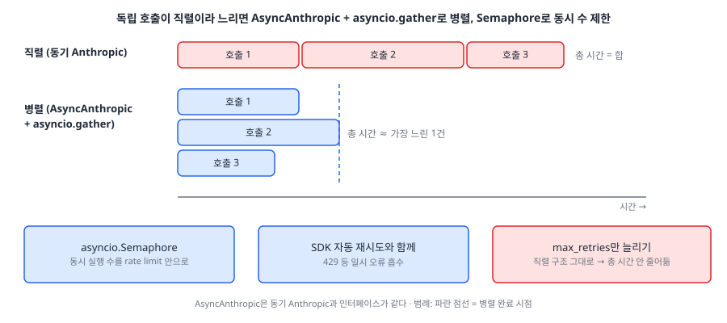
*그림: 독립 호출을 병렬로 돌리면 총 시간이 가장 느린 1건 수준으로 줄고, Semaphore가 동시 수를 rate limit 안으로 묶는다.*

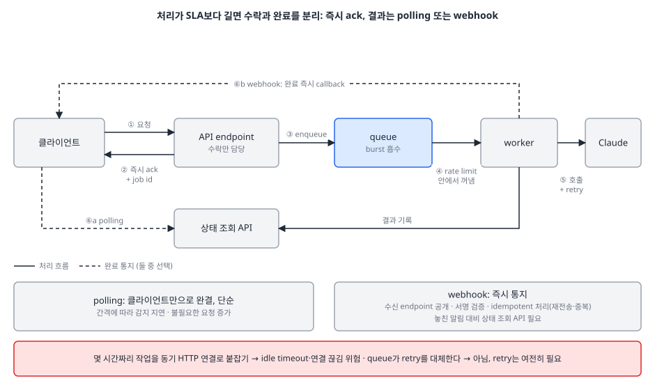
*그림: 오래 걸리는 처리는 수락과 완료를 분리해 즉시 ack하고, 결과는 polling이나 webhook으로 전달한다.*

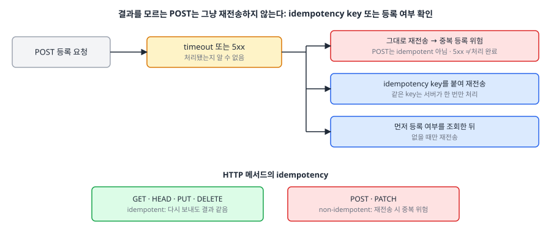
*그림: POST는 idempotent가 아니므로 결과를 모를 때는 idempotency key를 붙이거나 등록 여부를 확인한 뒤 재전송한다.*

근거: Amey-0052, Amey-0067, Amey-0069, Udemy-0008, Udemy-0010, Udemy-0028

### 1.12 Context window 관리
**window 문제 = 올라가는 토큰 자체를 줄여야 해결**

| 수단 | 효과 · 이유 | 판정 |
|---|---|---|
| compaction | window 초과 예상 → 이전 턴 요약(압축 상태)을 이어서 유지 | ✓ |
| server-side compaction | Claude가 서버에서 오래된 턴 → 요약으로 교체 요약 처리 직접 구현 불필요 window 한계 근접 대화의 주요 전략 | ✓ |
| tool result clearing (context editing의 `clear_tool_uses_20250919`) | threshold(입력 토큰 수 등) 초과 → 오래된 tool result부터 placeholder 최근 결과 지정 개수 유지 · compaction보다 좁은 수단 | ✓ |
| tool payload 축소 | 불필요한 큰 payload(예: 50,000토큰 JSON) → tool이 작업에 필요한 필드만 반환하도록 수정 | ✓ |
| payload 대안: window 확대 | 문제를 미룰 뿐 · 근본 해결 ✗ | ✗ |
| payload 대안: 2차 호출로 요약 | 비용 · 실패 지점 증가 | ✗ |
| 오래된 턴 단순 절단 | 사실이 조용히 소실 | ✗ |
| 새 대화 시작 | 상태 전부 상실 | ✗ |
| prompt caching | 요금 대응 → 이력 양 그대로 | ✗ |
| `max_tokens` 증가 | 출력 상한 대응 → 이력 양 그대로 | ✗ |
| backoff 재시도 | 일시적 오류 대응 → 이력 양 그대로 | ✗ |
| 큰 window 모델에 전체 기록 | 매번 투입 → TTFT · ITPM 소비 증가 → 실시간 요구 부적합 | ✗ |

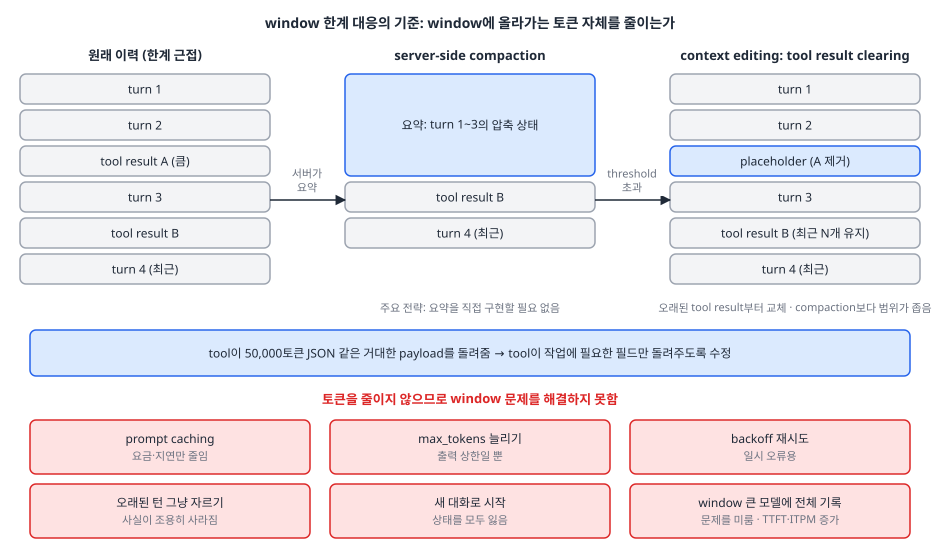
*그림: window 문제는 올라가는 토큰 자체를 줄이는 compaction, tool result clearing, payload 축소로만 해결된다.*

근거: Amey-0016, Amey-0054, Udemy-0001, Udemy-0026

### 1.13 SDK · 플랫폼 client
**SDK = 같은 REST API wrapper + 편의 기능**

| 구분 | 내용 |
|---|---|
| 공식 SDK | Python · TypeScript · C# · Go Java · PHP · Ruby |
| 정체 | raw HTTP와 같은 REST API 호출 wrapper |
| 추가 편의 기능 | typed request/response streaming helper(`messages.stream()` 등) 자동 retry · typed exception · tool runner |
| 기능 · 속도 | raw HTTP와 동일 |
| AWS IAM 인증 | `AnthropicBedrock()` + AWS credentials Messages 인터페이스 유지 |
| Vertex | `AnthropicVertex()` 별도 제공 |

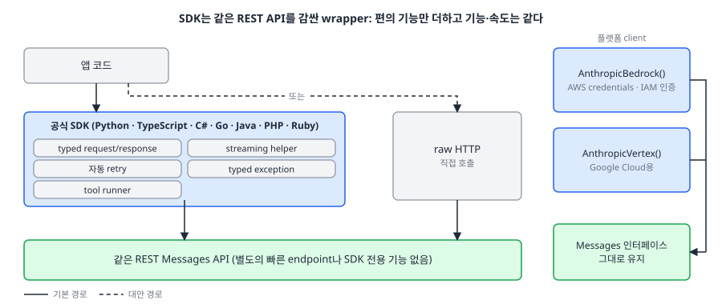
*그림: SDK와 플랫폼 client는 같은 Messages 인터페이스 위에 편의 기능과 인증 방식만 더한다.*

근거: Patrick-0009, Udemy-0038

### 1.14 운영 · 변경 관리 · 디버깅
**production = version pin + eval 후 업그레이드**

| 구분 | 내용 |
|---|---|
| 사고 유형 | 코드 변경 없이 출력 형식 변화 |
| 원인 | floating alias · production 직접 수정 |
| 모델 | production에서 특정 model version 고정(pin) → eval 후 의도적 업그레이드 |
| prompt | version control · prompt registry로 관리 변경 전 eval |
| 형식 정상 · 의미 오류 | 해당 입력에 실제 들어간 prompt · context부터 조사 (전송 계층 · rate limit · `max_tokens` ✗) |

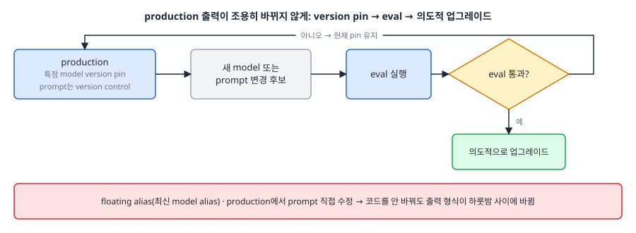
*그림: production은 model version을 pin하고 eval을 통과한 경우에만 의도적으로 업그레이드한다.*

근거: Amey-0070, Preporato-0008

### 1.15 요구사항 분류 (Claude 시스템 기획)
**"시스템은 ~을 받아 ~을 출력한다" = 기능 요구**

| 구분 | 내용 |
|---|---|
| 비즈니스 요구 | 목표 · KPI (예: 작성 시간 30% 단축) |
| 기능 요구 | 무엇을 받아 어떻게 처리해 무엇을 출력하는지 테스트로 확인 가능 판별: "시스템은 ~을 받아 ~을 출력한다"로 변환 가능 |
| 비기능 요구 | 성능 · 가용성 · 보안 (예: 동시 100건 · p95 10초) |
| 프로젝트 제약 | 기간 · 예산 |
| 성능 요구 분해 | 응답 속도 → streaming 처리량(동시 사용 수) → rate limit 용량 확보 |

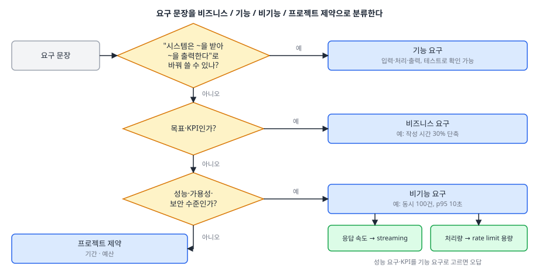
*그림: "시스템은 ~을 받아 ~을 출력한다"로 바꿀 수 있으면 기능 요구이고, 성능 요구는 속도와 처리량으로 나눠 수단을 붙인다.*

근거: Udemy-0026, Udemy-0046

## 2. 상황별 정답 판단 규칙

**비용 · 지연 · 처리량**

| 상황 | 정답 |
|---|---|
| 큰 system prompt · 문서 매 요청 반복 → 비용 · 지연 큼 | 안정적 내용 앞 + prompt caching |
| system prompt 같은데 cache hit ≈ 0 | tool 목록 · 순서 변동 확인 → 고정 바뀌는 내용 뒤에 breakpoint ✗ |
| `cache_control` 붙였는데 cache 토큰 0 · 오류 없음 | minimum cacheable length 미달 |
| 요청이 계속 들어오는 서비스의 TTL | 5분 TTL(쓸 때마다 연장) 간격 5분 초과 · batch → 1시간 TTL |
| 대량 처리 · 다음 날까지 · 비용 우선 | Message Batches API(50%) + 공통 prompt caching |
| batch 결과가 다른 레코드에 섞임 | 순서 아닌 `custom_id`로 매칭 |
| 화면 앞 대기 + 여러 독립 호출 | `AsyncAnthropic` 병렬 + Semaphore로 동시 실행 수 제한 |
| 첫 출력 빨리 · 큰 `max_tokens` 요청 timeout | streaming(`stream: true` · SSE) |
| 실시간 + 대규모 동시 사용 | streaming + RPM · ITPM · OTPM 용량 확보(상향 신청) |
| endpoint 지연 SLA < 모델 처리 시간 | 즉시 ack + callback · poll |
| 몇 시간 걸리는 job의 완료 통지 | 비동기 job + polling 또는 webhook (서명 · idempotent 처리) |
| 트래픽 burst | 앞단에 queue |

**오류 · 응답 · 운영**

| 상황 | 정답 |
|---|---|
| 429 · 529 · 5xx | jitter exponential backoff 횟수 상한 · `retry-after` 준수 |
| 400 · 잘못된 파라미터 · 401 | retry ✗ → 요청 · credential 수정 |
| 결과 모르는 POST 재전송 | idempotency key 또는 등록 여부 확인 후 재전송 |
| 응답이 문장 중간에서 끊김 | `stop_reason: max_tokens` → limit 상향 |
| model window 한계에서 멈춤 | `model_context_window_exceeded` |
| `stop_reason: tool_use` | tool 실행 → `tool_result` 반환 → 루프 계속 |
| thinking + 특정 tool 강제 → 400 | 수동 thinking은 `tool_choice` `auto` · `none`만 허용 |
| `budget_tokens` ≥ `max_tokens` → 거부 | `max_tokens`를 budget보다 크게 |
| AWS IAM 인증 | `AnthropicBedrock()` |
| 모델 출력 형식이 하룻밤 사이 변화 | model version pin + prompt 버전 관리 + eval |
| 형식 정상 · 의미 오류 | prompt · 해당 입력의 context부터 조사 |

**context · 입력 · 형식**

| 상황 | 정답 |
|---|---|
| 챗봇이 이전 대화를 잊음 | 전체 이력(user · assistant 교대) 매번 전송 |
| `messages`에 `role: system` → 오류 | 최상위 `system` 파라미터 |
| 긴 agent가 window 한계 근접 | compaction + context editing(tool result clearing) |
| tool이 거대한 payload 반환 | tool이 필요 필드만 반환하도록 수정 |
| 형식 정해진 레코드 추출 | `output_config.format` 또는 strict tool use + `stop_reason` 확인 |
| 주장마다 출처 구절 표시 | `document` block + `citations: {enabled: true}` |
| 같은 PDF · 이미지 여러 번 참조 | Files API 업로드 → `file_id` 참조 (필요 시 caching 추가) |
| 고해상도 사진 → 지연 큼 | 앱에서 미리 resize |
| window 적합 여부 · 비용 사전 확인 | token counting endpoint |

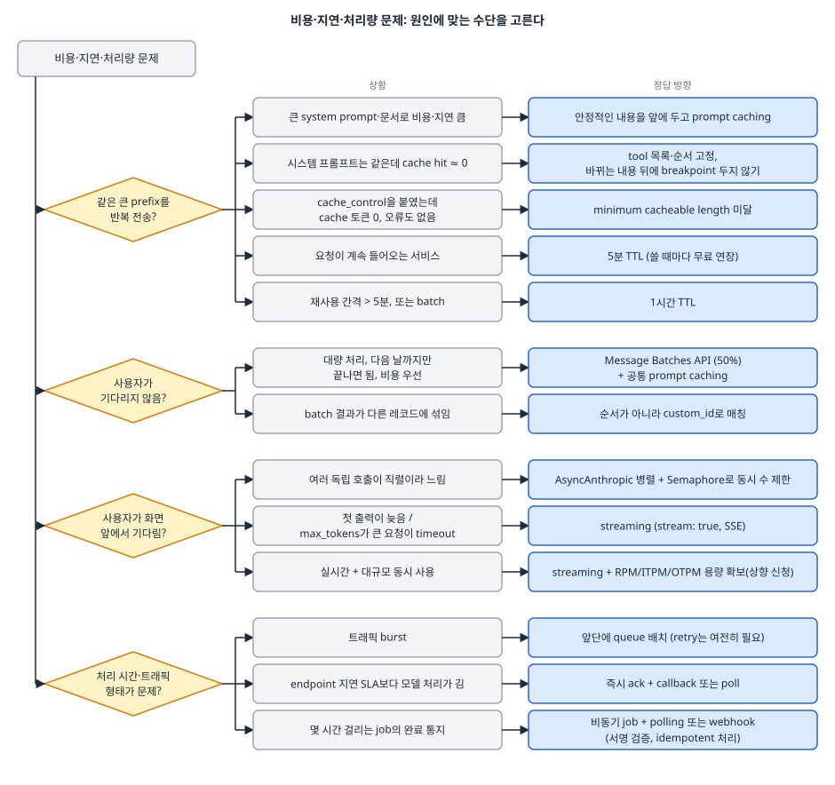
*그림: 비용·지연·처리량 문제는 prefix 반복, 대기 여부, 화면 대기, 트래픽 형태로 나눠 수단을 고른다.*

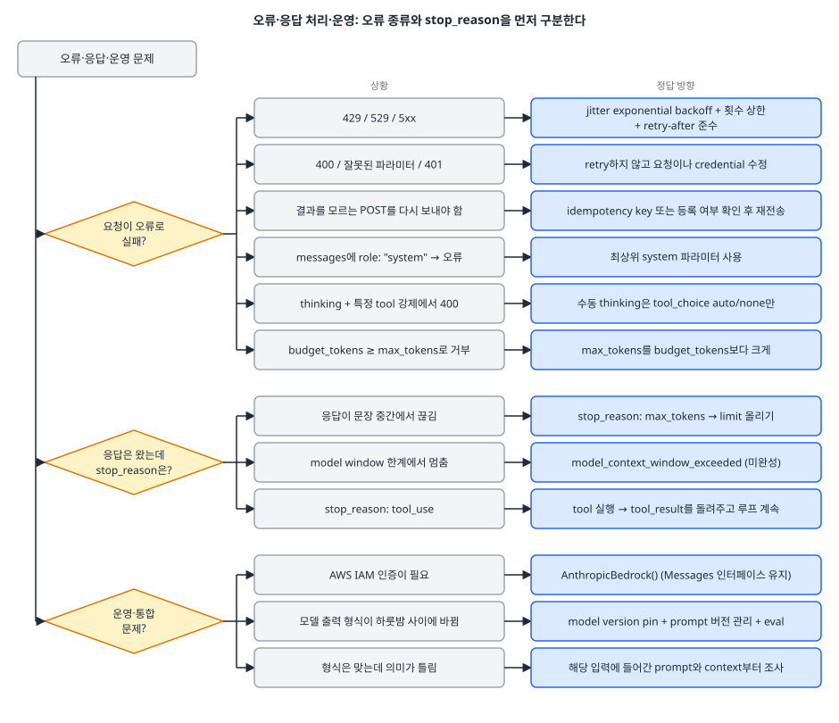
*그림: 오류는 일시적인지 영구적인지, 응답은 stop_reason으로 먼저 구분해 처리한다.*

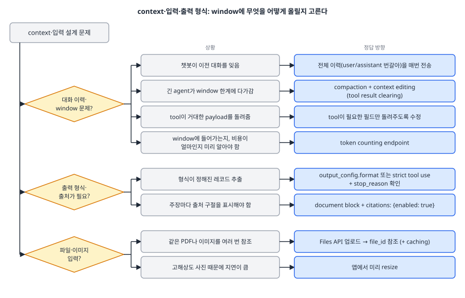
*그림: window 문제, 출력 형식과 출처, 파일 입력을 각각 맞는 API 기능으로 해결한다.*

근거: Amey-0001, Amey-0002, Amey-0011, Amey-0012, Amey-0014, Amey-0015, Amey-0016, Amey-0017, Amey-0018, Amey-0037, Amey-0038, Amey-0051, Amey-0052, Amey-0054, Amey-0055, Amey-0066, Amey-0068, Amey-0069, Amey-0070, Patrick-0001, Patrick-0005, Patrick-0009, Patrick-0010, Patrick-0015, Patrick-0016, Patrick-0023, Patrick-0025, Patrick-0034, Patrick-0035, Patrick-0036, Patrick-0040, Patrick-0042, Preporato-0001, Preporato-0002, Preporato-0003, Preporato-0004, Preporato-0005, Preporato-0006, Preporato-0007, Preporato-0008, Preporato-0009, Preporato-0010, Udemy-0001, Udemy-0007, Udemy-0008, Udemy-0010, Udemy-0026, Udemy-0028, Udemy-0034, Udemy-0040, Udemy-0043, Udemy-0044, Udemy-0047, Udemy-0048

## 3. 자주 나오는 오답 함정

**비용 · 지연 · 처리량**

| 오답 | 이유 |
|---|---|
| caching이 이전 대화 기억 · window 확대 | 보낸 내용의 요금 · 지연만 절감 기억 기능 ✗ · window 용량 변화 ✗ |
| 캐시 부분은 빼고 전송 | 매번 같은 내용 포함 전송 필요 |
| 캐시로 요청 크기 감소 | 요청 크기 그대로 요청 크기 감소 = Files API `file_id` |
| system prompt를 tools보다 앞에 | prefix 순서 고정 · 변경 불가 (tools → system → messages) |
| 1시간 TTL 항상 유리 | 1시간 write = 2배 |
| 5분 TTL은 5분마다 재과금 | 5분 TTL은 쓸 때마다 무료 연장 |
| 캐시는 사용자별로 따로 write | 같은 workspace 내 prefix 같으면 공유 |
| caching과 batch 병용 불가 | 병용 가능 · 할인 중첩 batch엔 1시간 TTL 권장 |
| streaming이 토큰 단가 인하 · rate limit 해결 · 정확도 향상 | 전달 방식만 변경 · 셋 다 불변 50% 할인 = Batches API 특징 |
| streaming = WebSocket 양방향 | HTTP SSE 단방향 |
| SDK는 SSE 처리 불가 | SDK가 streaming helper 기본 제공 |
| batch 결과가 제출 순서대로 | 순서 보장 ✗ |
| batch가 더 빠름 | 속도 보장 ✗ |
| batch 진행 상황 SSE 표시 | batch 내 stream 불가 |
| 실시간 화면 대기에 Batches API | 최대 24시간 · 완료 시각 불명 → 부적합 |
| `max_tokens` 낮추면 비용 절감 | 토큰 단가 동일 |
| max_retries만 늘리면 빨라짐 | 직렬 구조 그대로 → 총 시간 불변 |
| queue가 재시도 대체 | queue = burst 흡수 · retry 대체 ✗ |

**오류 · 응답 · 운영**

| 오답 | 이유 |
|---|---|
| `input_json_delta` = 깨진 JSON → 스키마 강화 · temperature 0 | 원래 조각 → 모아서 `content_block_stop` 후 파싱 |
| 400도 backoff 재시도 | 영구적 오류 → 재시도 ✗ · 원인 수정 |
| 429는 치명적이라 중단 | 일시적 오류 → backoff 재시도 |
| 즉시 재전송 | 오류 종류(일시적 · 영구적)별 처리 필요 |
| timeout 난 POST는 idempotent라 그냥 재전송 | POST = non-idempotent |
| 5xx면 등록된 것으로 간주 | 5xx는 완료 의미 ✗ |
| thinking과 tools 병용 불가 · thinking + tools는 Batches로만 가능 | `tool_choice` `auto` · `none`이면 병용 가능 |
| SDK는 별도 빠른 endpoint · SDK 전용 기능 사용 | 같은 API · 같은 기능 |
| 최신 model alias 사용 | 출력이 조용히 바뀌는 원인 → pin + eval |
| 성능 요구 · KPI를 기능 요구로 선택 | 기능 요구 = 입력 · 처리 · 출력으로 된 시스템 동작 |

**context · 입력 · 형식**

| 오답 | 이유 |
|---|---|
| `max_tokens` 낮추면 형식 안전 | 너무 낮으면 JSON 잘림 |
| `max_tokens` 올리면 window 문제 해결 | 출력 상한 · 출력도 window 차지 |
| window 초과 입력은 오래된 부분부터 자동 절단 | 400 오류 |
| 구조화 출력이면 `stop_reason` 확인 불필요 | `refusal` · `max_tokens`는 보장 범위 밖 |
| 프롬프트로 `[source]` · 페이지 번호 쓰게 함 | 검증 불가 → citations 기능 사용 |
| 이미지 URL을 텍스트로 적으면 Claude가 열람 | 문자열로만 읽힘 → `source.type: url` 사용 |
| 큰 context window 모델에 전체 기록 투입 | TTFT · ITPM 악화 |

근거: Amey-0002, Amey-0038, Amey-0069, Patrick-0005, Patrick-0010, Patrick-0033, Patrick-0034, Patrick-0035, Patrick-0042, Preporato-0001, Preporato-0003, Preporato-0004, Preporato-0006, Preporato-0008, Udemy-0001, Udemy-0007, Udemy-0008, Udemy-0026, Udemy-0028, Udemy-0030, Udemy-0034, Udemy-0038, Udemy-0040, Udemy-0043, Udemy-0044, Udemy-0046, Udemy-0047, Udemy-0048

## 4. 암기 목록

| 이름 | 의미 |
|---|---|
| `system` (최상위) | system prompt 위치 `messages`에는 system role 없음 |
| `max_tokens` | 출력 상한 thinking `budget_tokens`보다 커야 함 |
| `end_turn` · `max_tokens` · `stop_sequence` · `tool_use` · `pause_turn` · `refusal` · `model_context_window_exceeded` | `stop_reason` 종류 |
| `stream: true` | SSE 스트리밍 |
| `message_start` → `content_block_start` → `content_block_delta` → `content_block_stop` → `message_delta` → `message_stop` (+`ping`) | 스트림 이벤트 순서 |
| `text_delta` | 텍스트 조각 |
| `input_json_delta`(`partial_json`) | tool 입력 JSON 조각 |
| `message_delta` | 최종 `stop_reason` · 누적 output usage |
| `cache_control` | cache breakpoint |
| tools → system → messages | cache prefix 순서(고정) |
| `cache_creation_input_tokens` | 캐시 write 확인 usage 필드 |
| `cache_read_input_tokens` | 캐시 read 확인 usage 필드 |
| `custom_id` | batch request · 결과 매칭 키 |
| `processing_status` = `ended` | batch 완료 확인 polling |
| `results_url` (.jsonl) | batch 결과 수신 |
| `file_id` | Files API 참조 |
| `source.type: file` · `url` · `base64` | 이미지 source 종류 |
| `citations: {enabled: true}` | `document` block에서 citations 활성화 |
| `output_config.format` | 구조화 출력(JSON) `output_format` = deprecated |
| `strict: true` | strict tool use |
| `thinking: {type: "enabled", budget_tokens}` | 수동 extended thinking `tool_choice`는 `auto` · `none`만 허용 |
| `clear_tool_uses_20250919` | context editing의 tool result clearing |
| 400 `invalid_request_error` | 요청 오류(prompt is too long 포함) · retry ✗ |
| 401 | 인증 오류 → credential 점검 |
| 429 `rate_limit_error` | 일시적 → backoff + `retry-after` 지출 한도 429는 `retry-after` 없음 |
| 500 | 일시적 서버 오류 → backoff |
| 529 `overloaded_error` | 과부하 → backoff |
| `retry-after` | 대기 초 수 알려 주는 header |
| `max_retries` (기본 2) | SDK 자동 재시도 횟수 |
| RPM | 분당 요청 수 rate limit |
| ITPM | 분당 입력 토큰 수 rate limit |
| OTPM | 분당 출력 토큰 수 rate limit |
| `AsyncAnthropic` + `asyncio.Semaphore` | 비동기 병렬 처리 + 동시 실행 수 제한 |
| `AnthropicBedrock()` | AWS IAM용 client |
| `AnthropicVertex()` | Google Cloud용 client |
| GET · HEAD · PUT · DELETE | idempotent |
| POST · PATCH | non-idempotent |
| token counting endpoint | 요청의 정확한 토큰 수 측정 |

| 수치 | 의미 |
|---|---|
| 512~4,096토큰 | 모델별 minimum cacheable length 범위 미달 → 오류 없이 캐시 ✗ |
| 1.25배 | 5분 TTL write 배율 |
| 2배 | 1시간 TTL write 배율 |
| 0.1배 | read 배율 Opus 5.5 · Sonnet 5.5 → 0.05배 Fable 5.2 · Fable 5.1 → 0.025배 |
| 5분 · 1시간 | cache TTL · 쓸 때마다 무료 연장 |
| 50% | Batches API 할인(입력 · 출력 모두) |
| 100,000 requests 또는 256 MB | batch 1개 상한 |
| 1시간(대부분) · 24시간(최대) | batch 처리 시간 |
| 29일 | batch 결과 보관 기간 |
| 1M 토큰 | 현재 대부분 모델의 context window 크기 |

근거: Amey-0066, Patrick-0001, Patrick-0007, Patrick-0009, Patrick-0010, Patrick-0016, Patrick-0023, Patrick-0025, Patrick-0031, Patrick-0033, Patrick-0034, Patrick-0036, Patrick-0042, Preporato-0002, Preporato-0004, Preporato-0005, Preporato-0007, Preporato-0010, Udemy-0001, Udemy-0007, Udemy-0008, Udemy-0026, Udemy-0028, Udemy-0030, Udemy-0034, Udemy-0040, Udemy-0043, Udemy-0044, Udemy-0047, Udemy-0048

## 5. 시험 직전 체크리스트

- [ ] Messages API = stateless → 매번 전체 이력 전송
- [ ] system → 최상위 `system` 파라미터
- [ ] window 계산 = 입력 + 출력
- [ ] 입력 = tools · system · messages
- [ ] 출력 = thinking 포함
- [ ] `stop_reason`: `end_turn` · `max_tokens` · `stop_sequence`
- [ ] `stop_reason`: `tool_use` · `pause_turn` · `refusal`
- [ ] `stop_reason`: `model_context_window_exceeded`
- [ ] window 초과 입력 → 자동 절단 ✗ · 400
- [ ] 스트림 이벤트 순서 암기
- [ ] `stop_reason` · usage → `message_delta`
- [ ] `input_json_delta` → 조각 모아서 1회 파싱
- [ ] 파싱 시점 = `content_block_stop` 후
- [ ] streaming → TTFT · HTTP timeout 해결
- [ ] streaming → 가격 · 정확도 · rate limit 불변
- [ ] cache prefix 순서 = tools → system → messages
- [ ] 고정 내용 앞 · breakpoint는 고정 내용 끝
- [ ] tool 목록 · 순서 변동 → 캐시 전체 무효
- [ ] minimum cacheable length 미달 → 캐시 ✗(오류 없음)
- [ ] 캐시 여부 → usage 필드로 확인
- [ ] 캐시 write 배율 = 1.25배(5분) · 2배(1시간)
- [ ] 캐시 read 배율 = 0.1배
- [ ] TTL → 쓸 때마다 연장
- [ ] 캐시 → 요금 · 지연만 절감
- [ ] 캐시 → window 용량 · 요청 크기 그대로
- [ ] Batches: 50% · 최대 24시간
- [ ] Batches 상한 = 100,000건 또는 256 MB
- [ ] Batches: `custom_id`로 매칭 · 순서 보장 ✗
- [ ] Batches 내 stream 불가
- [ ] batch + caching → 1시간 TTL
- [ ] 반복 참조 PDF · 이미지 → Files API `file_id`
- [ ] `file_id` 참조도 과금은 매번 발생
- [ ] 출처 표시 → `document` + `citations` 활성화
- [ ] 구조화 출력 → `output_config.format` · `strict: true`
- [ ] 구조화 출력도 `stop_reason` 확인
- [ ] 구조화 출력 보장 밖 → `refusal` · `max_tokens`
- [ ] 429 · 529 · 5xx → jitter backoff
- [ ] 재시도 대기 → `retry-after` 준수
- [ ] 400 · 401 → retry ✗
- [ ] SDK 기본 재시도 2회
- [ ] 독립 호출 여러 개 + 화면 대기 → `AsyncAnthropic`
- [ ] 동시 실행 수 제한 → Semaphore
- [ ] 대기 없는 대량 처리 → Batches
- [ ] window 부족 → compaction · tool result clearing
- [ ] window 부족 → tool payload 축소
- [ ] window 부족에 `max_tokens` · caching ✗
- [ ] 수동 thinking: `budget_tokens` < `max_tokens`
- [ ] 수동 thinking: `tool_choice`는 `auto` · `none`만
- [ ] production → model version pin
- [ ] production → prompt 버전 관리 + eval

