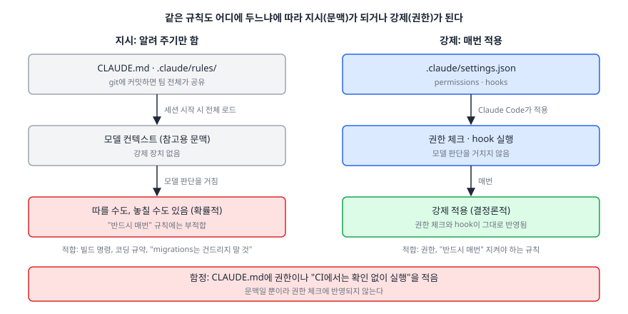
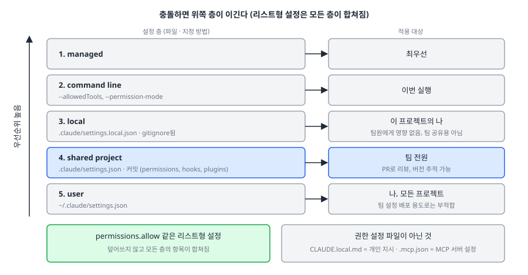
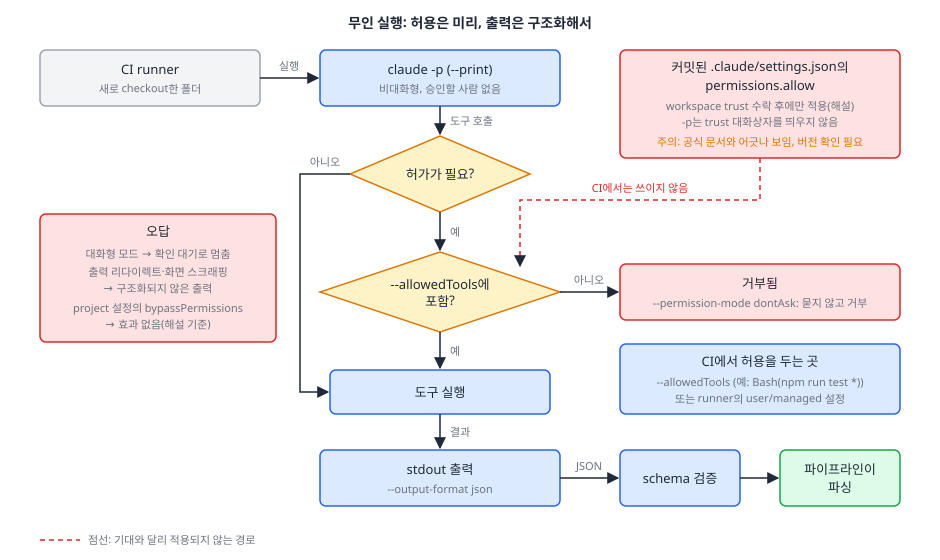
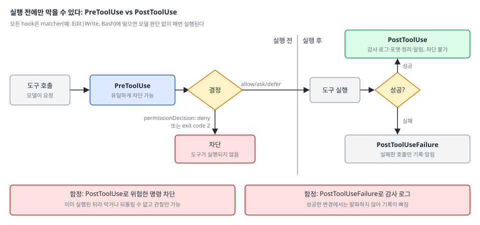
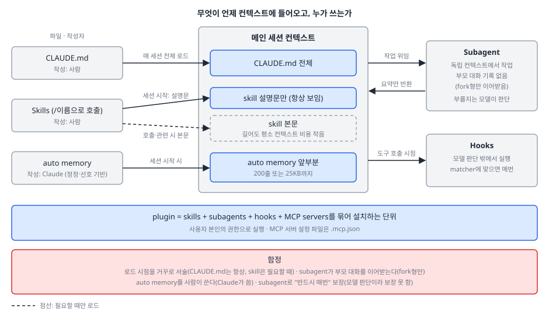
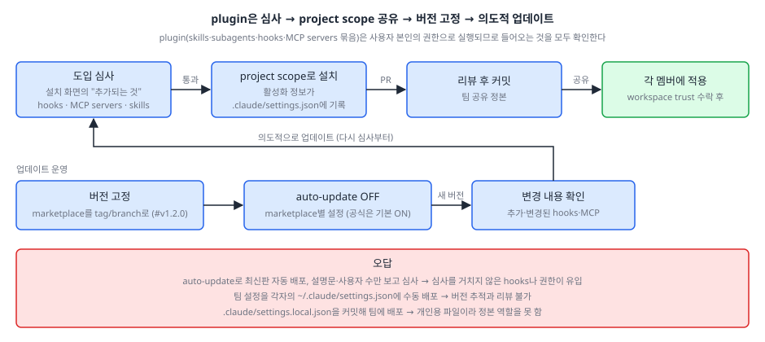
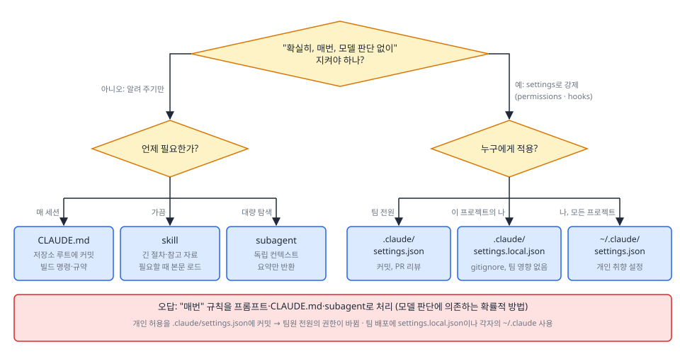
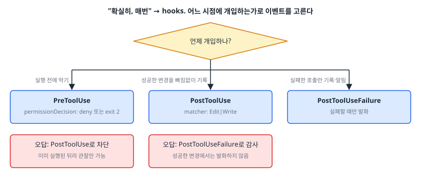

# 3. Claude Code — 반드시 알아야 할 지식
> 시험 비중 3% · 약 1문항 · 근거 문항 10개

## 1. 핵심 개념

### `CLAUDE.md`는 지시, `settings.json`은 강제
**매번 지킬 규칙은 settings로 강제**

| 구분               | 내용                                                          |
| ---------------- | ----------------------------------------------------------- |
| 정의               | `CLAUDE.md` = 프로젝트 컨텍스트 파일                                  |
| 로드               | 세션 시작 시 전체 자동 로드                                            |
| 내용               | 매번 필요한 정보 예: 빌드 명령 · 코딩 규약 예: "migrations 디렉터리 수정 금지" |
| 공유               | git 커밋 → 팀 전체 공유                                            |
| 강제력              | `CLAUDE.md` · `.claude/rules/` = 참고 문맥 강제 ✗              |
| 권한 · "반드시 매번" 규칙 | settings의 permissions 또는 hooks                              |

| 판단 축 | 내용 |
|---|---|
| 적용 대상 | 팀 · 개인 전체 · 이 프로젝트 개인 |
| 강제 여부 | 강제 = settings · 알려 주기만 = `CLAUDE.md` |

*그림: 같은 규칙도 CLAUDE.md에 두면 확률적 지시, settings.json에 두면 결정론적 강제가 된다.*

근거: Patrick-0028, Udemy-0017, Udemy-0029, Udemy-0032, Udemy-0052

### 설정 파일의 범위
**팀 = 공유 settings · 개인 = local · user**

| 파일 | 역할 |
|---|---|
| `.claude/settings.json` | 프로젝트 공유 설정 커밋 → 팀 전원 동일 배포 (permissions · hooks · plugins) |
| `.claude/settings.local.json` | 이 프로젝트 전용 개인 덮어쓰기 gitignore(Claude Code가 생성 시 git 제외) → 팀원 영향 없음 · 팀 공유용 ✗ |
| `~/.claude/settings.json` | 사용자 설정 → 한 사람 · 모든 프로젝트 |
| `CLAUDE.local.md` | 개인용 지시 권한 설정 파일 ✗ |
| `.mcp.json` | MCP 서버 설정 권한 설정 파일 ✗ |

| 구분 | 내용 |
|---|---|
| 우선순위(높은 순) | managed > command line > local > shared project > user |
| 리스트형 설정 | `permissions.allow` 등 덮어쓰기 ✗ → 병합 |

*그림: 충돌하면 위쪽 층(managed > command line > local > project > user)이 이기고, permissions.allow 같은 리스트는 합쳐진다.*

근거: Patrick-0044, Preporato-0029, Udemy-0029, Udemy-0031

### Headless / CI 실행
**CI = `-p` + `--allowedTools` + JSON**

| 구분 | 내용 |
|---|---|
| `claude -p` · `--print` | 비대화형 실행 → 결과 stdout |
| 기계 판독 출력 | `--output-format json` + schema 검증 |
| `-p`의 권한 | 승인자 없음 → 허가 필요 작업 거부 |
| 필요 도구 | `--allowedTools`로 사전 허용 |
| `--permission-mode dontAsk` | 허용 목록 밖 작업 → 묻지 않고 거부 |

| trust · `permissions.allow` | 내용 |
|---|---|
| 커밋된 `permissions.allow` | `.claude/settings.json` 허용 = workspace trust 수락 후에만 적용 |
| `-p`의 trust 처리 | trust 대화상자 표시 ✗ → CI 신규 checkout 폴더에서 허용 규칙 미적용 |
| CI 허용 위치 | `--allowedTools` 또는 runner의 user · managed 설정 |
| ⚠️ 공식 보안 문서 | "`-p` 비대화형 실행에서 trust verification 비활성화"만 기재 → 해설과 어긋나 보임 · 버전별 차이 가능 · 확인 필요 |

| defaultMode 제한 | 내용 |
|---|---|
| `permissions.defaultMode` | `auto` · `bypassPermissions` → project · local 설정에서 효과 ✗ |
| 지정 위치 | user · managed 설정 또는 `--permission-mode`만 |
| `bypassPermissions` | 격리 환경 한정 |
| ⚠️ project · local 제한 | 공식 문서 명시 확인 ✗ → 검증 필요 |

*그림: 무인 실행에서는 허용을 --allowedTools로 미리 주고, 출력은 --output-format json + schema로 받는다.*

근거: Amey-0049, Udemy-0017

### Hooks: 결정론적 실행
**차단은 실행 전 `PreToolUse`만 가능**

| 구분 | 내용 |
|---|---|
| hook 정의 | lifecycle 고정 시점에 실행되는 사용자 정의 처리 (shell command · HTTP 호출 등) |
| 실행 조건 | 모델 판단 ✗ `matcher` 일치 → 매번 실행 (예: `Edit\|Write` · `Bash`) |

| hook | 발화 시점 | 용도 · 제약 |
|---|---|---|
| `PreToolUse` | 도구 실행 전 | 유일하게 실행 차단 가능 차단 = exit code 2 또는 `deny` + 이유 (`hookSpecificOutput.permissionDecision`) 기타 반환값 = `allow` · `ask` · `defer` |
| `PostToolUse` | 도구 호출 성공 직후 | 감사 로그 · 포맷 정리 · 알림 이미 실행됨 → 차단 · 되돌리기 ✗ |
| `PostToolUseFailure` | 도구 호출 실패 시만 | 성공한 변경 기록 ✗ |

*그림: 차단은 실행 전 PreToolUse에서만 가능하고, 실행 후 hook은 성공/실패에 따라 나뉘어 관찰만 한다.*

근거: Udemy-0021, Udemy-0052

### 구성 요소 구분 (로드 시점 · 작성자)
**`CLAUDE.md` 항상 · skill 필요 시**

| 구성 요소 | 작성자 | 로드 | 비고 |
|---|---|---|---|
| `CLAUDE.md` | 사람 | 매 세션 전체 | 규약 |
| Skills | 사람 | 설명문만 상시 노출 호출 · 관련 시 본문 로드 → 길어도 컨텍스트 비용 작음 | 절차 · 참고 자료 custom slash command 통합 → `/이름`으로 호출 |
| Subagent | — | 부모 대화 기록 없이 독립 컨텍스트 → 요약만 반환 | 대화 이어받기 = fork형만 호출 = 모델 판단 → "반드시 매번" 보장 ✗ |
| auto memory(Agent Memory) | Claude | 세션 시작 시 앞부분 (200줄 또는 25KB까지) | 사용자 정정 · 선호 기반 메모 |

*그림: CLAUDE.md는 매 세션 전체, skill은 설명문만 있다가 필요할 때 본문, subagent는 독립 컨텍스트에서 요약만 돌려준다.*

근거: Udemy-0021, Udemy-0032, Udemy-0052

### Plugins의 팀 운영
**project scope 공유 + 버전 고정 + 내용 심사**

| 구분 | 내용 |
|---|---|
| plugin 정의 | skills · subagents · hooks · MCP servers 묶음 설치 단위 |
| 실행 권한 | 사용자 본인 권한 |
| 팀 배포 | project scope 설치 → PR 리뷰 가능 |
| 기록 위치 | 활성화 정보 → 커밋되는 `.claude/settings.json` |
| 적용 시점 | 공유 설정 일부 = 멤버별 workspace trust 수락 후 적용 |

| 구분 | 내용 |
|---|---|
| 버전 고정 | marketplace tag · branch로 고정 (예: `#v1.2.0`) |
| auto-update | marketplace별 ON/OFF 공식 marketplace 기본값 = ON |
| 팀 업데이트 방식 | 버전 고정 → 변경 확인 → 의도적 업데이트 |
| 도입 심사 | 설명문 · 사용자 수만 확인 ✗ → 설치 화면 "추가되는 것" 내용까지 확인 (hooks · MCP servers · skills) |

*그림: 팀 plugin은 심사 → project scope 설치 → PR 커밋 → trust 수락 후 적용, 업데이트는 고정된 버전에서 다시 심사를 거친다.*

근거: Udemy-0031

## 2. 상황별 정답 판단 규칙

| 상황 | 정답 |
|---|---|
| CI · 스크립트 무인 실행 + 출력 파싱 | `claude -p` + `--output-format json` (+ schema) |
| CI에서 확인 프롬프트 없이 필요 도구만 실행 | `--allowedTools` 사전 허용 필요 시 `--permission-mode dontAsk` |
| 매 세션 같은 빌드 명령 · 규약 재설명 | 저장소 루트 `CLAUDE.md` + 커밋 |
| 팀 공통 권한 · hooks · plugins 배포 | `.claude/settings.json` 커밋 |
| 팀 영향 없이 내 머신만 허용 추가 | `.claude/settings.local.json` |
| 모든 프로젝트 공통 개인 취향 | `~/.claude/settings.json` |
| "확실히, 매번, 모델 판단 없이" | hooks (프롬프트 · `CLAUDE.md` · subagent ✗) |
| "실행 전에" 차단 | `PreToolUse` + `deny` 또는 exit 2 |
| 성공한 변경 전부 기록 | `PostToolUse`(matcher `Edit\|Write`) |
| 실패한 호출만 기록 · 알림 | `PostToolUseFailure` |
| 가끔 필요한 긴 절차 · 참고 자료 | skill (`CLAUDE.md`는 매번 필요한 것만) |
| 대량 탐색으로 부모 컨텍스트 오염 방지 | subagent (독립 컨텍스트 → 요약 반환) |
| 팀 plugin 운영 | project scope 공유 + 버전 고정 + 의도적 업데이트 |

*그림: "매번, 모델 판단 없이"면 settings로 강제하고 적용 대상으로 파일을 고르며, 아니면 필요 빈도로 CLAUDE.md·skill·subagent를 고른다.*

*그림: 실행 전 차단은 PreToolUse, 성공 기록은 PostToolUse, 실패만 기록은 PostToolUseFailure.*

근거: Amey-0049, Patrick-0028, Patrick-0044, Preporato-0029, Udemy-0017, Udemy-0021, Udemy-0029, Udemy-0031, Udemy-0032, Udemy-0052

## 3. 자주 나오는 오답 함정

| 오답 | 이유 |
|---|---|
| `CLAUDE.md`에 권한 · "CI에서는 확인 없이 실행" 기재 | 문맥 → 권한 체크 반영 ✗ |
| 시스템 프롬프트로 금지 · 심사용 subagent | 모델 판단 의존 = 확률적 → 결정론적 ✗ |
| `PostToolUse`로 위험 명령 차단 | 이미 실행됨 → 차단 ✗ 관찰만 가능 |
| `PostToolUseFailure`로 감사 로그 | 성공한 변경에서 발화 ✗ |
| 개인 허용을 `.claude/settings.json`에 커밋 | 팀원 전원 권한 변경 |
| `.claude/settings.local.json` 커밋 → 팀 배포 | 개인용 파일 → 충돌 발생 · 정본 역할 ✗ |
| 팀 설정을 각자 `~/.claude/settings.json`에 수동 배포 | 버전 추적 · 리뷰 불가 |
| CI에서 대화형 모드 · 출력 파일 리다이렉트 · 화면 스크래핑 | 확인 대기로 정지 또는 비구조화 출력 |
| 프로젝트 설정 `bypassPermissions`로 확인 일괄 생략 | (해설 기준) project 설정에서 효과 ✗ 전부 무확인 = 과도 |
| `CLAUDE.md`와 skill 로드 시점 반대로 서술 | `CLAUDE.md` = 항상 로드 skill = 필요 시 로드 |
| subagent가 부모 대화 이어받는다고 서술 | fork형만 해당 |
| auto memory = 사람이 쓰는 파일 | Claude가 작성 |
| plugin auto-update로 최신판 자동 배포 | 미심사 hooks · 권한 유입 |
| plugin 설명문만 보고 심사 | 미심사 hooks · 권한 유입 |

근거: Amey-0049, Patrick-0044, Preporato-0029, Udemy-0017, Udemy-0021, Udemy-0029, Udemy-0031, Udemy-0032, Udemy-0052

## 4. 암기 목록

| 이름 | 의미 |
|---|---|
| `CLAUDE.md` (루트 또는 `.claude/CLAUDE.md`) | 팀 공유 지시 매 세션 로드 강제력 ✗ |
| `CLAUDE.local.md` | 개인 지시 |
| `.claude/settings.json` | 프로젝트 공유 설정 (permissions · hooks · plugins) 커밋 대상 |
| `.claude/settings.local.json` | 프로젝트 개인 덮어쓰기 gitignore |
| `~/.claude/settings.json` | 사용자 설정 모든 프로젝트 적용 |
| `.mcp.json` | MCP 서버 설정 |
| 우선순위 | managed > command line > local > shared project > user 리스트 = 병합 |
| `claude -p` · `--print` | 비대화형 실행 → stdout 출력 |
| `--output-format json` | 구조화된 출력 |
| `--allowedTools` | 도구 사전 허용 (예: `Bash(npm run test *)`) |
| `--permission-mode dontAsk` | 허용 밖 작업 → 묻지 않고 거부 |
| `bypassPermissions` | 모든 확인 생략 격리 환경 한정 |
| `PreToolUse` | 실행 전 발화 차단 가능 (`permissionDecision: deny` 또는 exit 2) |
| `PostToolUse` | 성공 후 발화 기록 · 알림 차단 ✗ |
| `PostToolUseFailure` | 실패 후에만 발화 |
| `matcher` | hook 대상 도구 지정 (`Edit\|Write` · `Bash`) |
| marketplace `#v1.2.0` | plugin 버전(tag) 고정 |

## 5. 시험 직전 체크리스트

- [ ] "확실히, 매번" → hooks
- [ ] "실행 전" → `PreToolUse`
- [ ] `PostToolUse` → 차단 ✗
- [ ] `PostToolUseFailure` → 실패 시만 발화
- [ ] `CLAUDE.md` = 지시(문맥)
- [ ] `settings.json` = 강제(권한)
- [ ] 팀 공유 → `.claude/settings.json`
- [ ] 이 프로젝트 개인 → `.claude/settings.local.json`
- [ ] 개인 · 전체 프로젝트 → `~/.claude/settings.json`
- [ ] CI 실행 → `-p` + `--allowedTools`
- [ ] CI 출력 → `--output-format json`
- [ ] `CLAUDE.md` = 항상 로드
- [ ] skill = 필요 시 본문 로드
- [ ] subagent = 독립 컨텍스트 → 요약만 반환
- [ ] 대화 이어받기 = fork형 subagent만
- [ ] auto memory = Claude가 직접 작성
- [ ] plugin → project scope 공유
- [ ] plugin 버전 고정
- [ ] plugin 심사 = 추가 hooks · MCP까지
