# 4. Eval, Testing, and Debugging — 반드시 알아야 할 지식
> 시험 비중 3% · 약 1문항 · 근거 문항 16개

## 1. 핵심 개념

### 1-1. Eval set: 변경은 측정한 뒤 ship
**held-out eval set · 기준 비교 후 ship**

| 구분 | 내용 |
|---|---|
| held-out eval set ✓ | 실제 분포 대표 · 미리 정한 기준 (defined criteria, success criteria) → 비교 후 ship |
| 직접 고른 example 3~5개 | 좋아 보여도 개선 vs noise 구분 불가 ✗ |
| 소수 example 확인 | 경향 파악의 첫걸음일 뿐 드문 입력 깨짐 · 출력 형식 변화 놓치기 쉬움 결과 재현 불가 ✗ |
| self-assessment | 모델에게 "어느 prompt가 나은가" 질문 측정 ✗ |
| flag · 일부 traffic 선배포 | 사용자를 test set으로 쓰는 셈 ✗ |

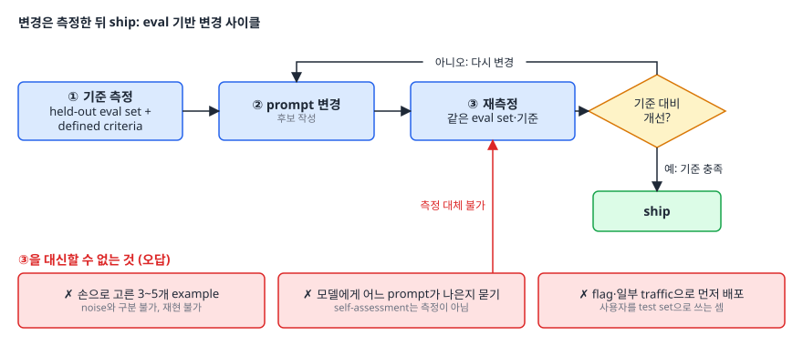
*그림: 같은 held-out eval set과 기준으로 재측정해 개선이 확인될 때만 ship하며, 손 example·self-assessment·일부 traffic 배포는 측정을 대신하지 못한다.*

근거: Amey-0035, Amey-0065, Patrick-0030, Udemy-0027

### 1-2. Grader 선택: free-form prose에는 LLM-as-judge
**주관적 prose 품질 = rubric을 준 LLM-as-judge**

| 구분 | 내용 |
|---|---|
| exact string match | free-form prose는 같은 정답도 표현 다름 → 채점 불가 ✗ |
| LLM-as-judge ✓ | 주관적 품질(예: faithfulness to source)에 사용 |
| rubric ✓ | rubric 제공 (예: 출처에 충실한가, 지어낸 주장 없는가) |
| 점수만 요청(rubric 없이) | ✗ |
| judge validation ✓ | human label 표본과 대조 |
| valid JSON 검사 | 형식 검사일 뿐 품질 eval ✗ |

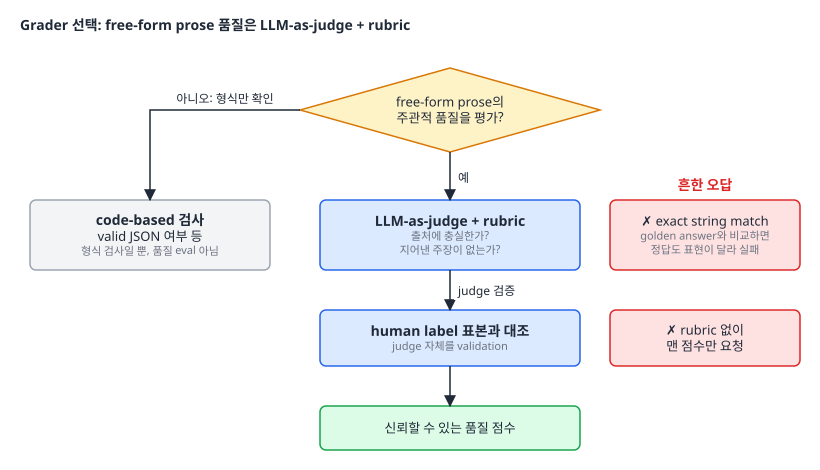
*그림: 주관적 prose 품질은 rubric을 준 LLM-as-judge로 채점하고 judge는 human label로 검증하며, 형식 검사와 exact match는 품질 eval이 아니다.*

근거: Patrick-0014, Patrick-0030

### 1-3. Regression suite
**깨지면 안 되는 것을 변경 때마다 계속 테스트**

| 구분 | 내용 |
|---|---|
| regression | 조용히 발생 예: 목표 동작은 개선, 다른 동작이 깨짐 |
| 일회성 eval과 차이 | 깨지면 안 되는 것을 계속 테스트해 포착 (이 점이 일회성 eval과 다름) |
| latency · rate limit · cost | 운영 신호일 뿐 correctness 신호 ✗ |
| eval set 운용 | versioning → regression suite로 겸용 |
| 실행 시점 | 모든 prompt 변경 · model upgrade 시 |
| production 실패 사례 | 새 case로 추가 |

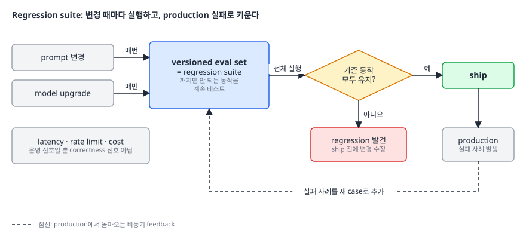
*그림: versioned eval set을 변경 때마다 돌려 조용한 회귀를 ship 전에 잡고, production 실패 사례를 새 case로 되먹인다.*

근거: Amey-0080, Patrick-0014, Patrick-0030

### 1-4. Model 업그레이드와 운영
**upgrade · 운영 모두 eval 확인 후 계획적 변경**

| 구분 | 내용 |
|---|---|
| production | model ID 고정(pin) |
| 새 모델 | regression eval로 성능 저하 없음 확인 → 원하는 시점에 이동 |
| ⚠️ Opus 5.5 (해설) | temperature 등 sampling 설정 변경 불가 thinking 비활성화 불가 공식 문서로 확인되지 않음 |
| ⚠️ parameter 호환 (해설) | 위 Opus 5.5처럼 모델 변경 시 이전 parameter가 error 가능 공식 문서로 확인되지 않음 |
| 동작 변화 | API 호환 유지돼도 변화 가능 (같은 prompt의 길이 · 형식 · 판단 경향) |
| 이전 모델용 지시 · 설정 | 그대로 이전 ✗ → 재eval |
| 근거 안 됨 | "새 모델이니 더 낫다" 가정 ✗ vendor benchmark ✗ |
| retirement | 모델 목록에 모델별 폐기 예정일 존재 → migration을 일정에 넣어 계획적 진행 |

| 구분 | 내용 |
|---|---|
| 단계 | release 이후 운영 · 보존 |
| monitoring | uptime만 감시 ✗ 응답 품질 · 이용 현황 monitoring |
| 변경 대응 | 모델 교체 · 외부 근거(제도 · 문서) 변경 영향 → eval set으로 확인 후 계획적 수정 |
| 재학습 | Claude API 모델은 운영 중 대화 · 피드백 버튼으로 재학습 ✗ |
| 피드백 용도 | 운영 측이 prompt · 참조 데이터 · eval set 수정에 사용 |

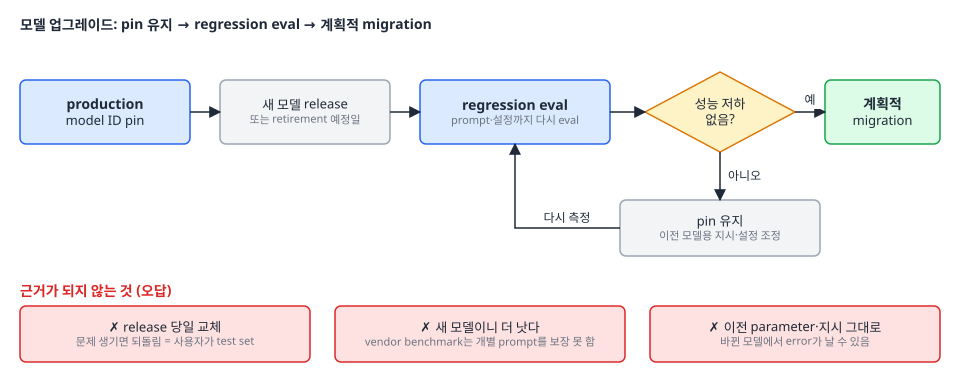
*그림: 새 모델은 pin을 유지한 채 regression eval을 통과한 뒤에만 계획한 시점에 migration한다.*

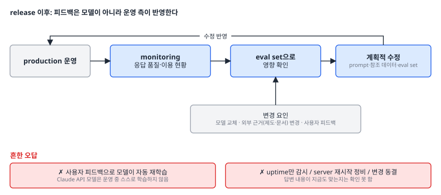
*그림: 운영 중 피드백과 외부 변경은 모델이 스스로 배우지 않으므로 운영 측이 eval로 영향을 확인해 prompt·참조 데이터·eval set을 고친다.*

근거: Patrick-0030, Udemy-0027, Udemy-0037

### 1-5. Prompt를 SDLC에 통합
**prompt = code처럼 repository · PR · eval로 관리**

| 구분 | 내용 |
|---|---|
| 이유 | prompt = 출력을 좌우하는 산출물 |
| 관리 ✓ | repository에서 version control |
| merge 조건 ✓ | PR에서 review · eval 결과 확인 후 |
| 효과 | diff 확인 · revert · eval 결과 대응 가능 |
| 관리 화면 직접 수정 · DB 저장 | production prompt 이력 · review 남지 않음 ✗ |
| production A/B test | 사전 eval 통과 후보 중 고르는 마지막 단계일 뿐 |

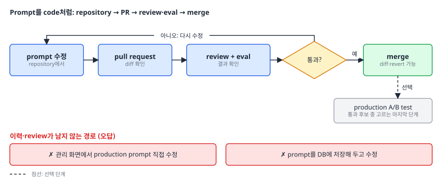
*그림: prompt는 PR에서 review와 eval을 통과해야 merge되며, A/B test는 통과 후보 중 고르는 마지막 선택 단계다.*

근거: Udemy-0018

### 1-6. 안전한 refactoring
**동작을 test로 고정 → 작은 단계로 변경 · 검증**

1. 현재 동작을 고정하는 테스트(characterization test) 작성
2. 작고 검증 가능한 단위로 변경
3. 매번 test · review 통과
4. 문제 발생 → 직전 단계로 되돌림

| 구분 | 내용 |
|---|---|
| 원칙 ✓ | refactoring = 외부 동작 유지 |
| 기능 추가 · bug fix 혼합 | 동작 변경 작업을 같은 변경에 섞음 → 원인 분리 불가 ✗ |
| big-bang rewrite · 수동 화면 확인만 | 안전성 보장 ✗ |

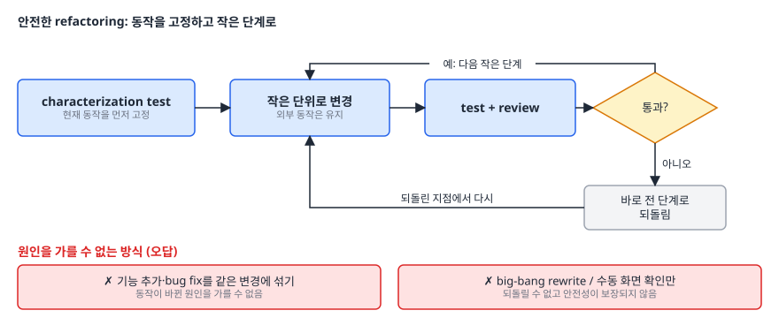
*그림: 동작을 test로 고정한 뒤 작은 단계마다 검증하고, 실패하면 직전 단계로 되돌려야 원인을 가를 수 있다.*

근거: Udemy-0003

### 1-7. Debugging: 결함 위치부터 찾기(localize)
**고치기 전 실패 지점부터 특정**

| 상황 | 판단 |
|---|---|
| trace: 받은 입력엔 올바른 추론, 입력 문서가 틀림 | 결함 = retrieval/integration layer (search · indexing) |
| 위 상황에서 모델 upgrade · prompt 문구 강화 | 잘못된 입력은 못 고침 ✗ |

- API 경계 → 실패를 4xx vs 200 이후로 분류

| 신호 | 판단 |
|---|---|
| 4xx (예: 400 `invalid_request_error`) | API가 요청을 받지 않음 → 자사 request 조립 코드 확인 |
| 200 이후 parse/validation 실패 | `stop_reason` · 원본 응답 본문 확인 → 모델 출력 vs 자사 parser 구분 |
| `stop_reason` = `max_tokens` | 응답 중간 잘림 → 200 이후 parse 실패의 한 원인 가능 400과 무관 |
| `request-id` header | 모든 응답에 부착 기록 → trace와 API 측 기록 대조 가능 |

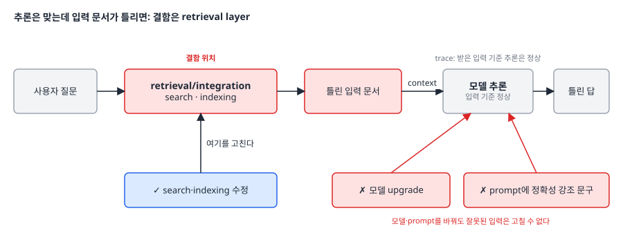
*그림: trace에서 추론은 맞고 입력 문서가 틀렸다면 retrieval layer를 고쳐야 하며, 모델이나 prompt를 바꿔서는 해결되지 않는다.*

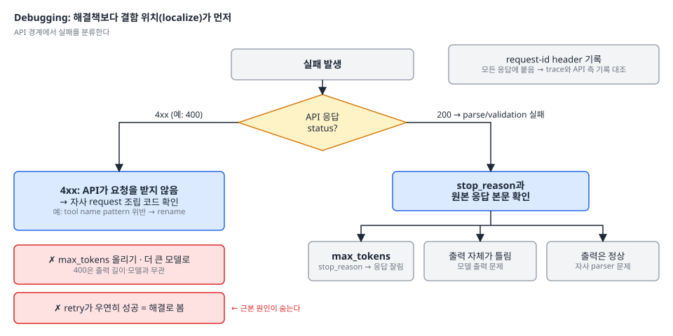
*그림: 4xx는 자사 request 조립 코드, 200 이후 parse 실패는 stop_reason과 원본 본문으로 잘림·모델 출력·자사 parser를 가른다.*

근거: Amey-0010, Amey-0050, Udemy-0023

### 1-8. API error와 retry policy
**429·5xx·connection error만 retry · 400·401·403·404는 요청·tool name 수정**

| error | 조치 |
|---|---|
| 429 `rate_limit_error` 500 `api_error` · 529 `overloaded_error` connection error | 일시적 error → exponential backoff + jitter server가 준 `retry-after` 준수 후 retry |
| 400 · 401 · 403 · 404 등 client error | 요청 자체 오류 → 매번 같은 이유로 실패 → 요청 수정 잘못된 retry policy의 증상: 느린 응답 · 비용 증가 |
| ⚠️ 408 · 409 | 해설: "429 외 4xx 모두 retry 불가"로 일반화 공식 SDK는 408 · 409도 기본 retry 시험: 400 · 401 · 403 · 404 = retry 불가로 암기 |
| 공식 SDK | 429 자동 retry status code별 typed exception (예: `RateLimitError`) |
| SDK로 구분 | retry 가능: 429 · 5xx · connection error retry 불가: 400 · 404 |

| 오답 | 이유 |
|---|---|
| 즉시 retry(tight loop) | 과부하 증가 |
| 첫 일시적 error에서 job 전체 실패 | 불필요하게 fragile |
| 여러 API key 순환으로 rate limit 회피 | ✗ |

| 구분 | 내용 |
|---|---|
| tool 이름 pattern | `^[a-zA-Z0-9_-]{1,128}$`만 허용 |
| 공백 포함 이름(예: `get order status`) | 400 → 이름 변경(`get_order_status`) |
| ⚠️ 길이 상한 | 공식 tool use 가이드 일부엔 `{1,64}` 허용 문자(영문 · 숫자 · `_` · `-`) 동일 길이 상한 → 문서로 재확인 |

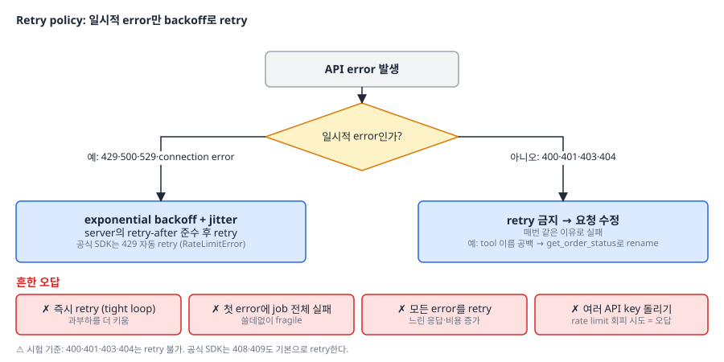
*그림: 429·500·529와 connection error만 backoff·jitter·retry-after로 retry하고, 400·401·403·404는 요청을 고친다.*

근거: Patrick-0006, Patrick-0027, Patrick-0032, Preporato-0030

## 2. 상황별 정답 판단 규칙

| 상황 | 정답 |
|---|---|
| prompt 변경이 몇 개 example에서 좋아 보임 | 대표성 있는 held-out eval set + defined criteria로 비교 → ship |
| free-form prose의 품질 · faithfulness 평가 | rubric 기반 LLM-as-judge human label로 judge validation |
| prompt · model 변경마다 생기는 회귀 포착 | versioned regression suite를 변경 때마다 실행 production 실패를 case로 추가 |
| 새 모델 release | model ID pin 유지 → regression eval 통과 → 계획적 migration |
| 모델 추론은 맞는데 받은 문서가 틀림 | retrieval/integration layer (search · indexing) 수정 |
| 400과 200 이후 parse 실패 혼재 | API 경계에서 분류: 4xx → request 조립 코드 200 이후 → `stop_reason` · 원본 본문 확인 → 모델 vs parser 구분 |
| 429 · 500 · 529 발생 | backoff + jitter + `retry-after`로 retry |
| 400 · 401 · 403 · 404 발생 | retry ✗ → 요청 수정 |
| tool 추가 후 모든 요청이 400 | tool name pattern 위반 확인 → rename |
| prompt를 자주 고치는 팀 | repository 관리 + PR에서 review · eval 후 merge |
| 대규모 legacy code refactoring | characterization test → 작은 단계별 변경 · 검증 |
| release 이후 운영 단계 | 품질 · 이용 현황 monitoring 모델 · 외부 변경 영향 eval → 계획적 수정 |

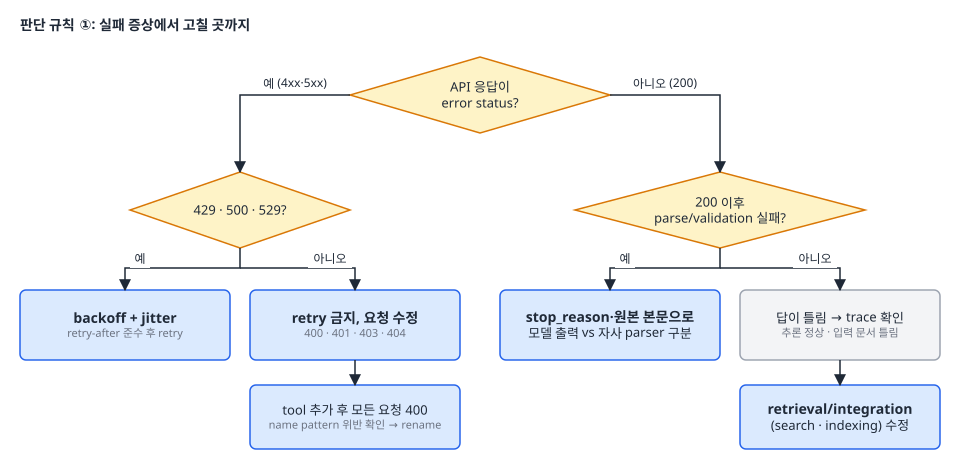
*그림: API status와 parse 결과, trace를 차례로 보면 고칠 곳이 retry 정책, request, parser, retrieval 중 어디인지 정해진다.*

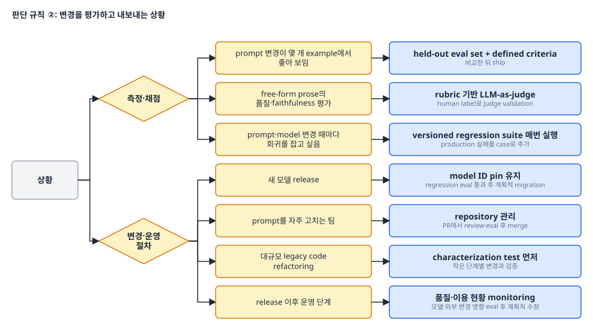
*그림: 변경을 평가하거나 내보내는 상황은 모두 eval·review로 측정한 뒤 계획적으로 진행하는 방향이 정답이다.*

근거: Amey-0010, Amey-0035, Amey-0050, Amey-0065, Amey-0080, Patrick-0006, Patrick-0014, Patrick-0027, Patrick-0030, Patrick-0032, Preporato-0030, Udemy-0003, Udemy-0018, Udemy-0023, Udemy-0027, Udemy-0037

## 3. 자주 나오는 오답 함정

| 오답 | 이유 |
|---|---|
| 더 큰 모델로 교체 | 잘못된 입력 · 잘못된 request(400)는 모델 교체로 해결 ✗ 실패 빈도만 지켜봐서는 원인 layer 파악 ✗ |
| prompt에 정확성 강조 문구 추가 | 입력 오류엔 효과 ✗ |
| 모델에게 어느 prompt가 나은지 질문 | self-assessment = 측정 ✗ |
| flag · 일부 traffic으로 먼저 내보내고 관찰 release 당일 교체, 문제 시 되돌림 | 사용자를 test set으로 사용 ✗ |
| golden answer와 exact string match | prose는 정답도 표현 다름 → match ✗ |
| 새 모델이 더 나음 / vendor benchmark가 증명 | 개별 prompt에서의 동작 보장 ✗ |
| 모든 error를 retry | 400은 retry 효과 ✗ (매번 실패) |
| 즉시 retry | 과부하 증가 |
| retry가 우연히 성공하면 해결 | 근본 원인 은폐 |
| `max_tokens` 올려 400 해결 | 출력 길이는 request 형식 오류와 무관 → 해결 ✗ |
| 사용자 피드백으로 모델 자동 재학습 | Claude API 모델은 운영 중 학습 ✗ |
| uptime · server 재시작 절차만 정비 변경 동결 | 답변 내용이 지금도 맞는지 확인 ✗ |
| refactoring에 기능 추가 동시 진행 big-bang rewrite | 원인 분리 ✗ · 되돌리기 ✗ |

근거: Amey-0010, Amey-0035, Amey-0050, Amey-0065, Patrick-0006, Patrick-0014, Patrick-0030, Patrick-0032, Udemy-0003, Udemy-0023, Udemy-0027, Udemy-0037

## 4. 암기 목록

| 이름 | 의미 |
|---|---|
| 400 `invalid_request_error` | request 형식 · 내용 오류 retry ✗ → 요청 수정 |
| 401 `authentication_error` | 인증 오류 retry ✗ |
| 403 · 404 | client error retry ✗ |
| 429 `rate_limit_error` | rate limit → backoff 후 retry `retry-after` 준수 SDK 자동 retry · `RateLimitError` |
| 500 `api_error` | server error → backoff 후 retry |
| 529 `overloaded_error` | 과부하 → backoff 후 retry |
| `request-id` header | 모든 응답에 부착 trace와 API 측 기록 대조용 |
| `stop_reason: max_tokens` | 응답 잘림 200 이후 parse 실패의 원인 후보 |
| ⚠️ `^[a-zA-Z0-9_-]{1,128}$` | tool name pattern 길이 상한 64로 적힌 문서도 있음 |

근거: Patrick-0006, Patrick-0027, Patrick-0032, Preporato-0030, Udemy-0023

## 5. 시험 직전 체크리스트

- [ ] 몇 개 example로 판단 ✗
- [ ] held-out eval set + defined criteria로 비교
- [ ] prose 품질 → rubric 준 LLM-as-judge
- [ ] judge → human label로 validation
- [ ] regression suite → prompt · model 변경 시마다 실행
- [ ] production 실패 → regression case로 추가
- [ ] model ID pin → regression eval 통과 후에만 → migration
- [ ] trace "추론 맞음 · 입력 틀림" → retrieval layer 수정
- [ ] 4xx = request 조립 문제
- [ ] 200 이후 실패 = `stop_reason` · 원본 출력 문제
- [ ] 429 · 500 · 529 → backoff 후 retry
- [ ] 400 · 401 · 403 · 404 → 요청 수정
- [ ] prompt → repository · PR · eval 거쳐 merge
- [ ] refactoring → characterization test → 작은 단계
