# 5. Model Selection and Optimization — 반드시 알아야 할 지식
> 시험 비중 17% · 약 5문항 · 근거 문항 28개

## 1. 핵심 개념

### 1-1. 모델 선택 원칙
**요구 품질 충족하는 가장 효율적 모델 = eval로 선택**

| 구분 | 내용 |
|---|---|
| 목표 | 요구 품질 충족하는 가장 효율적 모델 정확도 무한정 추구 ✗ |
| 과잉 품질 | 요구 수준 넘는 품질의 비용 = 낭비 |
| 판단 근거 | 실제 task 대표 sample · 그 task quality bar → 측정 결과(eval) |
| 하향 시점 | 작은 모델의 quality bar 충족 측정 결과 |
| 품질 동일 | 싼 모델 배포 |
| 입력 변화 | 그 시점에 재평가 |
| 재평가 주기 | eval set으로 주기적 재평가 일회성 결정 ✗ |
| 재평가 이유 | 후속 모델 → 같은 가격에 품질 · 속도 개선 사례 다수 모델 ID마다 retirement 일정 존재 |

| 오답 | 이유 |
|---|---|
| published benchmark · 더 최신 모델 · 더 큰 모델 | 판단 근거 ✗ |
| 예산 초과 · 호출량 증가 · latency 불만 → 하향 | 검토 시작 이유일 뿐 하향 근거 ✗ |
| 큰 모델을 "보험"으로 사용 | 품질 동일 → 싼 모델 배포 입력 변화는 그때 재평가로 대응 |
| SDK · quickstart 기본 모델 확인 없이 사용 | 라인업 변경 → 현재 model ID는 문서 확인 |

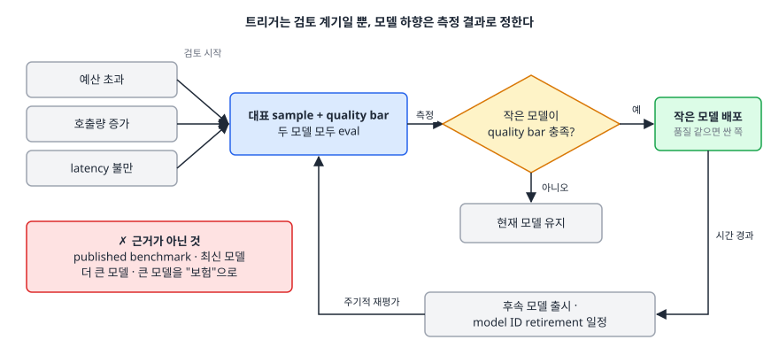
*그림: 예산 초과나 latency 불만은 검토 계기일 뿐이며, 작은 모델이 quality bar를 충족한다는 측정 결과가 있어야 내린다.*

근거: Amey-0019, Amey-0022, Amey-0057, Amey-0072, Patrick-0019, Preporato-0012, Udemy-0002, Udemy-0035

### 1-2. 계층(Opus · Sonnet · Haiku)별 적합 작업
**대량 단순 = Haiku · 균형 = Sonnet · 고난도 = Opus**

| tier | 특징 | 적합 작업 |
|---|---|---|
| Haiku (fast tier) | 가장 빠름 · 가장 저렴 | 대량 단순 작업 · latency 중요 작업 classification · extraction · routing 언어 판별 · 형식 변환 · autocomplete |
| Sonnet (balanced tier) | 속도 · 지능 균형 최고 | 어느 정도 능력 필요한 작업 escalated drafting 등에서 Opus 대체 선택지 |
| Opus (most capable) | 가장 capable → 오른쪽 작업에서 능력 차이 드러남 | 여러 시스템 맞물린 multi-step 계획 상호작용 제약 따지며 계획 수정 · 장시간 agent 작업 품질이 사업 가치 좌우하는 분석 |

| 오답 | 이유 |
|---|---|
| 추론 많은 작업을 작은 모델 여러 개로 분할 | 추론 단절 |
| prompt 길게 쓰기 · 다듬기 | 모델 능력 차이 메우기 ✗ |

| 구분 | 내용 |
|---|---|
| ⚠️ 해설 라인업 | Fable 5.2 = Opus 위 계층으로 소개 |
| ⚠️ 시점 변동 | 라인업은 시점마다 상이 |
| ⚠️ 시험 판단 | Opus · Sonnet · Haiku 3계층별 적합 작업 기준 |

근거: Amey-0020, Amey-0058, Patrick-0011, Preporato-0015, Udemy-0035

### 1-3. Routing: 요청별 맞는 모델로 전송
**쉬운 대량 → 작은 모델 · 계획 → capable 모델**

| 구분 | 내용 |
|---|---|
| 정의 | Model routing = 각 요청을 처리 가능한 가장 싼 모델로 전송 |
| 단일 모델 문제 | 쉬운 요청 → 비용 과다 어려운 요청 → 품질 부족 |
| 패턴 1: 난이도 분리 | 대량 쉬운 작업(분류 · 추출) → Haiku 소량 어려운 작업 → Sonnet · Opus (escalated reply · deep analysis) |
| 패턴 2: orchestrator–worker | 계획 수립 orchestrator → capable model 좁고 반복적인 worker subtask → 작고 빠른 모델 |

| 오답 | 이유 |
|---|---|
| 가장 어려운 단계(계획 수립)에 가장 약한 모델 배치 | 틀린 구성 ✗ 계획 수립 = capable model 담당 |

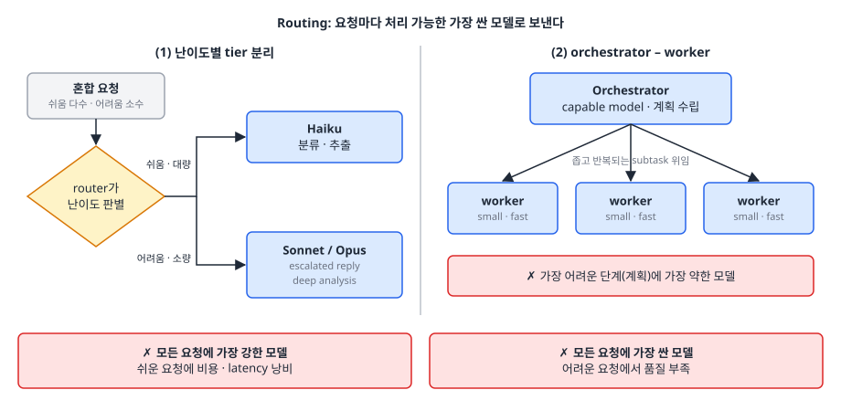
*그림: 쉬운 대량 요청은 작은 모델로, 어려운 요청과 계획 단계는 capable 모델로 보내야 한다.*

근거: Patrick-0011, Patrick-0019, Patrick-0037

### 1-4. 사고량 조절: effort, adaptive thinking, extended thinking
**thinking · effort = workload별 eval 결정**

| 구분 | 내용 |
|---|---|
| Thinking 효과 | multi-step 문제 → 정확도 향상 그 외 작업 → output token · latency만 증가 |
| 설정 방침 | 전부 켜기 · 전부 끄기 ✗ → eval 근거로 workload별 결정 thinking: 인사 같은 단순 응답 → 축소 effort: 일상 작업 → 낮춤 · 어려운 작업 → 높임 |
| 변경 조건 | effort 변경 전 eval로 품질 유지 확인 |
| `output_config.effort` | 모델 변경 없이 응답 전체 token 양 조절 (thinking · tool call 포함) |
| Adaptive thinking | 요청마다 생각 여부 · 깊이를 Claude가 결정 |
| effort 범위 | low ~ max로 adaptive thinking의 경향 조정 높을수록 더 적극적 · 깊은 사고 |
| 과금 | thinking token = output token 과금 · latency 증가 |
| few-shot | "어떤 형태로 답할지" 결정 (형식 · 톤 · 분류 경계) |
| thinking · effort | "얼마나 생각할지" 결정 |
| 권장 예시 수 | 관련성 있고 다양한 3~5개 |

| 오답 | 이유 |
|---|---|
| 형식 고정 단순 분류에 effort max | thinking token 과금 · latency 증가 → 비용 대비 효과 ✗ |
| 예시 많이 넣어 추론 대체 | few-shot = 형식 담당 추론 대체 ✗ |

| 구분 | 내용 |
|---|---|
| ⚠️ `budget_tokens` | 사고량 고정하는 예전 extended thinking 방식 |
| ⚠️ 해설 기준 | Claude Opus 4.7 이후 모델에서 미지원 |
| ⚠️ 확인 | 모델 버전별 상이 → 현재 문서 확인 |

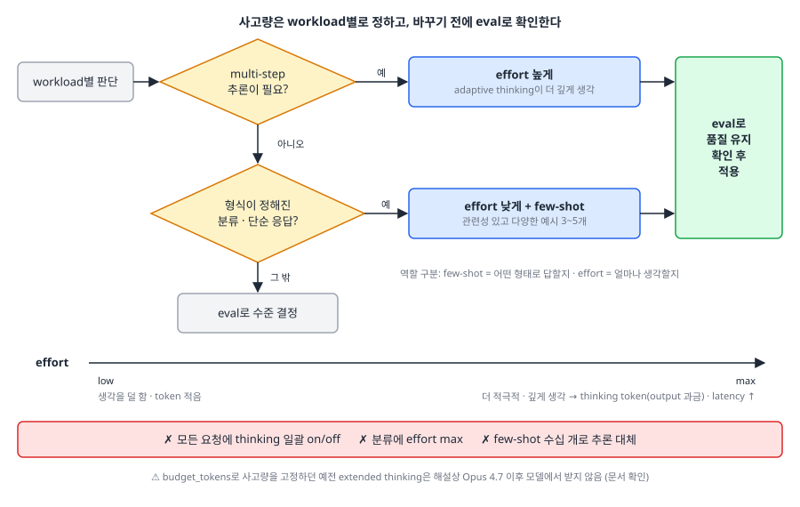
*그림: thinking과 effort는 일괄 설정하지 않고 workload별로 정하며, effort를 높일수록 output token과 latency가 늘어난다.*

근거: Preporato-0012, Preporato-0013, Udemy-0009

### 1-5. 비용 진단과 절감 수단
**비용 증가 → 요청당 token 진단 먼저 · tier 하향은 마지막**

| 증상 | 조치 |
|---|---|
| 호출량 그대로 · 비용 상승 | 요청 1건당 token 사용량 먼저 확인 매 호출 재전송 context 양 확인 |
| 품질 OK · 비용 증가 (tier 하향 전 선행 조치 2개) | (1) 불필요 tool output · history trimming → context 축소 (2) 불변 prefix(tools · system prompt) caching |

| 구분 | 내용 |
|---|---|
| latency | 과금 대상 ✗ |
| API key 개수 | 비용 영향 ✗ |
| tier 변경 | eval 근거 있을 때만 |
| `max_tokens` 높임 | 지출 증가 가능 |
| 비용 견적 | 실제 호출 모델로 token counting endpoint 호출 tokenizer = 모델 세대마다 다름 |
| model ID 형식 | 같은 모델 → alias · snapshot 어느 형식이든 단가 동일 |
| 절감 수단 | Batch 할인 · prompt caching · 더 작은 모델 선택 |

| 오답 | 이유 |
|---|---|
| `max_tokens` 낮춤 | 비용 절감 ✗ 작업 단가 그대로 · 답 중간 잘림 |
| 과대 context window 모델 | task에 불필요한 cost · latency 부담 정확도 · rate limit · 구조화 출력 신뢰성 향상 ✗ |
| 타사 tokenizer · "글자 수 ÷ 4" 추정 | Claude token 과소 집계 (code · 비영어 텍스트에서 두드러짐) |

| 구분 | 내용 |
|---|---|
| ⚠️ 공식 과금 | 실제 사용 token 기준 · window 크기 자체 과금 ✗ |
| ⚠️ 비용 차이 | window보다 모델 tier 단가에서 발생 |

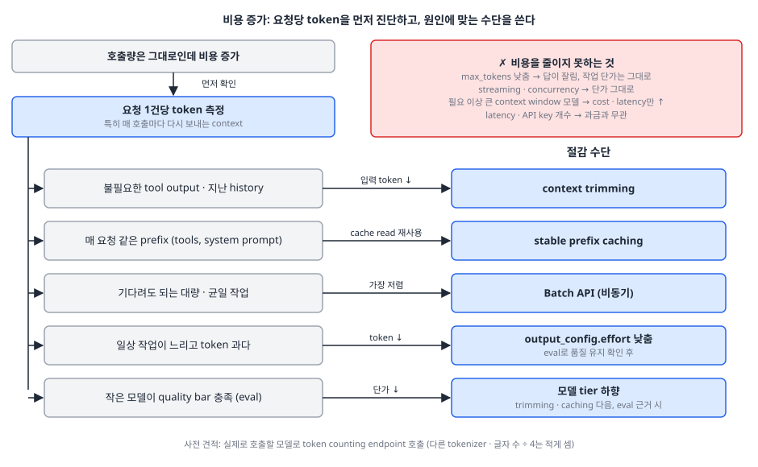
*그림: 비용이 늘면 요청당 token부터 보고, 원인에 맞춰 trimming·caching·Batch·effort·tier 하향 순으로 고른다.*

근거: Amey-0021, Amey-0071, Patrick-0029, Patrick-0037, Preporato-0011, Preporato-0012, Udemy-0002

### 1-6. Batch API
**기다려도 되는 대량 작업만 Batch · interactive ✗**

| 구분 | 내용 |
|---|---|
| Batch 적합 | 대량 · 균일 형태 · 대기 가능 작업 → 가장 저렴 (예: 사용자 상호작용 없는 야간 대량 처리) |
| Batch 부적합 | 비동기 → 사람이 기다리는 interactive 작업 ✗ |
| interactive 작업 예 | live chat · escalated reply autocomplete |
| Streaming | interactive 용도 비용 절감 ✗ |
| concurrency 높임 | 비용 절감 ✗ 단가 그대로 |

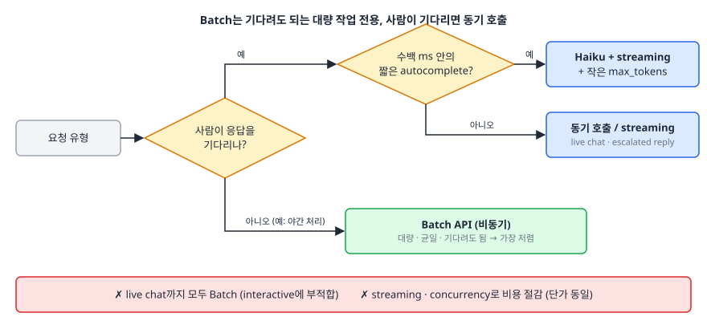
*그림: Batch는 기다려도 되는 대량 작업에만 쓰고, 사람이 기다리는 요청은 동기 호출이나 streaming으로 처리한다.*

근거: Amey-0056, Patrick-0011, Preporato-0011, Preporato-0015

### 1-7. Prompt caching
**breakpoint = 공유 prefix 마지막 block · 변하는 값은 뒤**

| 구분 | 내용 |
|---|---|
| `cache_control` 위치 | 개별 content block에 부착 요청 최상위 · model parameter ✗ |
| breakpoint 배치 | 공유 영역(preamble) 마지막 block (보통 system prompt 마지막 content block) → 그 앞 prefix 전체 = cache key |
| 매번 바뀌는 질문 | cache 밖(breakpoint 뒤) |
| breakpoint 상한 | 요청당 최대 4개 |
| 일치 조건 | 정확한 byte 단위 prefix 일치 |
| 렌더링 순서 | tools → system → messages |

| 오답 | 이유 |
|---|---|
| 바뀌는 부분 뒤 breakpoint | 요청마다 다른 cache entry write만 read ✗ |

| 무효화 원인 | 증상 | 조치 |
|---|---|---|
| system prompt에 timestamp · UUID 삽입 | cache 전체 무효 `cache_read_input_tokens` 계속 0 | 바뀌는 내용을 마지막 breakpoint 뒤로 이동 |
| 요청마다 tool set 변경 | cache 전체 무효 `cache_read_input_tokens` 계속 0 | 바뀌는 내용을 마지막 breakpoint 뒤로 이동 |

| TTL | 판단 |
|---|---|
| 5분 ephemeral cache | 몇 분 burst 후 몇 시간 공백 → 적합 |
| 1시간 cache | write 비용 더 비쌈 이 패턴에서 추가 hit ✗ |
| permanent cache | 옵션 없음 |

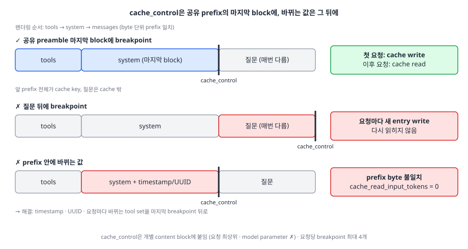
*그림: breakpoint는 공유 prefix의 마지막 block에 두고, 질문이나 timestamp처럼 바뀌는 값은 그 뒤에 둬야 cache read가 생긴다.*
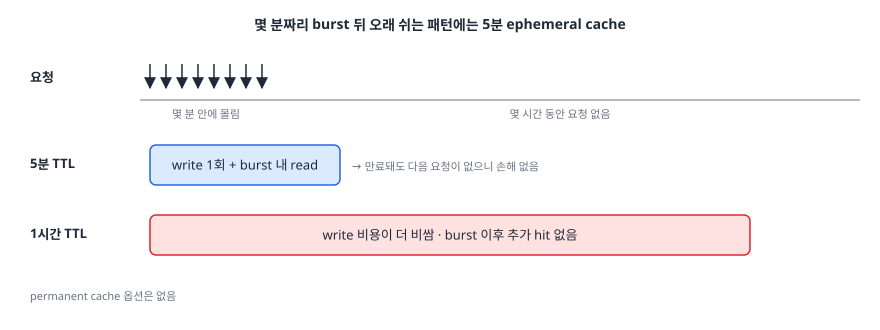
*그림: 몇 분짜리 burst에는 5분 cache로 충분하고, 1시간 cache는 write만 비싸고 추가 hit가 없다.*

근거: Patrick-0003, Patrick-0008, Patrick-0020, Patrick-0021

### 1-8. Version pinning과 snapshot
**pin 이점 = 재현성 · 이전 시점 통제**

| 구분 | 내용 |
|---|---|
| Production 방침 | model version pin 모델 업데이트 → refusal 등 동작 변화 가능 → 업그레이드 = eval 거친 의도적 변경 |
| pinning과 무관 | 가격 · context window · API 필수 요건 |
| Model ID | 각 ID = 고정 snapshot · weight 불변 개선 모델 = 새 ID → 고정 ID에 자동 반영 ✗ |
| pin으로 얻는 것 | 재현성 · audit 설명 용이 이전 시점 직접 결정 |
| pin으로 못 얻는 것 | 영속성 · 최신성 |
| 영구 사용 | 보장 ✗ ID마다 retirement 일정("이 날짜 전 retire 안 함") → 후속 모델 검증 · 이전 계획 수립 |
| 같은 ID 동작 변화 | 주변 시스템 업데이트 시 약간 변화 가능 (router · safety classifier 등) |

| 오답 | 이유 |
|---|---|
| prompt로 이전 모델처럼 행동 요청 | 계약(보장) ✗ |
| 다른 provider로 failover | 동작 변화 추가 발생 |
| 에러를 빈 응답으로 처리 | 장애 고착 |

| 세대 | snapshot ID | alias ID |
|---|---|---|
| 4.6 세대부터 | 날짜 없는 ID (예: `claude-sonnet-5`) | (해설 언급 없음) |
| 이전 세대 | 날짜 붙은 ID (`claude-haiku-4-5-20251001`) | 날짜 없는 이름 (`claude-haiku-4-5`) |

| 구분 | 내용 |
|---|---|
| ⚠️ 출처 | 위 ID 명명 규칙 = 해설 기준 |
| ⚠️ 확인 | 세대마다 상이 → 문서 확인 |

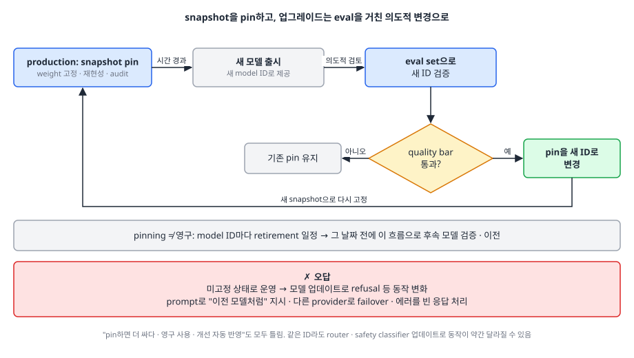
*그림: production은 snapshot을 pin하고, 새 ID는 eval을 통과했을 때만 의도적으로 pin을 바꾼다.*

근거: Amey-0006, Amey-0043, Udemy-0002

### 1-9. Sampling(temperature)과 비결정성, 테스트
**temperature 0도 비결정적 → assert · rubric**

| 구분 | 내용 |
|---|---|
| `temperature` | 다음 token 선택 무작위성 조절 |
| 낮음 | 안정적 · 보수적 출력 → 정형 추출 적합 |
| 높음 | 다양 · 창의적 출력 → 아이디어 발상 적합 |
| 오해 | 사실 정확도 향상 ✗ latency 조절 파라미터 ✗ |
| `temperature` 0 | 완전 결정적 ✗ 같은 입력도 호출마다 결과 상이 가능 |
| latency 요인 | 모델 크기 · 입력 · 출력 길이 · 사고량 |

| 방식 | 판정 | 이유 |
|---|---|---|
| golden string 정확 일치 | ✗ | 실패 들쭉날쭉 |
| 구조 · 핵심 사실 assert (schema 유효성 · 필수 필드 · 필수 수치) | ✓ | golden string 대체 |
| rubric 채점 | ✓ | golden string 대체 |
| 통과할 때까지 retry | ✗ | 회귀 은폐 |
| 테스트 삭제 | ✗ | 안전망 소실 |

| 구분 | 내용 |
|---|---|
| ⚠️ 대상 | 해설 기준 Claude Sonnet 5 · Opus 5.5 등 일부 모델 |
| ⚠️ 제약 | `temperature` · `top_p` · `top_k` 비기본값 설정 → 에러 |
| ⚠️ 대응 | 출력 방향 = prompt로 조정 |
| ⚠️ 확인 | 모델별 사양 → 문서 확인 |

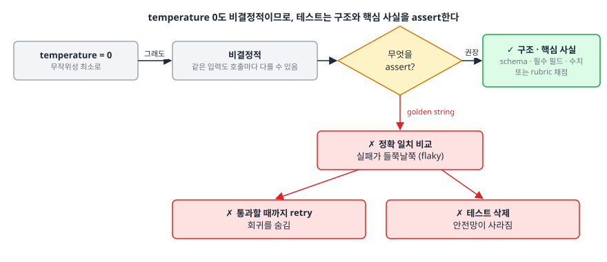
*그림: temperature 0도 결정적이지 않으므로 golden string 비교 대신 구조와 핵심 사실을 assert하거나 rubric으로 채점한다.*

근거: Preporato-0014, Udemy-0005

## 2. 상황별 정답 판단 규칙

**모델 · routing**

| 상황 | 정답 |
|---|---|
| 대량 단순 분류 · 추출 · routing · 빠듯한 latency | Haiku(fast tier) |
| 상호작용 제약 많은 multi-step 계획 · 마이그레이션 | 가장 capable한 모델(Opus) |
| 큰 모델로 거의 완벽한 정확도 나오는 대량 단순 작업 | 작은 모델의 요구 정확도 충족 여부 평가 |
| 작은 모델 · 큰 모델 정확도 동일 | 작은 모델 배포 |
| 두 모델 중 하나 선택 | 대표 sample · quality bar로 둘 다 측정 |
| 작업별 난이도 상이(쉬운 대량 · 어려운 소량) | Routing: 작업별 tier 분리 |
| Orchestrator · 다수 worker subtask | Orchestrator = capable 모델 worker = 작고 빠른 모델(small · fast) |

**비용 · 처리 · 사고량**

| 상황 | 정답 |
|---|---|
| 호출량 그대로 · 비용 급증 | 요청당 token · 재전송 context 확인 |
| 품질 OK · 비용 증가 | context trimming · stable prefix caching (tier 변경보다 먼저) |
| 사용자 상호작용 없는 대량 야간 처리 | Batch API |
| 사용자가 기다리는 interactive 요청 | Batch ✗ (stream 또는 동기 호출) |
| 수백 ms 내 응답 필요한 짧은 autocomplete | Haiku · streaming · 작은 `max_tokens` |
| 일상 작업 느림 · token 과다 eval로 품질 유지 확인 | 해당 작업만 `output_config.effort` 낮춤 |
| 전체 thinking 켬 → 단순 응답까지 느려짐 | workload별 결정(필요한 곳만 깊은 추론) |
| 분류 작업 · 복잡한 계획 작업 혼재 | 분류 = few-shot · 계획 = effort 높임 |
| 큰 prompt 전송 전 비용 추정 | 같은 모델로 token counting endpoint 호출 |

**cache · version · test**

| 상황 | 정답 |
|---|---|
| 긴 system prompt caching | 마지막 system content block에 `cache_control` |
| 공유 preamble 뒤 매번 다른 질문 | preamble 마지막 block에 breakpoint |
| `cache_read_input_tokens` 항상 0 | prefix 내 변하는 값을 뒤로 이동 (timestamp · UUID · tool set) |
| 몇 분 burst 후 몇 시간 요청 없음 | 5분 ephemeral cache |
| 모델 출시 후 production 동작 변화 · 규제 대응 | snapshot pin · 업그레이드는 eval 거쳐 진행 |
| 출력이 매번 달라 테스트 flaky | 구조 · 핵심 사실 assert 또는 rubric 채점 |

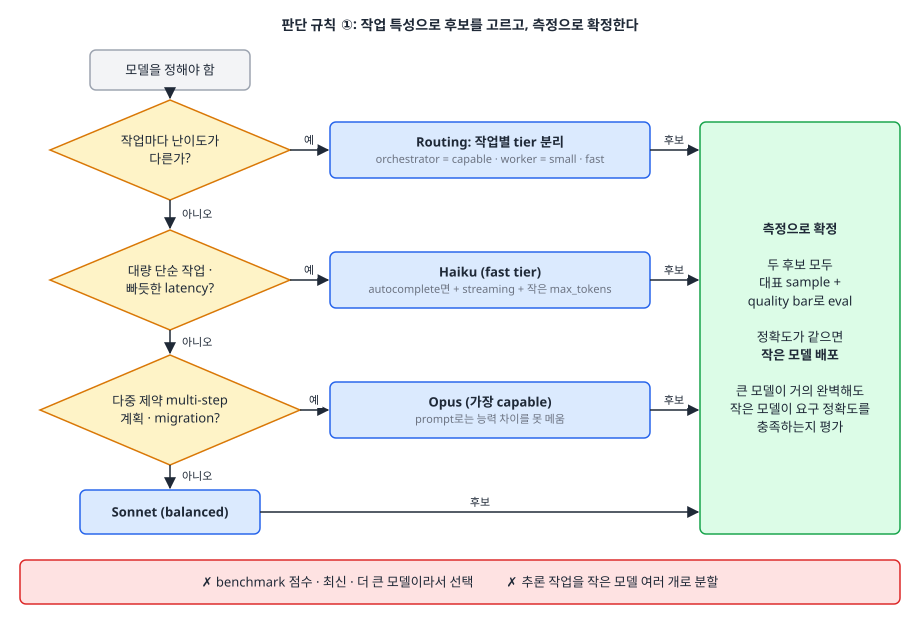
*그림: 작업 특성으로 tier 후보를 고르되, 최종 결정은 대표 sample과 quality bar로 측정해서 내린다.*
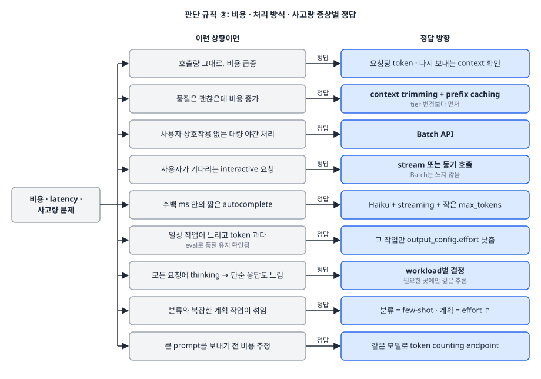
*그림: 비용·latency·사고량 문제는 증상별로 정답 수단이 정해져 있다.*
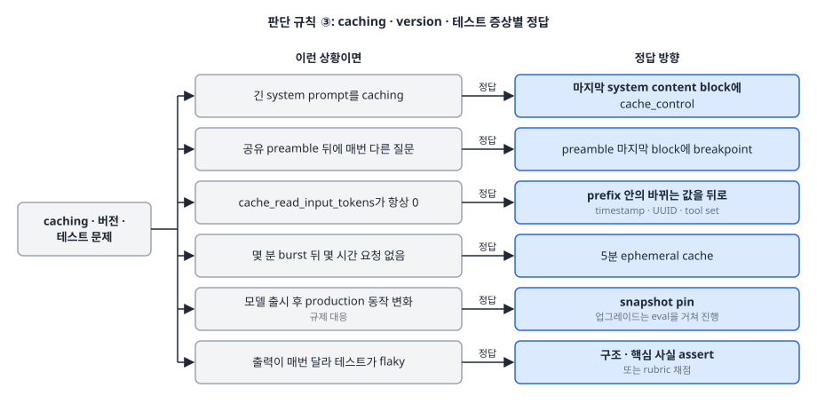
*그림: caching·version·테스트 문제도 증상을 보면 정답 방향이 하나로 좁혀진다.*

근거: Amey-0006, Amey-0019, Amey-0020, Amey-0021, Amey-0022, Amey-0056, Amey-0057, Amey-0058, Patrick-0003, Patrick-0008, Patrick-0011, Patrick-0019, Patrick-0020, Patrick-0021, Patrick-0029, Patrick-0037, Preporato-0011, Preporato-0012, Preporato-0013, Preporato-0014, Preporato-0015, Udemy-0002, Udemy-0009, Udemy-0035

## 3. 자주 나오는 오답 함정

**모델 · routing**

| 오답 | 이유 |
|---|---|
| 모든 작업에 가장 강한 모델 (품질 일관성 · 설정 단순화) | 쉬운 작업에 비용 · latency 낭비 |
| 모든 작업에 가장 싼 모델 | 어려운 작업에서 품질 부족 |
| prompt 길게 · 다듬기로 작은 모델 복잡 추론 | prompt로 모델 능력 차이 메우기 ✗ |
| 추론 작업을 작은 모델 여러 개로 분할 | 추론 단절 |
| benchmark 점수 높은 · 최신 · 큰 모델 선택 | 실제 task 측정 근거 아님 |
| 예산 초과 · 호출량 많음 → 작은 모델로 하향 | 검토 시작 계기일 뿐 quality bar 충족 여부 측정 확인 |
| 검증 없이 작은 모델 · fast tier로 바로 이동 | eval 확인 단계 생략 |

**비용 · 처리 · 사고량**

| 오답 | 이유 |
|---|---|
| `max_tokens` 낮춰 비용 절감 | 작업 단가 그대로 · 답 잘림 |
| `max_tokens` 높여 잘림 방지 → 비용 문제도 해결 | 지출 증가 가능 |
| thinking budget 늘림 · thinking 전부 켜기 · 전부 끄기 | 일괄 설정 ✗ → workload별 결정 |
| effort max → 분류 품질 향상 | output token 비용 · latency만 증가 |
| few-shot 예시 수십 개 → 깊은 추론 대체 | context 압박 · 예시 표면 패턴 모방 |
| live chat 포함 모든 요청 Batch | Batch = 비동기 → interactive 부적합 |
| streaming · concurrency 높임 → 비용 감소 | 단가 그대로 |
| 큰 context window 모델 = 정확 · rate limit 적음 | 이점 없음 · cost · latency만 증가 |
| 글자 수 ÷ 4 추정 · 타사 tokenizer | 부정확 |
| 일단 전송 후 usage 확인 | 사전 견적 아님 |

**cache · version · test**

| 오답 | 이유 |
|---|---|
| `cache_control`을 요청 최상위 · model parameter에 부착 | content block 단위로 부착 |
| `cache_control`을 모든 block · 첫 block에만 부착 | 공유 영역 마지막 block에 부착 |
| 질문 포함 prompt 끝에 breakpoint | 요청마다 새 entry write만 · read ✗ |
| cache hit 0 = 캐싱 고장 · 모델 미지원 | 대부분 prefix 안에 변하는 값 혼입 |
| 1시간 cache가 항상 우위 | 1시간 = write 더 비쌈 |
| permanent cache 사용 | permanent 옵션 없음 |
| pin 모델 = 더 쌈 | pinning은 가격과 무관 pinning 이점 = 재현성 · 이전 시점 직접 결정 |
| pin 모델 = 영구 사용 | 보장 ✗ · ID마다 retirement 일정 |
| pin 모델 = 개선 자동 반영 | 개선 = 새 ID · 고정 ID에 반영 ✗ |
| prompt로 이전 버전처럼 행동 지시 | 동작 보장 ✗ |
| 다른 provider로 failover | 동작 보장 ✗ |
| `temperature` 0 = 완전 결정적 | 0에서도 호출마다 결과 상이 가능 |
| `temperature` 높임 → 사실 정확도 향상 | 사실 정확도 효과 ✗ |
| flaky 테스트를 통과까지 retry | 회귀 은폐 |
| flaky 테스트 삭제 | 안전망 소실 |

근거: Amey-0006, Amey-0022, Amey-0043, Amey-0056, Amey-0057, Amey-0058, Amey-0071, Amey-0072, Patrick-0003, Patrick-0008, Patrick-0011, Patrick-0019, Patrick-0020, Patrick-0021, Patrick-0029, Patrick-0037, Preporato-0011, Preporato-0012, Preporato-0013, Preporato-0014, Udemy-0002, Udemy-0005, Udemy-0009, Udemy-0035

## 4. 암기 목록

| 이름 | 의미 |
|---|---|
| Haiku tier | 가장 빠름 · 가장 저렴 classification · extraction routing · autocomplete |
| Sonnet tier | 속도 · 지능 균형 최고 |
| Opus tier | 가장 capable multi-step reasoning · 장시간 agent 작업 고난도 분석 |
| ⚠️ "확신 없으면 Opus 5.5부터" | 해설 인용 시점의 안내 · 버전별 상이 |
| `output_config.effort` | 모델 변경 없이 응답 전체 token 사용량 조절 (thinking · tool call 포함) |
| effort low ~ max | adaptive thinking의 생각 적극성 · 깊이 조정 |
| ⚠️ `budget_tokens` | 예전 extended thinking의 사고량 고정 방식 해설 기준 Opus 4.7 이후 미지원 |
| thinking token | output token 과금 · latency 증가 |
| few-shot 예시 수 | 3~5개 · 관련성 있고 다양한 예시 선택 |
| `max_tokens` | 출력 상한 낮춤 → 잘림 · 높임 → 지출 증가 가능 단가 변화 ✗ |
| `cache_control` | content block 단위 지정 · 공유 영역 마지막 block |
| breakpoint | 요청당 최대 4개 |
| prefix 렌더링 순서 | tools → system → messages 앞부분 변경 → 그 뒤 전부 무효 |
| `cache_read_input_tokens` | cache hit로 읽은 token 수 계속 0 → prefix 변경 중 신호 |
| 5분 ephemeral · 1시간 cache | 짧은 burst → 5분 1시간 = write 비용 더 비쌈 · permanent 옵션 없음 |
| token counting endpoint | 전송 전 token 수 견적 · 실제 호출 모델로 집계 |
| Batch API | 비동기 · 대기 가능 대량 작업에서 훨씬 저렴함 |
| snapshot · alias | snapshot = weight 고정 alias = 최신 snapshot 지칭 개선 = 새 ID로 제공 |
| retirement 일정 | 모델 ID별 retire 예정일 pinning해도 영구 사용 ✗ |
| `temperature` · `top_p` · `top_k` | sampling 무작위성 조절 0이어도 완전 결정적 ✗ |

| 모델 | 단가(per 1M input/output tokens) |
|---|---|
| ⚠️ Haiku 5.5 | $0.10 / $0.50 |
| ⚠️ Sonnet 5.5 | $2 / $10 |
| ⚠️ Opus 5.5 | $4 / $20 |

| 구분 | 내용 |
|---|---|
| ⚠️ 기준 시점 | 2026년 11월 기준 해설 수치 |
| ⚠️ 시험 가이드 | 2026년 7월판 · 이전 라인업(예: Haiku 4.5) 기준 가능 → 시점별 변동 |

근거: Amey-0020, Amey-0056, Patrick-0003, Patrick-0008, Patrick-0020, Patrick-0021, Patrick-0029, Patrick-0037, Preporato-0011, Preporato-0012, Preporato-0013, Preporato-0015, Udemy-0002, Udemy-0005, Udemy-0009, Udemy-0035

## 5. 시험 직전 체크리스트

- [ ] 모델 선택 = 요구 수준 충족하는 가장 싼 모델
- [ ] 모델 선택 근거 = 실제 task 기준 eval
- [ ] benchmark 점수 · 최신 · 큰 모델 = 근거 ✗
- [ ] Haiku = 대량 · 단순 · 저지연 작업
- [ ] Opus = multi-step · 다중 제약 추론
- [ ] Sonnet = 균형형
- [ ] 난이도 혼재 workload → routing
- [ ] orchestrator = capable 모델 · worker = 작은 모델
- [ ] tier 하향 전 context trimming · prefix caching
- [ ] 비용 증가 → 요청당 token · 재전송 context 먼저 확인
- [ ] `max_tokens` = 비용 절감 수단 ✗(답 잘림)
- [ ] thinking · effort = workload별 결정
- [ ] 단순 응답 → thinking · effort 낮춤
- [ ] thinking token = output 과금
- [ ] 형식 = few-shot(3~5개) · 생각 깊이 = effort
- [ ] Batch = 대기 가능 대량 작업 전용
- [ ] interactive 요청 → Batch ✗
- [ ] `cache_control` = 공유 prefix 마지막 block
- [ ] breakpoint = 요청당 최대 4개
- [ ] cache hit 0 → prefix 내 변하는 값 탐색(timestamp · UUID · tool set)
- [ ] 짧은 burst = 5분 TTL
- [ ] 1시간 cache = write 더 비쌈
- [ ] 사전 token 견적 = 같은 모델 token counting
- [ ] production = snapshot pin
- [ ] 업그레이드 = eval 거친 의도적 변경
- [ ] retirement 일정 확인
- [ ] `temperature` 0도 비결정적
- [ ] 테스트 = 구조 · 핵심 사실 assert 또는 rubric 채점
