# 6. Prompt and Context Engineering — 반드시 알아야 할 지식
> 시험 비중 11% · 약 3문항 · 근거 문항 23개

## 1. 핵심 개념

### 1.1 System prompt vs user message 역할 분리
**안정적 지침 = system · 가변 입력 = user**

| 구분 | 내용 |
|---|---|
| system prompt | 모든 턴에 일관 적용할 안정적 지침 (role · 행동 규칙 · 안전 제약) |
| user message | 매번 바뀌는 사용자 질문 · 참조 데이터 |
| API 구조 | `system` = top-level 파라미터, 대화 전체의 전제 `messages`의 user 턴 = 개별 요청 |
| role 설정 | 행동 · 어조가 용도에 맞게 안정 |
| 항상 참조할 배경 정보 | system prompt에 배치 (일반적) (운영 규칙 요점 등) |

| 배치 | 결과 |
|---|---|
| 지침을 user 턴에 ✗ (첫 · 마지막 · 매 메시지 반복) | configuration · input 혼재 → drift 입력 문구로 지침 약화 · 덮어쓰기 가능 유지보수 어려움 |
| system prompt 불가 환경에서 user message에 지시 | 동작함 · Claude 대체로 준수 원칙 ✗ |
| 사용자별 질문까지 system prompt에 ✗ | 신뢰할 수 없는 입력을 지침과 같은 권위로 처리 |
| 행동 지침을 tool description에 ✗ | tool description = tool 선택용 매 턴 적용할 행동 지침 자리 아님 |

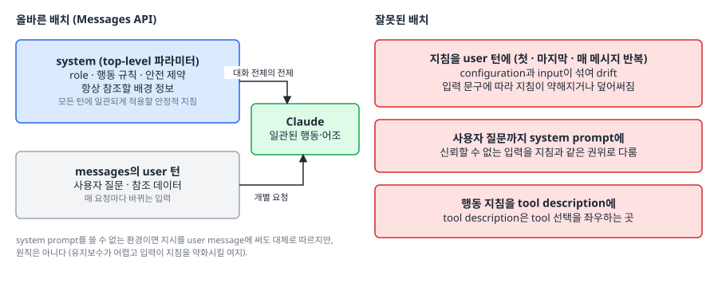
*그림: 안정적 지침은 top-level system에, 매번 바뀌는 입력은 user 턴에 두며, 이를 뒤섞으면 drift나 권위 혼동이 생긴다.*

근거: Amey-0028, Amey-0061, Udemy-0012

### 1.2 인터페이스마다 다른 컨텍스트
**결과 차이 = 지시문 바깥 컨텍스트 차이**

| 인터페이스 | 모델이 받는 컨텍스트 |
|---|---|
| 공통 | 지시문 · 주변 컨텍스트 전체 |
| claude.ai / 모바일 앱 | 자체 system prompt(현재 날짜 · 응답 스타일 등) API에는 미적용 |
| Claude Code | tool 정의 · `CLAUDE.md` auto memory · 세션 상태 등 추가 |
| Messages API | `system` · `messages`를 개발자가 직접 조립 |

| 판단 | 내용 |
|---|---|
| 프로덕션 | 일관된 동작 필요 → API/SDK 위에 구축 실제 제공 환경에서 평가 |
| 인터페이스별 결과 차이 | 버그 ✗ 설계상 차이 세 인터페이스가 같은 system prompt로 동작 ✗ |
| 지시문만 수정 ✗ | 지시문 바깥 컨텍스트 차이 잔존 |

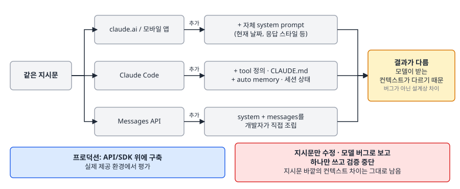
*그림: 인터페이스별 결과 차이는 지시문 바깥에 붙는 컨텍스트 차이에서 오므로, 프로덕션은 API/SDK로 만들고 실제 환경에서 평가한다.*

근거: Udemy-0015

### 1.3 Few-shot 예시 (multishot)
**few-shot = 형식 고정용 · 소수 · 다양 · 무모순**

| 구분 | 내용 |
|---|---|
| 적합 상황 | 출력 형식 · edge-case 처리 불일치 예시로 목표 동작 제시 가능 |
| 효과 | 형식 · edge-case 동작 → 지시 추가보다 예시가 훨씬 잘 고정 |
| 부적합 | 사실 지식 보충 ✗ · latency 감소 ✗ 작은 context window 해결 ✗ (예시 = token 소비) |
| 여러 제약 동시 준수 | 규칙을 지킨 출력 예시(worked example) → 제약 간 상호작용까지 제시 · 산문 설명으로는 불가 |
| 지시 vs 예시 모순 | 정해진 우선순위 없음 → 두 쪽 사이 동작 예측 불가 |
| 모순 시 흔한 오해 | 지시가 항상 이김 ✗ · 예시가 항상 이김 ✗ 요청 거부 ✗ |
| robustness 테스트용 모순 예시 ✗ | 모델이 지시를 무시하도록 학습 |

| 권장 구성 | 내용 |
|---|---|
| relevant | 실제 용도와 가까운 예시 |
| diverse | 경계 사례까지 포함 |
| 개수 | 소수 3~5개 (문항에 따라 2~4개) |
| 분리 | `<example>` 태그로 지시 · 실제 입력과 분리 |
| 까다로운 classification | reject할 negative case 포함 → 경계 학습 |
| 질 > 개수 | 선별 없는 수십 개 → 편향 · 잘못된 예시의 의도치 않은 패턴 학습 컨텍스트 점유 |
| 좁은 예시 ✗ | 모두 같은 label · 거의 같은 예시 50개 → 좁은 패턴만 학습 |

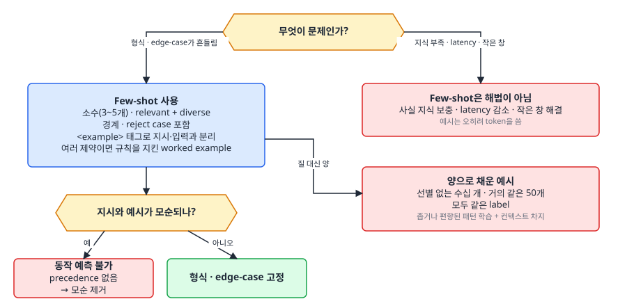
*그림: few-shot은 형식과 edge-case가 흔들릴 때만 쓰고, 소수의 다양한 예시를 지시와 모순 없이 넣어야 한다.*

근거: Amey-0027, Amey-0046, Amey-0062, Amey-0075, Preporato-0022, Udemy-0042

### 1.4 출력 형식 지정
**형식은 긍정형 · 예시 · XML 구조로 지정**

| 방법 | 판정 | 이유 |
|---|---|---|
| 긍정형 지정 ("~형식으로 출력하라") | ✓ | 원하는 형태 직접 제시 |
| 금지 목록 ("목록으로 쓰지 마라", "설명을 붙이지 마라") | ✗ | 원하는 형태 미제시 |
| XML 태그로 출력 구조 제시 | ✓ | 필요 시 · 예시와 함께 쓰면 효과 큼 |
| 형식 설명만 | ✗ | 항목 순서 · 표기 변형(단위 등) 세부 전달 어려움 |
| 가장 중요한 제약 강조 · 프롬프트 끝 제약 반복 | ✗ | 다시 말할 뿐 명확화 아님 |
| "깔끔하게(neat)" 같은 모호한 형용사 | ✗ | 아무것도 규정 안 함 |
| temperature 상향 | ✗ | variance 증가 → 일관성 · 신뢰성과 반대 방향 |
| 더 큰 모델 | ✗ | 당신의 형식을 모름 |

근거: Amey-0027, Amey-0045, Amey-0062, Udemy-0042

### 1.5 Structured outputs, tool 강제, prefill 폐지
**스키마 보장 = structured outputs · prefill → 400**

| 수단 | 내용 |
|---|---|
| structured outputs (constrained decoding) | 스키마 검증 통과 JSON 보장 요청 `output_config.format`에 JSON schema JSON을 산문으로 감싸는 류 실패 원천 제거 |
| forced tool choice | tool 1개, `input_schema` = 원하는 JSON 형태 `tool_choice`로 강제 → 반드시 그 tool 호출 `input` = 구조화 객체 |
| 확률적 수단 ✗ | system prompt "JSON으로 답하라" temperature 0 · 자유 텍스트 regex parser → 스키마 준수 보장 ✗ |
| assistant 턴 prefill (예: `{`로 시작) | 과거의 형식 강제 기법 Claude 4.6부터 마지막 assistant 턴 prefill → 400 error |
| 마이그레이션 가이드 | prefill 제거 · structured outputs로 대체 대안 ✗ · 대체재 |
| 프로덕션 추출 endpoint | 모델 출력 = untrusted input tool use 스키마 강제 → 파싱 결과 검증 |
| 검증 실패 시 | validation error 붙여 1회 retry → 모델 자가 수정 |

**해설 vs 공식 문서**

| 구분 | 내용 |
|---|---|
| ⚠️ 해설 | tool 강제 = "가장 신뢰할 수 있는 방법" |
| ⚠️ 현재 공식 문서 | 스키마 준수 보장 = structured outputs (`strict` tool 포함) |
| ⚠️ strict 없는 tool 강제 | 신뢰성 높음 · 보장 ✗ |
| ⚠️ 선택지에 structured outputs 있음 | structured outputs 우선 |

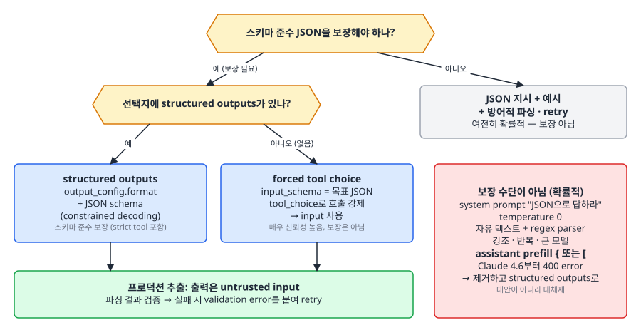
*그림: 스키마 보장이 필요하면 structured outputs, 선택지에 없으면 tool 강제이며, 지시·temperature·regex·prefill은 보장 수단이 아니다.*

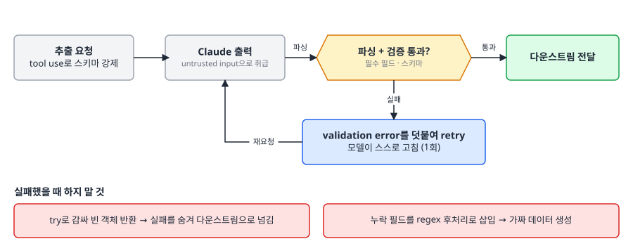
*그림: 모델 출력은 untrusted input이므로 검증에 실패하면 숨기거나 땜질하지 말고 error를 붙여 다시 요청한다.*

근거: Amey-0039, Patrick-0004, Patrick-0026, Preporato-0021, Udemy-0042

### 1.6 긴 문서(long context) 배치
**긴 문서는 태그로 감싸 위에 · 질문은 끝 · 먼저 인용**

| 구분 | 내용 |
|---|---|
| 위치 효과 | 한가운데 내용 → 가장자리(앞 · 끝)보다 놓치기 쉬움 |
| 흔한 오해 | 위치 무관 ✗ 가운데가 더 잘 지켜짐 ✗ 오류 발생 ✗ |
| 배치 (약 20K tokens 초과) | 문서 = 프롬프트 위쪽, 지시 · 질문 = 맨 끝 복잡한 multi-document 테스트에서 응답 품질 최대 30% 향상 |
| 문서 태그 | `<contract>` 같은 태그로 감쌈 |
| 여러 문서 태그 | 문서마다 `<document>`로 감쌈 하위 태그 `<document_content>` · `<source>` → 본문 · 출처(metadata) 구분 · 문서 간 혼동 방지 |
| 인용 | 답 전에 관련 부분 먼저 인용(quote) → 집중에 도움 |

**구조 문제 해결 ✗**

| 수단 | 이유 |
|---|---|
| effort | thinking · 응답 token 양 조절뿐 |
| prompt caching (`cache_control`) | 반복 질의의 비용 · 속도용 모델이 읽는 내용 불변 |
| 사전 요약 | 창에 안 들어가거나 개요만 필요할 때용 세부 · 출처 손실 |

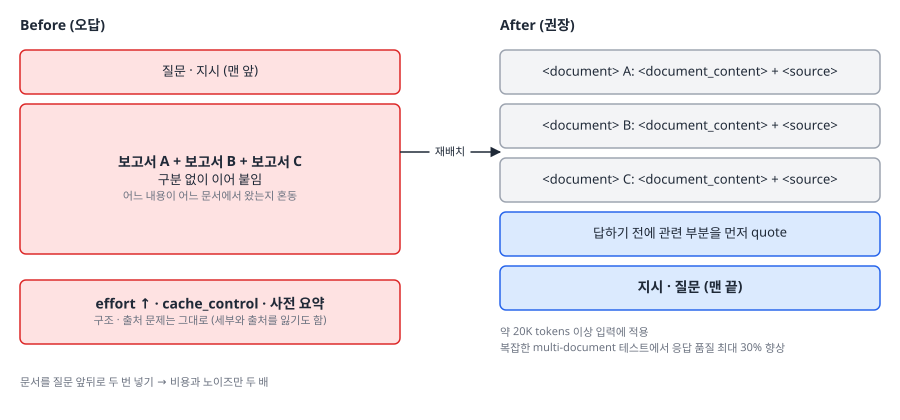
*그림: 긴 입력은 문서를 문서별 태그로 감싸 위에, 인용 지시와 질문을 끝에 둔다.*

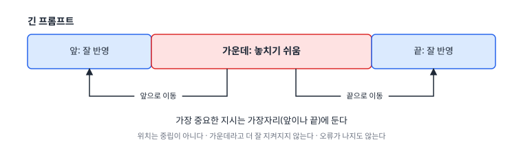
*그림: 긴 프롬프트 한가운데 내용은 놓치기 쉬우므로 중요한 지시는 앞이나 끝으로 옮긴다.*

근거: Amey-0076, Preporato-0020, Udemy-0012, Udemy-0024

### 1.7 Context는 예산이다 (context rot)
**컨텍스트 = 예산 · 불필요한 자료는 정확도도 하락**

| 구분 | 내용 |
|---|---|
| 성격 | 공짜 자원 ✗ · 예산 |
| 느슨한 배경 자료 ("혹시 도움이 될까") | 관련 자료와 attention 경쟁 → 비용 · 정확도 하락 |
| 모델 동작 | 질문이 참조하지 않는 내용을 알아서 무시 ✗ |
| context rot | token 증가 → 앞서 읽은 내용을 정확히 끌어오지 못하는 현상 |
| 선택 vs 용량 | 무엇을 넣을지 선택 = 용량만큼 중요 |
| 창 상한 vs 정확도 | 창에 들어감 ≠ 정확도 유지 (별개) |
| 큰 창 (1M token 등) | 긴 자료를 한 번에 읽힐 때 유용 전체 이력 계속 유지 → context rot · 비용 · latency 증가 |

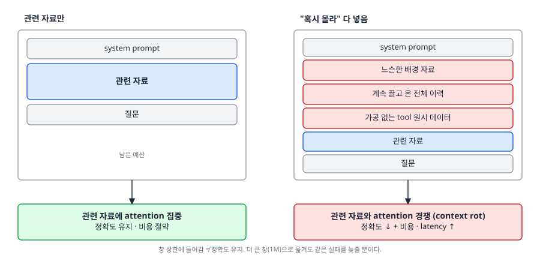
*그림: 불필요한 자료는 관련 자료와 attention을 놓고 경쟁해 비용뿐 아니라 정확도도 떨어뜨린다.*

근거: Amey-0007, Amey-0029, Udemy-0020, Udemy-0022

### 1.8 Context hygiene: prune, compact, isolate
**bloat 해법 = prune · compact · isolate · `max_tokens` ✗**

| 구분 | 내용 |
|---|---|
| 증상 (장시간 assistant) | 반복 · 이전 사례 혼동 최근 지시 망각 · 자기모순 장황한 tool output으로 컨텍스트 가득 |
| 진단 | context drift/bloat |
| prune | tool output 잘라내기 · 요약 |
| compact | 대화 이력 압축 |
| isolate | 독립 subtask를 subagent로 분리 → main context 경량 유지 |

**Messages API 전제 · 이력 관리**

| 구분 | 내용 |
|---|---|
| Messages API | stateless 매번 system prompt · 과거 messages 재전송 → 전부 context window · input token 과금에 누적 |
| 최신 메시지만 전송 ✗ | Claude가 앞의 경위 모름 |
| server 측 대화 상태 보존 | Anthropic-hosted managed agent 세션 등에 존재 Messages API의 전제 ✗ |
| session hygiene | 용건(task) 변경 → 세션 분리(isolate) 오래된 턴 요약(compaction) · 불필요 부분 잘라냄 관련 컨텍스트만 유지 |
| 오래된 턴 vs 최근 턴 | 오래된 턴 요약 · compact, 최근 턴 원문 유지 → 중요 사실(예: 고객의 원래 문제) 보존 · 공간 확보 |
| 이력 없이 새 대화 ✗ | 문제 자체를 잊음 |
| Compaction | 오래된 턴 → Claude가 server 측에서 작성한 요약으로 대체 긴 대화 · 장시간 agent를 상한 내에서 잇는 핵심 전략 |
| Context editing | 오래된(stale) tool result 제거 |
| `max_tokens` | 응답 1회의 출력 상한 (응답이 잘려 `stop_reason` = `max_tokens`일 때 상향) |
| bloat 대응으로 `max_tokens` 조정 ✗ | context window 용량 확장 ✗ 올려도 줄여도 bloat 해법 ✗ |

**tool output 증가 대응 (2단계)**

| 단계 | 대응 |
|---|---|
| 입구 | tool 응답이 다음 판단에 필요한 항목만 반환하도록 설계 (공식 tool 설계 지침) |
| 누적 | compaction · context editing으로 축소 |

- 미사용 tool 제거: tool 정의 token 감소 · 단 핵심 기능 tool 제거 ✗ → 목적 자체 붕괴
- 원인 = 가공 없이 쌓이는 결과 · tool 존재 ✗

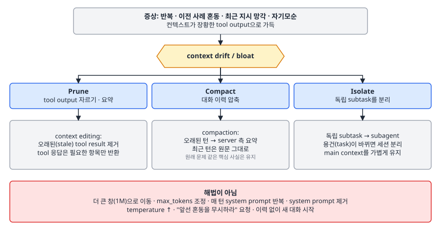
*그림: drift/bloat는 prune, compact, isolate로 다루며, 큰 창이나 max_tokens 조정은 해법이 아니다.*

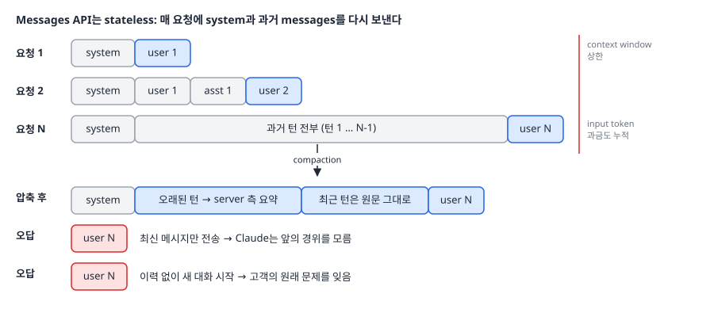
*그림: Messages API는 매 요청에 이력을 다시 보내므로 오래된 턴은 요약하고 최근 턴은 원문으로 남긴다.*

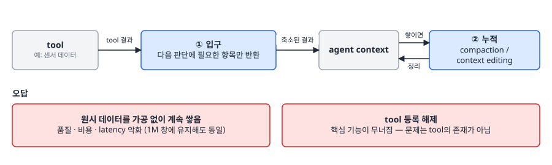
*그림: tool output은 입구에서 필요한 항목만 반환하고, 누적분은 compaction과 context editing으로 줄인다.*

근거: Amey-0007, Amey-0045, Patrick-0041, Udemy-0020, Udemy-0022

## 2. 상황별 정답 판단 규칙

| 상황 | 정답 |
|---|---|
| 모든 턴에 적용할 role · 행동 · 안전 제약 위치 | system prompt (가변 입력은 user message) |
| 같은 지시, 인터페이스별 결과 상이 (claude.ai · Claude Code · API) | 인터페이스별로 붙는 컨텍스트 차이 이해 프로덕션 = API/SDK 구축 · 실제 환경 평가 |
| 내용은 맞는데 형식이 매번 다름 | 정확한 출력 예시 relevant · diverse 3~5개 · `<example>` 태그 긍정형 형식 지정 |
| 여러 제약 동시 준수 | 규칙을 지킨 출력 예시 |
| few-shot 사용 여부 | 형식 · edge-case 흔들릴 때만 지식 부족 · latency · 작은 창 문제 ✗ |
| 까다로운 classification few-shot | 다양한 소수 예시 · reject case `<example>` 태그로 실제 입력과 분리 |
| 지시와 예시 모순 | 결과 예측 불가 → 모순 제거 |
| 스키마 검증 통과 JSON 보장 | structured outputs (`output_config.format` · JSON schema) |
| 엄격한 스키마 JSON, 선택지에 structured outputs 없음 | `input_schema` tool · `tool_choice` 강제 → `input` 사용 |
| prefill `{` 코드가 새 모델에서 400 error | prefill 제거 · structured outputs로 대체 |
| 추출 결과 필수 필드 가끔 누락 → 다운스트림 예외 | tool use 스키마 강제 · 결과 검증 validation error 붙여 retry |
| 긴 계약서 · 보고서에서 답이 관련 조항 놓침 | 문서는 태그로 감싸 위, 지시 · 질문은 끝 관련 조항 먼저 인용 |
| 긴 문서 여러 개를 구분 없이 연결, 질문은 앞 | 문서를 앞으로 문서별 `<document>` · `<source>` 태그 질문은 끝 |
| 가장 중요한 지시가 긴 프롬프트 한가운데 | 놓치기 쉬움 → 앞이나 끝으로 이동 |
| "혹시 몰라" 배경 자료 다량 투입 | 관련 자료와 경쟁 → 정확도 하락 → 관련 자료만 |
| 장시간 assistant 반복 · 혼동 · 지시 망각 컨텍스트가 tool output으로 가득 | prune · 요약 compact subagent로 isolate |
| 수백 턴 support chat이 창 상한 도달 | 오래된 턴 요약 · compaction 최근 턴 원문 유지 |
| 장시간 고객 대화의 session 설계 | 용건별 세션 분리 오래된 부분 요약 · 제거 |
| Agent tool이 원시 데이터 대량 반환 → 품질 · 비용 · latency 악화 | tool 결과를 필요 항목으로 축소 오래된 대화 요약 |

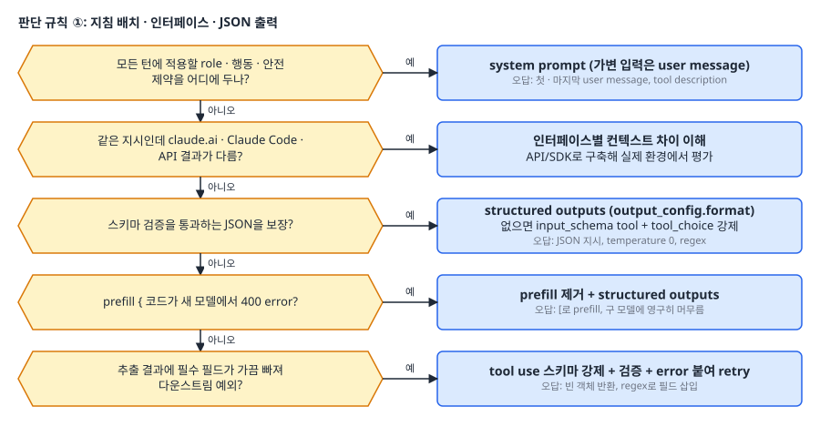
*그림: 지침 위치와 JSON 출력 문제는 system prompt, 실제 환경 평가, structured outputs, 검증 후 retry로 답한다.*

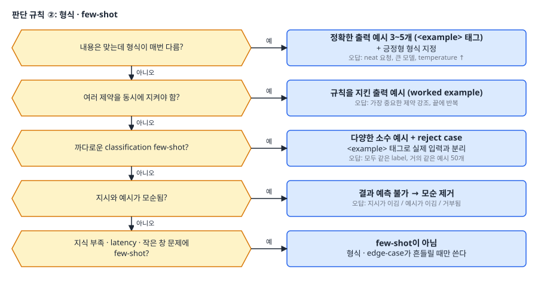
*그림: 형식 문제는 예시로 고정하되 reject case를 넣고 지시와 모순되지 않게 하며, 지식·latency·창 문제에는 쓰지 않는다.*

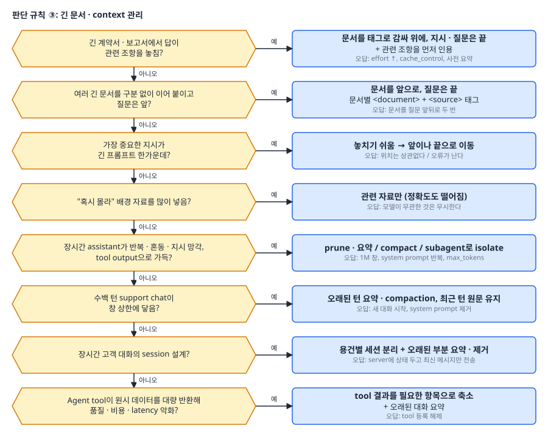
*그림: 긴 문서는 위·질문은 끝, context는 관련 자료만 남기고 prune·compact·isolate로 관리한다.*

근거: Amey-0007, Amey-0027, Amey-0028, Amey-0029, Amey-0039, Amey-0045, Amey-0046, Amey-0061, Amey-0062, Amey-0075, Amey-0076, Patrick-0004, Patrick-0026, Patrick-0041, Preporato-0020, Preporato-0021, Preporato-0022, Udemy-0012, Udemy-0015, Udemy-0020, Udemy-0022, Udemy-0024, Udemy-0042

## 3. 자주 나오는 오답 함정

**Context bloat / 장시간 세션**

| 오답 | 이유 |
|---|---|
| 더 큰 context window(1M) 모델로 옮겨 그대로 계속 1M 창에 전체 이력 또는 tool 원시 데이터 유지 | 같은 실패를 늦출 뿐 context rot · 비용 · latency 증가 |
| 매 턴 뒤에 system prompt 반복 | bloat 가속 · 지시는 이미 system prompt에 존재 |
| 모델에게 앞선 혼동을 무시하라고 요청 | 메커니즘 아님 |
| temperature를 올려 다양성 유도 | variance만 증가 · drift 미해결 |
| 응답마다 `max_tokens` 줄이기 `max_tokens`를 올려 창 확장 `max_tokens`를 올려 긴 응답을 끝까지 출력 | `max_tokens` = 출력 상한일 뿐 창 용량 · 누적 입력과 무관 올리면 창 사용 증가 |
| 상한이 가까우면 이력 없이 새 대화 시작 | 고객의 원래 문제 망각 |
| system prompt를 제거해 공간 확보 | assistant가 지켜야 할 규칙 상실 |
| 용건이 바뀌어도 같은 세션에서 이력을 깎지 않고 매번 재전송 | 무관한 이력 = 노이즈 · input token 과금 증가 |
| 대화 상태는 server에 두고 최신 메시지만 전송 | Messages API = stateless → Claude가 경위 모름 |
| 센서 데이터 tool 등록을 해제 | 핵심 기능 붕괴 · 원인 = 가공 없이 쌓이는 결과 |
| 많은 배경 자료는 정확도를 올린다 모델은 질문과 무관한 것은 무시한다 영향은 비용뿐 | 모두 ✗ 관련 자료와 경쟁 → 정확도도 하락 |

**지침 배치**

| 오답 | 이유 |
|---|---|
| 지침을 모든 대화의 첫 user message에 가장 신선하도록 마지막 메시지에 매 user message에 반복 | configuration · input 혼재 → drift 입력에 의해 덮어쓰기 가능 |
| 안전 제약을 user message 쪽에 두고 질문마다 조정 | 입력 문구에 따라 약화 · 덮어쓰기 가능 |
| system prompt 없이 매번 user message 앞에 지시를 모아 씀 | 동작은 함 지침 유지보수 어려움 · 입력이 지침을 약화할 여지 |
| 질문까지 포함해 전부 system prompt에 | 신뢰할 수 없는 입력을 지침과 같은 권위로 처리 |
| 행동 지침을 tool description에 | tool description = tool 선택용 |

**인터페이스별 차이**

| 오답 | 이유 |
|---|---|
| 지시문만 자세히 고쳐서 맞춤 | 지시 바깥 컨텍스트 차이 잔존 |
| 세 곳이 같은 system prompt이니 모델 버그로 보고 | 전제 ✗ · 각각 다른 컨텍스트 부착 |
| 가장 좋은 하나만 쓰고 검증 중단 | 원인을 모른 채 환경 변경 시 같은 문제 재발 |

**Few-shot / 형식**

| 오답 | 이유 |
|---|---|
| 가장 중요한 제약을 강조 · 프롬프트 끝에 제약 반복 | 다시 말할 뿐 명확화 ✗ |
| temperature를 올려 더 많은 선택지 탐색 | variance 증가 → 신뢰성과 반대 방향 |
| 출력을 "깔끔하게(neat)" 해 달라고 요청 | 모호한 형용사 → 형식 규정 ✗ |
| 더 큰 모델 사용 | 모델은 당신의 형식을 모름 |
| few-shot 용도로 사실 지식 보충 · latency 감소 작은 context window 해결 | few-shot = 형식 · edge-case 동작을 보여 주는 도구 |
| 예시 없이 형식 설명 단락만 추가 | 항목 순서 · 표기 변형까지 세부 전달 ✗ |
| "목록으로 쓰지 마라" / "설명을 붙이지 마라" 같은 금지사항 나열 | 원하는 형태 미제시 → 긍정형으로 지정 |
| 선별 없이 메모 수십 개를 그대로 예시로 거의 같은 예시 50개 | 편향 · 오류 패턴 학습 · 컨텍스트 점유 |
| 모든 예시가 같은 label | 경계 학습 ✗ |
| robustness 테스트로 지시와 모순되는 예시를 넣음 | 모델이 지시를 무시하도록 학습 |
| 지시 · 예시 모순 시 지시가 항상 이긴다 · 예시가 항상 이긴다 요청이 거부된다 | 정해진 precedence 없음 · 결과 예측 불가 |

**JSON / structured output**

| 오답 | 이유 |
|---|---|
| system prompt에서 JSON으로 답하라고 지시 더 강하게 지시 | 확률적 → 보장 ✗ |
| temperature 0 | 결정성과 스키마 준수는 별개 |
| 자유 텍스트나 산문에서 regex로 JSON 추출 | 취약 · 보장 ✗ |
| JSON 요청 + 예시 2개 + 방어적 파싱과 retry | 확률적 · 보장 필요 시 structured outputs |
| assistant 턴을 `{`로 prefill | Claude 4.6부터 400 error "`[`로 prefill"도 prefill |
| 구 모델에 영구히 머무름 | 향후 업그레이드 전부 차단 |
| try로 감싸 실패 시 빈 객체 반환 | 실패를 숨겨 다운스트림으로 전달 |
| 누락 필드를 regex 후처리로 삽입 | 가짜 데이터 생성 · 검증 후 retry가 정답 |

**긴 문서**

| 오답 | 이유 |
|---|---|
| 질문을 먼저, 그다음 문서 · 질문을 문서 한가운데 | 장문 가이드와 반대 · 문서는 위, 질문은 끝 |
| 문서를 질문 앞뒤로 두 번 | 비용 · 노이즈만 두 배 |
| 중요 지시의 위치는 상관없다 가운데 두면 더 잘 지켜진다 오류가 난다 | 오류 ✗ 가운데 내용은 놓치기 쉬울 뿐 |
| effort를 높여 더 깊이 생각 | 비용 · latency만 증가 구조 · 출처 문제 그대로 |
| 보고서를 각각 사전 요약해 요약만 전달 | 세부(공통 지적 사항 등) · 출처 손실 입력이 이미 창에 들어가면 불필요 |
| 보고서 끝에 `cache_control` | 비용 · 속도만 개선 · 모델이 읽는 내용 그대로 |

근거: Amey-0007, Amey-0027, Amey-0028, Amey-0029, Amey-0039, Amey-0045, Amey-0046, Amey-0061, Amey-0062, Amey-0075, Amey-0076, Patrick-0004, Patrick-0026, Patrick-0041, Preporato-0020, Preporato-0021, Preporato-0022, Udemy-0012, Udemy-0015, Udemy-0020, Udemy-0022, Udemy-0024, Udemy-0042

## 4. 암기 목록

| 이름 | 의미 |
|---|---|
| System prompt | 대화 전체에 적용할 안정적 지침(role · 행동 · 안전 제약) API의 top-level `system` 파라미터 |
| Few-shot (multishot) | 소수 예시 3~5개 · relevant · diverse 경계 · reject case 포함, `<example>` 태그로 분리 용도 = 형식 · edge-case |
| Structured outputs | `output_config.format`에 JSON schema → constrained decoding · 스키마 준수 보장 prefill의 대체재(대안 ✗) |
| Prefill | assistant 턴 시작을 미리 채우는 구 기법 Claude 4.6부터 마지막 assistant 턴 prefill → 400 error |
| Forced tool choice | `input_schema`가 목표 JSON인 tool `tool_choice`로 호출 강제 `input`을 구조화 객체로 사용 |
| Validation-retry loop | 결과 검증 → 실패 시 validation error 붙여 retry 출력 = untrusted input |
| Long-context 배치 | 문서는 태그로 감싸 위, 질문은 끝 · 먼저 인용 (약 20K+ tokens, 최대 30% 향상) |
| `<document>` · `<document_content>` · `<source>` | 여러 문서를 하나씩 감싸고 본문 · 출처를 분리하는 XML 태그 |
| Lost in the middle | 긴 입력 한가운데 내용 → 가장자리보다 놓치기 쉬움 |
| Context rot | token 증가 → 앞서 읽은 내용을 정확히 끌어오지 못하는 현상 |
| Compaction | 오래된 턴 → server 측 요약으로 대체 최근 턴 원문 유지 |
| Context editing | 오래된(stale) tool result 제거 |
| Prune · Compact · Isolate (context hygiene 3원칙) | prune = tool output 자르기 · 요약 compact = 이력 압축 isolate = subagent · 세션으로 분리 |
| `max_tokens` | 응답 1회의 출력 상한 · context window와 무관 |
| Effort | thinking · 응답에 쓰는 token 양 조절 프롬프트 구조 문제 해결 ✗ |
| `cache_control` (prompt caching) | 같은 접두부 재전송 시 비용 · 속도 개선 모델이 읽는 내용 불변 |

근거: Amey-0007, Amey-0039, Amey-0045, Amey-0046, Amey-0076, Patrick-0004, Patrick-0026, Patrick-0041, Preporato-0020, Preporato-0021, Preporato-0022, Udemy-0012, Udemy-0020, Udemy-0022, Udemy-0024, Udemy-0042

## 5. 시험 직전 체크리스트

- [ ] 안정적 지침 = system prompt, 가변 입력 = user message
- [ ] tool description = tool 선택용 · 행동 지침용 ✗
- [ ] 인터페이스별 출력 차이 = 붙는 컨텍스트 차이
- [ ] 프로덕션 = API/SDK 구축 · 실제 환경 평가
- [ ] 형식 불일치 → relevant · diverse 예시 3~5개
- [ ] 예시는 `<example>` 태그로 분리
- [ ] few-shot → 지식 · latency · 창 크기 문제 해법 ✗
- [ ] 형식은 긍정형("~형식으로") 지정
- [ ] few-shot classification → reject case 포함 · 예시와 입력 분리
- [ ] 지시 vs 예시 모순 → 결과 예측 불가 (precedence 없음)
- [ ] 강조 · 반복 · temperature 조정 · 큰 모델 → 신뢰성 해법 ✗
- [ ] 스키마 보장 JSON = structured outputs
- [ ] structured outputs 지정 = `output_config.format`
- [ ] prefill → Claude 4.6부터 400 error
- [ ] 프로덕션 추출 = tool use 스키마 · 검증 · error 붙여 retry
- [ ] 추출 실패를 빈 객체 · regex로 땜질 ✗
- [ ] 긴 문서는 위, 질문은 끝 (최대 30% 향상) · 먼저 인용
- [ ] 여러 문서 → `<document>` · `<source>`로 하나씩 감쌈
- [ ] effort · cache · 사전 요약 → 구조 해결 ✗
- [ ] 컨텍스트 = 예산 · 불필요 자료 → 정확도도 하락 (context rot)
- [ ] drift/bloat → prune · compact · isolate
- [ ] compact = 오래된 턴 요약 · 최근 턴 유지
- [ ] isolate = subagent · 세션 분리
- [ ] drift/bloat에 `max_tokens` · 큰 window → 해법 ✗
