# 8. Tools and MCPs — 반드시 알아야 할 지식
> 시험 비중 10% · 약 3문항 · 근거 문항 21개

## 1. 핵심 개념

### 1-1. tool_use ↔ tool_result 왕복 (client tools)
**결과 = user 메시지의 `tool_result`**

| 구분 | 내용 |
|---|---|
| 응답 | `stop_reason: tool_use`로 종료 content에 `tool_use` 블록(id, name, input) |
| 실행 주체 | 앱 |
| 다음 요청 ① | `tool_use` 블록이 든 assistant 턴 그대로 첨부 |
| 다음 요청 ② | 이어서 user 메시지에 `tool_result` 블록 각 `tool_result` = 같은 `tool_use_id`로 짝 맞춤 |
| stateless | Messages API → 모델 "기억" ✗ |
| 누락 시 | assistant 턴 · id 누락 → 에러 (graceful recovery ✗) |
| 오답 | 전용 SDK 메서드(예: `submit_result()`) ✗ system · assistant 메시지로 전송 ✗ |

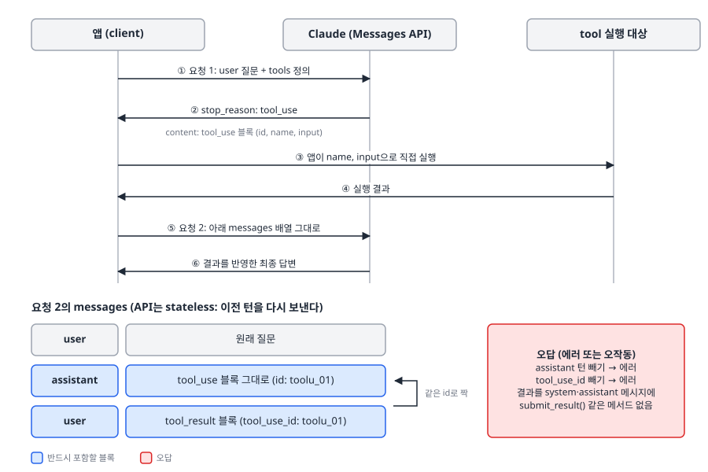
*그림: 앱이 tool_use를 실행하고, 다음 요청에서 assistant 턴을 그대로 둔 채 user 메시지의 tool_result(같은 tool_use_id)로 결과를 돌려줍니다.*

근거: Patrick-0002, Patrick-0017, Udemy-0013, Udemy-0016

### 1-2. Parallel tool use
**병렬 `tool_result`는 한 user 메시지에 모음**

| 구분 | 내용 |
|---|---|
| 기본 동작 | 한 assistant 턴에 `tool_use` 블록 여러 개 가능 |
| 반환 | 모두 실행 → 모든 `tool_result`를 한 user 메시지에 모음 |
| 여러 메시지로 분할 | 모델의 병렬 호출 감소 → 이후 latency 증가 |
| 한 턴 1호출 제한 | `disable_parallel_tool_use` |

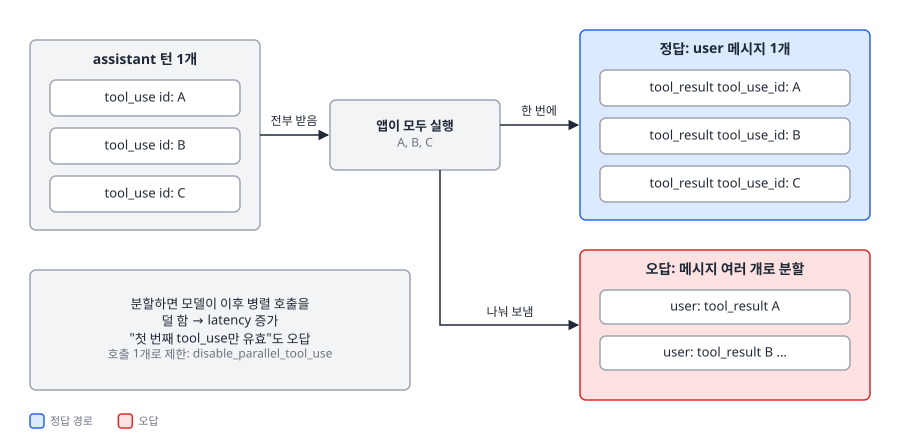
*그림: 여러 tool_use의 결과는 한 user 메시지에 모아 돌려주고, 메시지를 나누면 이후 병렬 호출이 줄어듭니다.*

근거: Patrick-0018

### 1-3. Tool 에러 처리
**실패 = `is_error: true`인 `tool_result`로 반환**

| 구분 | 내용 |
|---|---|
| 방법 | content에 에러 기재 + `is_error: true` |
| 효과 | 모델이 인자 수정 · 다른 방법 선택 · 사용자에게 설명 |
| 에러 내용 | 구체 기술 = 발생 내용 · 다음 시도 → 추측 없는 회복 |
| 빈 `tool_result` | 실제 결과 없음일 때만 |
| `is_error` 한계 | 호출 뒤의 회복 수단 잘못된 tool 선택 자체 방지 ✗ 되돌리기 어려운 작업(예약 확정 · 취소) = 호출 순간 영향 발생 |

| 처리 | 판정 |
|---|---|
| 실패를 빈 결과로 위장 | ✗ 모델이 "해당 데이터 없음"으로 오해 (예: 알레르겐 없음으로 착각) |
| 같은 호출 무한 재시도 | ✗ |
| raw 에러를 최종 사용자에게 노출 | ✗ |
| 실행 전체 중단 | ✗ |
| 일시적 장애 → 제한된 재시도 | 상황에 따라 ✓ |
| 복구 불가능한 장애(예: 인증 만료) → 중단 | 상황에 따라 ✓ |

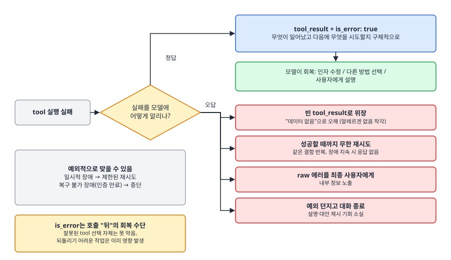
*그림: 실패는 is_error: true인 tool_result로 알려야 모델이 회복하며, 빈 결과·무한 재시도·raw 에러 노출·대화 종료는 오답입니다.*

근거: Amey-0032, Udemy-0025, Udemy-0036, Udemy-0045

### 1-4. tool_choice
**강제 호출 = `tool_choice` · 미지원 모델은 대체 조합**

| 값 | 의미 |
|---|---|
| `auto` | 기본값 · 호출 여부를 모델이 판단 |
| `any` | 어떤 tool이든 사용 강제 |
| `tool` | 지정 tool 사용 강제 |
| `none` | tool 사용 ✗ |

| 상황 | 조치 |
|---|---|
| "답 전 특정 tool 호출 강제" | 지원 모델 = `tool_choice`로 그 tool 지정 `auto` → 보장 ✗ |
| 일부 신규 모델 (Claude Opus 5.5, Claude Fable 5.1 등) | `any`/`tool`에 400 반환 → `auto` + 프롬프트 지시 + strict tool use 조합 |
| `tool_choice: auto` 설정 | 기본값 → 변화 없음 입력 형식 문제 해결 ✗ |

- 400 변경 = 시험 가이드(2026년 7월판) 이후
- 시험 = 강제 가능 전제로 출제 가능

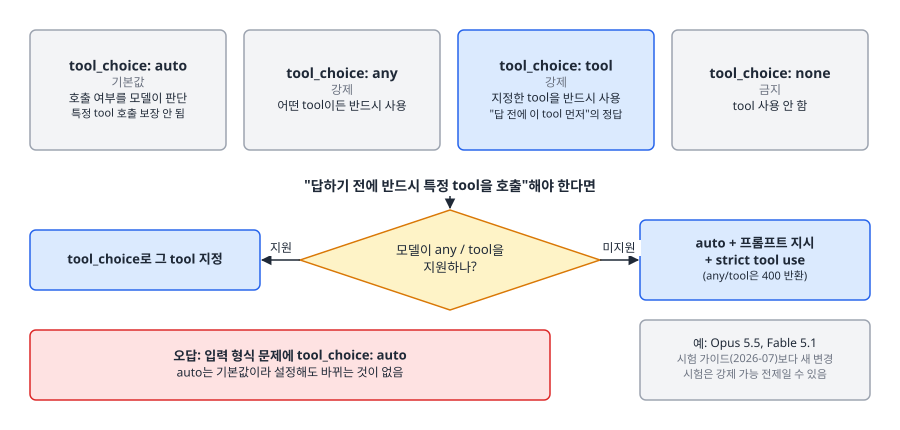
*그림: 특정 tool을 반드시 호출해야 하면 tool_choice로 지정하고, any/tool을 지원하지 않는 모델은 auto + 프롬프트 + strict로 대신합니다.*

근거: Preporato-0025, Udemy-0036

### 1-5. Strict tool use (입력 스키마 보장)
**입력 형식 보장 수단 = `strict: true`뿐**

| 수단 | 효과 |
|---|---|
| `strict: true` (tool 정의) | 입력이 `input_schema`를 따르도록 스키마 검증 타입 오류(문자열로 온 숫자) · 필수 필드 누락 근원 차단 |
| 더 긴 description | tool 선택 · 입력 작성에 도움 형식 보장 ✗ |
| temperature 낮춤 | 타입 보장 ✗ |

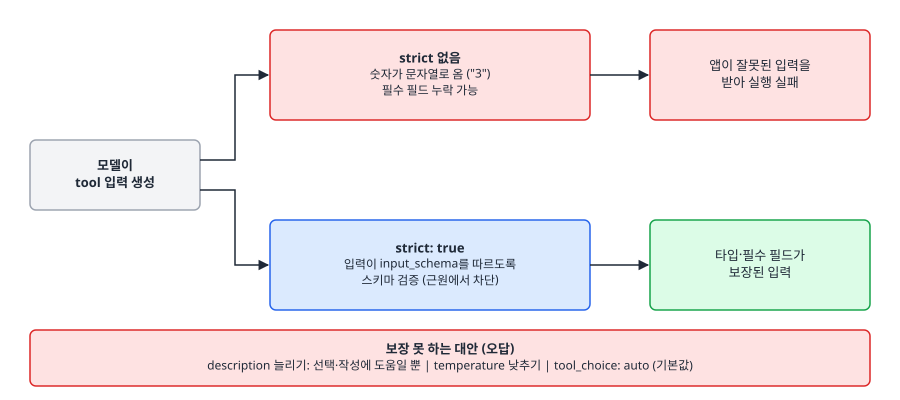
*그림: strict: true만 input_schema 검증으로 타입 오류와 필수 필드 누락을 근원에서 막고, description·temperature·auto는 보장하지 못합니다.*

근거: Preporato-0025

### 1-6. Tool description과 tool surface 설계
**정확도 = description · 겹침 = 설계로 해결**

| 구분 | 내용 |
|---|---|
| 올바른 tool 호출의 최대 요인 | description · 파라미터 설명의 명확성 |
| description 역할 | 모델이 tool을 고르고 쓰는 유일한 근거 |
| 좋은 description 요소 | ① 하는 일 ② 언제 쓰고 언제 쓰지 말지 ③ 각 파라미터의 의미 · 영향 ④ 제약(반환하지 않는 정보 등) |
| 공식 권장 | tool당 3~4문장 이상 |
| 우선순위 | 명확함 > 간결함 |

| 요인 | 영향 |
|---|---|
| 구현 언어 · 함수명 일치 | 선택에 도움 ✗ |
| 의미 있는 이름(서비스명 접두어 등) | 도움 · description 대체 ✗ |
| 모든 tool에 같은 범용 설명 | 구별 단서 소멸 |
| tool 개수 · 선언 순서 | description보다 영향 훨씬 작음 |
| JSON 반환 여부 | tool 선택엔 영향 ✗ · 결과 소비에 영향 |
| "신중히 고르라" 지시 더 큰 context window · 정렬 순서 | 오선택 해결 ✗ |
| MCP 서버 추가 후 uptime · latency 의심 | 먼저 볼 원인 ✗ (uptime · latency 문제는 에러 · 지연으로 드러남 · 모델은 바뀌지 않음) |

| 상황 | 조치 |
|---|---|
| tool끼리 겹쳐 오선택 | 원인 = interface 설계 문제 → 관련 작업 통합 · 목적이 뚜렷하게 tool surface 정리 |
| MCP 서버 추가 후 성공률 하락 | 먼저 새 tool의 기존 tool 중복 · description 구별성 확인 |

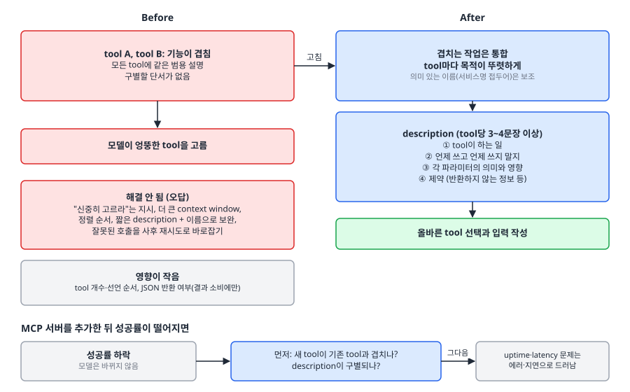
*그림: 엉뚱한 tool 선택은 겹치는 tool 통합과 4요소 description으로 고치며, 지시문·context 확장·정렬로는 고쳐지지 않습니다.*

근거: Amey-0030, Amey-0031, Amey-0063, Amey-0078, Udemy-0045

### 1-7. Tool 결과 크기 설계
**큰 객체를 다음 호출에만 쓰면 identifier 반환**

| 상황 | 반환 |
|---|---|
| 큰 객체 + 모델이 다음 호출에만 필요 | identifier(handle) → context 절약 |
| 그 외 | 필요한 전체 |
| "항상 전체" / "항상 id만" | 둘 다 ✗ 전체 vs identifier = 작업에 따라 결정 |

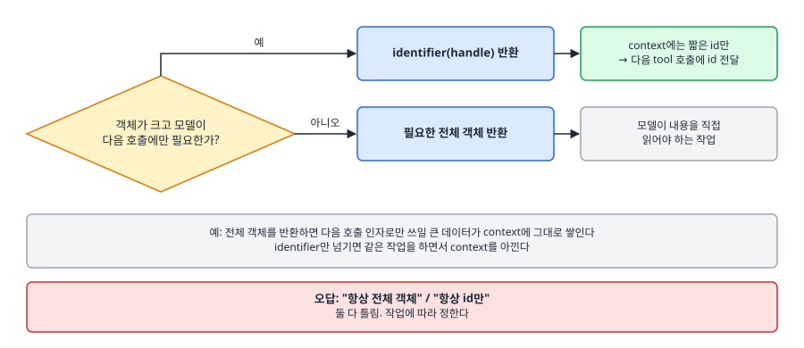
*그림: 큰 객체가 다음 호출에만 필요하면 identifier를 반환하고, 아니면 필요한 전체를 반환합니다.*

근거: Amey-0077

### 1-8. 워크플로 순서를 코드로 강제 (state machine + tool gating)
**필수 순서는 프롬프트가 아니라 코드로 강제**

| 구분 | 내용 |
|---|---|
| 필수 순서 예 | 본인 확인 → 정보 수집 → 확인 · 동의 → 실행 |
| 방법 | 앱이 현재 단계를 상태로 보유 상태별 허용 tool만 `tools`에 포함 |
| 효과 | 본인 확인 전 요청엔 변경 tool 부재 → 호출 불가 |
| 상태 전환 기준 | 코드로 검증 가능한 사실 (예: 본인 확인 tool 성공) |
| 역할 분담 | 대화 유연성 = Claude 깨지면 안 되는 순서 = 코드 |
| 대안 | tool 정의 변경 → prompt cache 전체 무효화 → 정의 고정 + 상태에 안 맞는 호출을 앱이 거부 · 에러 반환 |
| 보장 ✗ | 번호 목록 · few-shot effort 상향 · "다음 단계 이름 JSON 출력" → 최종 판단이 모델에 남음 = 확률적 |

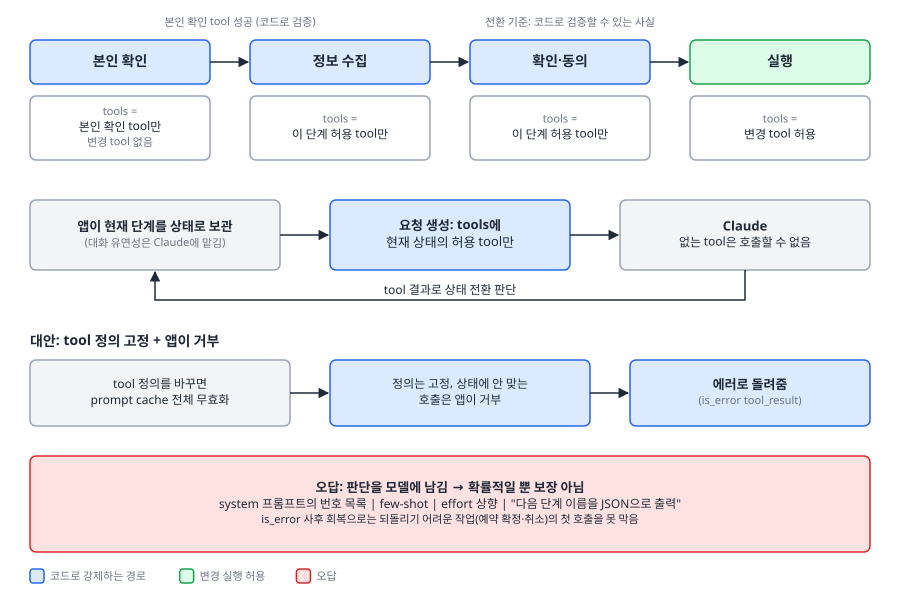
*그림: 앱이 단계를 상태로 갖고 상태별 허용 tool만 tools에 넣어 필수 순서를 코드로 강제합니다.*

근거: Udemy-0016

### 1-9. Client tools vs Server tools
**구분 기준 = 코드가 실행되는 위치**

| 구분 | Client tools | Server tools |
|---|---|---|
| 예 | 직접 정의한 tool Anthropic 스키마 tool(`bash` · `text_editor`) | `web_search` · `web_fetch` `code_execution` · `tool_search` 등 |
| 실행 위치 | 앱 | Anthropic 인프라 |
| 결과 처리 | `tool_use` 수신 → 앱 처리 → `tool_result` 반환 | 같은 응답에 결과 바로 포함 앱 실행 ✗ · `tool_result` 전송 ✗ |
| 사내 시스템(SIEM 등) | client tool로 접근 | 사용자 정의 ✗ (Anthropic 제공 기능) 사내 네트워크 도달 ✗ |
| 선언 | `tools`에 정의 | 일반 요청의 `tools`에 선언 MCP · Batch API 전용 ✗ |

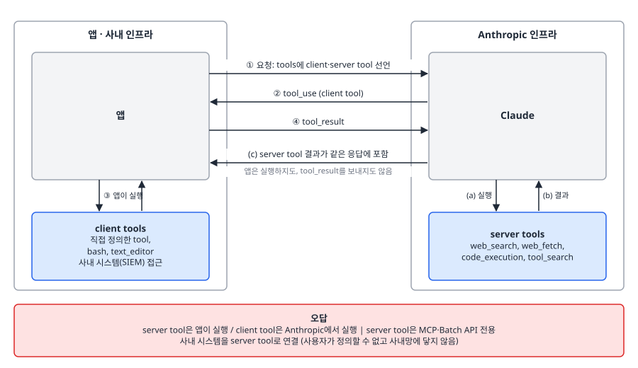
*그림: client tool은 앱이 실행해 tool_result를 보내고, server tool은 Anthropic 인프라에서 실행되어 결과가 같은 응답에 들어옵니다.*

근거: Preporato-0023, Udemy-0013

### 1-10. 확장 수단 선택: MCP server vs Tool vs Skill
**공유 · 독립 유지보수 = MCP server · 절차 = Skill**

| 수단 | 쓰는 경우 | 특징 |
|---|---|---|
| Tools | 행동(action) · 데이터 접근 추가 | MCP server와 공통 |
| MCP server | 여러 앱이 같은 기능 공유 + 플랫폼 팀이 앱과 독립 유지보수 | 서버가 tools/resources 노출 여러 client 연결 |
| Skill | 외부 시스템 없이 "절차 따르게 하기"만 | 지시 · 템플릿 · 절차(know-how) 묶음 · 작업 일치 시 로드 claude.ai · Claude Code · API 공통 live connection ✗ |

| 오답 | 이유 |
|---|---|
| 앱마다 서버 코드 복사 | 복사본끼리 어긋남 |
| 문서 하나로 충분한 절차에 fine-tuning | 과함 |
| 데이터를 매일 system prompt에 붙여 넣기 | 데이터 낡음 · context 낭비 |
| MCP server가 Messages API 대체 모델과 같은 프로세스 필요 | 둘 다 ✗ |

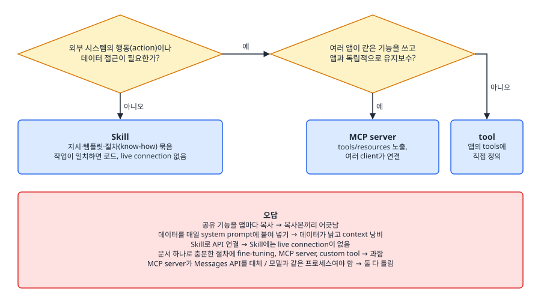
*그림: 행동·데이터 접근이 없으면 Skill, 여러 앱이 공유하고 독립 유지보수하면 MCP server, 그 외에는 앱의 tool입니다.*

근거: Amey-0009, Amey-0044, Preporato-0024

### 1-11. MCP primitives: tools / resources / prompts
**주도 = tools 모델 · resources 앱 · prompts 사용자**

| primitive | 주도 | 내용 |
|---|---|---|
| tools | 모델 | 상황에 따라 찾아 호출 |
| resources | 앱 | 참조 데이터(파일 · DB 스키마 · 문서)를 URI로 노출 context 포함 여부 = 앱 결정 tool 사양서를 resource로 읽혀도 호출 가능 tool 등록 ✗ |
| prompts | 사용자 | 재사용 가능한 프롬프트 템플릿 slash command 등으로 명시 선택 모델의 자동 tool 탐색 용도 ✗ |

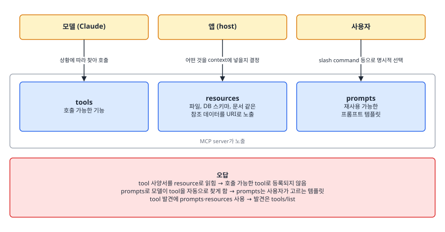
*그림: tools는 모델이, resources는 앱이, prompts는 사용자가 주도합니다.*

근거: Udemy-0011, Udemy-0025

### 1-12. MCP tool discovery (tools/list, tools/call)
**발견 = `tools/list` · 실행 = `tools/call`**

| 구분 | 내용 |
|---|---|
| `tools/list` | tools capability 선언 서버가 응답 각 tool의 `name` · `description` `inputSchema`(JSON Schema) |
| 변환 | client가 모델용 tool 정의로 변환 · 전달 → 서버에 tool 추가 시 앱 코드 그대로 모델에 노출 |
| `tools/call` | 모델이 고른 tool을 client가 실행 |
| 입력 검증 에러 | `isError` 붙은 tool 실행 에러로 모델에 반환 → 자가 수정용 (발견 수단 ✗) |
| 목록 변경 | `listChanged` 선언 서버 → `notifications/tools/list_changed` 전송 → client 재조회 |
| ⚠️ 미확인 | 해설: "2026-07-28판 사양 = stateless 연결별 tool 목록 변경 금지 · 요청 인가에 따른 변경 허용" → 공식 MCP 사양으로 확인 못 함 · 참고만 |

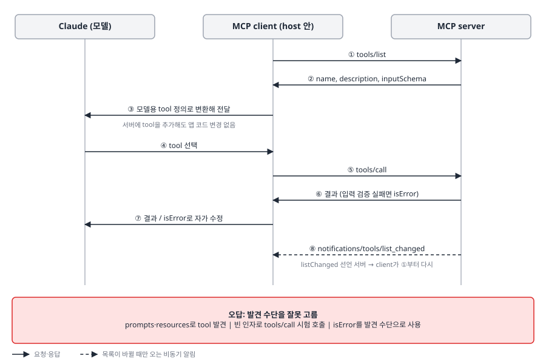
*그림: client가 tools/list로 받은 inputSchema를 모델용 tool 정의로 바꿔 노출하고, 모델이 고른 tool을 tools/call로 실행합니다.*

근거: Udemy-0025

### 1-13. MCP transport: stdio vs Streamable HTTP
**로컬 = stdio · 원격 = Streamable HTTP**

- 구조 = host가 서버마다 client 생성 · 연결
- host 예 = Claude Code
- 통신 경로 = transport 계층

| 항목 | stdio | Streamable HTTP |
|---|---|---|
| 방식 | 같은 머신 프로세스끼리 표준 입출력 직접 연결 서버를 subprocess로 실행 | client→server HTTP POST + 선택적 Server-Sent Events(SSE) |
| 용도 | 로컬 파일 · CLI 접근 | 원격 서버를 여러 client에 제공 |
| 특성 | 네트워크 오버헤드 없음 보통 client 하나에 제공 네트워크 너머 통신 ✗ | 표준 HTTP 인증 (Bearer 토큰 · API key · 커스텀 헤더) 토큰 획득 = OAuth 권장 |
| 오용 | 원격 서버를 각 단말에 배포해 stdio → 업데이트 · 인증 중앙 관리 ✗ | 로컬 subprocess 서버에 HTTP → 오버헤드 · 포트 노출 · 인증 부담만 증가 |

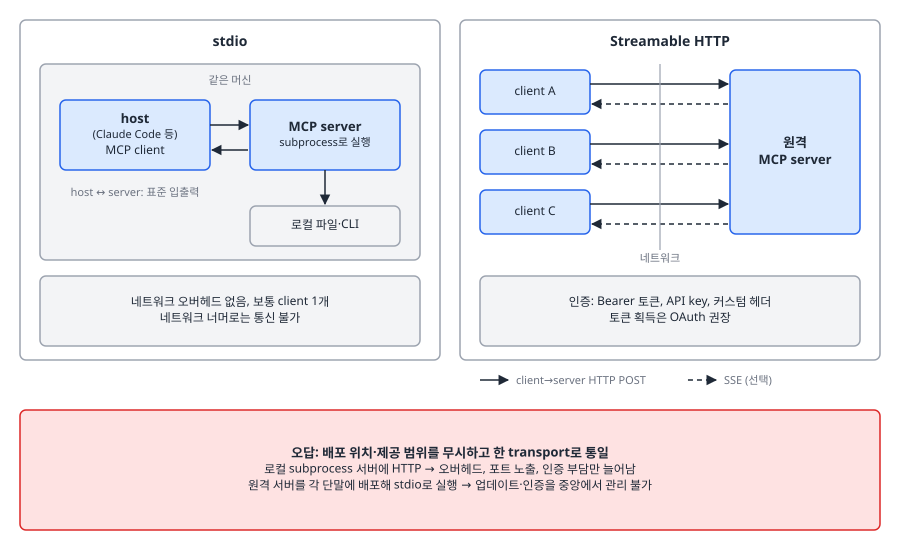
*그림: 같은 머신의 subprocess는 stdio, 원격 서버를 여러 client에 제공할 때는 Streamable HTTP를 씁니다.*

근거: Udemy-0011, Udemy-0033

### 1-14. MCP connector (Messages API의 `mcp_servers`)
**MCP connector = API가 tool 목록 조회 · 호출 대행**

- 전제 = 앱이 MCP client 직접 구현 ✗
- beta 기능 → beta 헤더 첨부

| 구분 | 내용 |
|---|---|
| 서버 정의 | `mcp_servers`에 서버 접속 정보 `type` · `url` · `name` `authorization_token`(필요 시) |
| toolset 참조 | `tools` 배열의 `mcp_toolset` → `mcp_server_name`으로 서버 참조 |
| tool별 설정 | `default_config` = 전체 기본값 `configs` = tool별 `enabled` 덮어쓰기 |
| 읽기 전용 | 쓰기 tool만 `enabled: false` (denylist) allowlist 형태도 가능 |

| 구분 | 내용 |
|---|---|
| 동작 | API가 서버에서 tool 목록 조회 → Claude에 제시 → 호출 대행 |
| 응답 | `mcp_tool_use` · `mcp_tool_result` 함께 수신 앱의 `tools/call` 재전송 · `tool_result` 반환 불필요 |
| 앱이 재실행 | ✗ 쓰기 작업 중복 위험 |

| 제약 | 내용 |
|---|---|
| 지원 범위 | MCP 사양 중 tool 호출만 resources · prompts ✗ |
| 연결 대상 | HTTP(Streamable HTTP 또는 SSE) 공개 서버만 로컬 stdio 서버 ✗ |
| 미제공 | Amazon Bedrock Google Cloud(Google managed) |
| 문서를 읽혀야 할 때 | 앱이 직접 가져와 메시지에 포함 또는 문서 반환 tool을 서버에 구현 |

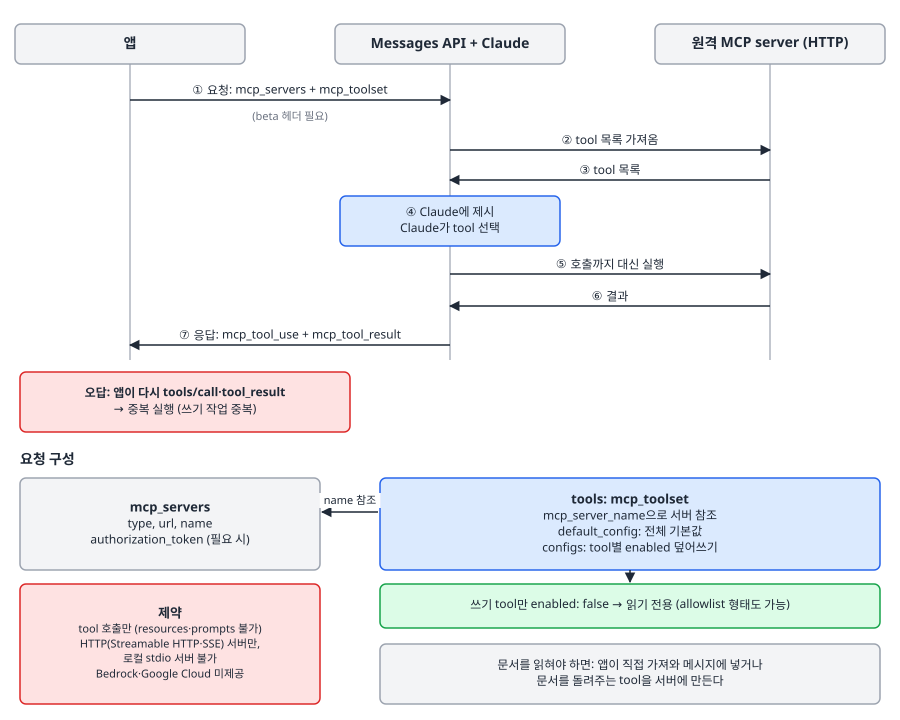
*그림: mcp_servers와 mcp_toolset을 적으면 API가 tool 목록 조회와 호출을 대신하므로 앱은 mcp_tool_use를 다시 실행하지 않습니다.*

근거: Udemy-0011

## 2. 상황별 정답 판단 규칙

| 상황 | 정답 |
|---|---|
| `stop_reason: tool_use` 뒤 결과 전송 | assistant 턴 유지 + user 메시지에 `tool_result` (같은 `tool_use_id`) |
| 한 턴에 `tool_use` 여러 개 | 모두 실행 → `tool_result`를 한 user 메시지에 모음 |
| tool 실행 실패 | `is_error: true` 붙은 `tool_result`로 모델에 반환 |
| 답변 전 특정 tool 호출 강제 | 지원 모델 = `tool_choice`로 지정 미지원 모델 = `auto` + 프롬프트 + strict |
| tool 입력 타입 오류 · 필수 필드 누락 | tool 정의에 `strict: true` |
| 모델이 엉뚱한 tool 선택 | description 구체화 + 겹치는 tool 통합 · 역할 구분 |
| MCP 서버 추가 후 성공률 하락 | 새 tool의 중복 · description 구별성부터 확인 |
| 큰 객체 반환 + 다음 호출에만 필요 | identifier(handle)만 반환 |
| 업무 순서 필수(본인 확인 먼저) | 앱 측 state machine → 상태별 허용 tool만 전달 |
| 사내망 시스템 조회 + 일반 웹 검색 | 사내 시스템 = client tool 웹 검색 = server tool(`web_search`) |
| 여러 앱이 같은 기능 공유 + 독립 유지보수 | MCP server |
| 외부 시스템 없이 정해진 절차 · 템플릿 | Skill |
| 서버에 tool 추가 + 앱 코드 변경 없이 노출 | client의 `tools/list` → `inputSchema`로 tool 정의 생성 |
| 로컬 파일 · CLI용 subprocess 서버 | stdio transport |
| 네트워크로 여러 client에 제공 | Streamable HTTP transport |
| Messages API에서 원격 MCP 서버 직접 사용 (client 직접 구현 ✗) | `mcp_servers`에 정의 → `tools`의 `mcp_toolset`에서 참조 |
| MCP connector 읽기 전용 제한 | `mcp_toolset`의 `configs` → 쓰기 tool `enabled: false` |

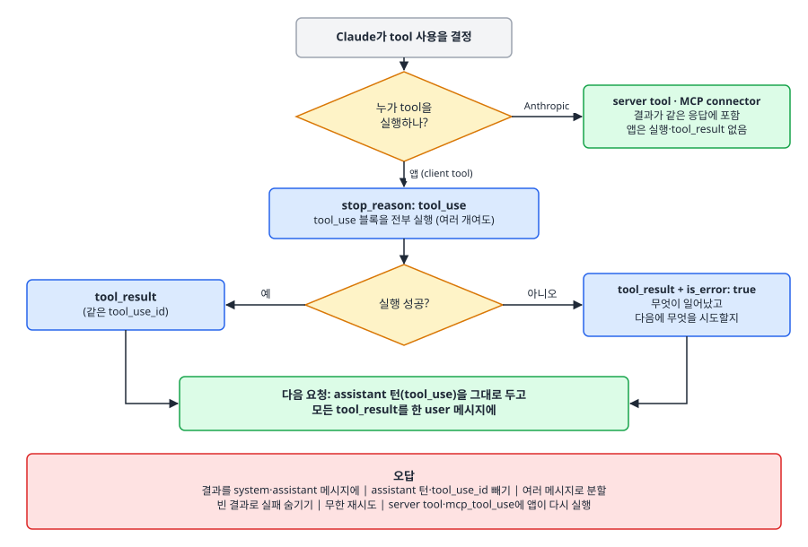
*그림: 실행 주체와 성공 여부에 따라 tool_result 형태가 정해지고, 결과는 모두 한 user 메시지로 돌려줍니다.*

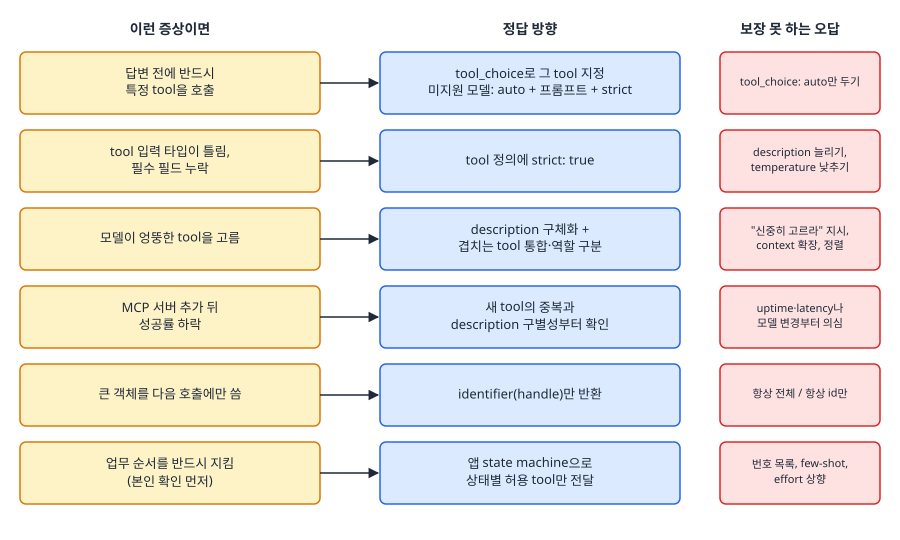
*그림: tool 정의·설계 문제는 증상마다 tool_choice, strict, description·통합, identifier, state machine 같은 보장 수단이 정해져 있습니다.*

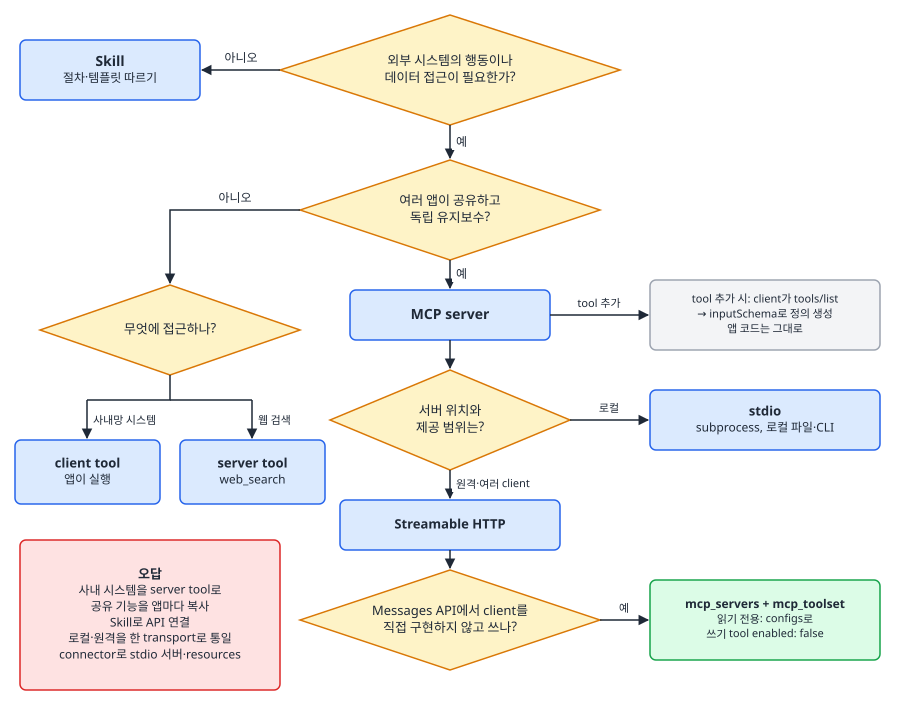
*그림: Skill/tool/MCP server를 먼저 고르고, MCP server는 위치에 따라 stdio/Streamable HTTP, client 미구현이면 MCP connector를 씁니다.*

근거: Amey-0009, Amey-0031, Amey-0032, Amey-0044, Amey-0077, Amey-0078, Patrick-0002, Patrick-0017, Patrick-0018, Preporato-0024, Preporato-0025, Udemy-0011, Udemy-0013, Udemy-0016, Udemy-0025, Udemy-0033, Udemy-0036, Udemy-0045

## 3. 자주 나오는 오답 함정

| 오답 | 이유 |
|---|---|
| tool 결과를 system 프롬프트 · system 메시지 assistant 메시지로 전송 | `tool_result` = user 메시지 assistant 턴 · `tool_use_id` 없으면 에러 |
| 모델이 어떤 tool을 불렀는지 기억 | API = stateless → assistant 턴 재전송 필요 |
| 대화 요약 후 새로 시작 | `tool_use`/`tool_result` 짝 끊김 |
| 병렬 `tool_result`를 여러 메시지로 분할 첫 번째 `tool_use`만 유효 | 한 user 메시지에 모두 담아야 함 |
| 성공할 때까지 같은 호출 무한 재시도 | 같은 결함 반복 · 장애 지속 시 응답 없음 |
| 실패를 빈 `tool_result`로 숨김 | 모델이 "결과 없음"으로 오해 → 잘못된 답 지속 |
| 실패마다 예외 던지고 대화 종료 | 모델의 설명 · 대안 제시 기회 소멸 |
| raw 에러를 최종 사용자에게 노출 | 내부 정보 유출 |
| 입력 형식 문제에 temperature 낮춤 description 늘림 · `tool_choice: auto` | 보장 수단 = `strict: true`뿐 |
| tool 선택 문제에 "신중히 고르라" 지시 context window 확장 · 알파벳 정렬 | 중복이라는 설계 문제 해결 ✗ |
| description은 짧게, 정확도는 이름으로 보완 | description이 가장 중요 이름만으론 사용 시점 · 파라미터 의미 전달 ✗ |
| 잘못된 tool 호출을 사후 재시도로 교정 | 첫 호출 자체 방지 ✗ 되돌리기 어려운 작업은 이미 영향 발생 |
| 필수 순서를 system 프롬프트 · few-shot effort 상향 · JSON 단계 출력으로 강제 | 판단이 모델에 남음 → 보장 ✗ |
| server tool은 앱이 실행 · `tool_result` 전송 | 실행 위치 혼동 server tool = Anthropic 실행 |
| client tool은 Anthropic 쪽에서 실행 | 실행 위치 혼동 client tool = 앱 실행 |
| server tool = MCP 전용 또는 Batch API 전용 | 일반 요청의 `tools`에 선언 |
| 사내 시스템을 server tool로 연결 | server tool = Anthropic 제공 → 사용자 정의 ✗ 사내망 도달 ✗ |
| 공유 기능을 앱마다 복사 | 복사본끼리 어긋남 |
| 데이터를 system 프롬프트에 매일 붙여 넣기 | 붙여 넣은 데이터 낡음 |
| Skill로 API 연결 | Skill엔 live connection 없음 |
| 외부 시스템 없는 절차 → MCP server · custom tool · fine-tuning | 절차 · know-how = Skill |
| tool 발견에 prompts · resources 빈 인자로 `tools/call` 시험 호출 | 발견 = `tools/list` |
| 로컬 · 원격 모두 stdio 또는 모두 HTTP | 배포 위치 · 제공 범위에 따라 구분 |
| MCP connector로 resources(약관 문서) 읽힘 | tool 호출만 지원 |
| MCP connector로 stdio 서버 연결 | HTTP 서버만 연결 |
| MCP connector `mcp_tool_use` 수신 후 앱이 `tools/call` 재실행 | API가 이미 실행 → 중복 실행 |
| MCP server가 Messages API 대체 모델과 같은 프로세스 필요 | 둘 다 ✗ |

근거: Amey-0009, Amey-0031, Amey-0032, Amey-0044, Amey-0063, Patrick-0002, Patrick-0017, Patrick-0018, Preporato-0023, Preporato-0024, Preporato-0025, Udemy-0011, Udemy-0013, Udemy-0016, Udemy-0025, Udemy-0033, Udemy-0036, Udemy-0045

## 4. 암기 목록

| 이름 | 의미 |
|---|---|
| `stop_reason: tool_use` | 모델이 client tool 호출을 요청하며 멈춘 상태 |
| `tool_use` 블록 | assistant content의 tool 호출 (id, name, input) |
| `tool_result` 블록 | user 메시지에 넣는 실행 결과 |
| `tool_use_id` | `tool_result`를 해당 `tool_use`와 짝짓는 id |
| `is_error: true` | `tool_result`의 실행 실패 표시 |
| `disable_parallel_tool_use` | 한 턴 tool 호출을 하나로 제한 |
| `tool_choice: auto` | 기본값 · 호출 여부를 모델이 판단 |
| `tool_choice: any` | 어떤 tool이든 사용 강제 |
| `tool_choice: tool` | 지정 tool 사용 강제 |
| `tool_choice: none` | tool 사용 ✗ |
| `strict: true` | tool 입력이 `input_schema`를 따르도록 검증 |
| `input_schema` | tool 입력의 JSON Schema(API tool 정의) |
| `description` | tool 선택 · 사용의 핵심 근거 하는 일 · 사용 시점 · 파라미터 · 제약 |
| client tools | 앱에서 실행(사용자 정의 tool, `bash`, `text_editor`) |
| server tools | Anthropic 인프라에서 실행 (`web_search`, `web_fetch` `code_execution`, `tool_search`) |
| MCP server | tools/resources 제공자 여러 client 공유 · 독립 유지보수 |
| Skill | 작업 일치 시 로드되는 지시 · 템플릿 묶음 (live connection 없음) |
| MCP tools | 모델이 주도해 호출하는 primitive |
| MCP resources | URI로 노출되는 참조 데이터 context 포함 여부 = 앱 결정 |
| MCP prompts | 사용자가 slash command 등으로 고르는 프롬프트 템플릿 |
| `tools/list` | 서버의 tool 목록 조회 (`name` · `description` · `inputSchema`) |
| `tools/call` | client의 tool 실행 요청 |
| `inputSchema` | MCP tool 인자를 정의하는 JSON Schema |
| `isError` | MCP tool 실행 에러 표시(입력 검증 실패 포함) |
| `listChanged` / `notifications/tools/list_changed` | tool 목록 변경을 client에 알림 |
| host / client / server | host(Claude Code 등)가 서버마다 client 생성 · 연결 |
| transport: stdio | 같은 머신 subprocess와 표준 입출력 통신 로컬 · 단일 client |
| transport: Streamable HTTP | HTTP POST + 선택적 SSE 원격 · 다수 client · HTTP 인증과 OAuth |
| `mcp_servers` | MCP connector 서버 정의 (`type`, `url`, `name`, `authorization_token`) |
| `mcp_toolset` | `tools` 배열 안의 항목 `mcp_server_name`으로 서버 참조 |
| `default_config` / `configs` | `mcp_toolset`의 전체 기본값 / tool별 `enabled` 덮어쓰기 |
| `mcp_tool_use` / `mcp_tool_result` | MCP connector 응답에 함께 오는 호출 · 결과 블록 (API가 실행) |

근거: Amey-0044, Patrick-0002, Patrick-0017, Patrick-0018, Preporato-0024, Preporato-0025, Udemy-0011, Udemy-0013, Udemy-0025, Udemy-0033, Udemy-0036, Udemy-0045

## 5. 시험 직전 체크리스트

- [ ] `tool_result` = user 메시지
- [ ] assistant 턴 유지
- [ ] 짝 = 같은 `tool_use_id`
- [ ] 병렬 `tool_use` 결과 = 한 user 메시지에 모두
- [ ] tool 실패 = `is_error: true`로 모델에 알림
- [ ] 실패 숨기기 · 무한 재시도 · 중단 ✗
- [ ] `tool_choice` 네 가지 = auto/any/tool/none
- [ ] 강제 호출 = `tool`로 지정 (지원 모델)
- [ ] 입력 타입 · 필수 필드 보장 = `strict: true`
- [ ] 선택 정확도 = description
- [ ] description = 하는 일 · 사용 시점 · 파라미터 · 제약
- [ ] tool 겹침 → 통합 · 역할 분리
- [ ] 지시문 · context 확장 · 정렬 ✗
- [ ] 큰 객체가 다음 호출에만 필요 → identifier 반환
- [ ] 필수 순서 = 앱 측 state machine으로 tool을 걸러 강제
- [ ] 필수 순서를 프롬프트로 보장 ✗
- [ ] client tool = 앱 실행
- [ ] server tool = Anthropic 실행
- [ ] server tool `tool_result` 전송 ✗
- [ ] 공유 + 독립 유지보수 = MCP server
- [ ] 절차 · know-how = Skill
- [ ] 행동 · 데이터 접근 = tool/MCP
- [ ] primitive 주도 = tools 모델 · resources 앱 · prompts 사용자
- [ ] tool 발견 = `tools/list`(`inputSchema`)
- [ ] tool 실행 = `tools/call`
- [ ] 로컬 subprocess = stdio
- [ ] 원격 · 다수 client = Streamable HTTP
- [ ] connector 설정 = `mcp_servers` + `mcp_toolset`
- [ ] MCP connector 제약 = tool만 지원 · HTTP 서버만
- [ ] MCP connector 결과 → 앱 재실행 ✗
